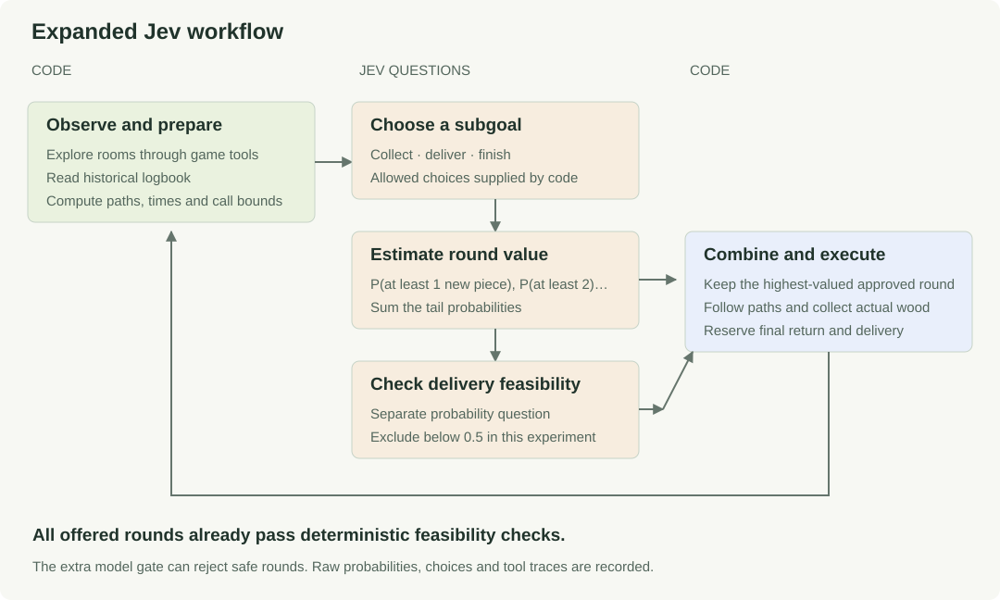

# Jev policies for Shores of the Tide

## Workflow at a glance



*Figure. The expanded workflow adds subgoal selection and a delivery gate around round scoring. Code supplies the map, paths, time calculations and feasible candidates. Because all candidates are already deterministically feasible, the extra gate can introduce false rejections. Results below compare this workflow with the simpler scoring hybrid and deterministic controls.*


## Abstract

We evaluated Jev as a direct player and as a component of explicit planning workflows on the nine island tasks. Direct action selection reached none of the episode targets. A hybrid in which code generates feasible rounds and Jev scores their expected yield reached 9/9 targets, delivering 733 pieces for $0.89 in API cost. A further decomposition added model-selected subgoals and a separate delivery-feasibility gate. It also reached 9/9, but delivered 724 pieces for $1.27 and used more tool calls. The empirical-rate planner reached the same nine targets, delivering 737 pieces without model calls. These single evaluations demonstrate successful hybrid execution and the importance of the supplied compute graph. They show no improvement from the additional model stages in this environment.

## Initial direct-player protocol

The requested model was `typesafe/jev-1.13`. Every trajectory reported the resolved model `typesafe/jev-1.13-20260917`.

The player used the existing `toyArena`, `shoreTask`, `SHORE_EPISODES` and `episodeSeed` implementations. Each episode ran on the same eight seeds as the generated bots. The goal remained the episode's mean delivered wood over those seeds, with the existing target of 90% of the reference planner's mean, rounded down to an eighth. Hidden episodes were enabled once a shown trajectory delivered some wood, matching the judge's positive-delivery gate.

Each Jev request contained the German task description, adapted to direct action selection, the remaining tool-call allowance and the complete history of tool calls and their replies. The `examples` condition also included the existing real tool-response examples from the first shown episode. Each trajectory started with empty history. No experience or feedback was carried between trajectories.

The adapter supplied a menu of individual actions.

- Observe the current room or read its island's logbook.
- Try any of the four exit directions.
- Move to a previously observed wood cell in the current room or beside a previously observed fire. Wood cells in the logbook were also available after the logbook was read.
- Pick up wood, feed one piece into the fire, or wait for a selected interval from 1 to 120 minutes.
- Stop the trajectory.

The adapter derived movement destinations from tool replies. It did not calculate routes, estimate arrival rates or supply action sequences. Jev chose every tool call, including observations. A stop choice incurred an API request but no game-tool point. Historical observations remained in the history even when their contents became stale.

Each trajectory allowed 300 charged tool calls and a 600-second wall-time cap. The overall series had a $5 budget. Model cost was persisted after each response, and action traces and completed trajectories were checkpointed separately. No retry or scripted substitute was used.

## Results

One fixed-policy evaluation was run per condition. Each evaluation covered nine episodes with eight seeds, giving 72 trajectories per condition.

| Metric | With tool examples | Without tool examples |
|---|---:|---:|
| Episode targets reached | 0/9 (0%) | 0/9 (0%) |
| Completed trajectories | 72 | 72 |
| Trajectories delivering any wood | 11/72 | 9/72 |
| Wood picked up | 48 | 77 |
| Wood delivered | 15 | 17 |
| Charged tool calls | 2,275 | 2,404 |
| Jev requests, including stop decisions | 2,347 | 2,476 |
| API cost | $0.79469 | $0.80882 |
| Tool calls per trajectory, minimum to maximum | 20–77 | 19–70 |
| Trajectories ending by Jev's stop choice | 72 | 72 |

Delivered wood is counted across all 72 trajectories. Episode success depends on its eight-seed mean. A few successful deliveries therefore do not imply that an episode passed.

| Episode | Island | Required mean | Mean with examples | Mean without examples |
|---|---:|---:|---:|---:|
| S1 | 52 | 5.500 | 0.000 | 0.000 |
| S2 | 64 | 12.875 | 0.000 | 0.000 |
| S3 | 148 | 8.000 | 0.125 | 0.250 |
| H1 | 72 | 11.750 | 0.000 | 0.000 |
| H2 | 75 | 9.875 | 0.000 | 0.000 |
| H3 | 105 | 6.750 | 0.500 | 0.125 |
| H4 | 140 | 13.375 | 1.125 | 1.500 |
| H5 | 176 | 8.875 | 0.000 | 0.000 |
| H6 | 222 | 5.500 | 0.125 | 0.250 |

Every trajectory read the logbook. Across both conditions, the player picked up 125 pieces and delivered 32. Successful pickup events and delivery counts come from the recorded tool replies and the arena's final score. This gap indicates that carrying resources through to delivery was a substantial weakness of the observed policy. It does not isolate whether navigation, time management or the decision to stop contributed most.

Each condition contained seven rejected waits that would have exceeded the 480-minute game day. The adapter returned these tool errors to Jev and continued. All API decisions were valid menu choices. Neither the API budget, trajectory wall-time cap nor tool-call cap ended a trajectory.

## Interpretation and comparison limits

Jev received many inexpensive decisions during play, averaging about 33 requests per trajectory. Additional available budget alone would not have prolonged these runs, because Jev chose to stop. Testing multiple evaluations per action would require a separate policy and controlled comparison.

The two conditions provide no clear benefit from the supplied tool examples in this evaluation. More independent evaluations would be needed to estimate the variability of the policy or the effect of examples.

The existing Sonnet, Opus and GPT series generates programs, improves them across generations and can select a winning program. This experiment evaluates a fixed direct decision policy. The common simulator, seeds, targets and tool allowance allow comparison of task performance. They do not remove differences in inference-time computation, adaptation and selection. The direct player's menu also constrains how actions are expressed, and its wall-time allowance differs from the generated bots' 10-second local execution limit.

The separate 95-island evaluation was not run in this experiment. The reported 0/9 applies to the selected nine task islands. It establishes the outcome of this Jev version and adapter configuration.

## Structured memory and action review (2026-11-16)

Two follow-up policies tested the same shown islands and eight seeds, using tool examples in both. Each was allocated a $2.50 series budget.

**Memory** retained the complete tool history and added a deterministic summary of the current location, elapsed time, remaining time, carried wood, delivered wood, observed room connections and timestamped room observations. Connections were recorded from successful exit commands, including their inverse as specified by the task. No route or arrival probability was computed.

**Review** used the same memory and made two sequential Jev requests for every decision. The first proposed an action. The second received that proposal and the same action menu, with instructions to check location, connections, carried wood, remaining time and delivery. It could retain or replace the proposal. API requests and their costs were counted separately from game-tool calls.

Neither follow-up delivered wood in any shown trajectory. The existing positive-delivery gate therefore skipped all six hidden episodes. The table compares the same 24 shown trajectories with the corresponding subset of the original example-assisted baseline.

| Metric on the three shown islands | Raw-history baseline | Structured memory | Memory and action review |
|---|---:|---:|---:|
| Shown trajectories | 24 | 24 | 24 |
| Shown episode targets reached | 0/3 | 0/3 | 0/3 |
| Wood picked up | 7 | 1 | 2 |
| Wood delivered | 1 | 0 | 0 |
| Charged game-tool calls | 672 | 547 | 565 |
| Jev requests, including stop decisions | 696 | 571 | 1,178 |
| API cost | $0.21808 | $0.17631 | $0.37610 |

The baseline's hidden episodes were evaluated because one shown trajectory delivered a piece. The follow-ups' hidden episodes were skipped. No direct comparison of hidden-island performance is available for these follow-ups.

Both follow-ups completed without exhausting their budget. Every trajectory ended through the model's stop choice. Review retained the proposed action in all 565 executed tool steps. Final stop proposals were not retained in the per-step history, so this agreement count covers executed actions only. The extra review request added no observed correction to those actions.

The new policies used 1,749 requests and cost $0.55240 combined. These results provide no evidence of improvement from the tested summary or review procedure. There is one evaluation per policy, and adding a second choice with review instructions tests a particular policy. It does not establish that other uses of multiple requests would fail.

Outputs are in `~/phi-experiments/2026-11-15-series/jev-memory/` and `jev-review/`, with logs in their parent directory. The resolved model remained `typesafe/jev-1.13-20260917`.

## Hybrid candidate evaluation

The third strategy is implemented in [jev-hybrid.ts](../server/jev-hybrid.ts) and exposed by the existing runner as `--policy hybrid`. The code maps the island through charged `look` and `act` calls and reads landing cells from the historical logbook. It enumerates tide rounds and asks Jev to estimate their incremental reward. The live evaluation below measures this policy on the nine task episodes.

The responsibilities are explicit.

| Component | Responsibility |
|---|---|
| Planner | Observe room connections, enumerate walks, check pickup expiry, reserve the return to the fire and delivery calls |
| Jev | Estimate the probability that each feasible candidate collects at least one, two, and up to its maximum number of new pieces |
| Selector | Sum those probabilities to estimate expected new wood, select the highest score and break ties by tool allowance and stable id |
| Executor | Follow the chosen round, collect actual visible wood, replan at the next tide and deliver the carried wood at the end |

Each walk uses at most five exits after its start. Every pickup must occur before the tide's pieces expire after 30 minutes. Each candidate reserves a return by minute 480 and enough of the 300-call allowance to collect and deliver every possible piece. The shortlist contains at most 32 candidates by default. It rotates across visit counts, using travel cost and stable ordering within each group. Estimated yield is not used to construct this shortlist.

The candidate generator uses observed connections and landing cells, with no access to the world's true arrival probabilities or current seed. The complete logbook and the candidate schedules are sent to Jev. Each question uses `noul`, and at most ten questions are sent per API request. For a candidate collecting N pieces, its estimated value is computed as the sum of P(N >= k) for k from one to the number of visited pickup rooms. This identity provides a common numerical scale across candidates. Independent model estimates can be miscalibrated or mutually inconsistent; the raw answers and resulting scores are retained for inspection.

Paid replies are accounted before validation, including an invalid answer or an evaluation that fails partway through its batches. API errors interrupt the series visibly. There is no replacement scorer in the live hybrid policy.

### Control and implementation checks

`--policy hybrid-empirical` uses exactly the same planner, candidate shortlist and executor. It scores candidates by summed empirical arrival rates from the logbook. It requires no API key or model calls. In the final implementation check, this control reached all nine episode targets across 72 trajectories, using **8,059 charged tool calls**, zero model requests and zero API cost. This result validates the planning and execution path with that scorer. The live comparison below evaluates Jev's estimates on the same task and seeds.

Five focused hybrid tests cover return and tool-budget bounds, pickup expiry, all nine task episodes, batched probability questions, request and usage accounting, missing answers, and a complete trajectory with simulated Jev replies. The original direct-player tests also pass after extracting the shared Decisions API transport. The hybrid change passes the Codemode typecheck and the full 212-test Codemode suite. The final five focused hybrid tests also pass independently.

### Live hybrid evaluation (2026-11-16)

One live evaluation with tool examples completed all 72 trajectories, using the nine task episodes and their eight original seeds. The requested model was `typesafe/jev-1.13`; every trajectory reported `typesafe/jev-1.13-20260917`. All trajectories completed normally. The $5 budget was not exhausted.

| Scorer on the same hybrid planner | Episode targets reached | Total wood delivered | Charged tool calls | Model requests | API cost |
|---|---:|---:|---:|---:|---:|
| Jev, live candidate probabilities | 9/9 | 733 | 8,447 | 3,352 | $0.89258 |
| Empirical logbook rates | 9/9 | 737 | 8,059 | 0 | $0 |
| Equal value for every room with a recorded landing cell | 8/9 | 707 | 7,953 | 0 | $0 |

The equal-value control scores each candidate by its number of pickup rooms and otherwise uses the identical generator, tie-breaking and executor. It still uses the logbook to identify landing cells. Thus this control measures an unweighted score within the hybrid workflow.

| Episode | Required mean | Live Jev | Empirical rates | Equal room values |
|---|---:|---:|---:|---:|
| S1 | 5.500 | 6.125 | 6.125 | 6.125 |
| S2 | 12.875 | 14.375 | 14.375 | 14.375 |
| S3 | 8.000 | 9.000 | 9.000 | 9.000 |
| H1 | 11.750 | 13.125 | 13.125 | 13.125 |
| H2 | 9.875 | 11.000 | 11.000 | 11.000 |
| H3 | 6.750 | 7.625 | 7.625 | 7.625 |
| H4 | 13.375 | 14.375 | 14.875 | 11.125 |
| H5 | 8.875 | 9.875 | 9.875 | 9.875 |
| H6 | 5.500 | 6.125 | 6.125 | 6.125 |

On H4, Jev's ranking passes where equal room values fail. Its mean remains below the empirical-rate control. On the other eight islands, all three scorers produce the same delivered-wood mean. The live hybrid uses 6.5% fewer game-tool calls than the task's 9,033-call reference plan. The empirical control reaches the same nine targets with fewer tool calls and no API expenditure.

The run contains 512 round decisions, 14,704 candidate evaluations and 31,016 individual probability answers, batched into 3,352 requests. Of the candidate evaluations, 125 have a higher probability for a stricter threshold than for a weaker one. The independent answers therefore do not always form a coherent tail distribution. Raw probabilities were preserved and summed as implemented, without post-hoc correction. Successful task performance does not establish calibrated probabilities.

This result demonstrates completion of the task by the Jev-and-code hybrid in one evaluation. The planner, landing-cell extraction and delivery logic provide substantial structure, as the controls show. No repeated hybrid series or fresh 94-island evaluation has been run. The earlier direct-player failures and this hybrid success concern different policies around the same model version.

Live outputs are in `~/phi-experiments/2026-11-15-series/jev-hybrid/`. The empirical control is in `jev-hybrid-empirical/`, and the equal-value control in `jev-hybrid-equal.json` beside it. Each result retains its seeds, counts and tool traces. The live series also records usage and the candidate probability answers.

To run the live hybrid evaluation with a new output directory, an explicit budget and the existing key configuration:

```bash
cd codemode-chat
node --no-warnings --experimental-strip-types server/data/run-jev-player.ts \
  --policy hybrid --conditions examples --runs 1 --seeds 8 \
  --max-candidates 32 --budget-usd 5 \
  --out "$HOME/phi-experiments/2026-11-15-series/jev-hybrid"
```

For the empirical control, replace `--policy hybrid` with `--policy hybrid-empirical` and use a separate output directory. Hybrid trajectory JSON includes the candidates, selected round, raw model probabilities and scores. Model requests remain separate from game-tool calls.

## Explicit subgoal and feasibility workflow

`--policy hybrid-workflow` extends the candidate-scoring hybrid with two separate typed decisions. Before a round, Jev chooses a subgoal from the available options `collect`, `deliver` and `finish`. Delivery is offered only for a nonempty load with a known feasible return. Finishing ends collection and the executor delivers any carried wood. After an intermediate delivery, the policy considers collection again.

For each candidate round, a separate `noul` question asks whether its return minute and tool allowance permit delivery. Probabilities below 0.5 exclude that candidate from selection. Expected-yield questions remain separate and use the existing tail-probability sum. Rejected candidates, raw probabilities and each subgoal decision are retained in the results.

The code continues to calculate movement times, tool bounds and legal paths. Candidate rounds already satisfy those deterministic checks. The model feasibility question therefore tests a redundant judgment of supplied facts. It can falsely reject a safe round, and no model rejection can authorize an unsafe round. If all candidates are rejected, that tide is skipped with no replacement scorer. Subgoal choice can also end collection early.

This evaluates the combined workflow. It does not isolate the effect of subgoal selection from that of the probability gate. The initial live comparison uses the same nine episodes and eight seeds, tool examples, at most 32 candidates and a $5 overall budget. The empirical-rate planner and the earlier live scoring-only hybrid are its controls.

Five focused tests cover allowed subgoals and paid errors, the independent delivery gate, an intermediate delivery followed by further collection, visible skipping when all candidates are rejected, and delivery of a carried load when the model finishes early. The full Codemode suite passed all 217 tests, and the final focused tests and typecheck also pass.

### Live workflow evaluation (2026-11-16)

One evaluation with tool examples completed all 72 trajectories on the same nine episodes and eight seeds as the scoring-only hybrid. The resolved model remained `typesafe/jev-1.13-20260917`. Every trajectory ended normally. The $5 overall budget was not exhausted.

| Policy | Episode targets reached | Wood delivered | Tool calls | Jev requests | API cost |
|---|---:|---:|---:|---:|---:|
| Expanded typed workflow | 9/9 | 724 | 9,740 | 5,725 | $1.26707 |
| Scoring-only hybrid | 9/9 | 733 | 8,447 | 3,352 | $0.89258 |
| Empirical-rate planner | 9/9 | 737 | 8,059 | 0 | $0 |

| Episode | Required mean | Expanded workflow | Scoring-only hybrid | Empirical rates |
|---|---:|---:|---:|---:|
| S1 | 5.500 | 6.125 | 6.125 | 6.125 |
| S2 | 12.875 | 14.375 | 14.375 | 14.375 |
| S3 | 8.000 | 8.500 | 9.000 | 9.000 |
| H1 | 11.750 | 13.125 | 13.125 | 13.125 |
| H2 | 9.875 | 11.000 | 11.000 | 11.000 |
| H3 | 6.750 | 7.625 | 7.625 | 7.625 |
| H4 | 13.375 | 14.250 | 14.375 | 14.875 |
| H5 | 8.875 | 9.500 | 9.875 | 9.875 |
| H6 | 5.500 | 6.000 | 6.125 | 6.125 |

Jev selected 512 collection subgoals and 378 intermediate deliveries. It never selected `finish` at the offered decision points. The executor made the final delivery after the last collection round. There were 890 subgoal requests and 4,835 candidate-evaluation requests, producing 45,594 probability answers.

The delivery gate rejected 407 of 14,704 candidate evaluations, although all candidates passed the deterministic checks. Applying the 0.5 threshold changed the selected candidate in 27 of 512 rounds. No round lost all candidates. These are false rejections on the supplied safe-plan population. The experiment contains no unsafe candidates and therefore does not establish the model's ability to detect unsafe plans.

Against the scoring-only hybrid, the expanded workflow delivered nine fewer pieces, used 15.3% more tool calls and 70.8% more API requests, and cost 42.0% more. Both policies passed all nine episode means. This run supports completion by the expanded workflow but provides no observed benefit from the extra stages. Because subgoal choice and the gate were added together, it does not isolate which stage caused the differences. Repetitions and fresh-island tests remain open.

The new mode is implemented by `jev-workflow.ts` and the optional workflow hooks in `jev-hybrid.ts`. It is run with `--policy hybrid-workflow`. Recorded results are in `~/phi-experiments/2026-11-15-series/jev-workflow/`, with its log beside the directory. Per-trajectory JSON retains subgoals, exclusions, scores and tool histories.

## Next controlled experiments

1. Localize which decisions fail through navigation and delivery subtasks, with explicit action traces and scripted controls.
2. Ablate the subgoal selector and the delivery gate separately, comparing equal-budget performance and requests per successful delivery.
3. Test Jev on navigation-to-fire and pickup-and-delivery subtasks to identify which component limits the complete task.
4. Repeat promising policies with fixed prompts and fresh evaluation seeds, retaining simple scripted controls and explicit budgets.

## Reproduction and verification

The implementation is in [jev-player.ts](../server/jev-player.ts). The standalone [series runner](../server/data/run-jev-player.ts) uses the existing simulation without changing running Codemode servers.

```bash
cd codemode-chat
node --no-warnings --experimental-strip-types server/data/run-jev-player.ts \
  --out "$HOME/phi-experiments/2026-11-15-series/jev-direct" \
  --runs 1 --seeds 8 --conditions examples,plain --budget-usd 5
```

The runner also accepts `--policy memory`, `--policy review`, `--policy hybrid`, `--policy hybrid-workflow` and `--policy hybrid-empirical`; each policy should use its own output directory. The default `raw` preserves the original policy.

The command makes paid API requests and requires `JEV_OPENROUTER_API_KEY` in the environment or the existing ignored `.env`. Completed output under the same configuration is reused. A new evaluation should use a new output directory.

Recorded results are under `~/phi-experiments/2026-11-15-series/jev-direct/`, including `config.json`, `summary.json`, `usage.jsonl`, per-trajectory JSON and action traces. The parent directory contains `jev-direct.log`.

The initial implementation passed the Codemode typecheck, all five focused direct-player tests and the full 205-test Codemode suite. The follow-ups pass all seven focused tests and the Codemode typecheck. The full follow-up suite passed 207 of 208 tests. The existing generation-memory integration test failed because the second freeze contained no paths; it passed when rerun alone. Its random scripted-variant selection and assumption of first-generation success make a stochastic failure plausible. That test failure remains part of the validation record. The focused tests include a scripted sequence that collects and delivers wood through the same action menu. The full suite required permission to open local test sockets after the sandboxed attempt failed.

The earlier tasks, model-agent results and interpretation are documented in the [full planning article](codemode-planning-article.en.md) and its [compact report](codemode-planning-summary.en.md).
