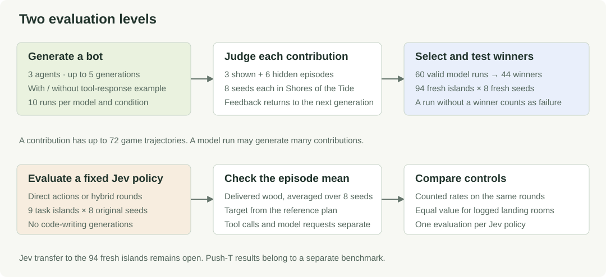
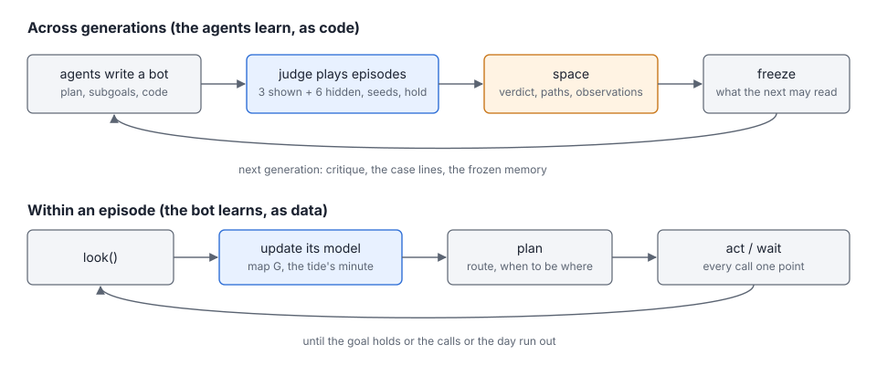
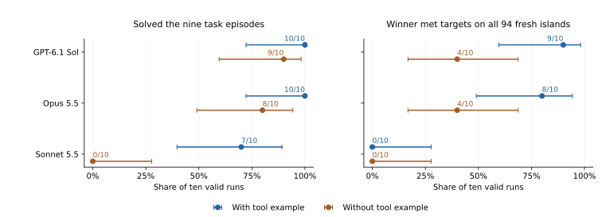

# Learning to Plan from Island Logbooks

*A compact experimental report on code-generating agents in Codemode-Chat*

## Abstract

We study how code-generating agents build programs that learn resource-arrival probabilities and plan routes in unfamiliar island worlds. A task sequence exposed successful strategies that bypassed the intended inference problem, motivating island-specific probabilities and a historical logbook. We then compared prompts with and without concrete tool responses in 60 valid runs, ten per condition for Sonnet, Opus and GPT. With examples, the models solved the nine task episodes in 7/10, 10/10 and 10/10 runs, versus 0/10, 8/10 and 9/10 without. Every selected winner was evaluated on 94 fresh islands with fresh seeds. GPT and Opus produced a winner meeting every fresh-island target in 17/20 runs with examples and 8/20 without. Sonnet produced no such winner. Example-assisted conditions showed gains in task success and the transfer of selected programs. A separate direct-player Jev experiment reached none of the episode targets. A hybrid using Jev to score feasible rounds reached 9/9 targets, matching an empirical-rate control that required no model calls. The results support explicit interface examples and independent program evaluation, with conclusions bounded by the small symbolic environment and exploratory study design.

## 1. Research question

Can language-model agents write programs that learn useful properties of an unfamiliar environment and plan accordingly? The project explores this question in small island worlds, inspired by the planning, memory and evaluation questions discussed in the source article's account of JEPA world models.

The setting makes the intermediate reasoning inspectable. A bot maintains a map, estimates where resources will arrive and chooses a route. The experiments examine whether the evaluation rewards these capabilities and whether improvements carry to additional islands.

## 2. Method



*Figure. The repeated code-generation study and the separate Jev fixed-policy study use different evaluation units. All 44 selected code winners face the fresh-island test; that test remains open for Jev.*

Agents generate JavaScript bots that observe rooms with `look()`, issue commands with `act()` and advance time with `wait()`. Each call costs one point. A judge evaluates each contribution in fresh worlds. Later generations receive feedback and write revised programs.



*Figure 1. Agents revise programs across generations; a running bot updates its knowledge within an episode. The diagram illustrates the earlier memory-based tasks. In the final task, observations come from the current island's historical logbook.*

The task sequence progressively strengthens the evaluation.

| Stage | Added capability or control | Question tested |
|---|---|---|
| Steps 1–2 | Three shown and six hidden episodes, seeds, held goals, recorded paths | Does success survive changed conditions? |
| Steps 3–4 | Frozen path memory, costs for switching paths, explicit subgoals | Can earlier experience support longer plans? |
| Steps 5–6 | Evaluation-writing tasks and unfamiliar generated islands | Do tests expose weak strategies, and do bots explore new maps? |
| Steps 7–8 | A hidden tide rule, then probabilistic resource arrivals | Can observations support timing and expected-yield planning? |
| Step 9 | Island-specific arrival probabilities and a local logbook | Does the program adapt its plan to this island's data? |

In step 9, each room except the fire room has a fixed arrival probability for that island. A logbook records six earlier days, excluding the evaluated days. Bots must collect driftwood and deliver it to the fire. An episode passes when its mean delivery over eight fixed seeds reaches 90% of a reference planner's mean. The reference knows the true probabilities and follows a fixed round. Model-generated bots can improve on it by replanning before each tide.

The nine task islands were selected to expose failures of known weak strategies. The original evaluation also used 95 unselected islands from the same generation range. The repeated study evaluates winners on a separate range, islands 234–433 retaining those with at least two rooms whose true arrival probability is 0.35 or higher, giving 94 fresh islands. Each is played on eight seed indices, 8–15, which differ from the task's 0–7. Targets are recomputed against the reference on the same fresh seeds. A secondary evaluation uses the 95 earlier islands with the fresh seeds.

The repeated experiment comprises ten runs per model and condition, 60 valid runs in total. Each run uses three agents, up to five generations, one contribution per agent, two improvement rounds, German prompts and a $5 model budget. Conditions are interleaved within each model series. Tool examples contain actual responses from the first shown episode. Runs with a scripted substitute for a missing model response are excluded and repeated. The reported sample contains no substitutes. All 60 saved sessions carry the same task specification, agent settings and $5 budget.

A run is solved when a contribution passes all nine task episodes. Its winner is the passing contribution with the fewest charged tool calls. All 44 winners are evaluated on the fresh set without further editing, giving 752 game trajectories per winner on that set. A run that produces no winner fails the combined generation-and-transfer criterion. Solve-rate intervals use Wilson's 95% method. Reported Fisher tests are two-sided and exploratory, without multiplicity correction.


### 2.1 What the example shows, and how a bot uses it

The tool example supplies actual response shapes from the first shown island. It includes observations, a logbook, a move, a second observation, a wait and an unsuccessful pickup. The following excerpts retain selected fields from those responses.

```javascript
await tools.look({});
// → { room: { id: "n52-4", name: "Windmühle" },
//     at: { x: 12, y: 8 }, time: "Tag 1, 08:00",
//     exits: [{ name: "nord", x: 12, y: 0 },
//             { name: "west", x: 0, y: 8 }], things: [] }

await tools.logbook({});
// → { days: [{ day: 1,
//     rooms: [{ room: "n52-1", exits: ["süd", "west"],
//       fromFire: 1, pieces: [{ minute: 30, x: 12, y: 12 },
//                             { minute: 210, x: 12, y: 12 }] }] }] }

await tools.act({ line: "go nord" });
// → { said: ["Du gehst nach Robbenstein."],
//     at: { room: "n52-3", x: 12, y: 14 } }
```

The full logbook example shows one complete day and indicates that five more have the same shape. In particular, `fromFire` is a numeric distance in exits. The example contains neither a successful solution nor a proposed route. The agent must write the program that uses these fields.

A concrete solution pattern is to count arrivals, build a room graph, search feasible rounds and reserve time to deliver the wood. On this island, the six-day logbook contains 48 tides.

| Room | Recorded arrivals | Empirical probability per tide |
|---|---:|---:|
| Fischerkate (`n52-1`) | 20/48 | 41.7% |
| Salzpfanne (`n52-2`) | 6/48 | 12.5% |
| Torfgrube (`n52-5`) | 13/48 | 27.1% |

Once the connections are known, a feasible round starts at Fischerkate when the tide arrives, visits Salzpfanne after five minutes and Torfgrube after ten. Returning via Salzpfanne and Fischerkate reaches the fire at Heidekamm after 25 minutes. The estimated collection is (20 + 6 + 13) / 48 = 0.8125 pieces per tide. Each room is visited before its piece expires after 30 minutes. Even the last tide at minute 450 allows delivery at minute 475, before the day ends at 480.

This is a worked calculation using the actual island and logbook, not a newly measured bot result. One stored [GPT winner](../tests/fixtures/shores/gpt-examples.js) implements a more elaborate version. It smooths positive rates as (arrivals + 0.5) / (tides + 1), constrains candidate maps with the logbook's exits and fire distances, replans during each tide and checks the final return to the fire.

## 3. Results

### 3.1 The task had to distinguish inference from shortcuts

On unfamiliar islands, an explorer reached all nine episodes, while a bot carrying a fixed map reached none. Later, however, successful bots exposed weaknesses in the inference tasks. A search strategy could pass step 7, and spatial heuristics could pass step 8 without estimating arrival probabilities. Step 9 removed the shared spatial relationship by assigning probabilities separately for each island.

A scripted learner that counted logbook arrivals and planned a route reached all nine selected episodes and fell below target on one of the 95 additional islands. A strategy treating all rooms alike failed all nine selected episodes and fell below target on 41% of the additional islands. These results support the usefulness of island-specific data within this task family.

### 3.2 Repeated runs distinguish solving from transfer

| Model | Tool example | Solved, Wilson 95% interval | Median solution generation | Mean model cost per run | Median winner tool calls (reduction vs. reference) | Runs producing a winner meeting all 94 fresh-island targets |
|---|---|---|---:|---:|---|---|
| GPT-6.1 Sol | With | 10/10 (72–100%) | 2 | $0.40 | 7,938 (12.1%) | 9/10 (90%) |
| GPT-6.1 Sol | Without | 9/10 (60–98%) | 2 | $0.48 | 8,413 (6.9%) | 4/10 (40%) |
| Opus 5.5 | With | 10/10 (72–100%) | 1 | $1.15 | 8,428 (6.7%) | 8/10 (80%) |
| Opus 5.5 | Without | 8/10 (49–94%) | 3 | $1.93 | 8,965 (0.8%) | 4/10 (40%) |
| Sonnet 5.5 | With | 7/10 (40–89%) | 2 | $0.60 | 7,745 (14.3%) | 0/10 (0%) |
| Sonnet 5.5 | Without | 0/10 (0–28%) | — | $0.46 | — | 0/10 (0%) |

*Table 1. Each row represents ten valid model runs. Solution-generation and tool-call medians include solved runs only. Cost includes all ten valid runs. Winner tool calls cover nine task episodes × eight seeds = 72 game trajectories. Each charged call costs one point. The reference uses 9,033 calls; reduction is (9,033 − median winner calls) / 9,033 × 100%. Tool-call medians are rounded to whole calls. The final column counts model runs, with unsolved runs included in its denominator. Meeting a fresh-island target requires at least 90% of the reference's mean delivered wood on that island, rounded down to an eighth. Each island mean uses eight fresh seeds.*



*Figure 2. The left panel measures whether a model run solves the selected task episodes. The right panel measures whether it produces a winner meeting every target on the 94 fresh islands. Whiskers are Wilson 95% intervals over ten model runs. Game trajectories and islands are not treated as independent model runs.*

**Sonnet's observed success depended on the example.** It solved 7/10 runs with examples and 0/10 without (Fisher p = 0.0031). Every Sonnet winner nevertheless fell below target on between one and ten fresh islands. Passing the task episodes did not establish consistent transfer.

**GPT and Opus solved earlier with examples.** Opus solved in generation 1 in seven of ten example-assisted runs. GPT's solution generations ranged from 1 to 3 with examples and 2 to 5 without. Solve-rate differences alone were inconclusive in these samples (GPT p = 1.00; Opus p = 0.474).

**The larger observed difference concerns the selected winners.** GPT and Opus together produced a winner meeting every fresh-island target in 17/20 runs with examples and 8/20 without (85% versus 40%, Fisher p = 0.0079). This pooled comparison describes the full generation-and-transfer outcome. It does not establish the effect separately for each model. One GPT winner and two Opus winners with examples still failed on 4–18 fresh islands. The original single-run results therefore overstated the consistency of transfer.

The secondary evaluation adds another distinction. Requiring success on both the 94 fresh islands and the 95 earlier islands with fresh seeds gives 16/20 runs with examples and 7/20 without. One example-assisted Opus winner and one GPT winner without examples pass every fresh island but fail on one earlier island each. The main table and figure use the fresh set alone.

**Cost and interaction effort measure different quantities.** Mean model cost was lower with examples for GPT ($0.40 versus $0.48) and Opus ($1.15 versus $1.93). Sonnet's mean cost was higher with examples ($0.60 versus $0.46), alongside its higher solve rate. All groups with winners had median game-tool totals below the reference, although this efficiency comparison is conditional on solving. Valid-run series totals were GPT $8.73, Opus $30.80 and Sonnet $10.62, $50.15 combined. GPT used the pi login and its reported dollar costs are list-price estimates. Invalid attempts and their retry costs are outside these totals.

### 3.3 Additional model assistance had limited benefit

Jev classified failures between generations and supplied a corresponding hint. On this task, its structured diagnosis always selected the interface hint. A fixed interface hint produced comparable progress, and neither condition solved the task for Sonnet or Haiku.

As an offline probability estimator, Jev matched the reference planner's yield when given the generator's four probability classes. Without those classes, its positive estimates for empty rooms led to wasted travel and failures on 25 or 26 of 95 islands. Adding a separate check for whether the logbook contained any arrivals reduced this to two or three. Simple empirical counting failed on one. The experiment shows how probability calibration and identifying empty rooms affect the resulting route.

### 3.4 Jev performance depended on the surrounding policy

A separate experiment used Jev 1.13 to select individual game-tool calls from observed data. One fixed-policy evaluation per condition covered the same 72 task trajectories. With examples, it collected 48 pieces and delivered 15; without examples, it collected 77 and delivered 17. Neither condition reached any of the nine episode targets. The 4,823 requests cost $1.60 in total.

All trajectories ended through Jev's stop choice, before the tool or API budget was exhausted. More available budget alone would therefore not have prolonged these runs. This direct policy has no program-generation or improvement loop. Its task performance can be evaluated under common game rules, while its inference and adaptation differ from the code-generating series. Two follow-ups, both with tool examples, added structured observation memory and then an extra proposal-review request. Each played the 24 shown trajectories and delivered no wood. All six hidden episodes were skipped by the judge's positive-delivery gate. The review retained the proposal in all 565 executed actions. The follow-ups cost $0.55 combined. Neither budget nor tool limits ended a trajectory. These policies supplied no observed improvement; further repetitions and alternative decision procedures remain separate questions. The [Jev experiment report](codemode-jev-player.en.md) records the adapter and detailed results.

A live hybrid evaluation then separated map discovery, feasible-round generation and delivery from model-based value estimation. Jev scored candidates through batched probability questions. The hybrid reached **9/9 episode targets across 72 trajectories**, delivering 733 pieces with 8,447 game-tool calls and 3,352 model requests for $0.89258. The identical planner and executor with empirical-rate scores delivered 737 pieces and also passed 9/9, using 8,059 tool calls and no API requests. An equal-value score for each room with a logged landing cell passed 8/9.

The difference occurs on H4. Its target is 13.375 pieces per seed on average. Jev brings 14.375, empirical rates 14.875 and equal room values 11.125. This supports a useful ranking signal from Jev on this episode within the supplied workflow. The controls also show how much of the task the surrounding code already solves. This is one hybrid evaluation on the original task seeds. Its repeated-run reliability and transfer to the 94 fresh islands remain unmeasured. Raw tail-probability inconsistencies are documented in the [Jev experiment report](codemode-jev-player.en.md).

A further live workflow separated model-selected subgoals, candidate reward estimates and a delivery-feasibility probability gate. It also reached 9/9 targets across 72 trajectories, delivering 724 pieces with 9,740 tool calls and 5,725 requests for $1.26707. Jev selected 378 intermediate deliveries and continued collecting afterward. The gate rejected 407 already feasible candidate evaluations, changing the selected round 27 times. Compared with the scoring-only hybrid, this evaluation delivered nine fewer pieces and increased tool calls by 15.3% and API cost by 42.0%. The combined change therefore showed no observed improvement. One evaluation per policy does not establish a general effect or isolate the contribution of each added stage.

## 4. What was learned

**Interface examples affected observed success and transfer.** The repeated study confirms the original Sonnet improvement and reveals variation hidden by the single GPT and Opus winners. Concrete responses reduce the need to infer a tool's data format from prose.

**Task success and transfer are separate outcomes.** A successful search can select a program that fails elsewhere. Evaluating every winner on fresh islands and seeds exposes this gap. The relevant unit for generation reliability is an independent model run.

**Compact estimation supports useful plans in this environment.** Empirical arrival rates and observed room connections suffice for strong scripted and generated programs. The reference's fixed route also leaves room for programs that replan during the day.

**Cheap decisions need an effective policy.** Jev's estimator and diagnosis results depended on the surrounding code and controls. The direct player collected resources but delivered little. The hybrid completed delivery after code supplied explicit planning and execution, while empirical scores achieved the same target coverage with fewer tool calls and no API cost.

## 5. Limitations

The study uses symbolic worlds with five to eight rooms, known movement rules and structured observations. Fresh islands come from the same generator family. The experiment measures transfer within that family.

There are ten valid runs per model and condition. Intervals remain wide, and pooled tests do not establish model-specific effects. Conditions were interleaved, and the reported tests are exploratory and uncorrected for multiple comparisons. Excluding runs with scripted substitutions makes the results conditional on valid model responses. They do not measure end-to-end provider reliability.

Winner efficiency is conditional on solving, and selecting the lowest-cost passing program can select failures that the nine task islands do not expose. Fresh-seed means provide a stronger check than the original fixed seeds, but they do not bound lower-tail performance. No uncertainty interval for each island's expected yield is established.

The reference knows the true probabilities and uses a fixed route. Beating it does not establish optimality. Earlier task revisions changed several prompt and scoring elements together. The Jev follow-ups modify the surrounding policy and must be evaluated as additional exploratory conditions.

## 6. Next experiments

1. **Replicate with a reserved final set.** Fix prompts, winner-selection rules and a small set of primary endpoints before further independent runs. Reserve additional islands and seeds for the final evaluation, and account for invalid attempts and total expenditure.
2. **Test changing probabilities.** Alter arrival distributions during play or between generations. Measure detection and adaptation against fixed rules and empirical estimators.
3. **Evaluate poor-yield days.** Add a lower-quantile or minimum-success-probability objective alongside mean delivery, with more evaluation seeds.
4. **Test alternative Jev decision procedures.** The first structured-memory and proposal-review follow-ups yielded no improvement. Repeat the scoring-only and expanded workflow comparisons on fresh islands and seeds, using the empirical and equal-value controls. Measure probability coherence and calibration as well as target coverage and total cost. Separate the added stages in ablations to identify their contributions.
5. **Localize direct-player failures.** Evaluate navigation to the fire, pickup-and-delivery sequences and full-day planning as separate tasks before increasing the number of paid requests per action.

The expanded Jev workflow above tests the proposed decomposition into typed subgoal, value and delivery questions. TypeSafe describes workflows combining probabilistic decisions and candidate scoring. Here, code supplied the deterministic movement and timing calculations. The extra model stages preserved task coverage while adding cost and false rejections of known-safe rounds. Further ablations could separate the stages, and feasibility discrimination would require a test set containing unsafe plans as well. [TypeSafe's description](https://typesafe.ai/blog/introducing-system-one-models-and-jev)

## 7. Conclusion

Across 60 valid runs, tool examples were associated with higher observed task success and more consistently transferable winners. Sonnet improved from 0/10 to 7/10 solved runs, while GPT and Opus produced a winner passing all fresh-island targets in 17/20 runs with examples versus 8/20 without. Some example-assisted winners still failed, so reliable generation requires both repeated trials and independent program evaluation. Jev completed the task within an explicit hybrid workflow after its direct policies failed. The empirical-rate control matched its target coverage, so the added model cost requires further justification for this environment.

## Source and reproducibility

This report summarizes the initial experiments of 14 November 2026, the repeated series and fresh evaluation of 15 November, and the Jev follow-ups. Aggregate results were checked against the series summaries, stored winners and fresh-evaluation JSON. Fisher values were independently recomputed from the reported contingency tables. Results, implementation commits, task details and further figures are documented in the [full experimental article](codemode-planning-article.en.md). The [implementation plan](codemode-planung.en.md) describes the nine development steps. The repository includes the judge, task generators, recorded Jev responses and bot fixtures used in regression tests.
