# Planungsbots ohne neuronales Weltmodell

[Englische Fassung](../codemode-planning-article.en.md) · [Technischer Plan](../codemode-planung.en.md)

## Versuchsaufbauten lesen und vergleichen

Der neue Codemode-Bereich `/experiments` bereitet das kompakte Planungspaper, den Jev-Bericht und diesen Entwicklungsartikel als HTML auf. Versuchsprotokolle, Abbildungen und GitHub-Verweise auf die Markdown-Quelldokumente sind dort getrennt zugänglich.

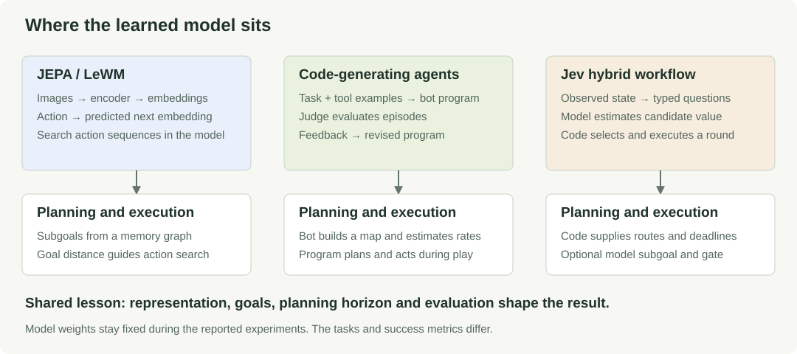

*Abbildung. Die Ansätze setzen gelernte Modelle unterschiedlich ein: JEPA sagt latente Zustände voraus, Code-Agenten erzeugen Programme und Jev beantwortet typisierte Fragen innerhalb eines expliziten Programms.*

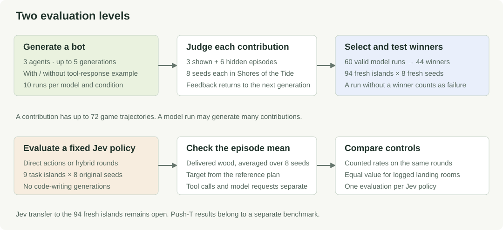

*Abbildung. Aus 60 gültigen Code-Agenten-Läufen gingen 44 Gewinner für die Prüfung auf frischen Inseln hervor. Jev-Policies wurden stattdessen jeweils einmal auf den ursprünglichen Inseln ausgewertet. Die Auswertungseinheiten unterscheiden sich.*

### JEPA, Code-generierende KI und Jev: Gemeinsamkeiten und Unterschiede

Alle drei sind KI-Ansätze. „Code-generierende KI“ bezeichnet hier Sprachmodell-Agenten, die Bots schreiben und überarbeiten, keine Gegenkategorie zu JEPA oder Jev.

| Aspekt | JEPA / LeWM in der Quellanalyse | Code-Agenten hier | Jev-Hybrid hier |
|---|---|---|---|
| Modellausgabe | Nächster latenter Zustand aus Zustand und Aktion | Ausführbarer JavaScript-Bot | Typisierte Auswahl oder Wahrscheinlichkeiten über vorgegebene Kandidaten |
| Zustand und Umgebung | Bilder und kontinuierliche Push-T-Physik | Symbolische Spiel-Tool-Antworten | Von Code vorbereitete Zustände und Kandidaten |
| Planung | Suche über Aktionsfolgen mit gelerntem Prädiktor; Demonstrationsspeicher liefert Zwischenziele | Agenten überarbeiten Code über Generationen; Bots kartieren, schätzen Raten und planen während des Spiels neu | Code berechnet Wege, Fristen und machbare Runden; Jev bewertet oder wählt darin |
| Anpassung im Versuch | Vortrainierte Modellgewichte bleiben fest | Code-Revisionen und Datenschätzungen im Spiel; keine neuronalen Gewichtsänderungen | Festes vortrainiertes Modell und fester Workflow; Zustandsabfragen, kein neuronales Dynamiktraining |
| Generalisierungsprüfung | Neue Start-Ziel-Paare, Seeds und gehaltene Ziele in Push-T | Verborgene Aufgabenepisoden plus 94 frische Inseln und Seeds für Gewinner | Bisher neun ursprüngliche Inseln mit acht Seeds; entsprechende Transferprüfung noch offen |

Gemeinsam sind die Fragen nach Repräsentation, Teilzielen, Speicher, Planungshorizont und Zielbewertung. Die Verbindung ist konzeptionell: Unser Hybrid lernt nicht das neuronale Vorwärtsmodell von LeWM. Eine typkorrekte Antwort belegt außerdem weder eine richtige Wertschätzung noch eine wirksame Strategie.

[Alchaers Analyse](https://haddyalchaer.com/jepa) zeigt die Bedeutung von Aufgabenzerlegung und Zielbewertung. Das motiviert entsprechende Kontrollen hier. Die Push-T-Prozentzahlen und die Zahl erfüllter Inselziele messen jedoch verschiedene Dinge und bilden keine gemeinsame Rangliste. Besonders aufschlussreich ist unsere Kontrolle mit empirischen Raten: Sie erreicht ebenfalls alle neun Inselziele ohne Modellanfragen. Der Versuch zeigt damit einen funktionsfähigen Jev-Hybrid, bisher keinen Mehrwert gegenüber dieser Kontrolle.

Quellen: [LeWorldModel](https://arxiv.org/abs/2603.19312), [TypeSafe zu typisierten Entscheidungen](https://docs.typesafe.ai/introduction). Der Vergleich ist unsere Einordnung der Architekturen und unserer Versuche, keine gemeinsame Auswertung dieser Quellen.

## Die Ausgangsfrage

Haddy Alchaer untersucht im November 2026 LeWorldModel (LeWM, Maes et al., 2026) an der Aufgabe Push-T. Ein Roboter muss einen
T-förmigen Block auf eine vorgegebene Position schieben. LeWM nutzt eine Joint-Embedding Predictive Architecture
(JEPA) mit zwei trainierten Komponenten. Bei der Planung kommt eine dritte hinzu.
[Alchaers Beitrag](https://haddyalchaer.com/jepa) · [LeWorldModel](https://arxiv.org/abs/2603.19312)

1. Der Encoder bildet ein Kamerabild auf einen Vektor im latenten Raum ab, das sogenannte Embedding.
2. Der Prädiktor sagt aus dem aktuellen Embedding und einer Aktion das Embedding des nächsten Zustands voraus.
3. Der Planer spielt mit dem Prädiktor viele Aktionsfolgen durch. Er wählt die Folge, deren vorhergesagter Endzustand
   dem Ziel am nächsten liegt.

Alchaer berichtet, dass vor allem der Planungshorizont die Leistung begrenzt. Zwischenziele helfen ebenso wie ein
Speicher mit Zuständen aus Demonstrationen, in dem ein Wechsel zwischen Demonstrationen Kosten verursacht. Die
Bewertung sollte sich auf die Merkmale konzentrieren, die für das Ziel relevant sind. Neue Start-Ziel-Paare, andere
Zufallsseeds und eine Mindestdauer für den Zielzustand liefern niedrigere Erfolgsquoten als die übliche Auswertung.
Diese Befunde geben den Beitrag sinngemäß wieder. Die Versuche wurden für diesen Artikel nicht wiederholt.

In Codemode-Chat schreiben skript- oder modellgesteuerte Agenten Code. Ein Bewerter führt die Beiträge in einer
Sandbox aus und bildet eine Rangfolge. Die nächste Generation baut auf den besten Beiträgen auf. Für das Onlinespiel
spaces-mmo können die Agenten Bots schreiben, die in der Arena für jeden Beitrag eine frische Spielwelt erhalten.
Welche Ideen aus dem Beitrag lassen sich auf diese Bots übertragen? Welche Art von Weltmodell brauchen sie dabei?

## Wie die Bots spielen und lernen

Die Agenten schreiben JavaScript-Funktionen, die eine Spielfigur über drei Tools steuern.

- `look()` meldet den aktuellen Raum, seine Ausgänge, Gegenstände und Feuerstellen.
- `act({ line })` führt einen Spielbefehl aus.
- `wait({ minutes })` lässt Spielzeit verstreichen.

Jeder Aufruf kostet einen Punkt. Der Bewerter prüft die Bots in drei offengelegten und sechs verdeckten Episoden, jeweils
in einer eigenen Spielwelt. Je nach Aufgabe gibt es einen oder mehrere Zufallsseeds pro Episode. Bei Aufgaben mit
`hold` muss der Zielzustand nach dem Ende des Bots noch eine vorgegebene Zeit bestehen bleiben. Während einer Episode
kartiert der Bot die Räume, die er besucht. In Schritt 7 und 8 kann er aus den Beobachtungen früherer Generationen ein
Modell der Flut ableiten. In Schritt 9 liefert ein Logbuch historische Daten zur jeweiligen Insel. Zwischen den
Generationen lesen die Agenten die Bewertungen, die Ergebnisse der einzelnen Testfälle und den zu Beginn der Generation
festgeschriebenen Datenstand. Daraus entwickeln sie den nächsten Bot.

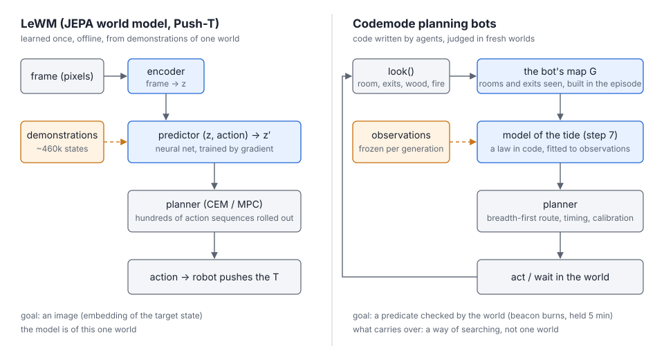

*Abbildung 1. Links steht LeWM mit einem vorab trainierten Modell. Rechts steht der Codemode-Bot, der beim Erkunden
eine Karte erstellt und aus protokollierten Beobachtungen ein Modell der Flut ableiten kann. Ob er sein Ziel erreicht
hat, prüft die Spielwelt anhand einer festgelegten Bedingung.*

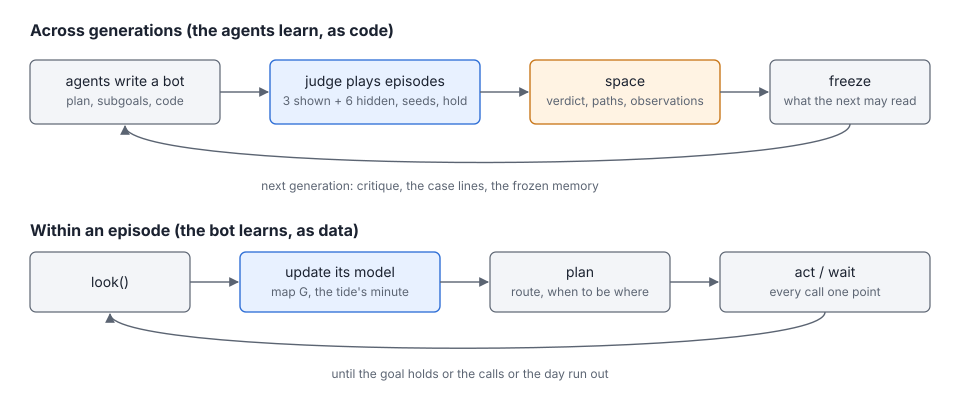

*Abbildung 2. Zwischen den Generationen entwickeln die Agenten den Code weiter. Innerhalb einer Episode ergänzt der Bot
seine Daten über die Spielwelt.*

## LeWM und Codemode im Vergleich

| Aspekt | LeWM | Codemode |
|---|---|---|
| Wahrnehmung | Der Encoder wandelt Pixel in Embeddings um. | `look()` liefert strukturierte Daten. |
| Vorhersage | Ein trainiertes neuronales Netz sagt aus dem aktuellen Embedding und einer Aktion das nächste Embedding voraus. | Der Bot kartiert Übergänge wie „Raum A, Ausgang `ost` → Raum B“. Ab Schritt 7 kann er zusätzlich die Flut anhand von Beobachtungen modellieren. |
| Planung | Die Cross-Entropy-Methode (CEM) optimiert die Aktionsfolge für die modellprädiktive Regelung (MPC). | Der Bot sucht per Breitensuche einen Weg, stimmt sein Vorgehen auf die Spielzeit ab und kalibriert in Schritt 7 die Flut am ersten beobachteten Holzstück. Ab Schritt 8 bewertet er mögliche Routen nach der erwarteten Ausbeute. |
| Ziel | Ein Bild des gewünschten Zustands. | Eine Bedingung der Spielwelt, etwa `beacon:island` für fünf Minuten oder `feed:island:3`. |
| Planungshorizont | Zwischenziele erleichtern längere Aktionsfolgen. | Ziele können mehrere Räume entfernt liegen. Ab Schritt 4 enthält der Plan explizite Zwischenziele. |
| Gedächtnis | Ein Graph verknüpft Zustände aus Demonstrationen. Ein Wechsel zwischen Demonstrationen verursacht Kosten. | `recall` durchsucht die festgeschriebenen Wege früherer Generationen. Ein Wechsel zwischen Wegen kostet zehn Zellen (Schritt 3). |
| Auswertung | Neue Start-Ziel-Paare, andere Seeds und eine Mindestdauer für den Zielzustand. | Drei offengelegte und sechs verdeckte Episoden. Ab Schritt 6 sind die verdeckten Inseln eigene Welten. |
| Anpassung | Die Modellgewichte werden vorab per Gradientenabstieg trainiert. | Die Agenten überarbeiten den Code zwischen den Generationen. Der Bot kann zur Laufzeit Hypothesen anhand der Daten prüfen. |

## Was der Bot vorhersagen muss

In Schritt 6 besteht ein Bot mit der fest eingebauten Karte der Grauen Insel keine der neun Episoden auf generierten
Inseln. Der Bot, der seinen Standort prüft, die beobachteten Verbindungen speichert und darauf seine Route plant,
besteht alle neun. Auf neue Inseln übertragbar ist hier das Suchverfahren.

Die Welt des Bewerters folgt expliziten Regeln. Für diese Aufgaben genügt es, die beobachteten Raumverbindungen zu
speichern und die Regeln für Bewegung und Zeit anzuwenden. Ein neuronaler Prädiktor käme etwa dann infrage, wenn ein
Planer viele Aktionsfolgen prüfen muss und die direkte Simulation zu langsam ist. Diesen Vergleich untersuchen die
vorliegenden Versuche nicht.

Die Flut in Schritt 7 stellt eine andere Anforderung. Ihre Regel ist dem Bot unbekannt, doch er kann sie aus
protokollierten Ereignissen ableiten und für seinen Zeitplan nutzen.

## Aussagekraft des Vergleichs

Die Codemode-Bots arbeiten mit diskreten Räumen, bekannten Bewegungsregeln und strukturierten Beobachtungen. Karte,
Route, Zwischenziele und die geschätzte Flutregel lassen sich ausgeben und überprüfen. Die Generalisierung wird ab
Schritt 6 auf unbekannten Welten getestet. Die Aufgabe „Planer bewerten“ prüft außerdem, ob die Agenten selbst ein
Testverfahren schreiben können, das typische Schwächen von Bots aufdeckt.

LeWM verarbeitet Pixel und plant in Umgebungen mit kontinuierlicher Steuerung und physikalischen Effekten wie Kontakt
und Reibung. Die Inseln in Codemode umfassen fünf bis acht Räume mit einer Feuerstelle und vier möglichen
Ausgangsrichtungen. Schritt 7 kalibriert einen vom Seed abhängigen Zeitversatz. In Schritt 8 und 9 wird das Anspülen
pro Raum und Stunde probabilistisch modelliert.

Die geskripteten Bots stehen für vorab festgelegte Strategien. Ihre Ergebnisse zeigen, welche Strategien der Bewerter
unter den jeweiligen Testbedingungen unterscheiden kann. In den Modellläufen lässt sich zusätzlich verfolgen, welche
Beobachtungen in spätere Codebeiträge einfließen. Opus nutzte bei „Die Flut lernen“ zunächst eine einfache Statistik der
Beobachtungen. Sobald die Beobachtungen im Prompt standen, erkannte es in der ersten Generation mit diesen Daten den
für seinen Bot entscheidenden Teil der Flutregel. Der geskriptete Bot von Schritt 7 wählt dagegen aus vorgegebenen
Hypothesen. Bei „Die Chancen der Flut“ bestanden Sonnet, Opus und GPT. Nur GPT schätzte dafür Wahrscheinlichkeiten.
Haiku scheiterte bei beiden Aufgaben an der Spielsteuerung. Die einzelnen Läufe liefern Fallbeispiele.

Auf die ersten Läufe mit Tool-Beispielen folgten 60 gültige Läufe, zehn je Modell und Bedingung, sowie eine Prüfung
aller 44 Gewinner auf 94 frischen Inseln mit neuen Seeds. Mit Beispiel löste Sonnet 7/10 Läufe, Opus und GPT jeweils
10/10. GPT und Opus erzeugten mit Beispiel in 17/20 Läufen einen Gewinner, der jedes Ziel der frischen Inseln erreichte,
ohne Beispiel in 8/20. Die Intervalle bleiben breit. Diese explorativen Vergleiche begründen keine allgemeine
Rangfolge der Modelle.

Jev wurde außerdem als direkter Spieler und in vorgegebenen Workflows geprüft. Die direkten Strategien verfehlten
die Aufgabenziele. Ein Hybrid mit Kandidatenbewertung und ein erweiterter Workflow erreichten jeweils 9/9 Ziele.
Die Kontrolle mit empirisch gezählten Fundraten erreichte dieselbe Zielabdeckung mit weniger Tool-Aufrufen und ohne
Modellanfragen. Für jede Jev-Strategie liegt eine Auswertung auf den ursprünglichen Aufgabenseeds vor. Wiederholungen
und die Prüfung auf frischen Inseln stehen dafür noch aus.

## Entwicklungsprotokoll

Die Umsetzung folgte am 14. November 2026 auf den Plan vom Vortag. Die Commits liegen auf `master`.
Die Tabelle zeigt die Testergebnisse der geskripteten Varianten.

| Schritt | Commit | Änderung | Ergebnis |
|---|---|---|---|
| Plan | cd17ffe, 385b95b | Der Plan nach dem Beitrag, die Werte (3 + 6 Episoden, Seeds 1 oder 3, 5 Minuten halten) | — |
| 1. Auswertung | 13d818f | Episoden mit offengelegten und verdeckten Fällen, Seeds, `hold`; `start`, `seed`, `setup` der Arena; die Fortschrittskurve und die Episodenmatrix; die Aufgabe „Inselbot“ | Verdeckte Episoden laufen nur, wenn eine offengelegte erreicht wurde |
| 2. Wege auf der Karte | 5db6a5a | Die Arena zeichnet jede Zelle auf; `path`, `map`; Wege in `BotEpisode`; der Atlas mit Wegen | Ein Test: Keine verdeckte Episode liegt auf dem Weg einer offengelegten |
| 3. Gedächtnis | 03395d3 | `PlanMemory`, `MemoryFreeze` pro Generation, `recall` mit Sprungkosten, Abdeckung, die Gedächtnisansicht | Echte Arena: Die erste Generation deckt keinen verdeckten Start ab, spätere 1 von 6; ein Bot mit gespeicherten Routen erreicht die offengelegten Episoden und keine verdeckte |
| 4. Zwischenziele | 49e9fb6 | Pläne nennen Zwischenziele als Daten; die Arena markiert, wo jedes erreicht wurde; die Kette der Zwischenziele; die Aufgabe „Den Feuerkorb am Anleger entzünden“ | Echte Arena: der Suchplan 9/9 (152 Punkte), der Dünen-Plan 1/9, der Plan „erst das Feuer“ 9/9 (195) |
| 5. Planer bewerten | 7d50eea | Agenten schreiben mit `rate()` ein Testprogramm, das Inselbots in einer vereinfachten Arena bewertet. | Zwei Testprogramme ordnen alle Bots richtig ein. Vier übersehen jeweils genau die Schwäche, für die sie entworfen wurden. |
| 6. Neue Welten | e44f11d | Inseln, aus einer Zahl erzeugt; die vereinfachte Arena des Bewerters; die Aufgabe „Neue Inseln“ ohne Karte; „Planer bewerten“ auf erzeugten Inseln | Erkunder ohne Karte 9/9 (163), die Karte der Grauen Insel 0/9, die offengelegten Inseln auswendig 3/9; echte Arena: der Erkunder ohne Karte 9/9 (111) |
| 7. Die Flut | 2412979 | Ein verborgenes Gesetz der Flut; Gehen kostet Zeit; Beobachtungen ins Gedächtnis protokolliert und eingefroren; die Aufgabe „Die Flut lernen“ | Das Gesetz im Code 9/9 (2253); der lernende Bot 9/9 mit Beobachtungen, 6/9 ohne; kein Modell 6/9 (4603); ohne Kalibrierung 0/9; nach Raum-IDs 3/9 |
| 8. Die Chancen der Flut | 0ea9172 | In jeder Sackgasse kann stündlich Holz erscheinen. Die Wahrscheinlichkeit steigt mit der Entfernung zur Feuerstelle. Pro Episode zählt ein Zielwert über acht Seeds. Die Beobachtungsdaten enthalten die Funde je Raum und Tag; die Aufgabe „Die Chancen der Flut“ | Das Gesetz im Code und der lernende Bot mit Beobachtungen 9/9; Zählungen statt Raten 2/9; der wahrscheinlichste Ort 0/9; jede Sackgasse jede Stunde 2/9; das Gesetz von Schritt 7 0/9; nach Raum-IDs 3/9; der lernende Bot ohne Beobachtungen 1/9 |
| 9. Die Ufer der Flut | e26c34d | Eigene Wahrscheinlichkeiten je Insel und Raum, mit Ausnahme der Feuerstelle. Ein Logbuch mit sechs früheren Tagen derselben Insel ersetzt `observations()`; die Aufgabe „Die Ufer der Flut“ | Der lernende Bot mit dem Logbuch 9/9; das Gesetz von Schritt 8, der Rundgang, nur Sackgassen, der wahrscheinlichste Raum, jeder Raum gleich 0/9; die drei Modellsieger von Schritt 8 0/9 |

### Was sich bei der Umsetzung änderte

- **Schritt 1.** Derselbe Seed konnte unterschiedliche Verläufe ergeben. Die Spielticks lösten Zufallsereignisse zu
  Zeitpunkten der realen Uhr aus. Bei Aufgaben mit `wait` beeinflusste deshalb auch das Timing den Verlauf.
- **Schritt 4.** Nach dem Erlöschen einer Feuerstelle kann dichter Nebel die Ausgänge sperren. Ein Test, der erst nach
  Ablauf der Haltezeit den nächsten Raum betrat, schlug bei dichtem Nebel fehl.
- **Schritt 5.** Das Testprogramm führt jeden Bot Dutzende Male aus. Ein Durchlauf in der regulären Arena dauert
  mehrere Sekunden, und nach einem Wartebefehl hängt der Verlauf auch vom Timing ab. Für die
  Bewertungsaufgabe verwendet der Bewerter deshalb eine vereinfachte Simulation.
- **Schritt 6.** Der ursprünglich erwogene neuronale Prädiktor entfiel. Der Schritt prüft stattdessen, wie sich Bots
  mit einer selbst erstellten Karte auf neuen Inseln zurechtfinden.
- **Schritt 6.** Ein Test mit 21 Räumen zeigte, dass die Oberfläche eine Bewertung anzeigen konnte, bevor alle auf
  der Route besuchten Räume gespeichert waren. Der Bewerter speichert jetzt zuerst die Räume.
- **Schritt 6.** Mit dem Wegfall der vorgegebenen Karte fand der Bot mit begrenztem Suchradius auch die Feuerstelle
  nicht mehr. Seine Reichweitenbeschränkung gilt jetzt nur für die Holzsuche. Damit prüft die Variante gezielt, ob eine
  lokale Holzsuche genügt.

## Schritt 7 – Ein Weltmodell aus Beobachtungen

Die Flut spült auf einer generierten Insel stündlich ein Holzstück an. Die Sackgassen kommen in der Reihenfolge ihrer
Raumnummern an die Reihe. Als Sackgasse zählt jeder Raum mit genau einem Ausgang, ausgenommen der Raum mit der
Feuerstelle. Das Holzstück liegt drei Zellen vom Ausgang entfernt und bleibt 30 Minuten liegen. Das erste Stück
erscheint in Minute 30 + 10 · (Seed mod 3), jedes weitere 60 Minuten nach dem vorherigen. Ein Raumwechsel kostet fünf
Minuten. Der Spieltag endet nach 480 Minuten. Der Aufgabenprompt verrät diese Regel nicht.

In jeder offengelegten Episode erfasst der Bewerter für alle drei Seeds jedes Anspülereignis. Er speichert Insel, Seed,
Holzstück, Minute, Raum und Zelle sowie die Ausgänge des Raums und seine Entfernung zur Feuerstelle. Zu Beginn einer
Generation wird dieser Datenstand festgeschrieben. Der Bot liest ihn mit `observations()`. Wie die Demonstrationen
für ein JEPA-Modell beschreiben diese Daten beobachtete Zustände und Ereignisse.

Der Bot prüft zur Laufzeit, ob Holz ausschließlich in Sackgassen außerhalb des Feuerraums erscheint. Er prüft die
auf- und absteigende Reihenfolge der Raumnummern, die Position relativ zum Ausgang und den Zeitpunkt innerhalb der
Stunde. Er behält die Hypothesen, die zu den Daten passen. Auf seiner Insel geht er frühzeitig zur nächsten Sackgasse
und wartet in Zehn-Minuten-Schritten. Das erste beobachtete Holzstück verrät ihm den Zeitversatz seiner Episode.
Danach kann er seine Route auf die Ankunftszeiten abstimmen. Bei fehlenden Daten oder unpassenden Hypothesen sucht er
die Insel ab.

- Ohne Beobachtungen besteht der lernende Bot 6 von 9 Episoden und verbraucht etwa doppelt so viele Punkte.
- Eine Variante, die mit den beobachteten Raum-IDs arbeitet, besteht die drei offengelegten Episoden.
- Wer ohne Kalibrierung stets Minute 30 annimmt, besteht keine Episode. Eine Episode zählt erst als bestanden, wenn
  der Bot das Ziel bei allen drei Seeds erreicht.
- Die fest codierte Regel und die aus Daten abgeleitete Regel bestehen jeweils 9 von 9 Episoden. Der Unterschied
  zwischen 2 253 und 2 280 Punkten entspricht einem zusätzlichen `observations()`-Aufruf pro Durchlauf.

## Schritt 8 – Routen nach erwarteter Ausbeute planen

Jeweils zur halben Stunde kann in jeder Sackgasse unabhängig Holz erscheinen. Die Wahrscheinlichkeit beträgt
0,15 pro Raumwechsel Entfernung zur Feuerstelle und ist auf 0,9 begrenzt. Der Prompt nennt die Uhrzeiten der Flut.
Die Wahrscheinlichkeiten muss der Bot selbst erschließen.

Das Holz bleibt 30 Minuten liegen, ein Raumwechsel dauert fünf Minuten. In diesem Zeitfenster kann der Bot bis zu
fünf Ausgänge passieren und noch Holz aufnehmen. Die erwartete Ausbeute einer Route ergibt sich aus der Summe der
Wahrscheinlichkeiten der besuchten Sackgassen. Zwei gut erreichbare Sackgassen können zusammen mehr Holz liefern als
die abgelegene Sackgasse mit der höchsten Einzelwahrscheinlichkeit.

Der Bewerter mittelt die Ausbeute über acht Seeds. Je nach Kandidateninsel bringt eine gute Route im Mittel
2,6 bis 10,5 Holzstücke. Der Zielwert einer Episode beträgt 90 % der mittleren Ausbeute des Referenzbots, der die
Wahrscheinlichkeitsregel kennt. Ein Hash aus Insel, Seed, Stunde und Raum bestimmt die Ziehung. Alle Bots treffen
dadurch auf dieselben Anspülereignisse. Das Beobachtungsprotokoll enthält pro Tag die Flutzeiten und alle Räume mit
ihren Ausgängen, ihrer Entfernung vom Feuer und der Zahl der Holzstücke. Auch Räume ohne Fund zählen, weil zur
Schätzung der Wahrscheinlichkeit die Zahl aller Gelegenheiten gebraucht wird.

Die sechs verdeckten Inseln wurden anhand der Ergebnisse der Vergleichsbots so gewählt, dass jede schwache Strategie
mindestens einmal scheitert. Die Prozentangaben beziehen sich auf alle 97 Kandidaten außerhalb der offengelegten
Stichprobe.

- **Fundrate pro Gelegenheit.** Die offengelegten Inseln haben viele Sackgassen in Entfernung zwei, zwei in
  Entfernung vier und keine in Entfernung drei. Wer nur Funde nach Entfernung zählt, überschätzt Entfernung zwei
  und hat keine Werte für drei, fünf und sechs. Das reicht für 2 von 9 Episoden und verfehlt auf 64 % der
  Kandidaten den Zielwert. Der lernende Bot teilt die Fundzahlen durch die Gelegenheiten und schätzt daraus den
  linearen Zusammenhang. Er besteht 9 von 9 Episoden und erreicht alle 97 Zielwerte.
- **Erwartete Ausbeute einer Route.** Wer jede Stunde am wahrscheinlichsten Fundort wartet, sammelt ein Drittel bis
  zwei Drittel der Ausbeute des Referenzbots. Das ergibt 0 von 9 Episoden und 82 % unter dem Zielwert.
- **Zeitfenster.** Eine Route, die stündlich alle Sackgassen in fester Reihenfolge abläuft, besteht 2 von 9 Episoden
  und verfehlt auf 34 % der Kandidaten den Zielwert. Sonnet 5.5 schrieb später eine dynamische Route, die zu weit
  entfernte Sackgassen überspringt. Sie besteht auch ohne geschätzte Wahrscheinlichkeiten.
- **Beitrag der Beobachtungsdaten.** Der lernende Bot besteht mit Beobachtungen 9 von 9 Episoden und ohne sie 1
  von 9. Auf allen Kandidateninseln fällt der Unterschied kleiner aus. Ohne Beobachtungen verfehlt er 27 % der
  Zielwerte. Auf vielen Inseln erfasst eine Route über alle Räume zufällig auch die ergiebigen Sackgassen.

LeWM bewertet viele Stichproben von Aktionsfolgen mit seinem trainierten Prädiktor. In Schritt 8 kann der Bot die
möglichen Routen einer Stunde vollständig durchsuchen. Als Modell genügen ihm die geschätzten Wahrscheinlichkeiten.

## Erster Haiku-Lauf mit „Die Flut lernen“ (14. November 2026)

Drei Agenten mit `anthropic/claude-haiku-5-5` hatten höchstens fünf Generationen, zwei Verbesserungsrunden und ein
Budget von 1 US-Dollar. Die geskripteten Agenten waren deaktiviert, da ihre Varianten die Flutregel bereits enthalten.
Jeder Beitrag entstand mit einem Modellaufruf (`CODEMODE_DURABLE_AGENT=0`) und wurde wie üblich bewertet. Der Prompt
erklärte `observations()` samt Feldern und Kosten. Die Flutregel musste der Bot selbst ermitteln.

Alle 15 Beiträge blieben bei 0 von 9 Episoden. Der Lauf verbrauchte 86 733 Tokens und kostete 0,017 US-Dollar.

| Generation | Woran die Bots scheiterten |
|---|---|
| 1 | Zwei warteten über das Ende des 480-Minuten-Tages hinaus. Einer überschritt mit 1 954 `look()`-Aufrufen die Grenze von 300 Tool-Aufrufen. |
| 2–3 | Die Zeit- und Aufrufgrenzen blieben ein Problem. Die Zahl der `look()`-Aufrufe sank von etwa 1 000 auf etwa 300. |
| 4–5 | Alle Bots hielten die Grenzen ein. Keiner legte eines der drei benötigten Holzstücke ins Feuer. |

Die Notizen des Teams hielten schließlich fest, dass ein Blick pro Entscheidung genügt, Bewegung und Warten dasselbe
Zeitbudget verbrauchen und der Bot gegen Minute 455 aufhören sollte. In Generation 1 warteten die Bots lange genug,
damit der Bewerter Anspülereignisse protokollierte. Eine Notiz schlug vor, mögliche Fundorte anhand ihrer Entfernung
zur Feuerstelle und ihrer Ausgänge zu gruppieren. Drei Bots riefen `observations()` auf, davon einer in der ersten
Generation mit leerem Datenstand. Keiner passte eine Hypothese an die Daten an. In Generation 4 und 5 nutzte kein Bot
das Tool.

Die Agenten sahen den Code, die Fehlermeldungen und die Punkte der bisherigen Versuche. Die Rückgaben von
`observations()` waren nur den Bots zugänglich. Ein Agent hätte also ohne Beispieldaten eine Funktion schreiben
müssen, die zur Laufzeit die passenden Hypothesen prüft. Der nächste Versuch sollte deshalb die protokollierten
Beobachtungen auch im Prompt zeigen.

Beim Lauf traten drei technische Probleme auf.

- Der Modellkatalog mit etwa 500 Einträgen überschritt mit 65 550 Bytes die Grenze von 64 KiB für einen
  `ModelInfo`-Eintrag. Die Oberfläche zeigte daher keine Modelle. Eine kompakte Liste aus Anbieter, ID und bei
  Bedarf Anzeigename braucht etwa 32 KB.
- Bei einem fehlgeschlagenen Modellaufruf springt ein geskripteter Agent ein. Ein früher Lauf mit Codestral und
  Haiku wurde nach einer Generation abgebrochen, nachdem Mistral für Codestral mit HTTP 429 geantwortet hatte.
- Der persistente Agentenpfad erlaubt standardmäßig vier Anfragen mit je 1 500 Tokens und prüft den eigenen
  Code mit `verify_code`. Bei dieser Aufgabe schlug die Prüfung vor der Abgabe wiederholt fehl. Nach Ausschöpfen
  des Anfragebudgets sprang der geskriptete Agent ein. Der ausgewertete Lauf verwendete den direkten Pfad.

## Erste Opus-Läufe mit beiden Flutaufgaben (14. November 2026)

Für jede Aufgabe lief ein Experiment mit drei Agenten auf `anthropic/claude-opus-5-5`, höchstens fünf Generationen,
zwei Verbesserungsrunden und einem Budget von 5 US-Dollar. Die Läufe verwendeten dieselben Prompts und denselben
direkten Modellpfad wie Haiku (`CODEMODE_DURABLE_AGENT=0)). Geskriptete Agenten waren deaktiviert. Die beiden
Aufgaben `tide-law` und `tide-odds` liefen parallel.

| Aufgabe | Gelöst | Bestandene Episoden pro Generation | Kosten |
|---|---|---|---|
| Die Flut lernen | Generation 5 | 0, 0, 6 · 6, 5, 6 · 6, 6, 6 · 6, 7, 5 · 7, 7, **9** von 9 | 1,24 US-Dollar |
| Die Chancen der Flut | 0 von 9 für jeden Beitrag | Der beste Beitrag sammelte in Generation 5 im Mittel 2,93 Holzstücke bei einem mittleren Zielwert von 6,19. Der Bot ohne Beobachtungen erreichte in Generation 1 einen Mittelwert von 2,40. | 1,37 US-Dollar |

Der siegreiche Bot patrouillierte. Er besuchte Räume nach der Zeit seit dem letzten Besuch und gewichtete sie danach,
wie häufig ihre Entfernung zur Feuerstelle in den Beobachtungen vorkam. Mit bis zu drei Holzstücken kehrte er zum
Feuer zurück. Die genaue Abfolge der Sackgassen, der Abstand vom Ausgang und der Zeitversatz tauchten in seiner
Strategie nicht auf. Die folgende Neubewertung lief ohne Modellaufrufe.

| Bot | Ohne Beobachtungen | Mit den Beobachtungen des Referenzbots | Punkte mit Beobachtungen |
|---|---|---|---|
| Geskripteter Bot mit fest codierter Regel | 9 von 9 | 9 von 9 | 2 253 |
| Sieger von Opus | 7 von 9 | 9 von 9 | 3 258 |

Die grobe Statistik reichte mit Beobachtungen für alle neun Episoden. Der Bot verbrauchte rund 45 % mehr Punkte als
der Referenzbot. Die damalige Bewertung verlangte lediglich, das Ziel in jeder Episode zu erreichen. Eine Grenze für
Tool-Punkte pro Episode sollte im nächsten Versuch auch den Aufwand berücksichtigen.

Bei „Die Chancen der Flut“ beschäftigten sich die ersten beiden Generationen vor allem mit der Schnittstelle.
`bot()` nimmt keine Argumente, `tools` ist global, `wait` erlaubt 1 bis 120 Minuten und es sind höchstens 300
Tool-Aufrufe zulässig. Spätere Bots lasen aus `observations()` die mittlere Zahl der Holzstücke nach Entfernung zur
Feuerstelle. Im besten Fall erreichten sie weniger als die Hälfte des Zielwerts.

Ein früheres Paar Läufe lieferte ausschließlich leere Opus-Antworten. Der geskriptete Ersatz übernahm jeden Beitrag,
während die Modellaufrufe 1,29 US-Dollar kosteten. Opus 5.5 verwendet adaptives Denken ohne Stufe `off`. Ohne
explizite Stufe setzt pi-ai den Denkaufwand auf `high`. Das verbrauchte zunächst alle 1 500 Tokens. Auch mit
13 500 Tokens kam nach 158 Sekunden kein Code zurück. `guardedCall` in `server/llm.ts` setzt für solche Modelle
den Denkaufwand auf `low` und gibt ihnen zusätzlich 4 000 Tokens und 180 Sekunden. Damit lieferte derselbe Prompt
nach 21 Sekunden Code und kostete 0,04 US-Dollar.

## Vergleich von vier Modellen nach der Überarbeitung (14. November 2026)

Bei jedem Modellaufruf stellt der Modellprozess den Prompt aus dem Space neu zusammen (`server/context.ts`). Er
enthält die Aufgabe, den besten Versuch mit seinen Ergebnissen je Testfall, bis zu drei weitere und bis zu drei
abgelehnte Versuche, die Teamnotizen und den gewählten Plan. Nach den ersten Opus-Läufen wurden vier Dinge
gleichzeitig geändert. Der Versuch erlaubt daher keine Aussage über die Wirkung einer einzelnen Änderung.

1. **Beobachtungen im Prompt.** Der Team- und der Planungs-Prompt zeigen denselben Datenstand, den der Bot mit
   `observations()` liest. In Schritt 7 gibt es eine Zeile pro Anspülereignis, in Schritt 8 eine pro Tag. Die
   Darstellung ist auf 12 000 Zeichen begrenzt.
2. **Mehr Platz für Code.** Bisher zeigte der Prompt bis zu 4 000 Zeichen des bearbeiteten Versuchs und bis zu
   1 500 Zeichen der anderen Versuche. Der siegreiche Opus-Bot hatte 4 129 Zeichen. Jetzt sind für den
   bearbeiteten Bot, das Tool-Programm oder das Testprogramm 12 000 Zeichen erlaubt, für weitere Versuche 6 000
   und für abgelehnte Versuche 3 000. Das Ausgabelimit stieg von 1 500 auf 3 000 Tokens.
3. **Genauere Fehlermeldungen.** Die vereinfachte Arena zählt, wie viele Holzstücke der Bot gesehen und
   aufgehoben hat. Eine Meldung lautet etwa „0 of 3 pieces in the fire (3 seen in a look, 2 picked up)“. Aufgaben
   mit einem Mittelwert zeigen zusätzlich das Ergebnis für den ersten Seed.
4. **Punktelimit für „Die Flut lernen“.** Das Limit einer Episode beträgt das 1,3-Fache der Kosten des
   Referenzbots über alle Seeds der Episode (`TIDE_LAW_COST`). Es steht im Episodentext. Der geskriptete Bot,
   der die Regel aus den Daten ableitet, benötigt drei zusätzliche Punkte pro Episode und besteht weiterhin.
   Der bisherige Sieger von Opus besteht unter dem neuen Limit höchstens 1 von 9 Episoden. Das hält der Test
   mit `tests/fixtures/opus-tide-patrol.js` fest.

Pro Modell und Aufgabe starteten drei Agenten mit höchstens fünf Generationen, einem Beitrag pro Agent und
Generation und zwei Verbesserungsrunden. Die Bedingungen waren ein Budget von 5 US-Dollar, aktivierte Planung,
deutsche Prompts, der direkte Modellpfad (`CODEMODE_DURABLE_AGENT=0`) und ein deaktiviertes Tageskontingent
(`CODEMODE_TOKENS_PER_IP_DAY=0`). Geskriptete Agenten waren deaktiviert. Jeder Eintrag der ersten Tabelle
beruht auf einem Lauf pro Modell und Aufgabe. Die Kosten sind Schätzungen zu den Listenpreisen aus dem
pi-ai-Katalog. Für Haiku 5.5 waren das 0,10 US-Dollar pro Million Eingabetokens und 0,50 pro Million Ausgabetokens.

| Modell | Die Flut lernen | Die Chancen der Flut | Kosten (Gesetz + Chancen) |
|---|---|---|---|
| Haiku 5.5 | nicht gelöst; alle 15 Beiträge 0 von 9 | nicht gelöst; alle 15 Beiträge 0 von 9 | 0,03 US-Dollar + 0,03 US-Dollar |
| Sonnet 5.5 | nicht gelöst; bestes 3 von 9 (Generation 5) | **gelöst in Generation 4**, 6493 Punkte | 0,57 US-Dollar + 0,88 US-Dollar |
| Opus 5.5 | **gelöst in Generation 3**, 1371 Punkte | **gelöst in Generation 3**, 6304 Punkte | 1,47 US-Dollar + 1,68 US-Dollar |
| GPT-6.1 Sol | nicht gelöst; bestes 7 von 9 (Generationen 4 und 5) | **gelöst in Generation 4**, 6305 Punkte | 0,64 US-Dollar + 0,78 US-Dollar |

Der geskriptete Referenzbot benötigt 2 253 Punkte für „Die Flut lernen“ und 7 627 für „Die Chancen der Flut“.

Die Tabelle zeigt pro Generation drei Beiträge. Bei vollständig bestandenen Beiträgen stehen die Tool-Punkte in Klammern.

| Lauf | 1 | 2 | 3 | 4 | 5 |
|---|---|---|---|---|---|
| Haiku, Gesetz | 0, 0, 0 | 0, 0, 0 | 0, 0, 0 | 0, 0, 0 | 0, 0, 0 |
| Haiku, Chancen | 0, 0, 0 | 0, 0, 0 | 0, 0, 0 | 0, 0, 0 | 0, 0, 0 |
| Sonnet, Gesetz | 0, 0, 0 | 0, 0, 0 | 0, 1, 1 | 2, 0, 0 | 3, 3, 3 |
| Sonnet, Chancen | 0, 0, 0 | 0, 0, 0 | 0, 0, 0 | 9 (7947), 0, 9 (6493) | 0, 9 (6493), 9 (7947) |
| Opus, Gesetz | 0, 0, 0 | 7, 0, 7 | 7, 7, 9 (1371) | 9, 9, 9 (je 1371) | 9 (1371), 8, 8 |
| Opus, Chancen | 0, 0, 0 | 0, 0, 0 | 0, 9 (8636), 9 (6304) | 0, 9 (8480), 0 | 0, 0, 0 |
| GPT, Gesetz | 0, 0, 0 | 0, 0, 0 | 6, 0, 6 | 7, 7, 0\* | 7, 6, 7 |
| GPT, Chancen | 0, 0, 0 | 0, 0, 0 | 0, 0, 0 | 9 (6305), 9 (6627), 9 (8401) | 9 (6507), 9 (6305), 9 (6337) |
| GPT (2. Lauf), Gesetz | 0, 0, 0 | 0, 0, 0 | 2, 2, 1 | 2, 2, 2 | 1, 2, 2 |
| GPT (2. Lauf), Chancen | 0, 0, 0 | 0, 0, 0 | 0, 0, 0 | 0, 0, 0 | 9 (8071), 7, 0 |

\* Ein OpenRouter-Aufruf brach mit „Stream ended before a terminal response event“ ab. In den acht ersten
Läufen war dies der einzige Beitrag eines geskripteten Ersatzagenten. GPT-6.1 Sol lief über
`openrouter/openai/gpt-6.1-sol`, da die direkte Anmeldung bei OpenAI mit `invalid_grant` scheiterte. Wie
Opus und Sonnet erhielt GPT den Denkaufwand `low` und ein zusätzliches Budget von 4 000 Tokens.

**Zweiter Lauf mit GPT-6.1 Sol.** Nach Erneuerung der pi-CLI-Anmeldung lief `openai/gpt-6.1-sol` direkt
und erzeugte alle 30 Beiträge selbst. Bei „Die Flut lernen“ erreichte GPT 2 von 9 Episoden für 0,50 US-Dollar.
Im ersten Lauf waren es 7 von 9. Bei „Die Chancen der Flut“ löste der zweite Lauf die Aufgabe in Generation 5
mit 8 071 Punkten für 0,58 US-Dollar. Der erste Lauf löste sie in Generation 4 mit 6 305 Punkten. Auch der
zweite Sieger liest `observations()` zur Laufzeit.

Ein früheres Paar Haiku-Läufe endete in Generation 5 am täglichen Tokenkontingent pro Adresse. Die Läufe
hatten 13 bzw. 12 Beiträge mit jeweils 0 von 9 bestandenen Episoden. Für die Läufe in der Tabelle war das
Kontingent deaktiviert.

**Beobachtungen in den Teamnotizen.** Die Agenten sahen in Generation 2 erstmals protokollierte Beobachtungen
im Prompt. Bei „Die Chancen der Flut“ notierte Sonnet, dass Treibholz nur in Sackgassen in der Nähe des
Ausgangs auftaucht. Es schätzte grob 0,5 Stück pro Flut. Bei „Die Flut lernen“ erkannte Sonnet den Wechsel
zwischen zwei Sackgassen im 60-Minuten-Takt und den ersten Fund zwischen Minute 30 und 50. Die Reihenfolge
nach Raumnummer und den Abstand von drei Zellen zum Ausgang hielt es nicht fest. Haiku erkannte ebenfalls
den Stundentakt und wiederkehrende Fundorte, setzte aber bei der Suche auf die Entfernung zum Feuer.

**Sonnet 5.5.** Bei „Die Chancen der Flut“ besucht der beste Bot zur halben Stunde jeweils die nächste
Sackgasse, die er rechtzeitig erreichen kann. Am Ende des Tages legt er alle Funde ins Feuer. Diese Greedy-Strategie
nutzt weder `observations()` noch geschätzte Wahrscheinlichkeiten. Die Verbesserungsrunden brachten den Bot auf
6 493 Punkte. Der Referenzbot benötigt 7 627. Auf den 91 Inseln außerhalb der offengelegten und verdeckten Episoden
verfehlt Sonnet 8 % der Zielwerte, der geskriptete Rundgang mit fester Reihenfolge 32 %. Im Median sammelt Sonnet
das 1,07-Fache der Referenzausbeute. Die flexible Route zeigt, dass die Zielwerte in Schritt 8 auch ohne
Wahrscheinlichkeitsschätzung erreichbar sind.

Bei „Die Flut lernen“ überschritten Sonnet-Bots entweder den 480-Minuten-Tag oder das neue Punktelimit, etwa mit
„3 of 3 pieces in the fire …; 359 points, over the limit of 316“. Die Teamnotizen beschrieben bereits wesentliche
Teile der Flutregel. Innerhalb von fünf Generationen setzte kein Bot sie so um, dass er alle Episoden bestand.

**Opus 5.5.** Bei „Die Flut lernen“ patrouillierten die Bots der ersten Generation mit leerem Beobachtungsstand.
In Generation 2 erkannten sie, dass das Holz alle 60 Minuten abwechselnd in zwei Sackgassen landet, je nach Seed
erstmals in Minute 30 bis 50 und jeweils für 30 Minuten. Generation 3 leitete daraus einen Zeitplan ab. Zur Minute
55 + 60 · k liegt genau ein Stück aus. Der Bot prüft je Stunde eine Sackgasse und ordnet anhand der Funde die
Sackgassen geraden und ungeraden Stunden zu. Eine Sackgasse ohne Fund scheidet für die betreffende Parität aus.
Der Bot hat die Regel im Code und ermittelt pro Insel nur noch die Zuordnung. Er benötigt 1 371 Punkte für neun
Episoden, der geskriptete Referenzbot 2 253. Längere Wartezeiten sind günstig, da bis zu 120 Minuten nur einen
Aufruf kosten. Der Bot kommt auch ohne die Reihenfolge der Raumnummern und die genaue Entfernung vom Ausgang aus.
Zwei Varianten beendeten die Suche früher und fielen jeweils auf 8 von 9 Episoden zurück.

Bei „Die Chancen der Flut“ erkannte Opus in Generation 2, dass Holz ausschließlich in Sackgassen und weiter weg
vom Feuer häufiger erscheint. Der beste Bot aus Generation 3 kartiert die Insel und gewichtet die Sackgassen
nach Entfernung. Er sucht vor jeder Flut eine rechtzeitig erreichbare Route aus bis zu sechs Sackgassen mit
maximalem Gesamtgewicht. Damit benötigt er 6 304 Punkte. Die späteren Varianten übersprangen `look()` vor
`nimm` und gingen davon aus, dass die Figur beim Betreten des Raums bereits beim Holz steht. Sie sammelten
nichts. Der beste Beitrag bleibt deshalb der aus Generation 3.

**GPT-6.1 Sol.** In den ersten drei Generationen versuchten die Bots, das nicht begehbare Feuerfeld zu betreten,
um das Holz abzulegen. Die Notizen aus Generation 3 hielten fest, dass die Figur auf ein Nachbarfeld muss.

- Bei „Die Chancen der Flut“ bestanden danach alle Beiträge aus Generation 4 und 5. Der beste Bot liest
  `observations()`, gruppiert die Räume nach Anzahl der Ausgänge und Entfernung vom Feuer und schätzt für
  jede Gruppe die Fundrate pro Flut. Seine Routenplanung nutzt diese Raten. Er benötigt 6 305 Punkte.
- Bei „Die Flut lernen“ leiten die Bots aus den beobachteten Ankunftszeiten ab, dass sich ein bestätigter
  Fundort alle 120 Minuten erneut lohnt. Der beste Bot besteht 7 von 9 Episoden. Auf zwei verdeckten Inseln
  stimmt seine Zuordnung der Sackgassen zu geraden und ungeraden Stunden nicht.

**Haiku 5.5.** Bei „Die Flut lernen“ warteten frühe Bots über das Ende des 480-Minuten-Tages hinaus. Spätere
Bots beendeten die Episode häufig ohne Sichtung oder Fund. Einer von 15 hob drei Holzstücke auf und brachte sie
nicht zum Feuer. Bei „Die Chancen der Flut“ deklarierten 9 von 15 Beiträgen `bot(tools)`. Der Parameter
verdeckte das globale `tools`, sodass `tools.look` nicht aufgerufen werden konnte. Die Notizen enthielten
zwar Muster aus den Beobachtungen, doch die Beiträge scheiterten bereits an der Spielsteuerung. Ein Beitrag
kostete etwa 0,002 US-Dollar.

**Auswertung.** Mit den Beobachtungen im Prompt konnte Opus die Flutregel in den Code übernehmen. Sonnet
beschrieb wesentliche Teile in den Notizen, löste die Aufgabe aber mit seinen Bots innerhalb des Punktelimits
nicht. Da vier Änderungen gleichzeitig wirksam wurden, bleibt der Beitrag jeder Änderung offen. Das
Punktelimit filterte die zuvor erfolgreiche Patrouille und mehrere Varianten von Sonnet aus. Der neue
Opus-Bot lag mit rund 150 Punkten pro Episode über drei Seeds unter den Limits von 248 bis 417 Punkten.

Bei „Die Chancen der Flut“ bestanden Sonnet, Opus und GPT auf den verdeckten Inseln. Nur GPT schätzte
Wahrscheinlichkeiten zur Laufzeit. Der Folgeschritt prüft diese Fähigkeit mit inselspezifischen
Wahrscheinlichkeiten. Opus löste beide Aufgaben für insgesamt 3,15 US-Dollar. GPT und Sonnet lösten jeweils
eine für 1,42 bzw. 1,45 US-Dollar. Haiku verbrauchte 0,06 US-Dollar. Der zweite GPT-Lauf zeigt, wie weit
die Ergebnisse bei einer Wiederholung auseinanderliegen können.

## Schritt 9 – Wahrscheinlichkeiten für jede Insel aus dem Logbuch schätzen

Bei „Die Chancen der Flut“ bestanden Sonnet und Opus mit Strategien, die vom gleichen Muster auf jeder Insel
profitierten. Sonnet suchte Sackgassen ab, Opus gewichtete sie nach Entfernung zur Feuerstelle und GPT schätzte
Fundraten aus `observations()`. Die Bot-Routen kosteten 6 304 bis 6 493 Punkte, der Referenzbot 7 627. Ein
strengeres Punktelimit hätte die einfacheren Strategien daher nicht ausgeschlossen.

„Die Ufer der Flut“ übernimmt die Spielwelt und die Bewertung über acht Seeds. Die Fundorte folgen einer
inselspezifischen Verteilung.

- In jedem Raum außerhalb der Feuerstelle kann Holz erscheinen. Die Wahrscheinlichkeit wird für jede Insel und
  jeden Raum einmal festgelegt. Sie beträgt in etwa der Hälfte der Räume 0, sonst 0,1, 0,35 oder 0,7. Raumform,
  Entfernung und Raumname geben darüber keinen Aufschluss.
- `logbook()` kostet einen Punkt und liefert sechs frühere Fluttage der eigenen Insel mit den Funden je Raum.
  Die Tage der laufenden Episode sind ausgenommen.
- Die Aufgabe stellt weder Beobachtungen anderer Inseln noch das Gedächtnis früherer Generationen bereit. Der Bot
  schätzt die Fundrate je Raum zur Laufzeit aus dem Logbuch.
- Der Zielwert beträgt 90 % der mittleren Ausbeute des Referenzplans mit den wahren Wahrscheinlichkeiten. Ein
  Punktelimit entfällt, da keine der gescheiterten Vergleichsvarianten mehr Punkte als die Referenz verbraucht.

| Bot | Bestandene Episoden | Unter dem Zielwert auf 95 weiteren Inseln |
|---|---|---|
| Lernender Bot mit Fundrate je Raum und einer Route nach erwarteter Ausbeute | 9 von 9 | 1 % |
| Ohne Logbuch, alle Räume gleich gewichtet | 0 von 9 | 41 % |
| Jede Stunde alle Räume absuchen | 0 von 9 | 88 % |
| Regel aus Schritt 8, Sackgassen nach Entfernung gewichtet | 0 von 9 | 97 % |
| Mit Logbuch, auf Sackgassen beschränkt | 0 von 9 | 97 % |
| Nur am wahrscheinlichsten Fundort warten | 0 von 9 | 100 % |
| Sieger von Sonnet 5.5 aus Schritt 8 | 0 von 9 | 97 % |
| Sieger von Opus 5.5 aus Schritt 8 | 0 von 9 | 97 % |
| Sieger von GPT-6.1 Sol aus Schritt 8 | 0 von 9 | 100 % (`observations()` ist in dieser Aufgabe nicht verfügbar) |

Die neun Episoden wurden so gewählt, dass jede schwache Vergleichsvariante scheitert. Die letzte Spalte zeigt
ihre Ergebnisse auf den übrigen 95 Inseln. Die Gewinner von Sonnet und Opus aus Schritt 8 gehen weiterhin von den
Fundorten der alten Aufgabe aus. Die Variante von GPT scheitert bereits am Aufruf von `observations()`. Ob ihre
Strategie mit an `logbook()` angepasster Datenauswertung bestünde, wurde hier nicht gemessen. Über die 95 Inseln
erreicht der lernende Bot das 0,87- bis 1,04-Fache der mittleren Ausbeute des Referenzplans, bei einem Median von 1,00.

## Vier Modelle bei „Die Ufer der Flut“ (14. November 2026)

Es galten dieselben Bedingungen wie zuvor. Drei Agenten pro Modell, fünf Generationen, ein Beitrag je Agent und
Generation, zwei Verbesserungsrunden, ein Budget von 5 US-Dollar und deutsche Prompts. GPT-6.1 Sol lief über
OpenRouter. Ein früherer Start über den pi-Zugang wurde abgebrochen, als das Token während des Laufs ungültig
wurde (`invalid_grant`) und ein geskripteter Agent einsprang.

| Modell | Gelöst | Tool-Punkte des besten Bots über neun Episoden | Kosten in US-Dollar | Unter dem Zielwert auf 95 weiteren Inseln |
|---|---|---|---|---|
| Claude Haiku 5.5 | 0 von 9 in allen fünf Generationen beider Läufe | | 0,02 und 0,02 | |
| Claude Sonnet 5.5 | 0 von 9 in allen fünf Generationen beider Läufe | | 0,43 und 0,48 | |
| Claude Opus 5.5 | Generation 2 (9 von 9, ein weiterer Bot 4 von 9) | 9 516 | 1,51 | 9 (9 %) |
| GPT-6.1 Sol | Generation 2 (9 von 9, ein weiterer Bot 8 von 9) | 8 793 | 0,61 | 0 |
| Lernender Bot (geskriptet) | | 9 105 | | 1 (1 %) |
| Referenzplan mit den wahren Wahrscheinlichkeiten | | 9 033 | | Legt die Zielwerte fest |

Opus schätzt für jeden Raum eine Fundrate aus den protokollierten Holzstücken. Vor jeder Flut sucht sein Bot vom
aktuellen Standort aus eine Route durch höchstens fünf Räume mit möglichst hoher erwarteter Ausbeute. Bei einer
geschätzten Wahrscheinlichkeit unter 0,5 prüft er vor dem Aufheben, ob dort Holz liegt. GPT plant ebenfalls vor
jeder Flut neu. Laut Laufbericht nutzt sein Bot eine geglättete Rate von (Holzstücke + 0,5) / (8 · Tage + 1)
und Raumdaten aus dem Logbuch, um Erkundung zu sparen und das halbstündige Zeitfenster für seine Route zu nutzen.
Das Logbuch enthält je Raum die Ausgangsrichtungen und die Entfernung zur Feuerstelle als Anzahl der
Raumwechsel. Vollständige Wege sind darin nicht enthalten.

Der Referenzplan verwendet bei jeder Flut dieselbe Route. Auf den 95 weiteren Inseln erreicht der Bot von GPT
das 1,00- bis 1,41-Fache der mittleren Referenzausbeute (Median 1,09) und benötigt in den neun gewerteten
Episoden weniger Tool-Punkte als die Referenz. Opus erreicht das 0,75- bis 1,24-Fache (Median 1,00) und
verfehlt neun Zielwerte. Der geskriptete lernende Bot verfehlt einen.

Die Bots von Haiku riefen ein Tool auf einem undefinierten Objekt auf oder beendeten den Lauf nach einem Blick
und dem Lesen des Logbuchs bei Minute null. Bei Sonnet lasen die Bots das Logbuch und warteten bis zu 451
Spielminuten, ohne Holz zu sehen. Die Teamnotizen hielten fest, dass die Formate von `fromFire` und `exits`
ungeprüft waren. Auch Opus hatte zunächst Probleme beim Einlesen und berücksichtigte ab Generation 2 mehrere
mögliche Datenformen.

Die Wiederholung unter denselben Bedingungen bestätigte bei Haiku das beobachtete Fehlermuster. Sonnet kam im
zweiten Lauf in Generation 3 am weitesten. Nach 456 Spielminuten lagen beim ersten Seed zwei Holzstücke im
Feuer. In Generation 4 und 5 bewegten sich die Bots nicht oder scheiterten mit „not a function“. Schritt 9
unterscheidet in diesen Läufen zwischen den beiden Siegern mit inselspezifischer Ratenschätzung und den
Vergleichsstrategien aus Schritt 8. Für Haiku und Sonnet liegen jeweils zwei Läufe vor, für Opus und GPT
jeweils einer.

## Jev schätzt die Fundwahrscheinlichkeiten (14. November 2026)

Der Bewerter muss auf jedem Rechner ohne Netzwerkzugriff dieselben Punktzahlen liefern. Ein Aufruf eines externen
Entscheidungsmodells bei jeder Flut wäre damit unvereinbar und käme auf rund 500 Aufrufe pro Beitrag. Wie ergiebig
ein Raum in Schritt 9 ist, lässt sich jedoch aus einem für die jeweilige Insel festen Logbuch schätzen. Die Antworten
können daher vorab pro Insel ermittelt, gespeichert und bei der Bewertung wiederverwendet werden. Dasselbe Verfahren
kommt bei den Aufgaben zum Klassifizieren von Issues zum Einsatz.

`server/data/fetch-shore-jev.ts` übergibt Jev (`typesafe/jev-1.13`) das Logbuch einer Insel und lässt das Modell
jeden Raum einer von vier Klassen zuordnen. Treibholz erscheint dort nie, bei etwa jeder zehnten, bei etwa jeder
dritten oder bei etwa zwei von drei Fluten. Für jede der 104 ausgewählten Inseln wurde die Abfrage dreimal
ausgeführt. Das waren 312 Aufrufe für rund 0,027 US-Dollar. `jevShoreBot` in `server/shores.ts` verwendet die
Klassenzuordnungen als Wahrscheinlichkeiten für dieselbe Routenplanung wie der lernende Bot. Die Werte stehen wie
beim Referenzplan fest im Bot-Code.

| Verfahren | Korrekt klassifizierte Räume | Unter dem Zielwert auf 95 weiteren Inseln | Verhältnis zur mittleren Ausbeute des Referenzplans |
|---|---|---|---|
| Jev, drei Durchläufe | 96,6 % (1 757 von 1 818 Zuordnungen) | 0 in jedem Durchlauf | 1,00 auf jeder Insel |
| Lernender Bot mit empirischen Fundraten | – | 1 | 0,87 bis 1,04 (Median 1,00) |
| Empirische Fundrate auf die nächstgelegene der vier Klassen gerundet | 96,5 % (585 von 606 Räumen) | 1 | 0,87 bis 1,12 (Median 1,00) |

Jev ordnete alle Räume ohne Funde im Logbuch der Klasse „nie“ zu. Räume mit mindestens einem Fund erhielten
eine der drei anderen Klassen. Die 61 Fehlzuordnungen betreffen benachbarte Klassen, etwa „bei jeder dritten“
statt „bei jeder zehnten“ Flut. Sie ändern die gewählte Route nicht. In allen drei Durchläufen erreicht der Bot
auf jeder Insel die Ausbeute des Referenzplans. Bei 15 der 606 Räume unterscheiden sich die Klassenzuordnungen
zwischen den Durchläufen. Der Test in `tests/bots.test.ts` prüft für die neun Aufgabeninseln die Abdeckung aller
Räume in den gespeicherten Antworten und das Erreichen der Zielwerte mit dem ersten Antwortsatz.

Jev erhielt die vier Wahrscheinlichkeitsstufen des Inselgenerators (`SHORE_ODDS`) als Auswahl. Den anderen Bots
wurden diese Stufen nicht vorgegeben. Der Versuch bewertet die Routen anhand vorab gespeicherter Antworten. Ob Jev
einem Agententeam während eines Laufs hilft, bleibt offen.

**Schätzung ohne vorgegebene Stufen.** Bei einer `noul`-Frage schätzt Jev die Wahrscheinlichkeit, dass eine
Aussage zutrifft. Hier lautete die Frage „Wird bei der nächsten Flut ein Stück Treibholz in Raum R angespült?“
Die vier Klassen waren dabei nicht vorgegeben. Mit `fetch-shore-jev.ts --noul` wurden erneut 104 Inseln je
dreimal abgefragt. Die 312 Aufrufe kosteten rund 0,020 US-Dollar. Die Antworten stehen in
`server/data/shore-jev-noul.json`. Die mittleren Schätzwerte steigen mit der tatsächlichen Fundwahrscheinlichkeit.
Niedrige Wahrscheinlichkeiten werden überschätzt, die höchste wird unterschätzt.

| Tatsächliche Fundwahrscheinlichkeit | 0 | 0,1 | 0,35 | 0,7 |
|---|---|---|---|---|
| Jevs `noul`-Schätzung, Mittelwert (Minimum bis Maximum) | 0,07 (0,05 bis 0,10) | 0,31 (0,10 bis 0,46) | 0,47 (0,30 bis 0,58) | 0,62 (0,49 bis 0,77) |

| Grundlage der Routenplanung | Unter dem Zielwert auf 95 weiteren Inseln | Verhältnis zur mittleren Ausbeute des Referenzplans |
|---|---|---|
| Jevs `noul`-Schätzungen, je Durchlauf | 25 oder 26 | 0,64 bis 1,23 (Median 1,00) |
| Jevs `noul`-Schätzungen, bei Räumen ohne Fund im Logbuch auf 0 gesetzt | 2 | 0,64 bis 1,00 (Median 1,00) |
| Jevs `noul`-Schätzungen, bei laut Jev fundlosen Räumen auf 0 gesetzt (`--seen`) | 2 oder 3 | 0,40 bis 1,00 (Median 1,00) |
| Lernender Bot mit empirischen Fundraten | 1 | 0,87 bis 1,04 (Median 1,00) |

Der größte Teil des Ausbeuteverlusts entsteht durch Räume, in denen nie Treibholz angespült wird. Jev weist ihnen
Wahrscheinlichkeiten zwischen 0,05 und 0,10 zu, sodass der Planer sie in die Route aufnimmt. Setzt man die
Wahrscheinlichkeit für Räume ohne protokollierten Fund auf null, verfehlt die Route noch auf zwei Inseln den
Zielwert. Diese Korrektur benötigt nur das Logbuch.

Im zweiten Versuch entscheidet Jev selbst, für welche Räume der Planer die Wahrscheinlichkeit auf null setzt.
Die zusätzliche `noul`-Frage lautet „Verzeichnet das Logbuch an mindestens einem Tag einen Treibholzfund in
Raum R?“ (`--seen`, 312 Aufrufe, rund 0,020 US-Dollar). Jev beantwortet 1 812 von 1 818 Raumabfragen korrekt.
Bei den sechs Fehlern übersieht Jev jeweils einen vorhandenen Fund. Die Ja-Wahrscheinlichkeiten liegen in
diesen Fällen zwischen 0,04 und 0,49. Räume ohne protokollierten Fund erkennt Jev durchgängig. Die so geplante
Route verfehlt je nach Durchlauf auf zwei oder drei der 95 übrigen Inseln den Zielwert. Auf den neun
Aufgabeninseln verfehlt sie je nach Durchlauf null oder zwei Zielwerte.
[Technischer Plan, Schritt 9](../codemode-planung.en.md#steps)

Mit den vier vorgegebenen Stufen erreichte der Jev-Bot überall die Referenzausbeute. Ohne diese Stufen liefert
Jev mit der zusätzlichen Prüfung auf protokollierte Funde ähnliche Ergebnisse wie der lernende Bot mit
empirischen Fundraten. Die Dokumentation beschreibt `noul` als Wahrscheinlichkeit für eine Ja-Antwort und
macht keine Zusage zur Kalibrierung.

## Fehleranalyse zwischen den Generationen (14. November 2026)

Bei Sonnet und Haiku scheiterten die ersten Läufe von Schritt 9 bereits an der Schnittstelle. Ihre Bots gingen von
einer falschen Struktur des Logbuchs aus und sahen kein Treibholz. Beim Start eines Laufs lässt sich deshalb
`triage: "jev"` oder `triage: "fixed"` wählen (`server/triage.ts`). Nach der Bewertung einer Generation
ordnet Jev jeden fehlgeschlagenen Beitrag einer Ursache zu. Die Kategorien sind Schnittstelle, Spielregel und
Strategie. Die nächste Generation erhält als Teamnotiz einen vorformulierten Hinweis zur häufigsten Ursache.
Im Kontrollmodus `fixed` erhält die nächste Generation einen festen Schnittstellenhinweis, solange die
Aufgabe ungelöst ist und Beiträge fehlgeschlagen sind. Der Bewerter liefert die Ergebnisse für die Fehleranalyse.

In der ersten Version erhielt Jev den Fehlertext des Bewerters. Die Meldung „goal not reached; 0 seen in a look,
0 picked up“ deutete Jev als Strategiefehler und gab den Hinweis, den funktionierenden Code beizubehalten.
Bei der nachträglichen Auswertung der 103 fehlgeschlagenen Beiträge aus Schritt 9 stimmte Jevs Einstufung in
drei Durchläufen insgesamt 233 von 309 Mal mit der regelbasierten Zuordnung überein. Mit separaten Feldern
für die Fehlermerkmale (`failureFacts`) stimmten alle 309 Zuordnungen überein. Die Felder erfassen gesichtete
und aufgehobene Holzstücke, Spielminuten, Tool-Aufrufe sowie Abstürze und überschrittene Grenzen. Das
regelbasierte Verfahren und Jevs Kriterien stützen sich auf dieselben Felder. Die Übereinstimmung zeigt, dass
Jev diese Felder wie vorgesehen auswertet.

| Lauf bei „Die Ufer der Flut“ (fünf Generationen) | Beiträge mit mindestens einem aufgehobenen Holzstück | Höchstzahl der Holzstücke im Feuer (erster Seed) | Abgestürzte Beiträge | Kosten in US-Dollar |
|---|---|---|---|---|
| Sonnet, ohne Fehleranalyse (zwei Läufe) | 0 und 2 von 15 | 0 und 2 | 3 und 6 | 0,43 und 0,48 |
| Sonnet, Jev mit Fehlertext (Strategiehinweis in Generation 1 bis 3) | 0 von 15 | 0 | 1 | 0,45 |
| Sonnet, Jev mit strukturierten Fehlermerkmalen (Schnittstellenhinweis) | 5 von 15 | 3 | 1 | 0,52 |
| Sonnet, fester Schnittstellenhinweis (`fixed`) | 7 von 15 | 3 | 5 | 0,45 |
| Haiku, ohne Fehleranalyse (zwei Läufe) | jeweils 0 von 15 | 0 | jeweils 7 | jeweils 0,02 |
| Haiku, Jev mit strukturierten Fehlermerkmalen (Schnittstellenhinweis) | 0 von 15 | 0 | 13 | 0,02 |
| Haiku, fester Schnittstellenhinweis (`fixed`) | 0 von 15 | 0 | 12 | 0,02 |

Keiner dieser Läufe löste die Aufgabe. Bei Sonnet sammelten mit dem Schnittstellenhinweis 5 bzw. 7 von 15
Beiträgen Holz. In den beiden Läufen ohne Hinweis waren es 0 bzw. 2. Mit dem unpassenden Strategiehinweis
sammelte kein Beitrag Holz. Jev wählte anhand der strukturierten Fehlermerkmale jedes Mal den
Schnittstellenhinweis. Jev und `fixed` gaben in dieser Aufgabe also denselben Hinweis. Für Aufgaben, bei
denen sich die Fehlerursache zwischen Generationen ändert, könnte die dynamische Auswahl einen Unterschied
machen. Bei Haiku stürzten mit Hinweis 12 bzw. 13 von 15 Beiträgen
ab, in den Läufen ohne Hinweis jeweils 7. Pro Hinweisvariante liegt ein Lauf vor. Die Unterschiede geben
einen ersten Anhaltspunkt für weitere Wiederholungen.

## Konkrete Tool-Antworten im Prompt (14. November 2026)

Ein Beispiel zeigt, welche Daten ein Tool tatsächlich zurückgibt. Mit `examples: "always"`
(`server/examples.ts`) enthält der Prompt jedes Beitrags eine Folge echter Tool-Antworten aus der ersten
offengelegten Episode. Die Folge umfasst einen Blick, das Logbuch mit dem ersten Tag und dem Hinweis auf fünf
weitere Tage im selben Format, einen Raumwechsel, einen zweiten Blick, einen Wartebefehl und einen
Aufhebeversuch ohne Fund. Die Antworten stammen aus derselben vereinfachten Arena, die der Bewerter nutzt.
Gezeigt werden eine offengelegte Insel und die historischen Tage ihres Logbuchs. Am Feld `fromFire` sieht
das Modell zum Beispiel, dass die Entfernung zur Feuerstelle als Zahl ausgegeben wird. Sonnet hatte das
Feld zuvor als Liste von Ausgängen behandelt. Der alternative Modus `examples: "triage"` blendet die
Beispiele ein, sobald die Fehleranalyse ein Schnittstellenproblem festgestellt hat.

Pro Modell lief ein Versuch unter denselben Bedingungen wie zuvor. Drei Agenten konnten in bis zu fünf
Generationen je einen Beitrag einreichen. Nach einer Lösung folgten bis zu zwei Verbesserungsrunden.
Die Prompts waren auf Deutsch.

| Modell | Ohne Tool-Beispiel | Mit Tool-Beispiel | Beste Tool-Punkte über neun Episoden | Verhältnis zur mittleren Referenzausbeute auf 95 weiteren Inseln | Unter dem Zielwert auf 95 weiteren Inseln | Kosten in US-Dollar |
|---|---|---|---|---|---|---|
| Claude Haiku 5.5 | Ungelöst (zwei Läufe) | Ungelöst | – | – | – | 0,03 |
| Claude Sonnet 5.5 | Ungelöst (zwei Läufe ohne Hinweise und drei mit Fehleranalyse) | Generation 2 | 6 965 | 0,87 bis 1,41 (Median 1,06) | 2 | 0,63 |
| Claude Opus 5.5 | Generation 2 (9 516 Punkte) | Generation 1 | 7 440 | 1,00 bis 1,54 (Median 1,11) | 0 | 1,10 |
| GPT-6.1 Sol | Generation 2 (8 793 Punkte) | Generation 1 | 6 720 | 1,00 bis 1,54 (Median 1,14) | 0 | 0,39 |

Mit dem Beispiel löste Sonnet die Aufgabe in Generation 2. Opus und GPT lösten sie eine Generation früher
als im jeweiligen Lauf ohne Beispiel und benötigten weniger Punkte. Alle drei blieben unter den 9 033
Punkten des Referenzplans und sammelten auf den meisten Inseln mehr Holz. Ihre Bots planen vor jeder Flut
eine neue Route. Haikus Bots stürzten mit dem Beispiel nicht mehr ab. In jeder Generation lasen sie das
Logbuch, riefen einmal `look()` auf und beendeten den Lauf bei Spielminute null.

Die ersten Läufe von Schritt 9 erfassten neben der Planung auch, wie gut die Agenten die Schnittstelle
anhand ihrer Beschreibung erschließen konnten. Das konkrete Beispiel beseitigte in diesen Läufen einen
großen Teil dieser Hürde. Offen bleibt, ob solche Beispiele in den Standardprompt aller Bot-Aufgaben gehören.

## Prüfung auf frischen Inseln und Seeds (15. November 2026)

Die früheren 95 zusätzlichen Inseln stammten aus demselben Zahlenbereich wie die neun Aufgabeninseln, 34 bis 233.
Alle bisherigen Auswertungen verwendeten die Seed-Indizes 0 bis 7. `server/data/shore-fresh.ts` prüft gespeicherte
Gewinner und geskriptete Kontrollen auf Inseln 234 bis 433. Dieselbe Auswahlregel, mindestens zwei Räume mit einer
wahren Fundwahrscheinlichkeit von 0,35 oder mehr, ergibt dort 94 Inseln. Dazu kommen neue Seed-Indizes 8 bis 15.
Der Zielwert wird je Insel auf diesen Seeds erneut aus dem Referenzplan berechnet. Eine zweite Prüfung nutzt die
95 früheren Inseln mit den neuen Seeds. Dafür entstehen keine Modellaufrufe.

| Bot aus einem ursprünglichen Einzellauf | Frische Inseln unter Ziel, von 94 | Ertrag relativ zur Referenz, Minimum / Median / Maximum | Mittlere Tool-Aufrufe je Insel | Frühere Inseln unter Ziel bei neuen Seeds, von 95 |
|---|---:|---|---:|---:|
| GPT-6.1 Sol, mit Beispiel | 0 | 0,98 / 1,13 / 1,44 | 778 | 0 |
| GPT-6.1 Sol, ohne Beispiel | 0 | 1,00 / 1,10 / 1,41 | 968 | 0 |
| Opus 5.5, mit Beispiel | 0 | 1,00 / 1,11 / 1,41 | 897 | 0 |
| Opus 5.5, ohne Beispiel | 13 | 0,71 / 1,00 / 1,22 | 1.031 | 8 |
| Sonnet 5.5, mit Beispiel | 2 | 0,63 / 1,06 / 1,36 | 810 | 0 |
| Lerner mit gezählten Fundraten | 0 | 1,00 / 1,00 / 1,16 | 1.059 | 0 |
| Jeder Raum gleich bewertet | 31 | 0,11 / 1,00 / 1,11 | 1.097 | 39 |
| Referenzplan | — | 1,00 | 1.050 | — |

Die beiden GPT-Gewinner und Opus' Gewinner mit Beispiel erreichen jedes Ziel der frischen Inseln. Dies prüft die
Übertragbarkeit dieser ausgewählten Programme. Wie zuverlässig ein Modell einen solchen Gewinner erzeugt, lässt
sich erst durch wiederholte Modellläufe beurteilen.

## Zehn Läufe je Modell und Bedingung (15. November 2026)

`server/data/run-series.ts` wiederholt den Versuch zehnmal mit und zehnmal ohne Tool-Beispiel pro Modell.
Die Bedingungen werden je Serie abwechselnd ausgeführt. Jeder Lauf nutzt drei Agenten, höchstens fünf Generationen,
einen Beitrag je Agent, zwei Verbesserungsrunden, deutsche Prompts und ein Budget von 5 US-Dollar.
GPT-6.1 Sol lief über die OpenAI-Anmeldung der pi CLI, Sonnet und Opus über die Anthropic-API. Läufe mit einem
eingesprungenen Skript-Agenten wurden getrennt gespeichert und wiederholt. Die 60 gültigen Läufe enthalten keinen
solchen Ersatz. Jeder der 44 Gewinner, der günstigste bestandene Beitrag eines Laufs, wurde anschließend auf den
94 frischen Inseln und den neuen Seeds geprüft.

| Modell | Bedingung | Gelöst, Wilson-Intervall 95 % | Generationen der ersten Lösung | Mittlere Kosten je Lauf | Tool-Aufrufe des Gewinners, Median | Läufe mit einem Gewinner, der alle 94 frischen Inselziele erreicht |
|---|---|---|---|---:|---:|---|
| GPT-6.1 Sol | Mit Beispiel | 10/10 (72–100 %) | 1 1 1 2 2 2 2 2 3 3 | $0,40 | 7.938 | 9/10 (90 %) |
| GPT-6.1 Sol | Ohne | 9/10 (60–98 %) | 2 2 2 2 2 3 3 5 5 | $0,48 | 8.413 | 4/10 (40 %) |
| Opus 5.5 | Mit Beispiel | 10/10 (72–100 %) | 1 1 1 1 1 1 1 2 2 2 | $1,15 | 8.428 | 8/10 (80 %) |
| Opus 5.5 | Ohne | 8/10 (49–94 %) | 2 3 3 3 3 3 4 4 | $1,93 | 8.965 | 4/10 (40 %) |
| Sonnet 5.5 | Mit Beispiel | 7/10 (40–89 %) | 1 1 2 2 3 3 3 | $0,60 | 7.745 | 0/10 (0 %) |
| Sonnet 5.5 | Ohne | 0/10 (0–28 %) | — | $0,46 | — | 0/10 (0 %) |

Die Tool-Aufrufe des Gewinners summieren neun Aufgabenepisoden mit je acht Seeds, insgesamt 72 Spieldurchläufe.
Der Referenzplan benötigt 9.033 Aufrufe. Die Mediane beziehen sich auf gelöste Läufe, die mittleren Modellkosten auf
alle zehn gültigen Läufe. In der letzten Spalte zählt ein Lauf ohne Gewinner als Misserfolg. Ein frisches Inselziel
verlangt mindestens 90 % des mittleren Referenzertrags auf denselben acht neuen Seeds, abgerundet auf ein Achtel.

Sonnet löste mit Beispiel 7/10 Läufe und ohne Beispiel 0/10. Der zweiseitige Fisher-Test ergibt p = 0,0031.
Opus und GPT lösten mit Beispiel früher. Bei Opus gelang es siebenmal in Generation 1. Die Unterschiede ihrer
reinen Lösungsquoten bleiben bei diesen Stichprobengrößen unklar, mit p = 0,474 für Opus und p = 1,00 für GPT.

Der größere beobachtete Unterschied betrifft die Gewinner. GPT und Opus erzeugten mit Beispiel zusammen in
17/20 Läufen einen Gewinner, der alle 94 frischen Inselziele erreicht, ohne Beispiel in 8/20. Der zusammengefasste
Fisher-Test ergibt p = 0,0079. Daraus folgt kein gesicherter Effekt für jedes Modell einzeln. Sonnets sieben
Gewinner scheiterten jeweils auf einer bis zehn frischen Inseln. Auch mit Beispiel blieben ein GPT- und zwei
Opus-Gewinner auf vier bis 18 frischen Inseln unter dem Ziel. Die ursprünglichen Einzelläufe überschätzten daher
die Verlässlichkeit der Übertragung.

Fordert man zusätzlich Erfolg auf den 95 früheren Inseln mit neuen Seeds, bestehen GPT und Opus gemeinsam in
16/20 Läufen mit Beispiel und 7/20 ohne Beispiel. Ein Opus-Gewinner mit Beispiel und ein GPT-Gewinner ohne Beispiel
erreichen alle frischen Inselziele, verfehlen aber jeweils eines der früheren Inselziele bei neuen Seeds.
Die Haupttabelle betrachtet ausschließlich die 94 frischen Inseln.

Die gültigen Serien kosteten insgesamt GPT $8,73, Opus $30,80 und Sonnet $10,62. GPTs Dollarwerte sind Listenpreis-
Schätzungen für die Nutzung über die pi-Anmeldung. Kosten ungültiger Versuche und ihrer Wiederholungen sind in diesen
Summen nicht enthalten. Mit Beispiel waren die mittleren Kosten für GPT und Opus niedriger. Bei Sonnet stiegen sie
von $0,46 auf $0,60, zusammen mit der höheren Lösungsquote. Die Tests sind explorativ und nicht für Mehrfachvergleiche
korrigiert. Zehn gültige Läufe pro Bedingung begrenzen die Genauigkeit und erfassen keine Zuverlässigkeit des Anbieters
bei ungültigen Antworten.

## Jev als direkter Spieler und in expliziten Workflows (16. November 2026)

Die früheren Schätzversuche ließen Jev das Logbuch auswerten und spielten gespeicherte Antworten in einem festen
Planer ab. Weitere Live-Versuche prüften direkte Spielentscheidungen und Entscheidungen innerhalb eines vorgegebenen
Planungsablaufs. Alle nutzten `typesafe/jev-1.13`, aufgelöst als `typesafe/jev-1.13-20260917`. Simulation, Aufgabeninseln,
die acht ursprünglichen Seeds je Episode und die Grenze von 300 Tool-Aufrufen entsprechen Schritt 9.

**Direkter Spieler.** Jede Modellanfrage wählte eine einzelne Aktion aus einem Menü, das aus bisherigen
Tool-Antworten abgeleitet wurde. Jev erhielt die Aufgabenbeschreibung und den bisherigen Verlauf. Mit und ohne
Tool-Beispiele wurden je 72 Durchläufe abgeschlossen. Beide Bedingungen erreichten 0/9 Episodenziele.
Mit Beispiel hob der Spieler 48 Stück auf und lieferte 15 ab, ohne Beispiel 77 und 17. Zusammen kosteten
4.823 Anfragen $1,60351. Jeder Durchlauf endete durch Jevs eigene Stop-Entscheidung vor der Tool-Grenze.

Zwei weitere Strategien ergänzten ein strukturiertes Gedächtnis und danach eine zweite Anfrage zur Prüfung jeder
vorgeschlagenen Aktion. Beide lieferten in den 24 sichtbaren Durchläufen kein Holz ab. Die sechs versteckten Episoden
wurden deshalb nach der bestehenden Judge-Regel übersprungen. Das Gedächtnis benötigte 571 Anfragen für $0,17631.
Die Aktionsprüfung benötigte 1.178 für $0,37610 und behielt den Vorschlag in allen 565 ausgeführten Aktionen bei.
Diese einzelnen Auswertungen zeigten keinen Vorteil der Ergänzungen.

**Hybrid mit Kandidatenbewertung.** Code erkundet die Insel über die Spieltools, erzeugt je Flut bis zu
32 machbare Sammelrunden, reserviert Rückweg und Ablieferung und führt die ausgewählte Runde aus. Jev schätzt den
Ertrag mit getrennten Fragen nach mindestens einem, zwei und weiteren neuen Holzstücken. Die Summe dieser
Wahrscheinlichkeiten ergibt die geschätzte erwartete Holzmenge. Der Code wählt die höchste Bewertung und löst
Gleichstände deterministisch auf. Rohwahrscheinlichkeiten, Kandidaten, Auswahl und Tool-Verlauf werden gespeichert.
Die empirische Kontrolle nutzt dieselben Kandidaten und dieselbe Ausführung mit gezählten Logbuchraten.
Die gleichgewichtete Kontrolle gibt jedem Raum mit protokollierter Fundstelle denselben Wert.

**Erweiterter Workflow.** Zusätzlich wählt Jev das Zwischenziel `collect`, `deliver` oder `finish`. Eine eigene
Wahrscheinlichkeitsfrage prüft die Ablieferbarkeit jeder Runde. Antworten unter 0,5 schließen einen Kandidaten aus.
Wege, Bewegungszeiten, Aufrufgrenzen und sichere Rückwege berechnet weiterhin der Code. Jede folgende Bedingung
schloss alle 72 Durchläufe ab.

| Strategie | Episodenziele erreicht | Holz abgeliefert | Tool-Aufrufe | Jev-Anfragen | API-Kosten |
|---|---:|---:|---:|---:|---:|
| Hybrid mit Kandidatenbewertung | 9/9 | 733 | 8.447 | 3.352 | $0,89258 |
| Erweiterter Workflow | 9/9 | 724 | 9.740 | 5.725 | $1,26707 |
| Empirische Fundraten | 9/9 | 737 | 8.059 | 0 | $0 |
| Gleichgewichtete Fundstellen | 8/9 | 707 | 7.953 | 0 | $0 |

Ein Episodenziel gilt für die durchschnittliche Holzmenge über acht Seeds. Die Summen der Tabelle umfassen alle
72 Durchläufe. Je Modellstrategie liegt eine Auswertung mit Tool-Beispielen und einem Budget von 5 US-Dollar vor.
Der Referenzplan benötigt 9.033 Spielaufrufe. Diese festen Strategien unterscheiden sich von der Serie mit
codegenerierenden Agenten, die Programme über Generationen verbessert und auswählt. Die Spielleistung wird unter
denselben Regeln geprüft. Inferenz und Anpassung unterscheiden sich zwischen diesen Ansätzen.

Die gleichgewichtete Kontrolle verfehlt H4. Bei einem Ziel von 13,375 Stück liefert sie im Mittel 11,125 ab.
Der Jev-Hybrid erreicht 14,375, der erweiterte Workflow 14,250 und die empirische Kontrolle 14,875.
Hier enthält Jevs Bewertung ein nützliches Signal gegenüber gleichen Raumwerten. Die höchste mittlere Ausbeute
unter diesen Kontrollen erreicht das Zählen der Logbuchfunde.

Beim einfacheren Hybrid gab es unter 14.704 Kandidatenbewertungen 125 Fälle, in denen eine strengere
Holzmengenschwelle eine höhere Wahrscheinlichkeit erhielt als eine schwächere. Die rohen Werte wurden ohne
Korrektur summiert. Das Bestehen der Aufgabe belegt daher weder kalibrierte Schätzungen noch durchgehend
kohärente Wahrscheinlichkeitsverteilungen.

Der erweiterte Workflow wählte 512 Sammelziele und 378 Zwischenablieferungen. `finish` wurde an keinem der
angebotenen Entscheidungspunkte gewählt. Die zusätzliche Prüfung lehnte 407 bereits mathematisch zulässige
Kandidaten ab und änderte die Auswahl in 27 von 512 Runden. Da nur Kandidaten mit bestandenen Code-Prüfungen
angeboten werden, misst dieser Versuch falsche Ablehnungen sicherer Runden. Er belegt keine Erkennung unsicherer
Pläne.

Die Ergänzungen hielten die Zielabdeckung, lieferten aber neun Stück weniger als der einfachere Hybrid, benötigten
15,3 % mehr Spielaufrufe und kosteten 42,0 % mehr. Zwischenzielwahl und zusätzliche Prüfung wurden gemeinsam
geändert. Ihr jeweiliger Einfluss lässt sich daraus nicht bestimmen. Für beide Hybride fehlen Wiederholungsserien
und die Prüfung auf den 94 frischen Inseln. Die Kombination von Jev und Code bewältigt diese Aufgabenepisoden.
Die empirische Kontrolle erreicht dieselben Ziele mit weniger Interaktionen und ohne API-Ausgaben.

Der [ausführliche Jev-Bericht](../codemode-jev-player.en.md) enthält Strategien, Implementierungsprüfungen und
Startbefehle. Das [kompakte Paper](../codemode-planning-summary.en.md) verbindet die Ergebnisse mit den wiederholten
Modellläufen. Die Rohdaten liegen unter `~/phi-experiments/2026-11-15-series/` in `jev-direct/`, `jev-memory/`,
`jev-review/`, `jev-hybrid/` und `jev-workflow/`.

## Abbildungen

Die SVG-Diagramme passen sich an das helle oder dunkle Farbschema an. Die Abbildungen 3 bis 7 stammen aus einem
lokalen Lauf mit geskripteten Agenten, einem neutral benannten Bewerter und deutscher Oberfläche im dunklen
Farbschema. Die Abbildungen 8 bis 19 zeigen Modellläufe. Alle Bilder liegen in `codemode-chat/docs/img/codemode-planung/`.

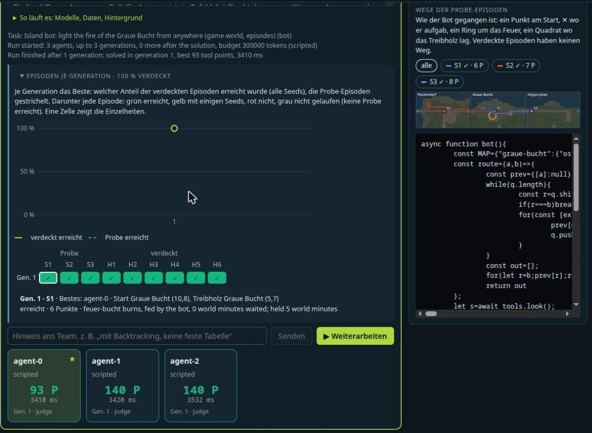

*Abbildung 3 (Schritte 1 und 2), „Inselbot“. Die Fortschrittskurve zeigt den Anteil der erreichten verdeckten Episoden
pro Generation. Die Matrix unterscheidet offengelegte Episoden (S) und verdeckte Episoden (H). Rechts sind die Wege des besten
Beitrags auf der Grauen Insel eingezeichnet. Jede Episode hat eine eigene Farbe. Ein Ring markiert die Feuerstelle.*

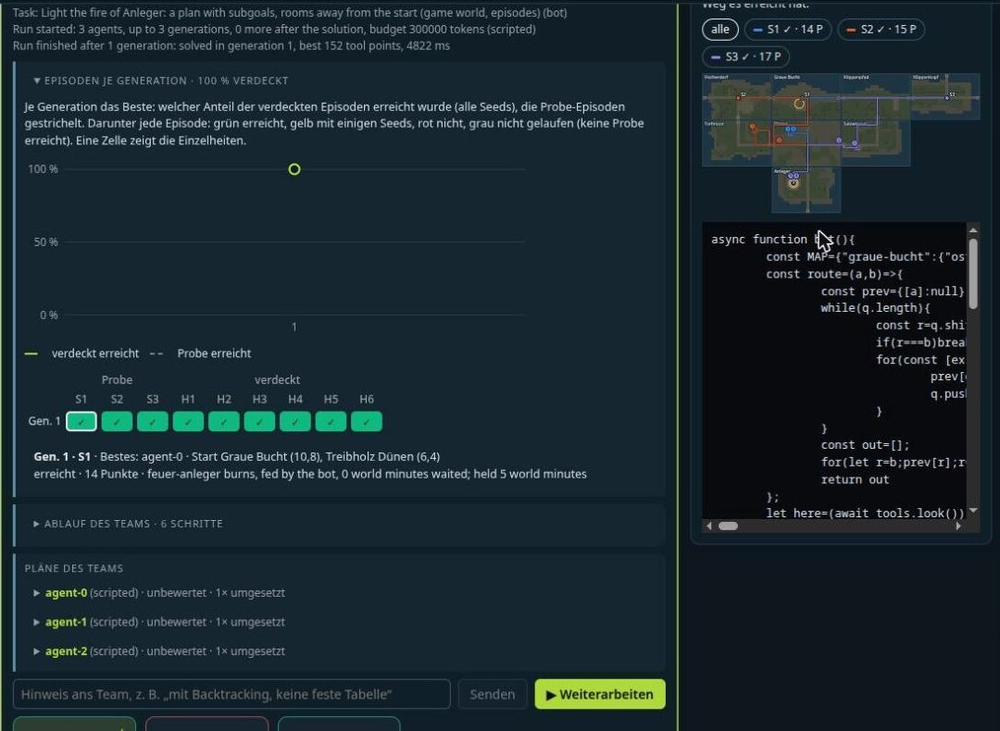

*Abbildung 4 (Schritt 4), „Den Feuerkorb am Anleger entzünden“. Die Pläne des Teams und die Wege mit den nummerierten
Marken, wo jedes Zwischenziel erreicht wurde. Zwei der drei Beiträge erreichten alle neun Episoden (152 Punkte); einer
erreichte keine.*

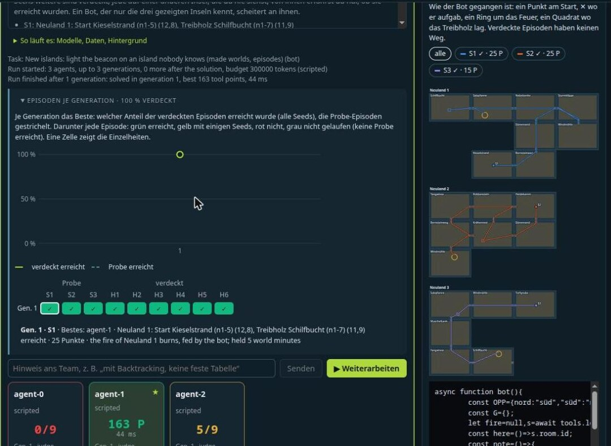

*Abbildung 5 (Schritt 6), „Neue Inseln“. Drei erzeugte Inseln im Atlas, untereinander, mit den Wegen des Erkunders. Auf
den Karten: Der Erkunder erreicht 9/9 (163 Punkte), der Wanderer ohne Gedächtnis 5/9 und die Karte der Grauen Insel
0/9.*

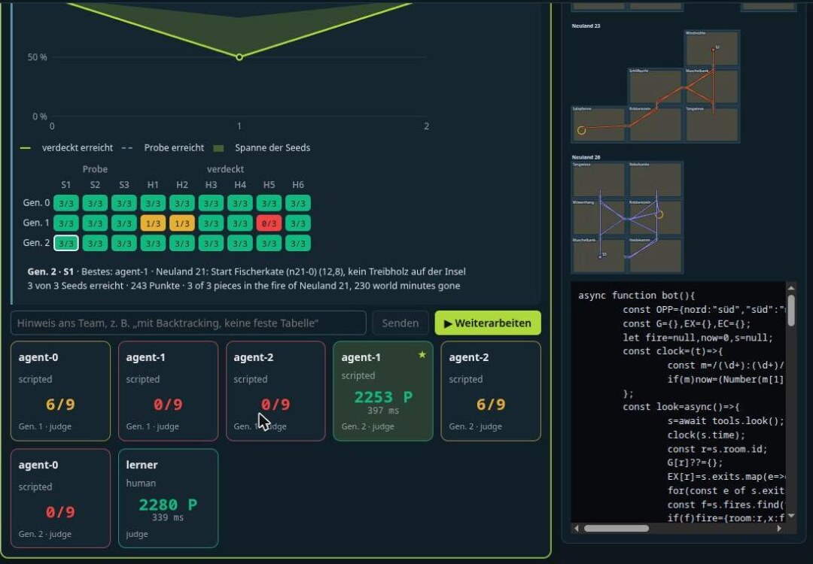

*Abbildung 6 (Schritt 7), „Die Flut lernen“.*

- *Generation 1: die Tour ohne Modell (6/9, gelb bei Episoden, die nur bei einem Teil der Seeds bestanden wurden) und der Camper (0/9).*
- *Generation 2: das Gesetz im Code (9/9, 2253 Punkte).*
- *Die Karte „lerner“ zeigt den nachträglich eingereichten lernenden Bot. Er las die Beobachtungen, die der Lauf protokolliert hatte,
  und erreichte 9/9 (2280 Punkte). Die Seite zählt einen von Hand abgegebenen Beitrag als Generation 0. Deshalb steht der Beitrag in der obersten Zeile der Matrix.*

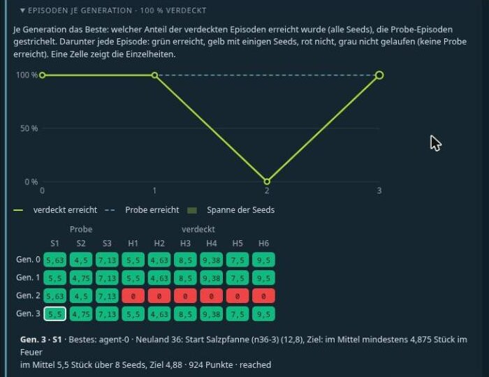

*Abbildung 7 (Schritt 8), „Die Chancen der Flut“. In dieser Aufgabe zeigt eine Zelle die mittlere Zahl der Stücke über
die 8 Seeds; grün, wo sie den Zielwert der Episode erreicht. Die Detailzeile darunter nennt den Mittelwert, die Seeds und
den Zielwert.*

- *Generation 1: Das Gesetz im Code erreicht jeden Zielwert.*
- *Generation 2: die beobachteten Raum-IDs. Sie erreichen die drei offengelegten Inseln und bringen auf den verdeckten
  nichts.*
- *Generation 3: wieder das Gesetz, von einem anderen Agenten.*
- *Generation 0 (oberste Zeile): der nachträglich eingereichte lernende Bot. Er schätzte die Chancen aus den 24 Tagen, die der
  Lauf protokolliert hatte, und erreichte jeden Zielwert (7714 Punkte).*

Die Abbildungen 8 bis 15 zeigen „Die Flut lernen“ und „Die Chancen der Flut“ nach den vier Änderungen. Die
Abbildungen 16 bis 19 zeigen „Die Ufer der Flut“. Neben jedem deutschen Screenshot liegt eine englische Fassung
als `*-en.jpg`. Zu sehen sind die Zusammenfassung, die Fortschrittskurve für die verdeckten Episoden und die
Episodenmatrix mit dem besten Beitrag je Generation. Die Detailzeile gehört zur weiß umrandeten Zelle.

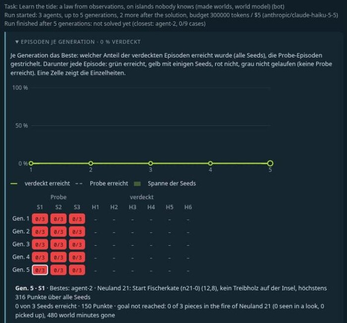

*Abbildung 8. Haiku 5.5 auf „Die Flut lernen“: In fünf Generationen bestand kein Bot eine
offengelegte Episode. Daher starteten die verdeckten Episoden nicht.*

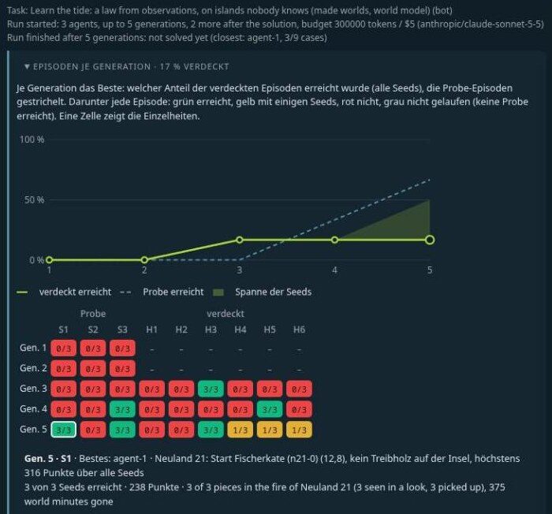

*Abbildung 9. Sonnet 5.5 auf „Die Flut lernen“: einzelne Episoden ab Generation 3, höchstens 3 von 9; gelb, wo nur
einige Seeds erreicht wurden.*

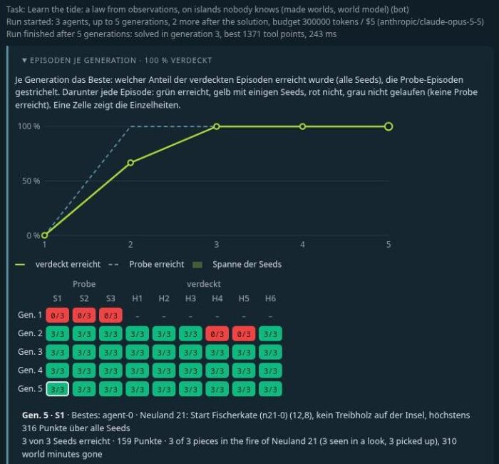

*Abbildung 10. Opus 5.5 auf „Die Flut lernen“: 7 von 9 in Generation 2, der ersten, die die Beobachtungen sah; 9 von 9
ab Generation 3, mit dem Gesetz in seinem Code (1371 Punkte).*

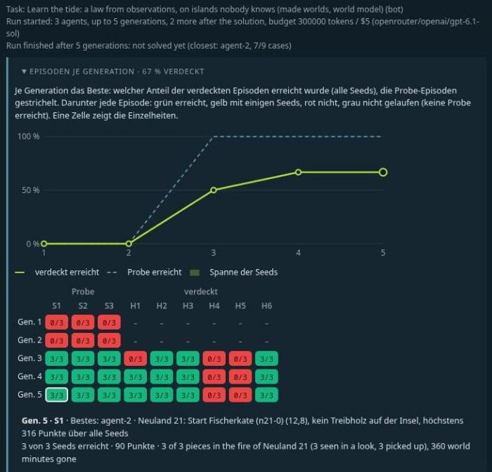

*Abbildung 11. GPT-6.1 Sol auf „Die Flut lernen“: nichts bis Generation 3 (die Bots standen auf dem Feld des Feuers),
dann 6 und 7 von 9; die verdeckten H4 und H5 bleiben rot.*

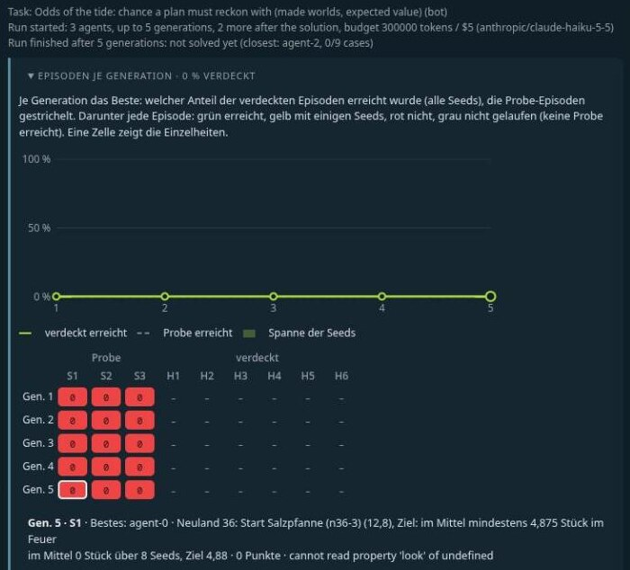

*Abbildung 12. Haiku 5.5 auf „Die Chancen der Flut“: Eine Zelle ist die mittlere Zahl der Stücke über 8 Seeds; jede
offengelegte Episode 0. Die Detailzeile zeigt den häufigsten Fehlschlag, `bot(tools)` mit undefiniertem `tools`.*

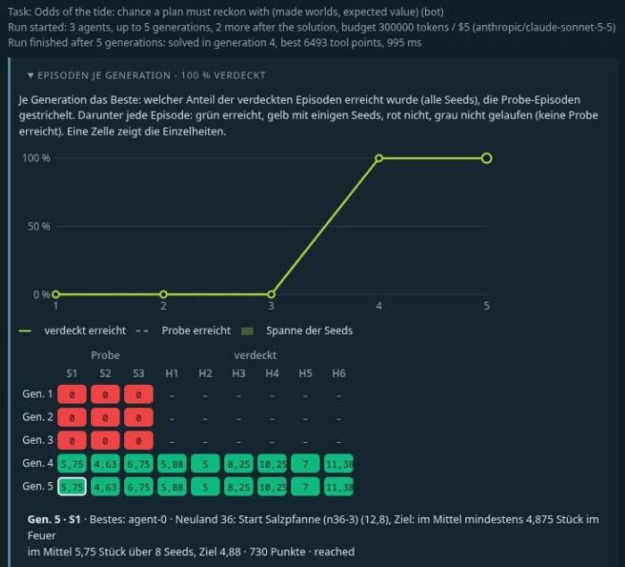

*Abbildung 13. Sonnet 5.5 auf „Die Chancen der Flut“: nichts in den Generationen 1 bis 3 (die Bots scheiterten an den
Grenzen des Spiels und am Ausgangsbefehl), jeder Zielwert ab Generation 4.*

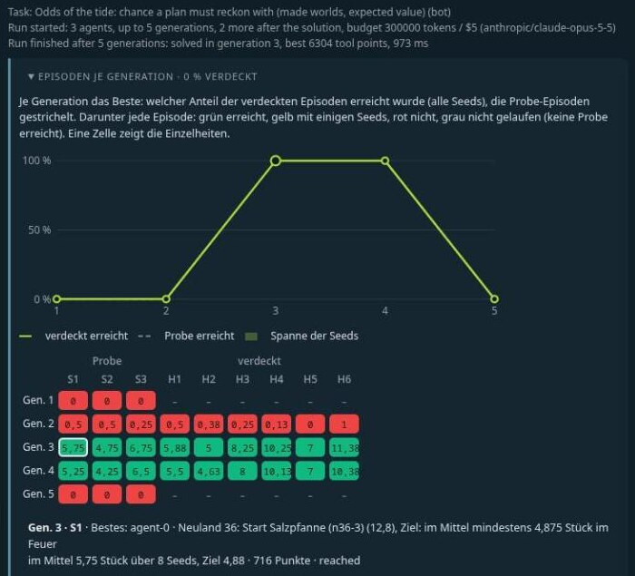

*Abbildung 14. Opus 5.5 auf „Die Chancen der Flut“: jeder Zielwert in den Generationen 3 und 4; die Bots von Generation
5 ließen den Look vor dem Nehmen weg und brachten nichts. Der Sieger des Laufs ist der von Generation 3 (6304 Punkte,
die gerahmte Zelle).*

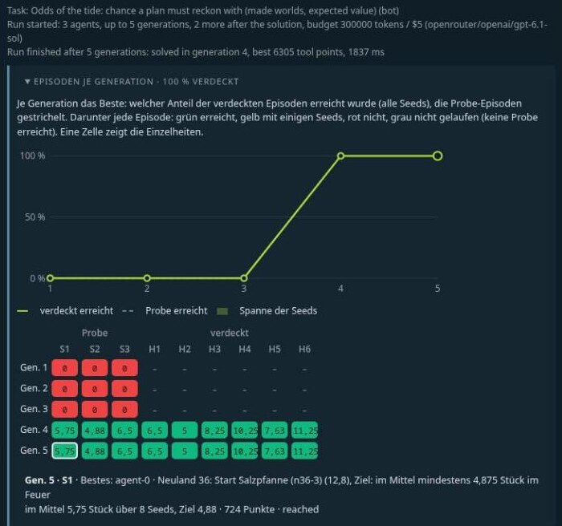

*Abbildung 15. GPT-6.1 Sol auf „Die Chancen der Flut“: jeder Zielwert ab Generation 4, mit den aus `observations()`
gezählten Chancen (6305 Punkte).*

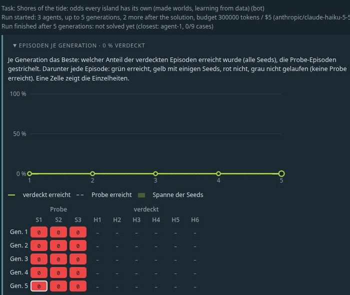

*Abbildung 16. Haiku 5.5 auf „Die Ufer der Flut“: 0 in jeder Episode jeder Generation; die Bots endeten nach einem Blick
und dem Logbuch.*

*Abbildung 17. Sonnet 5.5 auf „Die Ufer der Flut“: durchweg 0; seine Bots lasen das Logbuch und warteten, erreichten aber
nie einen Raum mit Stücken.*

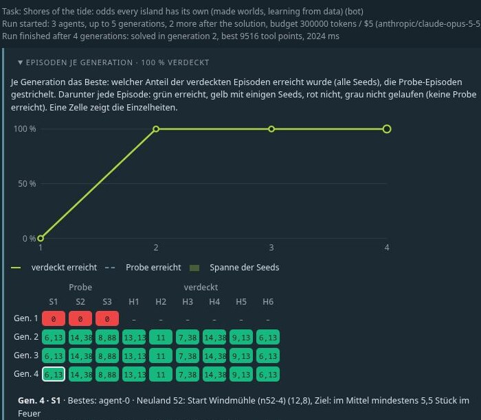

*Abbildung 18. Opus 5.5 auf „Die Ufer der Flut“: jeder Zielwert ab Generation 2, mit der Chance jedes Raums aus dem
Logbuch gezählt (9516 Punkte).*

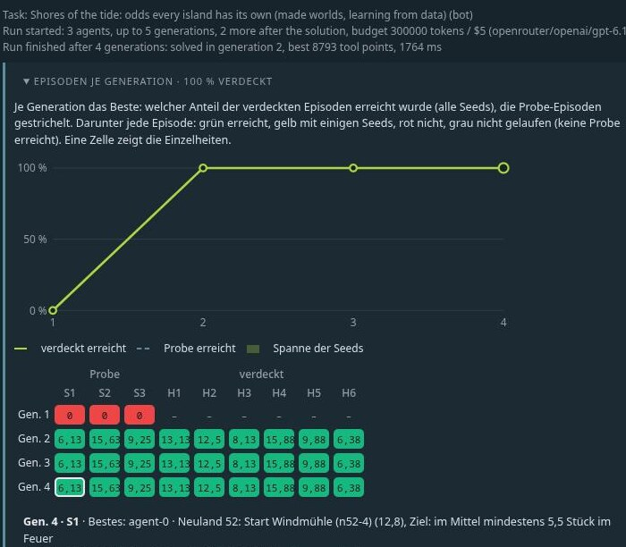

*Abbildung 19. GPT-6.1 Sol auf „Die Ufer der Flut“: jeder Zielwert ab Generation 2; Karte und Chancen aus dem Logbuch,
eine neue Runde vor jeder Flut (8793 Punkte, weniger als die 9033 des Referenzplans).*

## Offene Fragen

- Wie verlässlich sind die beiden Jev-Hybride über Wiederholungen und auf den 94 frischen Inseln? Getrennte
  Versuche sollten Zwischenzielwahl und zusätzliche Prüfung untersuchen. Für die Erkennung unsicherer Pläne
  braucht es sichere und unsichere Kandidaten.
- Wie wirken sich konkrete Tool-Beispiele in Schritt 7 und 8 aus? Sollen sie bei Bot-Aufgaben auf generierten
  Inseln zum Standard gehören? Warum bewegen sich Haikus Bots auch mit einem Beispiel nicht?
- Wie stabil sind die Ergebnisse von Schritt 7 und 8 über weitere Modellläufe? GPT erreichte bei „Die Flut lernen“
  7 von 9 Episoden im ersten Lauf und 2 von 9 im zweiten. Schritt 9 hat inzwischen zehn Läufe je Modell und Bedingung.
- Wie reagieren Bots, wenn sich die Flutregel zwischen Generationen ändert? Ein Vergleich könnte zeigen, wann eine
  neue Schätzung über `observations()` einer fest codierten Regel überlegen ist.
- Welchen Beitrag leisten die Beobachtungen im Prompt, das längere Codefenster, die genaueren Fehlermeldungen und
  das Punktelimit jeweils für sich?
- Kann der persistente Agentenpfad den letzten Code abgeben, wenn seine eigene Prüfung bis zum Ende des
  Anfragebudgets fehlschlägt?
- Wie lassen sich Zielmengen wie „Irgendein Feuer auf der Insel brennt“ und Ziele entgegen der üblichen Richtung
  behandeln? Auch Alchaers Beitrag lässt beides offen.
- Wie ändern sich die Routen, wenn ein Quantil der Ausbeute den Erfolg bestimmt? Ein solcher Zielwert würde auch
  die Streuung der Ergebnisse über die Seeds berücksichtigen.
