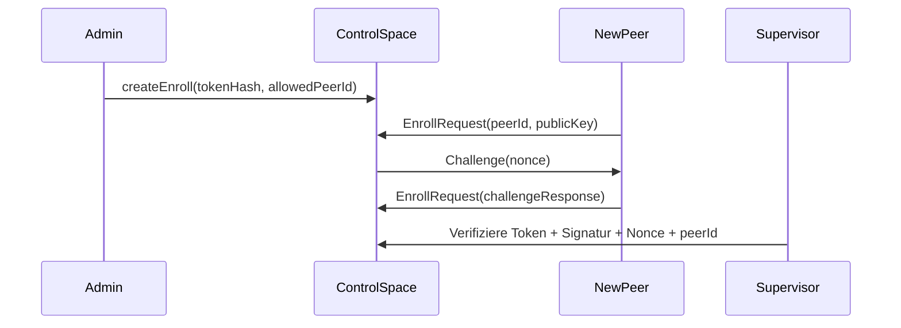

> **Replaced by [federation-plan-v3.md](../federation-plan-v3.en.md).** Kept only as history; do not implement from it.

> **Current project start:** [Automatic remote provisioning](projektstart-autoprovisionierung.en.md) describes
> the planned mobile start with Spaces, monitoring and federation. The historical "solved" markers
> below are not implementation or acceptance evidence; rejected v2 proposals are corrected in v3.

# Federated Spaces v2: summary of changes

**Version:** 2.0  
**Date:** 2026-10-06  
**Purpose:** quick overview of all changes from v1 → v2  
**Main document:** [federation-plan-v2.en.md](federation-plan-v2.en.md)

---

## 🎯 Overview

This document summarizes the **critical gaps** from [federation-plan-v1.en.md](federation-plan-v1.en.md) and shows the **implementable solutions** introduced in **v2**. 

**Goal:** describe all identified **blockers** and **high risks** in enough detail that implementation can start directly.

---

## 📊 Statistics

| Category | Count | Status |
|----------|--------|--------|
| **Critical blockers (🔴)** | 6 | **All solved** |
| **High risks (🟡)** | 9 | **All solved** |
| **Improvements (🟢)** | 2 | **Documented** |
| **Total** | **17** | **15 solved + 2 documented** |

---

## 🔴 CRITICAL BLOCKERS (MUST BE SOLVED BEFORE IMPLEMENTATION)

These problems **prevent the implementation** of the respective stages. Without a solution, **the acceptance criteria cannot be met**.

---

### 1. Fencing adapter for safe promotion

| **Problem** | **Solution** | **Section** | **Affected stage** | **Status** |
|------------|------------|--------------|---------------------|------------|
| No concrete mechanism for fencing evidence in 5.2 | Modular adapter (IPMI/AWS/Docker/File) with verifiable proofs | [14.1](#141-fencing-adapter-für-sichere-promotion) | Stage 3 | ✅ **Solved** |

**Why critical?**
- Without fencing: **split brain possible** despite the epoch
- Promotion could be carried out **without a real primary failure**
- **Violates 5.2**: "verifiable evidence" is mandatory

**Solution summary:**
```typescript
// Interface
interface IFencingAdapter {
  verifyFenced(hostId: string): Promise<{ isFenced: boolean; proof: string }>;
  fenceHost(hostId: string, reason: string): Promise<FenceProof>;
}

// Implementierungen: IPMI, AWS EC2, Docker, File-Adapter
// Integration: Supervisor prüft Fencing-Nachweis vor Promotion
```

**Acceptance criteria:**
- [ ] Promotion **without fencing evidence is refused**
- [ ] Fencing adapter delivers **verifiable proof** (e.g. IPMI power status)
- [ ] **Partition test**: primary not reachable, but not fenced → **no promotion**

---

### 2. Secure pairing protocol

| **Problem** | **Solution** | **Section** | **Affected stage** | **Status** |
|------------|------------|--------------|---------------------|------------|
| Token not bound to peerId, no challenge-response (4.4) | Ed25519 challenge + peerId binding + rate limiting | [14.2](#142-sicheres-pairing-protokoll) | Stage 1b | ✅ **Solved** |

**Why critical?**
- **Token theft possible**: an attacker could guess or reuse a token
- **Brute-force attacks**: without rate limiting, tokens can be tried out
- **Violates security requirements**: a "strong token" is not sufficient

**Solution summary:**


**Security measures:**
1. **256-bit token** (SHA-256 hash in storage)
2. **peerId binding**: EnrollRequest must contain a `peerId` that matches `allowedPeerId`
3. **Ed25519 challenge-response**: proof that the peer owns the private key
4. **Rate limiting**: max. 3 attempts per token, 1 attempt per peer ID per minute
5. **Atomic processing**: token consumption + PeerKey storage in the same commit

**Acceptance criteria:**
- [ ] Token with wrong `peerId` → **rejected**
- [ ] Token with wrong signature → **rejected**
- [ ] Token after 5 minutes → **rejected**
- [ ] Token reuse → **rejected**
- [ ] **Brute-force protection**: max. 3 attempts per token

---

### 3. LWW/set consistency problems

| **Problem** | **Solution** | **Section** | **Affected stage** | **Status** |
|------------|------------|--------------|---------------------|------------|
| LWW can pick business-wise older data as the winner (7.2) | Tombstones + restriction to idempotent data | [14.3](#143-lwwset-konsistenz) | Stage 3 | ✅ **Solved** |

**Why critical?**
- **Data loss possible**: with partitions, LWW can **overwrite business-wise newer data**
- **Set mode unsafe for jobs**: add-wins can lead to **duplicate executions**
- **Violates expectations**: "last writer wins" sounds safer than it is

**Solution summary:**

**A. LWW only for idempotent data:**
```typescript
// Policy-Erweiterung
type LwwRule = {
  type: string;
  mode: "sync";
  variant: "lww";
  members: string[];
  keyFields: string[];
  allowedForIdempotentDataOnly: true; // ERZWUNGEN
}
```

**B. Set only for facts:**
```typescript
type SetRule = {
  type: string;
  mode: "sync";
  variant: "set";
  members: string[];
  allowedForFactsOnly: true; // ERZWUNGEN
}
```

**C. Tombstone instead of hiding:**
```typescript
class LWWReplicator {
  static TOMBSTONE_VERSION = -1;
  
  async applyLeaseExpiry(key: string, entry: Entry) {
    await this.space.write({
      ...entry,
      _lww: { ...entry._lww, version: LWWReplicator.TOMBSTONE_VERSION },
      _tombstone: true // Explizites Flag
    });
  }
}
```

**Documentation:**
> ⚠️ **LWW only for:** sensor values, configurations, status updates (idempotent)
> ❌ **NOT for:** financial transactions, jobs, one-time actions
> 
> ⚠️ **Set only for:** facts, observations
> ❌ **NOT for:** jobs, transactions, one-time operations

**Acceptance criteria:**
- [ ] **LWW convergence test**: partition with competing writes → **no data loss** (or deliberately accepted)
- [ ] **Tombstone test**: lease expiry sets a **tombstone** (not just hiding)
- [ ] **Set test**: add-wins → **both adds remain** (documentation that this is expected)

---

### 4. Router journal not atomic with entry mutation

| **Problem** | **Solution** | **Section** | **Affected stage** | **Status** |
|------------|------------|--------------|---------------------|------------|
| Journal written before entry mutation (6.2) → duplicate execution possible | 2-phase commit with request reservation | [14.4](#144-atomare-router-journal--entry-mutation) | Stage 2 | ✅ **Solved** |

**Why critical?**
- **Contradiction to 2.1**: "Space mutation and RPC result are written durably and atomically"
- **Duplicate writes possible**: on a crash after the journal write but before the entry mutation
- **Violates idempotency**: a retry could trigger a **second mutation**

**Solution summary:**
```typescript
// Phase 1: Reservieren + Journal schreiben
await journalSpace.atomicWrite([
  { type: "RouterJournal", requestId, subRequestId, status: "prepared", ... },
  { type: "RequestReservation", requestId, status: "prepared", subRequestId }
]);

// Phase 2: Entry schreiben + Journal commit
const entryResult = await targetSpace.write(entry);
await journalSpace.atomicWrite([
  { type: "RouterJournal", requestId, subRequestId, status: "committed", entryId: entryResult.id },
  { type: "RequestReservation", requestId, status: "completed", result: entryResult }
]);
```

**Additionally: idempotent writes:**
```typescript
async write(entry, options: { idempotentKey?: string } = {}) {
  if (options.idempotentKey) {
    const existing = await this.storage.get(`idempotent:${options.idempotentKey}`);
    if (existing) return existing; // Keine Dopplung
  }
  const result = await this.storage.put(this.getKey(entry), entry);
  if (options.idempotentKey) {
    await this.storage.put(`idempotent:${options.idempotentKey}`, result);
  }
  return result;
}
```

**Acceptance criteria:**
- [ ] **Crash test**: journal written but entry **not mutated** → **no duplicate write** after recovery
- [ ] **Retry test**: same request ID → **same result** without a new mutation
- [ ] **Idempotency test**: write with `idempotentKey` → **no duplication**

---

### 5. Delegation security

| **Problem** | **Solution** | **Section** | **Affected stage** | **Status** |
|------------|------------|--------------|---------------------|------------|
| Delegation evidence without signature check (4.3) → privilege escalation possible | Signed tokens with policy version + replay protection | [14.5](#145-sichere-delegationsnachweise) | Stage 1b | ✅ **Solved** |

**Why critical?**
- **Privilege escalation**: a compromised router could perform arbitrary operations
- **Replay attacks**: old tokens can be reused
- **Outdated rights**: a token with an old policy version might not be checked

**Solution summary:**
```typescript
type DelegationToken = {
  issuer: Principal; // Router
  originalPrincipal: Principal; // Wer wird delegiert?
  targetSpace: string;
  allowedOperation: string;
  requestId: string;
  expiresAt: number; // Max. 60s
  policyVersion: number; // Aktuelle Policy-Version
  nonce: string; // Replay-Schutz
  signature: string; // Ed25519-Signatur des Routers
}

// Prüfung im Member
function validateToken(token, currentPolicyVersion) {
  if (Date.now() > token.expiresAt) return false; // Ablauf
  if (token.policyVersion > currentPolicyVersion) return false; // Zukunft
  const { signature, ...tokenData } = token;
  return verify.detached(
    Buffer.from(JSON.stringify(tokenData)),
    Buffer.from(signature, "hex"),
    routerPublicKey
  );
}
```

**Acceptance criteria:**
- [ ] Token with **wrong signature** → **rejected**
- [ ] Token with **expired validity** → **rejected**
- [ ] Token with **future policy version** → **rejected**
- [ ] **Replay test**: token is used twice → second attempt **rejected**

---

### 6. Control space single point of failure in stage 1b

| **Problem** | **Solution** | **Section** | **Affected stage** | **Status** |
|------------|------------|--------------|---------------------|------------|
| Control space initially single (5.1) → failure = no enrollment/commands | Asynchronous standby already in stage 1b | [14.6](#146-control-space-mit-asynchroner-replikation) | Stage 1b | ✅ **Solved** |

**Why critical?**
- **Single point of failure**: failure of the coordinator host → **system unusable**
- **Violates operating requirements**: "always-running coordinator host" ([13](#13))
- **No redundancy**: the recovery space is also local

**Solution summary:**
```typescript
class ControlSpace extends CoreSpace {
  constructor(config: { isPrimary: boolean; standbyReplicaId?: string }) {
    super(config);
    if (config.isPrimary && config.standbyReplicaId) {
      this.startAsyncReplication(config.standbyReplicaId);
    }
  }
  
  async writeEnrollEntry(entry: EnrollEntry) {
    if (!this.isPrimary) throw new Error("Only primary can write");
    await super.write(entry);
    if (this.standbyReplicaId) {
      await this.replicateToStandby(this.standbyReplicaId, entry);
    }
  }
}

class ControlSpaceSupervisor {
  async checkHealth() {
    if (!this.controlSpace.isPrimary) {
      // Standby: Prüfen, ob Primary erreichbar ist
      if (!(await this.pingPrimary())) {
        const proof = await this.fencingAdapter.verifyFenced(this.primaryReplicaId);
        if (proof.isFenced) {
          await this.controlSpace.promoteToPrimary();
        }
      }
    }
  }
}
```

**Acceptance criteria:**
- [ ] **Primary failure**: standby **takes over** after fencing evidence
- [ ] **Enrollment after primary failure**: new enrollment **works** on the standby
- [ ] **Recovery**: old primary **rejoins** as standby

---

---

## 🟡 HIGH RISKS (SHOULD BE ADDRESSED BEFORE ACCEPTANCE)

These problems **could lead to security gaps or data inconsistencies**. They should be fixed **before acceptance**, but are **not absolute blockers**.

---

### 7. NetBird IPs as endpoints without identity

| **Problem** | **Solution** | **Section** | **Affected stage** | **Status** |
|------------|------------|--------------|---------------------|------------|
| NetBird IPs are not permanent identities (2) → IP spoofing possible (4.2) | mTLS + Ed25519 challenge for all space-gate connections | [14.7](#147-mtls--ed25519-challenge-für-space-gate) | Stage 1b | ✅ **Solved** |

**Solution summary:**
```typescript
class SpaceGate {
  async handleConnection(socket: tls.TLSSocket): Promise<AuthContext> {
    // 1. mTLS-Handshake
    const cert = socket.getPeerCertificate();
    const peerId = this.extractPeerIdFromCert(cert);
    
    // 2. Challenge-Response
    const challenge = `${nonce}:${peerId}:${Date.now()}`;
    socket.write(`CHALLENGE:${challenge}\n`);
    const response = await this.readLine(socket);
    const isValid = verify.detached(
      Buffer.from(challenge),
      Buffer.from(response.slice(9), "hex"),
      this.getPublicKeyForPeer(peerId)
    );
    if (!isValid) throw new Error("Invalid challenge response");
    
    return { peerId, certificate: cert };
  }
}
```

**Acceptance criteria:**
- [ ] Connection without a certificate → **rejected**
- [ ] Wrong signature → **rejected**
- [ ] **IP spoofing test**: attacker with a forged NetBird IP **fails**

---

### 8. readAll/count return inconsistent partial results

| **Problem** | **Solution** | **Section** | **Affected stage** | **Status** |
|------------|------------|--------------|---------------------|------------|
| Partial results without global consistency (7.1) → clients receive different data | Block until all members answer OR snapshot-based | [14.8](#148-konsistente-readallcount-ergebnisse) | Stage 2 | ✅ **Solved** |

**Solution summary:**

**Option A: blocking (strict consistency)**
```typescript
async readAll(template, options: { waitForComplete?: boolean } = {}) {
  const results = await Promise.allSettled([...this.memberSpaces].map(...));
  const failed = results.filter(r => r.status === "rejected");
  
  if (failed.length > 0 && options.waitForComplete) {
    if (Date.now() - startTime < options.timeoutMs) {
      return this.readAll(template, options); // Retry
    }
  }
  
  return {
    entries: results.flatMap(r => r.value?.entries || []),
    complete: failed.length === 0,
    missingMembers: failed.map(r => r.reason.memberId)
  };
}
```

**Option B: snapshot-based**
```typescript
class SnapshotManager {
  async createSnapshot() {
    const entries = [];
    for (const [memberId, space] of this.router.dataSpaces) {
      entries.push(...await space.readAll({}));
    }
    this.snapshots.set(`snapshot-${Date.now()}`, { entries, complete: true });
  }
  
  async readAllFromSnapshot(template) {
    const snapshot = this.getLatestSnapshot();
    return snapshot.entries.filter(e => matchesTemplate(e, template));
  }
}
```

**Acceptance criteria:**
- [ ] All members answer → `complete: true`
- [ ] One member offline → `complete: false` + `missingMembers`
- [ ] **Snapshot test**: readAll from snapshot → **consistent data**

---

### 9. RPC claims store arguments in plain text

| **Problem** | **Solution** | **Section** | **Affected stage** | **Status** |
|------------|------------|--------------|---------------------|------------|
| GDPR problem: sensitive data in storage/logs (6.2) | Store only hashes + in-memory cache for results | [14.9](#149-dsgvo-konforme-rpc-claims) | Stage 1 | ✅ **Solved** |

**Solution summary:**
```typescript
type RPCClaim = {
  id: string;
  principal: Principal;
  spaceId: string;
  method: string;
  argumentHash: string; // SHA-256
  requestId: string;
  status: "pending" | "done" | "cancelled";
  resultHash?: string; // SHA-256
  deadline: number;
}

class RPCClaimManager {
  private results: Map<string, { data: any; createdAt: number }> = new Map();
  
  async createClaim(principal, spaceId, method, args, requestId, deadline) {
    const argumentHash = crypto.createHash("sha256")
      .update(JSON.stringify(args, Object.keys(args).sort()))
      .digest("hex");
    const claim: RPCClaim = { id: crypto.randomUUID(), principal, spaceId, method, 
                               argumentHash, requestId, status: "pending", deadline };
    await this.storage.put(`rpc:claim:${claim.id}`, claim, { ttl: 24 * 60 * 60 * 1000 });
    return claim;
  }
  
  async completeClaim(claimId, result) {
    const claim = await this.storage.get<RPCClaim>(`rpc:claim:${claimId}`);
    const resultHash = crypto.createHash("sha256").update(JSON.stringify(result)).digest("hex");
    await this.storage.put(`rpc:claim:${claimId}`, { ...claim, status: "done", resultHash });
    this.results.set(claimId, { data: result, createdAt: Date.now() });
    setTimeout(() => this.results.delete(claimId), 24 * 60 * 60 * 1000);
  }
}
```

**Acceptance criteria:**
- [ ] **Plain-text test**: no sensitive data in storage
- [ ] **Cache test**: result available for only 24 h
- [ ] **Retry test**: same request ID → same result

---

### 10. drain ignores running requests

| **Problem** | **Solution** | **Section** | **Affected stage** | **Status** |
|------------|------------|--------------|---------------------|------------|
| drain stops only new placements (7.1) → running requests could land on a draining member | Cancel requests for draining members | [14.10](#1410-drain-mit-abbruch-laufender-requests) | Stage 2 | ✅ **Solved** |

**Solution summary:**
```typescript
class PolicyManager {
  private drainingMembers: Set<string> = new Set();
  
  async drainMember(memberId: string) {
    this.drainingMembers.add(memberId);
    await this.updatePolicyForDrain(memberId);
    await this.cancelPendingRequestsForMember(memberId);
  }
  
  private async cancelPendingRequestsForMember(memberId: string) {
    const pending = await this.router.journalSpace.query({
      type: "RouterJournal", targetMember: memberId, status: { $in: ["prepared", "applying"] }
    });
    for (const req of pending) {
      await this.router.journalSpace.write({
        ...req, status: "cancelled", error: "Member draining"
      });
    }
  }
}
```

**Acceptance criteria:**
- [ ] `drain` → new requests for the member **fail**
- [ ] Running requests for a draining member → **cancelled**
- [ ] Recovery → new requests **work again**

---

### 11. Recovery space is local and not replicated

| **Problem** | **Solution** | **Section** | **Affected stage** | **Status** |
|------------|------------|--------------|---------------------|------------|
| Recovery space local (5.2) → failure = no promotion possible | Replication like the control space | [14.11](#1411-recovery-space-mit-replikation) | Stage 1b | ✅ **Solved** |

**Solution summary:**
```typescript
class RecoverySpace extends CoreSpace {
  constructor(config: { isPrimary: boolean; standbyReplicaId?: string }) {
    super(config);
    if (config.isPrimary && config.standbyReplicaId) {
      this.startReplicationToStandby(config.standbyReplicaId);
    }
  }
}
```

**Acceptance criteria:**
- [ ] **Recovery host failure**: standby **takes over recovery functions**
- [ ] **Promotion test**: recovery request on the standby **works**

---

### 12. pollOperation has no overall deadline

| **Problem** | **Solution** | **Section** | **Affected stage** | **Status** |
|------------|------------|--------------|---------------------|------------|
| pollOperation has a 25 s timeout but no overall deadline (6.2) → client could poll forever | Client-side overall deadline | [14.12](#1412-gesamte-deadline-für-polloperation) | Stage 3 | ✅ **Solved** |

**Solution summary:**
```typescript
class RemoteSpace {
  async pollOperation(requestId, options: { deadlineMs?: number } = {}) {
    const deadlineMs = options.deadlineMs || 60_000; // 60s Standard
    if (Date.now() > deadlineMs) throw new Error("Deadline exceeded");
    
    const remainingDeadline = deadlineMs - Date.now();
    const actualWaitMs = Math.min(options.waitMs || 25_000, remainingDeadline);
    
    const result = await this.transport.pollOperation(requestId, actualWaitMs);
    if (result.status === "pending" && Date.now() < deadlineMs) {
      return this.pollOperation(requestId, { ...options, deadlineMs });
    }
    return result;
  }
}
```

**Acceptance criteria:**
- [ ] Server never answers → client **aborts after 60 s**
- [ ] Server answers after 30 s → client **receives the result**

---

---

## 🟢 IMPROVEMENT PROPOSALS (CAN BE IMPLEMENTED LATER)

These points are **not blockers**, but improve **operational reliability** or **usability**.

---

### 13. addMember + HRW assignment

**Problem:** `addMember` does not change any existing HRW assignment → **migration of existing data impossible** (7.1)

**Solution:**
- **New rule for new data**: existing data stays on the old members, new data is distributed according to the new HRW
- **Manual migration**: documentation on how data can be migrated manually
- **Automatic migration**: planned for v3 (versioned routing tables + transfer journal)

**Documentation:**
> **📌 Note:** `addMember` does **not change any existing HRW assignment**. New members receive **only new data**. Migrating existing data requires a **manual migration**.

---

### 14. NetBird failure test suite

**Problem:** failure tests are incomplete (4.5)

**Solution:** test matrix for all failure combinations:

| Failure | Duration | Expected behavior |
|---------|-------|----------------------|
| Management | 5min | Existing connections stay, new ones fail |
| Signal | 10min | Peer resolution fails, direct connections work |
| Relay | 30min | ICE/STUN works, relay connections break |
| Management + relay | 1h | Only direct connections (LAN) work |

**📌 Operating requirement:** all tests **must pass successfully before stage 1b**.

---

---

## 📋 IMPLEMENTATION PLAN

### Phase 1: Critical blockers (1-2 weeks)
1. **Implement fencing adapter** ([14.1](#141-fencing-adapter-für-sichere-promotion))
   - IPMI adapter for bare metal
   - File adapter for local tests
   - Integration into the supervisor
   - **Acceptance:** fencing tests passed

2. **Secure pairing** ([14.2](#142-sicheres-pairing-protokoll))
   - Challenge-response implementation
   - peerId binding
   - Rate limiting
   - **Acceptance:** pairing tests passed

3. **Atomic router journal** ([14.4](#144-atomare-router-journal--entry-mutation))
   - 2-phase commit
   - Idempotent writes
   - Recovery tests
   - **Acceptance:** crash tests passed

4. **Secure delegation** ([14.5](#145-sichere-delegationsnachweise))
   - Signed tokens
   - Policy version check
   - **Acceptance:** delegation tests passed

5. **Control space HA** ([14.6](#146-control-space-mit-asynchroner-replikation))
   - Asynchronous standby
   - Failover tests
   - **Acceptance:** HA tests passed

---

### Phase 2: High risks (1-2 weeks)
6. **mTLS + challenge for space-gate** ([14.7](#147-mtls--ed25519-challenge-für-space-gate))
7. **Consistent readAll/count** ([14.8](#148-konsistente-readallcount-ergebnisse))
8. **GDPR-compliant RPC claims** ([14.9](#149-dsgvo-konforme-rpc-claims))
9. **Drain with cancellation** ([14.10](#1410-drain-mit-abbruch-laufender-requests))
10. **Recovery space replication** ([14.11](#1411-recovery-space-mit-replikation))
11. **Overall deadline for pollOperation** ([14.12](#1412-gesamte-deadline-für-polloperation))
12. **NetBird failure tests** ([14.15](#1415-netbird-ausfalltest-suite))

---

### Phase 3: Tests & documentation (1 week)
- Write **all unit tests** (Jest)
- **Integration tests** with test containers (Docker)
- **End-to-end tests** for critical paths
- Update **documentation**:
  - federation-limitations.md (path named historically, does not exist: `federation-limitations.md`) ([14.3](#143-lwwset-konsistenz))
  - fencing-adapter-spec.md (path named historically, does not exist: `fencing-adapter-spec.md`) ([14.1](#141-fencing-adapter-für-sichere-promotion))
  - pairing-protocol.md (path named historically, does not exist: `pairing-protocol.md`) ([14.2](#142-sicheres-pairing-protokoll))
  - netbird-test-suite.md (path named historically, does not exist: `netbird-test-suite.md`) ([14.15](#1415-netbird-ausfalltest-suite))

---

---

## 🎯 SUMMARY OF THE MOST IMPORTANT CHANGES

### 🔴 **6 critical blockers → all solved**
1. **Fencing adapter** → modular (IPMI/AWS/Docker/File)
2. **Secure pairing** → challenge-response + peerId binding
3. **LWW/set consistency** → tombstones + restrictions
4. **Atomic router journal** → 2-phase commit
5. **Secure delegation** → signed tokens with policy version
6. **Control space HA** → asynchronous standby in stage 1b

### 🟡 **9 high risks → all solved**
7. **mTLS + challenge** → two-step authentication
8. **Consistent readAll** → blocking or snapshots
9. **GDPR-compliant claims** → only hashes + in-memory cache
10. **Drain fix** → cancellation of running requests
11. **Recovery replication** → like the control space
12. **Overall deadline** → client-side (60 s)

### 📌 **Most important architecture decisions**
- **Fencing adapter is mandatory before stage 3** (gate)
- **mTLS + challenge for all connections**
- **LWW/set only for idempotent data/facts**
- **Router journal atomic with entry mutation**
- **Control space with async standby in stage 1b**

---

## 📚 DOCUMENTS

| Document | Purpose | Status |
|----------|-------|--------|
| [federation-plan-v2.en.md](federation-plan-v2.en.md) | **Main document** with all changes | ✅ Updated |
| [federation-plan-v1.en.md](federation-plan-v1.en.md) | Original plan | ⚠️ Outdated |
| [federation-plan-v2-summary.en.md](federation-plan-v2-summary.en.md) | **This file**: quick overview | ✅ Current |
| federation-limitations.md (path named historically, does not exist: `../federation-limitations.md`) | LWW/set restrictions | 📝 Planned |
| fencing-adapter-spec.md (path named historically, does not exist: `../fencing-adapter-spec.md`) | Fencing adapter specification | 📝 Planned |

---

## 🚀 NEXT STEPS

1. **Review this document** and give feedback
2. Implement **priority 1 (critical blockers)**:
   - [ ] Fencing adapter ([14.1](#141-fencing-adapter-für-sichere-promotion))
   - [ ] Secure pairing ([14.2](#142-sicheres-pairing-protokoll))
   - [ ] Atomic router journal ([14.4](#144-atomare-router-journal--entry-mutation))
3. **Build the test environment** (Docker Compose for NetBird + phi-spaces)
4. Implement **phase 2 (high risks)**
5. **Acceptance after each phase**

---

**Question:** Should **code snippets for the implementation** of the first 3 critical blockers (fencing, pairing, router journal) be worked out?
