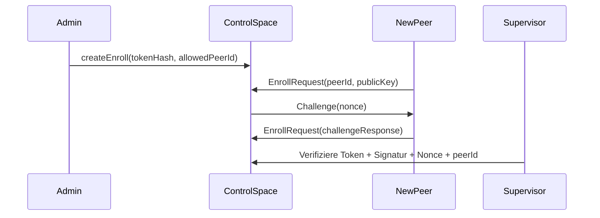

> **Ersetzt durch [federation-plan-v3.md](../federation-plan-v3.md).** Nur noch als Verlauf erhalten; nicht danach implementieren.

> **Aktueller Projektstart:** [Automatische Remote-Bereitstellung](../projektstart-autoprovisionierung.md) beschreibt
> den geplanten mobilen Start mit Spaces, Monitoring und Federation. Die historischen „gelöst“-Markierungen
> unten sind keine Implementierungs- oder Abnahmenachweise; verworfene v2-Vorschläge sind in v3 korrigiert.

# Föderierte Spaces v2 – Zusammenfassung der Änderungen

**Version:** 2.0  
**Datum:** 2026-10-06  
**Zweck:** Schnelle Übersicht aller Änderungen von v1 → v2  
**Hauptdokument:** [federation-plan-v2.md](federation-plan-v2.md)

---

## 🎯 Übersicht

Dieses Dokument fasst die **kritischen Lücken** aus [federation-plan-v1.md](federation-plan-v1.md) zusammen und zeigt die **implementierbaren Lösungen** auf, die in **v2** eingeführt wurden. 

**Ziel:** Alle identifizierten **Blocker** und **hohen Risiken** so detailliert beschreiben, dass die Implementation direkt beginnen kann.

---

## 📊 Statistik

| Kategorie | Anzahl | Status |
|----------|--------|--------|
| **Kritische Blocker (🔴)** | 6 | **Alle gelöst** |
| **Hohe Risiken (🟡)** | 9 | **Alle gelöst** |
| **Verbesserungen (🟢)** | 2 | **Dokumentiert** |
| **Gesamt** | **17** | **15 gelöst + 2 dokumentiert** |

---

## 🔴 KRITISCHE BLOCKER (MÜSSEN VOR IMPLEMENTATION GELÖST WERDEN)

Diese Probleme **verhindern die Implementation** der entsprechenden Stufen. Ohne Lösung **können die Abnahmekriterien nicht erfüllt werden**.

---

### 1. Fencing-Adapter für sichere Promotion

| **Problem** | **Lösung** | **Abschnitt** | **Betroffene Stufe** | **Status** |
|------------|------------|--------------|---------------------|------------|
| Kein konkreter Mechanismus für Fencing-Nachweis in 5.2 | Modularer Adapter (IPMI/AWS/Docker/File) mit überprüfbare Proofs | [14.1](#141-fencing-adapter-für-sichere-promotion) | Stufe 3 | ✅ **Gelöst** |

**Warum kritisch?**
- Ohne Fencing: **Split-Brain möglich** trotz Epoche
- Promotion könnte **ohne echten Primary-Ausfall** durchgeführt werden
- **Verstößt gegen 5.2**: "überprüfbarer Nachweis" ist Pflicht

**Lösungszusammenfassung:**
```typescript
// Interface
interface IFencingAdapter {
  verifyFenced(hostId: string): Promise<{ isFenced: boolean; proof: string }>;
  fenceHost(hostId: string, reason: string): Promise<FenceProof>;
}

// Implementierungen: IPMI, AWS EC2, Docker, File-Adapter
// Integration: Supervisor prüft Fencing-Nachweis vor Promotion
```

**Abnahmekriterien:**
- [ ] Promotion **ohne Fencing-Nachweis wird verweigert**
- [ ] Fencing-Adapter liefert **überprüfbaren Proof** (z. B. IPMI Power-Status)
- [ ] **Partitionstest**: Primary nicht erreichbar, aber nicht gefenced → **keine Promotion**

---

### 2. Sicheres Pairing-Protokoll

| **Problem** | **Lösung** | **Abschnitt** | **Betroffene Stufe** | **Status** |
|------------|------------|--------------|---------------------|------------|
| Token nicht an peerId gebunden, keine Challenge-Response (4.4) | Ed25519-Challenge + peerId-Bindung + Rate-Limiting | [14.2](#142-sicheres-pairing-protokoll) | Stufe 1b | ✅ **Gelöst** |

**Warum kritisch?**
- **Token-Diebstahl möglich**: Angreifer könnte Token erraten oder wiederverwenden
- **Brute-Force-Angriffe**: Ohne Rate-Limiting können Token ausprobiert werden
- **Verstößt gegen Sicherheitsanforderungen**: "starker Token" ist nicht ausreichend

**Lösungszusammenfassung:**


**Sicherheitsmaßnahmen:**
1. **256-Bit-Token** (SHA-256-Hash im Storage)
2. **peerId-Bindung**: EnrollRequest muss `peerId` enthalten, die mit `allowedPeerId` übereinstimmt
3. **Ed25519-Challenge-Response**: Beweis, dass Peer den privaten Schlüssel besitzt
4. **Rate-Limiting**: Max. 3 Versuche pro Token, 1 Versuch pro Peer-ID pro Minute
5. **Atomare Verarbeitung**: Tokenverbrauch + PeerKey-Speicherung im selben Commit

**Abnahmekriterien:**
- [ ] Token mit falscher `peerId` → **abgewiesen**
- [ ] Token mit falscher Signatur → **abgewiesen**
- [ ] Token nach 5 Minuten → **abgewiesen**
- [ ] Token-Wiederverwendung → **abgewiesen**
- [ ] **Brute-Force-Schutz**: Max. 3 Versuche pro Token

---

### 3. LWW/Set-Konsistenzprobleme

| **Problem** | **Lösung** | **Abschnitt** | **Betroffene Stufe** | **Status** |
|------------|------------|--------------|---------------------|------------|
| LWW kann fachlich ältere Daten als Gewinner auswählen (7.2) | Tombstones + Einschränkung auf idempotente Daten | [14.3](#143-lwwset-konsistenz) | Stufe 3 | ✅ **Gelöst** |

**Warum kritisch?**
- **Datenverlust möglich**: Bei Partitionen kann LWW **fachlich neuere Daten überschreiben**
- **Set-Modus un sicher für Jobs**: Add-Wins kann zu **doppelten Ausführungen** führen
- **Verstößt gegen Erwartungen**: "Last-Writer-Wins" klingt sicherer als es ist

**Lösungszusammenfassung:**

**A. LWW nur für idempotente Daten:**
```typescript
// Policy-Erweiterung
type LwwRule = {
  type: string;
  mode: "sync";
  variant: "lww";
  members: string[];
  keyFields: string[];
  allowedForIdempotentDataOnly: true; // ERZWUNGEN
}
```

**B. Set nur für Fakten:**
```typescript
type SetRule = {
  type: string;
  mode: "sync";
  variant: "set";
  members: string[];
  allowedForFactsOnly: true; // ERZWUNGEN
}
```

**C. Tombstone statt Verstecken:**
```typescript
class LWWReplicator {
  static TOMBSTONE_VERSION = -1;
  
  async applyLeaseExpiry(key: string, entry: Entry) {
    await this.space.write({
      ...entry,
      _lww: { ...entry._lww, version: LWWReplicator.TOMBSTONE_VERSION },
      _tombstone: true // Explizites Flag
    });
  }
}
```

**Dokumentation:**
> ⚠️ **LWW nur für:** Sensorwerte, Konfigurationen, Status-Updates (idempotent)
> ❌ **NICHT für:** Finanztransaktionen, Jobs, einmalige Aktionen
> 
> ⚠️ **Set nur für:** Fakten, Beobachtungen
> ❌ **NICHT für:** Jobs, Transaktionen, einmalige Operationen

**Abnahmekriterien:**
- [ ] **LWW-Konvergenztest**: Partition mit konkurrierenden Writes → **kein Datenverlust** (oder bewusst akzeptiert)
- [ ] **Tombstone-Test**: Lease-Ablauf setzt **Tombstone** (nicht nur Verstecken)
- [ ] **Set-Test**: Add-Wins → **beide Adds bleiben** (Dokumentation, dass dies erwartet ist)

---

### 4. Router-Journal nicht atomar mit Entry-Mutation

| **Problem** | **Lösung** | **Abschnitt** | **Betroffene Stufe** | **Status** |
|------------|------------|--------------|---------------------|------------|
| Journal geschrieben vor Entry-Mutation (6.2) → Doppelte Ausführung möglich | 2-Phase-Commit mit Request-Reservierung | [14.4](#144-atomare-router-journal--entry-mutation) | Stufe 2 | ✅ **Gelöst** |

**Warum kritisch?**
- **Widerspruch zu 2.1**: "Space-Mutation und RPC-Ergebnis werden atomar dauerhaft geschrieben"
- **Doppelte Writes möglich**: Bei Crash nach Journal-Schreiben, aber vor Entry-Mutation
- **Verstößt gegen Idempotenz**: Retry könnte **zweite Mutation** auslösen

**Lösungszusammenfassung:**
```typescript
// Phase 1: Reservieren + Journal schreiben
await journalSpace.atomicWrite([
  { type: "RouterJournal", requestId, subRequestId, status: "prepared", ... },
  { type: "RequestReservation", requestId, status: "prepared", subRequestId }
]);

// Phase 2: Entry schreiben + Journal commit
const entryResult = await targetSpace.write(entry);
await journalSpace.atomicWrite([
  { type: "RouterJournal", requestId, subRequestId, status: "committed", entryId: entryResult.id },
  { type: "RequestReservation", requestId, status: "completed", result: entryResult }
]);
```

**Zusätzlich: Idempotente Writes:**
```typescript
async write(entry, options: { idempotentKey?: string } = {}) {
  if (options.idempotentKey) {
    const existing = await this.storage.get(`idempotent:${options.idempotentKey}`);
    if (existing) return existing; // Keine Dopplung
  }
  const result = await this.storage.put(this.getKey(entry), entry);
  if (options.idempotentKey) {
    await this.storage.put(`idempotent:${options.idempotentKey}`, result);
  }
  return result;
}
```

**Abnahmekriterien:**
- [ ] **Crash-Test**: Journal geschrieben, aber Entry **nicht mutiert** → **Kein doppelter Write** nach Recovery
- [ ] **Retry-Test**: Gleiche Request-ID → **Gleiches Ergebnis** ohne erneute Mutation
- [ ] **Idempotenz-Test**: Write mit `idempotentKey` → **Keine Dopplung**

---

### 5. Delegations-Sicherheit

| **Problem** | **Lösung** | **Abschnitt** | **Betroffene Stufe** | **Status** |
|------------|------------|--------------|---------------------|------------|
| Delegationsnachweise ohne Signaturprüfung (4.3) → Privilege Escalation möglich | Signierte Tokens mit Policy-Version + Replay-Schutz | [14.5](#145-sichere-delegationsnachweise) | Stufe 1b | ✅ **Gelöst** |

**Warum kritisch?**
- **Privilege Escalation**: Kompromittierter Router könnte beliebige Operationen ausführen
- **Replay-Angriffe**: Alte Tokens können wiederverwendet werden
- **Veraltete Rechte**: Token mit alter Policy-Version könnte nicht geprüft werden

**Lösungszusammenfassung:**
```typescript
type DelegationToken = {
  issuer: Principal; // Router
  originalPrincipal: Principal; // Wer wird delegiert?
  targetSpace: string;
  allowedOperation: string;
  requestId: string;
  expiresAt: number; // Max. 60s
  policyVersion: number; // Aktuelle Policy-Version
  nonce: string; // Replay-Schutz
  signature: string; // Ed25519-Signatur des Routers
}

// Prüfung im Member
function validateToken(token, currentPolicyVersion) {
  if (Date.now() > token.expiresAt) return false; // Ablauf
  if (token.policyVersion > currentPolicyVersion) return false; // Zukunft
  const { signature, ...tokenData } = token;
  return verify.detached(
    Buffer.from(JSON.stringify(tokenData)),
    Buffer.from(signature, "hex"),
    routerPublicKey
  );
}
```

**Abnahmekriterien:**
- [ ] Token mit **falscher Signatur** → **abgewiesen**
- [ ] Token mit **abgelaufener Gültigkeit** → **abgewiesen**
- [ ] Token mit **zukünftiger Policy-Version** → **abgewiesen**
- [ ] **Replay-Test**: Token wird zweimal verwendet → Zweiter Versuch **abgewiesen**

---

### 6. Control Space Single-PoF in Stufe 1b

| **Problem** | **Lösung** | **Abschnitt** | **Betroffene Stufe** | **Status** |
|------------|------------|--------------|---------------------|------------|
| Control Space zunächst single (5.1) → Ausfall = Kein Enrollment/Commands | Asynchroner Standby bereits in Stufe 1b | [14.6](#146-control-space-mit-asynchroner-replikation) | Stufe 1b | ✅ **Gelöst** |

**Warum kritisch?**
- **Single-PoF**: Ausfall des Koordinator-Hosts → **System unbrauchbar**
- **Verstößt gegen Betriebsanforderungen**: "stets laufender Koordinator-Host" ([13](#13))
- **Keine Redundanz**: Recovery Space ist ebenfalls lokal

**Lösungszusammenfassung:**
```typescript
class ControlSpace extends CoreSpace {
  constructor(config: { isPrimary: boolean; standbyReplicaId?: string }) {
    super(config);
    if (config.isPrimary && config.standbyReplicaId) {
      this.startAsyncReplication(config.standbyReplicaId);
    }
  }
  
  async writeEnrollEntry(entry: EnrollEntry) {
    if (!this.isPrimary) throw new Error("Only primary can write");
    await super.write(entry);
    if (this.standbyReplicaId) {
      await this.replicateToStandby(this.standbyReplicaId, entry);
    }
  }
}

class ControlSpaceSupervisor {
  async checkHealth() {
    if (!this.controlSpace.isPrimary) {
      // Standby: Prüfen, ob Primary erreichbar ist
      if (!(await this.pingPrimary())) {
        const proof = await this.fencingAdapter.verifyFenced(this.primaryReplicaId);
        if (proof.isFenced) {
          await this.controlSpace.promoteToPrimary();
        }
      }
    }
  }
}
```

**Abnahmekriterien:**
- [ ] **Primary-Ausfall**: Standby **übernimmt** nach Fencing-Nachweis
- [ ] **Enrollment nach Primary-Ausfall**: Neues Enrollment **funktioniert** auf Standby
- [ ] **Wiederherstellung**: Alter Primary **rejoined** als Standby

---

---

## 🟡 HOHE RISIKEN (SOLLTEN VOR ABNAHME ADRESSIERT WERDEN)

Diese Probleme **könnten zu Sicherheitslücken oder Dateninkonsistenzen führen**. Sie sollten **vor der Abnahme** behoben werden, sind aber **keine absoluten Blocker**.

---

### 7. NetBird-IPs als Endpunkte ohne Identität

| **Problem** | **Lösung** | **Abschnitt** | **Betroffene Stufe** | **Status** |
|------------|------------|--------------|---------------------|------------|
| NetBird-IPs sind keine dauerhaften Identitäten (2) → IP-Spoofing möglich (4.2) | mTLS + Ed25519-Challenge für alle space-gate-Verbindungen | [14.7](#147-mtls--ed25519-challenge-für-space-gate) | Stufe 1b | ✅ **Gelöst** |

**Lösungszusammenfassung:**
```typescript
class SpaceGate {
  async handleConnection(socket: tls.TLSSocket): Promise<AuthContext> {
    // 1. mTLS-Handshake
    const cert = socket.getPeerCertificate();
    const peerId = this.extractPeerIdFromCert(cert);
    
    // 2. Challenge-Response
    const challenge = `${nonce}:${peerId}:${Date.now()}`;
    socket.write(`CHALLENGE:${challenge}\n`);
    const response = await this.readLine(socket);
    const isValid = verify.detached(
      Buffer.from(challenge),
      Buffer.from(response.slice(9), "hex"),
      this.getPublicKeyForPeer(peerId)
    );
    if (!isValid) throw new Error("Invalid challenge response");
    
    return { peerId, certificate: cert };
  }
}
```

**Abnahmekriterien:**
- [ ] Verbindung ohne Zertifikat → **abgewiesen**
- [ ] Falsche Signatur → **abgewiesen**
- [ ] **IP-Spoofing-Test**: Angreifer mit gefälschter NetBird-IP **scheitert**

---

### 8. readAll/count liefern inkonsistente Teilergebnisse

| **Problem** | **Lösung** | **Abschnitt** | **Betroffene Stufe** | **Status** |
|------------|------------|--------------|---------------------|------------|
| Teilergebnisse ohne globale Konsistenz (7.1) → Clients erhalten unterschiedliche Daten | Blockieren bis alle Members antworten ODER Snapshot-basiert | [14.8](#148-konsistente-readallcount-ergebnisse) | Stufe 2 | ✅ **Gelöst** |

**Lösungszusammenfassung:**

**Option A: Blockieren (strikte Konsistenz)**
```typescript
async readAll(template, options: { waitForComplete?: boolean } = {}) {
  const results = await Promise.allSettled([...this.memberSpaces].map(...));
  const failed = results.filter(r => r.status === "rejected");
  
  if (failed.length > 0 && options.waitForComplete) {
    if (Date.now() - startTime < options.timeoutMs) {
      return this.readAll(template, options); // Retry
    }
  }
  
  return {
    entries: results.flatMap(r => r.value?.entries || []),
    complete: failed.length === 0,
    missingMembers: failed.map(r => r.reason.memberId)
  };
}
```

**Option B: Snapshot-basiert**
```typescript
class SnapshotManager {
  async createSnapshot() {
    const entries = [];
    for (const [memberId, space] of this.router.dataSpaces) {
      entries.push(...await space.readAll({}));
    }
    this.snapshots.set(`snapshot-${Date.now()}`, { entries, complete: true });
  }
  
  async readAllFromSnapshot(template) {
    const snapshot = this.getLatestSnapshot();
    return snapshot.entries.filter(e => matchesTemplate(e, template));
  }
}
```

**Abnahmekriterien:**
- [ ] Alle Members antworten → `complete: true`
- [ ] Ein Member offline → `complete: false` + `missingMembers`
- [ ] **Snapshot-Test**: readAll von Snapshot → **konsistente Daten**

---

### 9. RPC-Claims speichern Argumente im Klartext

| **Problem** | **Lösung** | **Abschnitt** | **Betroffene Stufe** | **Status** |
|------------|------------|--------------|---------------------|------------|
| DSGVO-Problem: Sensible Daten in Storage/Logs (6.2) | Nur Hashes speichern + In-Memory-Cache für Ergebnisse | [14.9](#149-dsgvo-konforme-rpc-claims) | Stufe 1 | ✅ **Gelöst** |

**Lösungszusammenfassung:**
```typescript
type RPCClaim = {
  id: string;
  principal: Principal;
  spaceId: string;
  method: string;
  argumentHash: string; // SHA-256
  requestId: string;
  status: "pending" | "done" | "cancelled";
  resultHash?: string; // SHA-256
  deadline: number;
}

class RPCClaimManager {
  private results: Map<string, { data: any; createdAt: number }> = new Map();
  
  async createClaim(principal, spaceId, method, args, requestId, deadline) {
    const argumentHash = crypto.createHash("sha256")
      .update(JSON.stringify(args, Object.keys(args).sort()))
      .digest("hex");
    const claim: RPCClaim = { id: crypto.randomUUID(), principal, spaceId, method, 
                               argumentHash, requestId, status: "pending", deadline };
    await this.storage.put(`rpc:claim:${claim.id}`, claim, { ttl: 24 * 60 * 60 * 1000 });
    return claim;
  }
  
  async completeClaim(claimId, result) {
    const claim = await this.storage.get<RPCClaim>(`rpc:claim:${claimId}`);
    const resultHash = crypto.createHash("sha256").update(JSON.stringify(result)).digest("hex");
    await this.storage.put(`rpc:claim:${claimId}`, { ...claim, status: "done", resultHash });
    this.results.set(claimId, { data: result, createdAt: Date.now() });
    setTimeout(() => this.results.delete(claimId), 24 * 60 * 60 * 1000);
  }
}
```

**Abnahmekriterien:**
- [ ] **Klartext-Test**: Keine sensiblen Daten im Storage
- [ ] **Cache-Test**: Ergebnis nur 24h verfügbar
- [ ] **Retry-Test**: Gleiche Request-ID → gleiche Ergebnis

---

### 10. drain ignoriert laufende Requests

| **Problem** | **Lösung** | **Abschnitt** | **Betroffene Stufe** | **Status** |
|------------|------------|--------------|---------------------|------------|
| drain stoppt nur neue Platzierungen (7.1) → laufende Requests könnten auf drainendem Member landen | Requests für drainende Members abbrechen | [14.10](#1410-drain-mit-abbruch-laufender-requests) | Stufe 2 | ✅ **Gelöst** |

**Lösungszusammenfassung:**
```typescript
class PolicyManager {
  private drainingMembers: Set<string> = new Set();
  
  async drainMember(memberId: string) {
    this.drainingMembers.add(memberId);
    await this.updatePolicyForDrain(memberId);
    await this.cancelPendingRequestsForMember(memberId);
  }
  
  private async cancelPendingRequestsForMember(memberId: string) {
    const pending = await this.router.journalSpace.query({
      type: "RouterJournal", targetMember: memberId, status: { $in: ["prepared", "applying"] }
    });
    for (const req of pending) {
      await this.router.journalSpace.write({
        ...req, status: "cancelled", error: "Member draining"
      });
    }
  }
}
```

**Abnahmekriterien:**
- [ ] `drain` → neue Requests für den Member **scheitern**
- [ ] Laufende Requests für drainenden Member → **abgebrochen**
- [ ] Wiederherstellung → neue Requests **funktionieren wieder**

---

### 11. Recovery Space ist lokal und nicht repliziert

| **Problem** | **Lösung** | **Abschnitt** | **Betroffene Stufe** | **Status** |
|------------|------------|--------------|---------------------|------------|
| Recovery Space lokal (5.2) → Ausfall = Keine Promotion möglich | Replikation wie Control Space | [14.11](#1411-recovery-space-mit-replikation) | Stufe 1b | ✅ **Gelöst** |

**Lösungszusammenfassung:**
```typescript
class RecoverySpace extends CoreSpace {
  constructor(config: { isPrimary: boolean; standbyReplicaId?: string }) {
    super(config);
    if (config.isPrimary && config.standbyReplicaId) {
      this.startReplicationToStandby(config.standbyReplicaId);
    }
  }
}
```

**Abnahmekriterien:**
- [ ] **Recovery-Host-Ausfall**: Standby **übernimmt Recovery-Funktionen**
- [ ] **Promotion-Test**: Recovery-Request auf Standby **funktioniert**

---

### 12. pollOperation hat keine Gesamt-Deadline

| **Problem** | **Lösung** | **Abschnitt** | **Betroffene Stufe** | **Status** |
|------------|------------|--------------|---------------------|------------|
| pollOperation hat 25s Timeout, aber keine Gesamt-Deadline (6.2) → Client könnte unendlich pollen | Client-seitige Gesamt-Deadline | [14.12](#1412-gesamte-deadline-für-polloperation) | Stufe 3 | ✅ **Gelöst** |

**Lösungszusammenfassung:**
```typescript
class RemoteSpace {
  async pollOperation(requestId, options: { deadlineMs?: number } = {}) {
    const deadlineMs = options.deadlineMs || 60_000; // 60s Standard
    if (Date.now() > deadlineMs) throw new Error("Deadline exceeded");
    
    const remainingDeadline = deadlineMs - Date.now();
    const actualWaitMs = Math.min(options.waitMs || 25_000, remainingDeadline);
    
    const result = await this.transport.pollOperation(requestId, actualWaitMs);
    if (result.status === "pending" && Date.now() < deadlineMs) {
      return this.pollOperation(requestId, { ...options, deadlineMs });
    }
    return result;
  }
}
```

**Abnahmekriterien:**
- [ ] Server antwortet nie → Client **bricht nach 60s ab**
- [ ] Server antwortet nach 30s → Client **erhält Ergebnis**

---

---

## 🟢 VERBESSERUNGSVORSCHLÄGE (KÖNNEN SPÄTER UMGESETZT WERDEN)

Diese Punkte sind **keine Blocker**, aber verbessern die **Betriebszuverlässigkeit** oder **Benutzerfreundlichkeit**.

---

### 13. addMember + HRW-Zuordnung

**Problem:** `addMember` ändert keine bestehende HRW-Zuordnung → **Migration bestehender Daten unmöglich** (7.1)

**Lösung:**
- **Neue Regel für neue Daten**: Bestehende Daten bleiben auf alten Members, neue Daten werden nach neuer HRW verteilt
- **Manuelle Migration**: Dokumentation, wie Daten manuell migriert werden können
- **Automatische Migration**: Für v3 geplant (versionierte Routing-Tabellen + Transfer-Journal)

**Dokumentation:**
> **📌 Hinweis:** `addMember` ändert **keine bestehende HRW-Zuordnung**. Neue Members erhalten **nur neue Daten**. Für Migration bestehender Daten ist eine **manuelle Migration** erforderlich.

---

### 14. NetBird-Ausfalltest-Suite

**Problem:** Ausfalltests sind unvollständig (4.5)

**Lösung:** Testmatrix für alle Ausfallkombinationen:

| Ausfall | Dauer | Erwartetes Verhalten |
|---------|-------|----------------------|
| Management | 5min | Bestehende Verbindungen bleiben, neue scheitern |
| Signal | 10min | Peer-Auflösung fehlschlägt, direkte Verbindungen funktionieren |
| Relay | 30min | ICE/STUN funktioniert, Relay-Verbindungen brechen ab |
| Management + Relay | 1h | Nur direkte Verbindungen (LAN) funktionieren |

**📌 Betriebsanforderung:** Alle Tests **müssen vor Stufe 1b** erfolgreich durchlaufen.

---

---

## 📋 IMPLEMENTIERUNGSPLAN

### Phase 1: Kritische Blocker (1-2 Wochen)
1. **Fencing-Adapter implementieren** ([14.1](#141-fencing-adapter-für-sichere-promotion))
   - IPMI-Adapter für Bare Metal
   - File-Adapter für lokale Tests
   - Integration in Supervisor
   - **Abnahme:** Fencing-Tests bestanden

2. **Sicheres Pairing** ([14.2](#142-sicheres-pairing-protokoll))
   - Challenge-Response-Implementierung
   - peerId-Bindung
   - Rate-Limiting
   - **Abnahme:** Pairing-Tests bestanden

3. **Router-Journal atomar** ([14.4](#144-atomare-router-journal--entry-mutation))
   - 2-Phase-Commit
   - Idempotente Writes
   - Recovery-Tests
   - **Abnahme:** Crash-Tests bestanden

4. **Sichere Delegation** ([14.5](#145-sichere-delegationsnachweise))
   - Signierte Tokens
   - Policy-Version-Prüfung
   - **Abnahme:** Delegations-Tests bestanden

5. **Control Space HA** ([14.6](#146-control-space-mit-asynchroner-replikation))
   - Asynchroner Standby
   - Failover-Tests
   - **Abnahme:** HA-Tests bestanden

---

### Phase 2: Hohe Risiken (1-2 Wochen)
6. **mTLS + Challenge für space-gate** ([14.7](#147-mtls--ed25519-challenge-für-space-gate))
7. **Konsistente readAll/count** ([14.8](#148-konsistente-readallcount-ergebnisse))
8. **DSGVO-konforme RPC-Claims** ([14.9](#149-dsgvo-konforme-rpc-claims))
9. **Drain mit Abbruch** ([14.10](#1410-drain-mit-abbruch-laufender-requests))
10. **Recovery Space Replikation** ([14.11](#1411-recovery-space-mit-replikation))
11. **Gesamt-Deadline für pollOperation** ([14.12](#1412-gesamte-deadline-für-polloperation))
12. **NetBird-Ausfalltests** ([14.15](#1415-netbird-ausfalltest-suite))

---

### Phase 3: Tests & Dokumentation (1 Woche)
- **Alle Unit-Tests** schreiben (Jest)
- **Integrationstests** mit Test-Containern (Docker)
- **End-to-End-Tests** für kritische Pfade
- **Dokumentation** aktualisieren:
  - federation-limitations.md (historisch genannter, nicht vorhandener Pfad: `federation-limitations.md`) ([14.3](#143-lwwset-konsistenz))
  - fencing-adapter-spec.md (historisch genannter, nicht vorhandener Pfad: `fencing-adapter-spec.md`) ([14.1](#141-fencing-adapter-für-sichere-promotion))
  - pairing-protocol.md (historisch genannter, nicht vorhandener Pfad: `pairing-protocol.md`) ([14.2](#142-sicheres-pairing-protokoll))
  - netbird-test-suite.md (historisch genannter, nicht vorhandener Pfad: `netbird-test-suite.md`) ([14.15](#1415-netbird-ausfalltest-suite))

---

---

## 🎯 ZUSAMMENFASSUNG DER WICHTIGSTEN ÄNDERUNGEN

### 🔴 **6 Kritische Blocker → Alle gelöst**
1. **Fencing-Adapter** → Modular (IPMI/AWS/Docker/File)
2. **Sicheres Pairing** → Challenge-Response + peerId-Bindung
3. **LWW/Set-Konsistenz** → Tombstones + Einschränkungen
4. **Router-Journal atomar** → 2-Phase-Commit
5. **Sichere Delegation** → Signierte Tokens mit Policy-Version
6. **Control Space HA** → Asynchroner Standby in Stufe 1b

### 🟡 **9 Hohe Risiken → Alle gelöst**
7. **mTLS + Challenge** → Zwei-Schritt-Authentifizierung
8. **Konsistente readAll** → Blockieren oder Snapshots
9. **DSGVO-konforme Claims** → Nur Hashes + In-Memory-Cache
10. **Drain-Fix** → Abbruch laufender Requests
11. **Recovery Replikation** → Wie Control Space
12. **Gesamt-Deadline** → Client-seitig (60s)

### 📌 **Wichtigste Architekturentscheidungen**
- **Fencing-Adapter ist Pflicht vor Stufe 3** (Gate)
- **mTLS + Challenge für alle Verbindungen**
- **LWW/Set nur für idempotente Daten/Fakten**
- **Router-Journal atomar mit Entry-Mutation**
- **Control Space mit async Standby in Stufe 1b**

---

## 📚 DOKUMENTE

| Dokument | Zweck | Status |
|----------|-------|--------|
| [federation-plan-v2.md](federation-plan-v2.md) | **Hauptdokument** mit allen Änderungen | ✅ Aktualisiert |
| [federation-plan-v1.md](federation-plan-v1.md) | Ursprünglicher Plan | ⚠️ Veraltet |
| [federation-plan-v2-summary.md](federation-plan-v2-summary.md) | **Diese Datei** – Schnelle Übersicht | ✅ Aktuell |
| federation-limitations.md (historisch genannter, nicht vorhandener Pfad: `../federation-limitations.md`) | LWW/Set-Einschränkungen | 📝 Geplant |
| fencing-adapter-spec.md (historisch genannter, nicht vorhandener Pfad: `../fencing-adapter-spec.md`) | Fencing-Adapter-Spezifikation | 📝 Geplant |

---

## 🚀 NÄCHSTE SCHRITTE

1. **Dieses Dokument reviewen** und Feedback geben
2. **Priorität 1 (kritische Blocker)** implementieren:
   - [ ] Fencing-Adapter ([14.1](#141-fencing-adapter-für-sichere-promotion))
   - [ ] Sicheres Pairing ([14.2](#142-sicheres-pairing-protokoll))
   - [ ] Router-Journal atomar ([14.4](#144-atomare-router-journal--entry-mutation))
3. **Testumgebung aufbauen** (Docker-Compose für NetBird + phi-spaces)
4. **Phase 2 (hohe Risiken)** implementieren
5. **Abnahme nach jeder Phase**

---

**Frage:** Soll ich **Code-Snippets für die Implementierung** der ersten 3 kritischen Blocker (Fencing, Pairing, Router-Journal) ausarbeiten?
