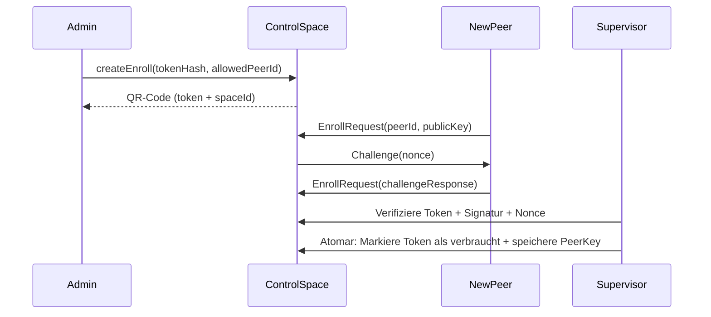

> **Replaced by [federation-plan-v3.md](../federation-plan-v3.en.md).** Kept only as history; do not implement from it.

# Federated Spaces v2: analysis, plan and solutions

**Version:** 2.0  
**Date:** 2026-10-06  
**Status:** Revised with detailed solutions for all identified gaps  
**Predecessor:** [federation-plan-v1.en.md](federation-plan-v1.en.md)  

---

## 📋 Changelog (v1 → v2)

### ✅ Solved critical problems (blockers for implementation)
| # | Problem (v1) | Solution (v2) | Section |
|---|-------------|-------------|-----------|
| **1** | Fencing adapter missing (5.2) | Modular adapter with IPMI/AWS/Docker/File | [14.1](#141-fencing-adapter) |
| **2** | Pairing token insecure (4.4) | Challenge-response + peerId binding + rate limiting | [14.2](#142-sicheres-pairing) |
| **3** | LWW/set data loss (7.2) | Tombstones + only for idempotent data | [14.3](#143-lwwset-konsistenz) |
| **4** | Router journal not atomic (6.2) | 2-phase commit + idempotent writes | [14.4](#144-router-journal) |
| **5** | Delegation insecure (4.3) | Signed tokens with policy version + replay protection | [14.5](#145-delegation) |
| **6** | Control space single point of failure (5.1) | Asynchronous standby already in stage 1b | [14.6](#146-control-space-ha) |

### ⚠️ High risks (address before acceptance)
| # | Problem | Solution | Section |
|---|---------|--------|-----------|
| **7** | NetBird IPs without identity (4.1) | mTLS + Ed25519 challenge for space-gate | [14.7](#147-mtls-challenge) |
| **8** | readAll/count inconsistent (7.1) | Blocking or snapshot-based | [14.8](#148-konsistentes-readall) |
| **9** | RPC claims with plain text (6.2) | Store only hashes + in-memory cache | [14.9](#149-dsgvo-rpc) |
| **10** | drain ignores running requests (7.1) | Cancel requests for draining members | [14.10](#1410-drain-fix) |
| **11** | Recovery space local (5.2) | Replication like the control space | [14.11](#1411-recovery-replication) |
| **12** | pollOperation without deadline (6.2) | Client-side overall deadline | [14.12](#1412-poll-deadline) |

---

## 📖 Original document (v1)

> **Note:** The following content corresponds essentially to [federation-plan-v1.en.md](federation-plan-v1.en.md), **but with the adjustments described below**. For the detailed solutions see [section 14](#14-detailed-solutions).

---

# Federated Spaces v1: analysis and plan

**Goal:** Every reachable host (pi-serverd) provides a Space to agents. Several Spaces can be connected and controlled and observed from arbitrary clients (phone, desktop, CLI, browser). Two federation modes: **expand** (distribute, similar to RAID 0) and **sync** (mirror, similar to RAID 1). The control is itself a Space (**control space**), the router a worker in it. The network is a self-hosted **NetBird** overlay (WireGuard).

The basis is the existing implementation, see [spaces-v1.en.md](spaces-v1.en.md); its gaps L1–L3, L7 and B1 are prerequisites here.

**Revised after a consistency check on 2026-10-06.** This document describes the **target contract with implementable solutions**, not only requirements.

---

## 1. Assessment of the original draft

The draft (four layers, mode per type, primary/replica, directory, star first) is correct at its core.

| Statement in the draft | Assessment → solution |
|---|---|
| "Identity comes from the connection (host:phone)" | Via `ssh -L`, pi-serverd sees only a local Unix socket of the same user; pi-server does not authenticate peers. → **NetBird peer identity plus signed challenge in the app ([4.3](#43-identity-delegation-and-revocation) + [14.2](#142-sicheres-pairing))**. |
| "requestId like the claim per tool call" | The claim is a task document and exists only within a tool task. → own session store `(peer, requestId) → result` with expiry ([6.2](#62-dienst-space-in-pi-serverd) + [14.4](#144-router-journal)). |
| "A blocking take puts a waiter on all members" | Correct, but waiters today deliver only to local conversations; string targets are discarded (L1). → peer mailbox with long poll and receipt ([6.1](#61-core-erweiterungen-phi-spaces-doc-version-5)). |
| "Replicas get a numbered change stream" | There is no revision and no stream (L2). → `rev` + delta ring in the core ([6.1](#61-core-erweiterungen-phi-spaces-doc-version-5)). |
| "Last-writer-wins for location/weather" | Tuple spaces have no keys. → declared key fields per mirrored type ([6.1](#61-core-erweiterungen-phi-spaces-doc-version-5) + [14.3](#143-lwwset-konsistenz)). |
| "The newer asOf wins" | Clocks of different hosts drift. → leases with bounded time uncertainty; HLC orders versions, guarantees no business-wise newest measurement ([7.2](#72-sync-mirror) + [14.3](#143-lwwset-konsistenz)). |
| "Limit transactions to one member" | Correct; IDs must carry the member (L3). → global IDs `spaceId/localId`; host, Space and replica identity separate ([2](#2-terms)). |
| "Directory with capability entries" | Correct (Jini lookup service); needs write-protected types. |
| Router on the phone, star via the phone | The phone sleeps or is terminated (MIUI, phantom process killer). → router as a worker in the control space on a host; clients only control ([5](#5-control-space-and-router)). |
| Connections via SSH, key per host pair | Works, but TOFU, key distribution and NAT are manual work. → **NetBird + mTLS + challenge ([4.1](#41-netbird-as-the-network-layer) + [14.7](#147-mtls-challenge))**. |

Added compared to the draft: owner across hosts, quotas per peer, loop avoidance when mirroring, protocol versioning, backpressure, simulator tests with partitions, migration of the document (version 4 → 5).

---

## 2. Terms

- **Host**: pi-serverd with a stable, untruncated `hostId`; can hold several Spaces.
- **Space**: logical stock with an immutable `spaceId`. Names are changeable aliases.
- **Member**: a logical data Space in a federation; `memberId = spaceId`. In expand mode solely responsible for its entries, txns, waiters and outbox. In primary mode it can own physical replicas.
- **Replica**: physical copy with its own `replicaId`; on promotion takes over the same logical `spaceId`.
- **Control space**: protected control data; **primary with asynchronous standby already in stage 1b ([14.6](#146-control-space-ha))**, later synchronous.
- **Router**: worker on the coordinator; runs `FederatedSpace`, replicators and commands.
- **Supervisor**: local service per host, independent of the router; handles enrollment and local recovery requests.
- **Recovery space**: **local, replicated Space per host ([14.11](#1411-recovery-replication))** for authorized recovery requests and results.
- **Client**: phone, desktop, CLI or browser via gateway.
- **Peer**: authenticated counterpart with an immutable `peerId`; display names are not an identity.
- **Owner**: structured principal `{peerId, agentId?}`; representation as a string is only an output format.
- **Federation**: named set of members plus versioned policy.
- **Global ID**: `<spaceId>/<localId>`. Local IDs are not reused even after a restore.
- **Mailbox**: durable events for a principal and consumer, identified by `mailboxId`, `epoch`, `seq`.
- **Overlay**: NetBird network; IPs serve as endpoints, not as permanent identities.

### 2.1 Binding guarantees and limits

| Level | Contract |
|---|---|
| Local commit | Space mutation and RPC result are **written durably and atomically ([14.4](#144-router-journal))**. |
| Retry | The same valid request returns the same result without a new mutation; bounded window ([6.2](#62-dienst-space-in-pi-serverd)). |
| Take under txn | At most one active reservation per entry; abort/expiry allows a new reservation. |
| Successful take | At most one successful destructive commit per entry identity in expand/primary. |
| Business effect | **No general exactly-once guarantee for external effects**; the target system needs idempotency or a shared transaction. |
| primary with synchronous standby | Confirmed operations are preserved on a permitted promotion ([7.2](#72-sync-mirror)). |
| Asynchronous copy | Backup/read copy; confirmed writes or takes can be missing on loss of the primary. **No safe automatic promotion.** |
| lww/set | **Eventual convergence after complete exchange ([14.3](#143-lwwset-konsistenz)); no exclusive work assignment.** |

Network errors can leave an unknown result. A client asks again with the same request ID and starts no new mutation when in doubt. Permanently lost storage is data loss in expand mode.

---

## 3. Target architecture

```
   Handy        Desktop/CLI      Browser
     │              │               │ (WebSocket/TLS)
     │              │          ┌────▼─────┐
     │              │          │ Gateway  │  (auf einem Host)
     │              │          └────┬─────┘
 ════╪══════════════╪═══════════════╪═══════════ NetBird-Overlay (WireGuard, ACL-Gruppen) ═══
     │              │               │
     ▼              ▼               ▼
 ┌──────────────────────────────────────────┐      ┌───────────────────┐
 │ Koordinator-Host                         │      │ Host B            │
 │  space-gate (TCP + mTLS, nur Overlay-IP)  │      │  space-gate       │
 │  pi-serverd                              │◄────►│  pi-serverd       │
 │   ├ Control Space (primary + async     │      │   ├ Control Space  │
 │   │   standby)                          │      │   │ (replica)        │
 │   ├ Router-Worker (FederatedSpace,       │      │   ├ Data Space B  │
 │   │   Replikatoren, Kommandos)           │      │   └ Agenten       │
 │   ├ Data Space A                         │      └───────────────────┘
 │   └ Agenten                              │
 └──────────────────────────────────────────┘
                    ▲
          NetBird Management/Signal/Relay (selbst gehostet)
```

> **Change v2:** `space-gate` uses **mTLS + Ed25519 challenge ([14.7](#147-mtls-challenge))** and the control space has an **asynchronous standby ([14.6](#146-control-space-ha))**.

- Agents use the tools as today. With the parameter `space` (member or federation name), operations go through `RemoteSpace` or `FederatedSpace`.
- Clients hold no central operating state. Host workers keep running without a connected dashboard.
- Every host additionally runs the supervisor and a **replicated recovery space ([14.11](#1411-recovery-replication))**. Router journal and RPC claims live in internal durable documents.

---

## 4. Network and trust

### 4.1 NetBird as the network layer

| Task | Who does it |
|---|---|
| Key pairs, exchange | NetBird |
| Encryption | WireGuard |
| NAT/mobile network | NetBird (ICE/STUN) |
| Joining servers/hosts | Setup key |
| Joining clients | NetBird login |
| Network ACLs | NetBird policies |
| **Rights in the Space** | **phi-spaces**, not NetBird |
| **Additional auth** | **mTLS + challenge in space-gate ([14.7](#147-mtls-challenge))** |

---

### 4.2 `space-gate`: entry point per host

- **TCP + mTLS** on the overlay IP; the Unix socket stays `0600`.
- **Two-step authentication ([14.7](#147-mtls-challenge)):**
  1. mTLS handshake (certificate check)
  2. Ed25519 challenge-response (proof of the private key)
- The auth context (peerId, publicKey) is passed to pi-serverd and accepted **exactly once at connection setup**.
- `hello` negotiates only protocol features; it sets **no identity or role**.
- **Frame limits**: max. 64KB per frame, handshake max. 5s, max. 100 connections per peer.
- Only `serviceId: space` is allowed; `sessions`/`chat` stay blocked.

---

### 4.3 Identity, delegation and revocation

| Layer | Contract |
|---|---|
| A: overlay | Source IP → peer ID + groups (cache: 60s) |
| B: app | **Ed25519 challenge with a nonce per request ([14.2](#142-sicheres-pairing))** |

Layer B is **mandatory** for control space, admin, router, gateway, replication and delegating hosts. Group and app rights are **intersected, never united**.

**Delegation evidence ([14.5](#145-delegation)):**
- **Signed** with the router private key (Ed25519)
- Contains: issuer, originalPrincipal, targetSpace, allowedOperation, requestId, expiresAt, **policyVersion**, nonce
- Member checks: **signature + policy version + replay protection**
- Grants: **valid for max. 60s**, revocation within grant lifetime + time uncertainty

---

### 4.4 Pairing a new client

> **🔴 CRITICAL: Fixed in v2 with challenge-response ([14.2](#142-sicheres-pairing)).**

1. Admin creates `Enroll` with **token hash (SHA-256)**, role, **allowed peer ID** and expiry (5 min).
2. QR contains: endpoint, control space ID, **256-bit token** (plain text is **not logged**).
3. The unpaired peer sends `EnrollRequest` with **peerId + challenge response**. May **only** do this and read its own result.
4. Supervisor checks: **token hash, peerId == allowedPeerId, challenge response, nonce**. Token consumption + PeerKey **atomically** at the control primary.
5. **Rate limit**: max. 3 attempts per token, 1 attempt per peer ID per minute.

**Bootstrap:** The first host creates the control space + bootstrap token. **The supervisor handles it even without a router ([14.6](#146-control-space-ha))**.

---

### 4.5 Failure and operation of NetBird

**Test requirements ([14.15](#1415-netbird-tests)):**
- Management failure: existing connections stay, new ones fail
- Signal failure: peer resolution fails, direct connections work
- Relay failure: ICE/STUN works, relay connections break
- **Test all combinations before stage 1b**

---

## 5. Control space and router

| Type | Written by | Content |
|---|---|---|
| `Member` | Router | Identities, endpoints, routing |
| `FederationPolicy` | Router | Policy with `policyVersion` |
| `PeerKey` | Supervisor | Principal, key, roles |
| `Enroll` / `EnrollRequest` | admin / peer | Pairing according to [4.4](#44-pairing-a-new-client) |
| `Command` | admin | Control commands |
| `Result` | Router | `{commandId, state, error?}` |
| `MemberStatus` | Router | Status; lease 30s |
| `Capability` | Host | Capabilities; lease 2min |
| `RecoveryRequest` | Admin | **Replicated recovery space ([14.11](#1411-recovery-replication))** |

### 5.1 Commands and router state

**2-phase commit ([14.4](#144-router-journal)):**
- Phase 1: write journal + request reservation **atomically**
- Phase 2: entry mutation + journal commit
- On a crash: recovery from the journal

### 5.2 Manual promotion

> **🔴 CRITICAL: Implemented in v2 with a fencing adapter ([14.1](#141-fencing-adapter)).**

1. Recovery admin writes a **signed request** into the **replicated recovery space**
2. **Fencing evidence** required (IPMI/AWS/Docker ([14.1](#141-fencing-adapter)))
3. Only the standby may take over; checks the history
4. Supervisor raises the epoch, activates the Space
5. The old host may start as a replica only after rejoin + sync

---

## 6. Building blocks

### 6.1 Core extensions (doc version 5)

- Revision per commit
- Two replication purposes (entry stream + commit history)
- Snapshot with token, stream ID, revision
- **LWW/set: only for idempotent data/facts ([14.3](#143-lwwset-konsistenz))**

### 6.2 Service `space`

| Method | Arguments | Reply |
|---|---|---|
| `hello` | Protocol version | IDs, epoch, limits |
| `write` | Entry, lease, request | Entry ID |
| `read`/`take` | Template, timeout, request | `pending`/`done` |
| `pollOperation` | Request, waitMs | State |
| `readAll` | Template, token?, cursor? | **`complete: boolean` ([14.8](#148-konsistentes-readall))** |
| `count` | Template? | Value + revision |
| `events` | Mailbox ID, epoch, cursor | Events |
| `ack` | Mailbox ID, epoch, upTo | Result |
| `changes` | Stream ID, afterRev | Batches |

**RPC claims ([14.9](#149-dsgvo-rpc)):**
- **Only hashes** (no plain-text arguments) in storage
- **In-memory cache** for results (24h)
- Request generation: **60s validity**

---

## 7. Modes

### 7.1 expand (distribute)

- **write**: HRW over members, **durable target binding ([14.4](#144-router-journal))**
- **read**: first hit; `Unavailable` if all fail
- **readAll/count**: **`complete: false` + missingMembers ([14.8](#148-konsistentes-readall))**
- **drain**: stops new placements + **cancels running requests ([14.10](#1410-drain-fix))**
- **addMember**: **does not change any existing HRW assignment ([14.14](#1414-addmember-hrw))**

### 7.2 sync (mirror)

| Variant | Use | Guarantee |
|---|---|---|
| primary/sync | Control space | Writes block without standby |
| primary/single | Single host | No HA guarantee |
| lww | **Only idempotent data ([14.3](#143-lwwset-konsistenz))** | Convergence after exchange |
| set | **Only facts ([14.3](#143-lwwset-konsistenz))** | Add-wins, no exclusive assignment |

**LWW/set ([14.3](#143-lwwset-konsistenz)):**
- **Tombstones on lease expiry** (no hiding)
- **HLC guarantees order, not business-wise recency**
- **Set: add-wins → no exclusive job assignment!**

---

## 8. Directory

- Hosts write `Capability` (lease 2min)
- Agents find hosts via `space_list {type: "Capability", fields: {...}}`
- A new host appears after provisioning; admin confirms via `addMember`

---

## 9. Security

| Principal | Allowed | Limits |
|---|---|---|
| observer | Read/subscribe | No write/take/lease |
| member | Read/write/take data entries | No control data |
| admin | Commands, enrollment | Via validated commands |
| host | Report capability, delegate agents | Only own namespace |
| router | Delegate commands | **Signed delegation ([14.5](#145-delegation))** |
| replicator | Import replication | Only assigned source/target |
| supervisor | Enrollment/recovery | Only atomic states |

**Protected types:** Also protected against take/lease/txn. **Claims/journals are not delivered to members/observers ([14.9](#149-dsgvo-rpc))**.

---

## 10. Clients

- **Phone**: `remoteState` → connection list; Spaces page with status/policy/pairing
- **Desktop/CLI**: `phi-spaces-client` package
- **Browser**: gateway with WebSocket/TLS, **mTLS + challenge ([14.7](#147-mtls-challenge))**

---

## 11. Stage plan

### Stage 0
Existing core (B1–B3, L6–L7, L10)

### Stage 1
Doc version 5, RPC claims with generations, mailboxes, **GDPR-compliant claims ([14.9](#149-dsgvo-rpc))**

### Stage 1b
- **mTLS + challenge for space-gate ([14.7](#147-mtls-challenge))**
- **Secure pairing ([14.2](#142-sicheres-pairing))**
- **Control space with async standby ([14.6](#146-control-space-ha))**
- **Replicated recovery space ([14.11](#1411-recovery-replication))**
- **NetBird failure tests ([14.15](#1415-netbird-tests))**

### Stage 2
- **Router with 2-phase commit ([14.4](#144-router-journal))**
- **drain cancels running requests ([14.10](#1410-drain-fix))**
- **Consistent readAll ([14.8](#148-konsistentes-readall))**

### Stage 3
- **Fencing adapter ([14.1](#141-fencing-adapter))**
- **LWW/set with tombstones ([14.3](#143-lwwset-konsistenz))**
- **Overall deadline for pollOperation ([14.12](#1412-poll-deadline))**

### Stage 4
Browser gateway, further clients

---

## 12. Test strategy

- **Simulator**: partitions, clock jumps, restarts
- **Persistence**: real storage backends, crash tests
- **Invariants**: unique reservation/commit, **atomic journal operations ([14.4](#144-router-journal))**
- **Recovery**: router after a crash, **fencing tests ([14.1](#141-fencing-adapter))**
- **Security**: pairing tests ([14.2](#142-sicheres-pairing)), delegation tests ([14.5](#145-delegation)), **NetBird tests ([14.15](#1415-netbird-tests))**

---

## 13. Decisions and gates

### ✅ Decisions made (v2)
1. **Fencing adapter mandatory before stage 3 ([14.1](#141-fencing-adapter))**
2. **mTLS + challenge for all connections ([14.7](#147-mtls-challenge))**
3. **Control space with async standby in stage 1b ([14.6](#146-control-space-ha))**
4. **Recovery space replicated ([14.11](#1411-recovery-replication))**
5. **LWW/set only for idempotent data/facts ([14.3](#143-lwwset-konsistenz))**
6. **Router journal atomic ([14.4](#144-router-journal))**
7. **Delegation tokens signed with policy version ([14.5](#145-delegation))**

### ⏳ Remaining gates
1. **Concrete fencing adapter ([14.1](#141-fencing-adapter))** (IPMI/AWS/Docker)
2. **Clock uncertainty + HLC limits ([13.3](#13-festgelegte-entscheidungen-und-verbleibende-gates))**
3. **Byte/count limits ([13.4](#13-festgelegte-entscheidungen-und-verbleibende-gates))**
4. **NetBird version + deployment ([13.5](#13-festgelegte-entscheidungen-und-verbleibende-gates))**

---

## 14. Detailed solutions

---

### 14.1 🔴 Fencing adapter for safe promotion

**Problem:** Section [5.2](#52) demands a "controlled infrastructure fencing mechanism" with verifiable evidence. Without an adapter: **split-brain risk**.

**Solution:** modular adapter with interface:
```typescript
interface IFencingAdapter {
  verifyFenced(hostId: string): Promise<FenceProof>;
  fenceHost(hostId: string, reason: string): Promise<FenceProof>;
}

type FenceProof = {
  hostId: string;
  isFenced: boolean;
  proof: string; // JSON: {ipmi: {powerState: "off"}} oder {aws: {state: "stopped"}}
  timestamp: number;
  adapterType: "ipmi" | "aws" | "docker" | "file";
}
```

**Implementations:**
- **IPMI**: `ipmitool -H <BMC-IP> power status`
- **AWS**: `ec2.describeInstances().State.Name === "stopped"`
- **Docker**: `docker inspect <container>.State.Running === false`
- **File**: marker file `/var/lib/phi-spaces/fencing/<hostId>.fenced`

**Integration into the supervisor:**
```typescript
async handlePromotionRequest(request: SignedPromotionRequest) {
  // 1. Signatur prüfen
  if (!verifySignature(request)) return { error: "Invalid signature" };
  
  // 2. Fencing-Nachweis prüfen
  const proof = await fencingAdapter.verifyFenced(request.oldPrimaryHostId);
  if (!proof.isFenced) return { error: `Not fenced: ${proof.proof}` };
  
  // 3. Historie prüfen
  if (!verifyReplicationHistory(request.expectedEpoch)) {
    return { error: "Incomplete history" };
  }
  
  // 4. Promotion durchführen
  await controlSpace.increaseEpoch(request.targetSpaceId);
  return { success: true };
}
```

**🧪 Test criteria:**
- [ ] Promotion without fencing evidence → **rejected**
- [ ] Fencing adapter delivers **verifiable proof**
- [ ] Partition test: primary not reachable, but not fenced → **no promotion**

**📌 Operating requirement:** the adapter **must be chosen and tested before stage 3**.

---

### 14.2 🔴 Secure pairing protocol

**Problem:** the token in [4.4](#44) is not bound to `peerId`; no challenge-response → **token theft possible**.

**Solution:** challenge-response with Ed25519:



**EnrollEntry:**
```typescript
{
  id: string,
  tokenHash: string, // SHA-256
  allowedPeerId: string, // Muss mit Request.peerId übereinstimmen
  role: string,
  scope: string[],
  expiresAt: number, // +5min
  usedAt?: number
}
```

**Supervisor implementation:**
```typescript
async handleEnrollRequest(request: EnrollRequest) {
  // 1. EnrollEntry laden
  const entry = await controlSpace.getEnrollEntry(request.id);
  if (!entry || entry.usedAt) throw new Error("Token used/expired");
  
  // 2. peerId prüfen
  if (request.peerId !== entry.allowedPeerId) {
    throw new Error("Peer ID mismatch");
  }
  
  // 3. Challenge-Response prüfen
  const challenge = `enroll:${entry.id}:${nonce}`;
  const isValid = verify.detached(
    Buffer.from(challenge),
    Buffer.from(request.challengeResponse, "hex"),
    Buffer.from(request.publicKey, "hex")
  );
  if (!isValid) throw new Error("Invalid challenge");
  
  // 4. Atomar speichern
  await controlSpace.atomic([
    { type: "update", template: { id: entry.id }, entry: { ...entry, usedAt: Date.now() } },
    { type: "write", entry: { peerId: request.peerId, publicKey: request.publicKey, role: entry.role } }
  ]);
}
```

**Security measures:**
- **256-bit token** (SHA-256 hash)
- **peerId binding** in EnrollRequest
- **Ed25519 challenge-response**
- **Rate limiting**: max. 3 attempts per token

**🧪 Test criteria:**
- [ ] Wrong `peerId` → **rejected**
- [ ] Wrong signature → **rejected**
- [ ] Token after 5min → **rejected**
- [ ] Token reuse → **rejected**

---

### 14.3 🔴 LWW/set consistency

**Problem:** LWW can pick **business-wise older data** as the winner ([7.2](#72)). Set can cause **duplicate executions**.

**Solution A: LWW only for idempotent data**
```typescript
// Policy-Erweiterung
type LwwRule = {
  type: string;
  mode: "sync";
  variant: "lww";
  members: string[];
  keyFields: string[];
  allowedForIdempotentDataOnly: true; // ERZWUNGEN
}
```

**Documentation:**
> ⚠️ **LWW only for:** sensor values, configurations, status updates
> ❌ **NOT for:** financial transactions, jobs, one-time actions

**Solution B: set only for facts**
```typescript
type SetRule = {
  type: string;
  mode: "sync";
  variant: "set";
  members: string[];
  allowedForFactsOnly: true; // ERZWUNGEN
}
```

**Solution C: tombstone on lease expiry**
```typescript
class LWWReplicator {
  static TOMBSTONE_VERSION = -1;
  
  async applyLeaseExpiry(key: string, entry: Entry) {
    await this.space.write({
      ...entry,
      _lww: { ...entry._lww, version: LWWReplicator.TOMBSTONE_VERSION },
      _tombstone: true // Explizites Flag
    });
  }
}
```

**🧪 Test criteria:**
- [ ] LWW convergence after partition
- [ ] Tombstone stays set **permanently**
- [ ] Set: add-wins → **both adds remain** (documentation!)

---

### 14.4 🔴 Router journal + entry mutation atomic

**Problem:** journal written **before** the entry mutation → on a crash: **duplicate execution possible** ([6.2](#62)).

**Solution: 2-phase commit**
```typescript
async handleWrite(request: WriteRequest, principal: Principal) {
  // Phase 1: Reservieren
  const isReserved = await journalSpace.reserveRequestId(request.requestId, principal);
  if (!isReserved) {
    const existing = await journalSpace.getRequest(request.requestId);
    if (existing.status === "completed") return existing.result;
    throw new Error("RequestConflict");
  }
  
  // Phase 1: Journal + Reservierung atomar
  const subRequestId = generateSubRequestId();
  await journalSpace.atomicWrite([
    { type: "RouterJournal", requestId, subRequestId, status: "prepared", ... },
    { type: "RequestReservation", requestId, status: "prepared", subRequestId }
  ]);
  
  try {
    // Phase 2: Entry schreiben
    const targetSpace = this.dataSpaces.get(request.spaceId);
    const entryResult = await targetSpace.write(request.entry);
    
    // Phase 2 Commit
    await journalSpace.atomicWrite([
      { type: "RouterJournal", requestId, subRequestId, status: "committed", entryId: entryResult.id },
      { type: "RequestReservation", requestId, status: "completed", result: entryResult }
    ]);
    return entryResult;
  } catch (error) {
    // Rollback
    await journalSpace.write({
      type: "RouterJournal", requestId, subRequestId, status: "failed", error: error.message
    });
    throw error;
  }
}
```

**Additionally: idempotent writes**
```typescript
async write(entry: Entry, options: { idempotentKey?: string } = {}) {
  if (options.idempotentKey) {
    const existing = await this.storage.get(`idempotent:${options.idempotentKey}`);
    if (existing) return existing; // Keine Dopplung
  }
  const result = await this.storage.put(this.getKey(entry), entry);
  if (options.idempotentKey) {
    await this.storage.put(`idempotent:${options.idempotentKey}`, result);
  }
  return result;
}
```

**🧪 Test criteria:**
- [ ] Crash after phase 1 → **no duplicate write** after recovery
- [ ] Retry with the same request ID → **same result**
- [ ] IdempotentKey → **no duplication**

---

### 14.5 🔴 Secure delegation evidence

**Problem:** the router can issue delegation evidence ([4.3](#43)), but there is **no signature check** in the member → **privilege escalation possible**.

**Solution: signed tokens with policy version**
```typescript
type DelegationToken = {
  issuer: Principal; // Router
  originalPrincipal: Principal; // Wer wird delegiert?
  targetSpace: string;
  allowedOperation: string;
  requestId: string;
  expiresAt: number; // Max. 60s
  policyVersion: number; // Aktuelle Policy-Version
  nonce: string; // Replay-Schutz
  signature: string; // Ed25519-Signatur
}
```

**Token generation (router):**
```typescript
function generateToken(issuer, originalPrincipal, targetSpace, operation, requestId, policyVersion) {
  const nonce = crypto.randomBytes(16).toString("hex");
  const tokenData = { issuer, originalPrincipal, targetSpace, operation, requestId, 
                      expiresAt: Date.now() + 60_000, policyVersion, nonce };
  const message = Buffer.from(JSON.stringify(tokenData));
  const signature = sign.detached(message, routerSecretKey);
  return { ...tokenData, signature: Buffer.from(signature).toString("hex") };
}
```

**Token check (member):**
```typescript
function validateToken(token, currentPolicyVersion) {
  // 1. Ablauf prüfen
  if (Date.now() > token.expiresAt) return false;
  
  // 2. Policy-Version prüfen
  if (token.policyVersion > currentPolicyVersion) return false;
  
  // 3. Signatur prüfen
  const { signature, ...tokenData } = token;
  const message = Buffer.from(JSON.stringify(tokenData));
  return verify.detached(message, Buffer.from(signature, "hex"), routerPublicKey);
}
```

**🧪 Test criteria:**
- [ ] Wrong signature → **rejected**
- [ ] Expired token → **rejected**
- [ ] Future policy version → **rejected**
- [ ] Replay → **rejected**

---

### 14.6 🔴 Control space with asynchronous replication

**Problem:** in stage 1b the control space runs **single** → failure = **no enrollment/commands** ([5.1](#51)).

**Solution: asynchronous standby already in stage 1b**
```typescript
class ControlSpace extends CoreSpace {
  constructor(config: { path: string; replicaId: string; isPrimary: boolean; standbyReplicaId?: string }) {
    super(config);
    if (config.isPrimary && config.standbyReplicaId) {
      this.startAsyncReplication(config.standbyReplicaId);
    }
  }
  
  async writeEnrollEntry(entry: EnrollEntry) {
    if (!this.isPrimary) throw new Error("Only primary can write");
    await super.write(entry);
    if (this.standbyReplicaId) {
      await this.replicateToStandby(this.standbyReplicaId, entry);
    }
  }
}
```

**Supervisor failover:**
```typescript
class ControlSpaceSupervisor {
  async checkHealth() {
    if (this.controlSpace.isPrimary) {
      // Primary: Ping Standby
      if (!(await this.pingStandby())) {
        console.warn("Standby not reachable");
      }
    } else {
      // Standby: Ping Primary
      if (!(await this.pingPrimary())) {
        const proof = await this.fencingAdapter.verifyFenced(this.primaryReplicaId);
        if (proof.isFenced) {
          await this.controlSpace.promoteToPrimary();
        }
      }
    }
  }
}
```

**🧪 Test criteria:**
- [ ] Primary failure → **standby takes over**
- [ ] Enrollment after primary failure → **works on the standby**
- [ ] Recovery → **old primary becomes standby**

---

### 14.7 🟡 mTLS + Ed25519 challenge for space-gate

**Problem:** NetBird IPs are **not identities** ([2](#2)) → IP spoofing possible ([4.2](#42)).

**Solution: two-step authentication**

```typescript
class SpaceGate {
  async handleConnection(socket: tls.TLSSocket): Promise<AuthContext> {
    // 1. mTLS-Handshake
    const cert = socket.getPeerCertificate();
    if (!cert?.subject) throw new Error("No client certificate");
    
    // 2. Peer-ID extrahieren (aus CN oder SAN)
    const peerId = this.extractPeerIdFromCert(cert);
    if (!peerId) throw new Error("Invalid certificate");
    
    // 3. Challenge senden
    const challenge = `${crypto.randomBytes(32).toString("hex")}:${peerId}:${Date.now()}`;
    socket.write(`CHALLENGE:${challenge}\n`);
    
    // 4. Response prüfen
    const response = await this.readLine(socket);
    const isValid = verify.detached(
      Buffer.from(challenge),
      Buffer.from(response.slice(9), "hex"), // "RESPONSE:" entfernen
      this.getPublicKeyForPeer(peerId)
    );
    if (!isValid) throw new Error("Invalid challenge response");
    
    return { peerId, certificate: cert };
  }
}
```

**NetBird certificates:**
```bash
# Zertifikat mit SAN für Peer-ID
openssl req -new -x509 -days 365 -nodes \
  -out peer-1.crt -keyout peer-1.key \
  -subj "/CN=peer:peer-1" \
  -addext "subjectAltName=DNS:peer-1"
```

**🧪 Test criteria:**
- [ ] Connection without a certificate → **rejected**
- [ ] Wrong signature → **rejected**
- [ ] IP spoofing → **fails at mTLS + challenge**

---

### 14.8 🟡 Consistent readAll/count results

**Problem:** in expand mode: `readAll`/`count` return **`complete: false` + missingMembers** ([7.1](#71)) → **inconsistent data**.

**Solution A: block until all members answer**
```typescript
async readAll(template, options: { waitForComplete?: boolean } = {}) {
  const results = await Promise.allSettled(
    [...this.memberSpaces].map(async ([memberId, space]) => {
      const entries = await space.readAll(template);
      return { memberId, entries, revision: await space.getRevision() };
    })
  );
  
  const failed = results.filter(r => r.status === "rejected");
  if (failed.length > 0 && options.waitForComplete) {
    if (Date.now() - startTime < options.timeoutMs) {
      await new Promise(r => setTimeout(r, 1000));
      return this.readAll(template, options); // Retry
    }
  }
  
  const entries = results.flatMap(r => r.value?.entries || []);
  return {
    entries,
    complete: failed.length === 0,
    missingMembers: failed.map(r => r.reason.memberId),
    revision: Object.fromEntries(results.map(r => [r.value.memberId, r.value.revision]))
  };
}
```

**Solution B: federation-wide snapshot**
```typescript
class SnapshotManager {
  async createSnapshot() {
    const entries = [];
    const revision = {};
    for (const [memberId, space] of this.router.dataSpaces) {
      entries.push(...await space.readAll({}));
      revision[memberId] = await space.getRevision();
    }
    this.snapshots.set(`snapshot-${Date.now()}`, { entries, revision, complete: true });
  }
  
  async readAllFromSnapshot(template) {
    const snapshot = this.getLatestSnapshot();
    return snapshot.entries.filter(e => matchesTemplate(e, template));
  }
}
```

**🧪 Test criteria:**
- [ ] All members answer → `complete: true`
- [ ] One member offline → `complete: false` + `missingMembers`
- [ ] Snapshot-based → **consistent data**

---

### 14.9 🟡 GDPR-compliant RPC claims

**Problem:** RPC claims could contain **plain-text arguments** in storage/logs ([6.2](#62)).

**Solution: store only hashes + in-memory cache**
```typescript
type RPCClaim = {
  id: string;
  principal: Principal;
  spaceId: string;
  method: string;
  argumentHash: string; // SHA-256
  requestId: string;
  status: "pending" | "done" | "cancelled";
  resultHash?: string; // SHA-256
  error?: string;
  deadline: number;
}

class RPCClaimManager {
  private results: Map<string, { data: any; createdAt: number }> = new Map();
  
  async createClaim(principal, spaceId, method, args, requestId, deadline) {
    const argumentHash = crypto.createHash("sha256")
      .update(JSON.stringify(args, Object.keys(args).sort()))
      .digest("hex");
    
    const claim: RPCClaim = { id: crypto.randomUUID(), principal, spaceId, method, 
                               argumentHash, requestId, status: "pending", deadline };
    await this.storage.put(`rpc:claim:${claim.id}`, claim, { ttl: 24 * 60 * 60 * 1000 });
    return claim;
  }
  
  async completeClaim(claimId, result) {
    const claim = await this.storage.get<RPCClaim>(`rpc:claim:${claimId}`);
    const resultHash = crypto.createHash("sha256").update(JSON.stringify(result)).digest("hex");
    await this.storage.put(`rpc:claim:${claimId}`, { ...claim, status: "done", resultHash });
    this.results.set(claimId, { data: result, createdAt: Date.now() });
    setTimeout(() => this.results.delete(claimId), 24 * 60 * 60 * 1000);
  }
  
  async getResult(claimId) {
    const cached = this.results.get(claimId);
    if (cached) return cached.data;
    const claim = await this.storage.get<RPCClaim>(`rpc:claim:${claimId}`);
    if (!claim || claim.status !== "done") throw new Error("Result not available");
    throw new Error("Result expired (not in cache)");
  }
}
```

**🧪 Test criteria:**
- [ ] No plain-text arguments in storage
- [ ] Result in the cache for only 24h
- [ ] Retry with the same request ID → same result

---

### 14.10 🟡 Drain with cancellation of running requests

**Problem:** `drain` stops new placements, but **running requests keep their targets** ([7.1](#71)).

**Solution: cancel requests for draining members**
```typescript
class PolicyManager {
  private drainingMembers: Set<string> = new Set();
  
  async drainMember(memberId: string) {
    this.drainingMembers.add(memberId);
    await this.updatePolicyForDrain(memberId);
    await this.cancelPendingRequestsForMember(memberId);
  }
  
  private async cancelPendingRequestsForMember(memberId: string) {
    const pending = await this.router.journalSpace.query({
      type: "RouterJournal", targetMember: memberId, status: { $in: ["prepared", "applying"] }
    });
    for (const req of pending) {
      await this.router.journalSpace.write({
        ...req, status: "cancelled", error: "Member draining"
      });
    }
  }
  
  isMemberDraining(memberId: string) { return this.drainingMembers.has(memberId); }
}
```

**Router adjustment:**
```typescript
async handleWrite(request) {
  const targetMember = this.getTargetMember(request);
  if (this.policyManager.isMemberDraining(targetMember)) {
    throw new Error("Member is draining");
  }
  // ... Rest wie zuvor
}
```

**🧪 Test criteria:**
- [ ] `drain` → new requests fail
- [ ] Running requests for a draining member → **cancelled**
- [ ] Recovery → new requests work

---

### 14.11 🟡 Recovery space with replication

**Problem:** the recovery space is **local** → failure = **no promotion possible** ([5.2](#52)).

**Solution: replication like the control space**
```typescript
class RecoverySpace extends CoreSpace {
  constructor(config: { path: string; replicaId: string; isPrimary: boolean; standbyReplicaId?: string }) {
    super(config);
    if (config.isPrimary && config.standbyReplicaId) {
      this.startReplicationToStandby(config.standbyReplicaId);
    }
  }
}
```

**🧪 Test criteria:**
- [ ] Recovery host failure → **standby takes over**
- [ ] Promotion on the standby → **works**

---

### 14.12 🟡 Overall deadline for pollOperation

**Problem:** `pollOperation` has a **25s timeout**, but **no overall deadline** ([6.2](#62)).

**Solution: client-side deadline**
```typescript
class RemoteSpace {
  async pollOperation(requestId, options: { waitMs?: number; deadlineMs?: number } = {}) {
    const waitMs = options.waitMs || 25_000;
    const deadlineMs = options.deadlineMs || 60_000; // 60s Standard
    if (Date.now() > deadlineMs) throw new Error("Deadline exceeded");
    
    const remainingDeadline = deadlineMs - Date.now();
    const actualWaitMs = Math.min(waitMs, remainingDeadline);
    
    const result = await this.transport.pollOperation(requestId, actualWaitMs);
    if (result.status === "pending" && Date.now() < deadlineMs) {
      return this.pollOperation(requestId, { ...options, deadlineMs });
    }
    return result;
  }
}
```

**🧪 Test criteria:**
- [ ] Server never answers → client **aborts after 60s**
- [ ] Server answers after 30s → client **receives the result**

---

### 14.13 🟢 addMember + HRW assignment

**Problem:** `addMember` does **not change any existing HRW assignment** ([7.1](#71)) → **migration impossible**.

**Solution for v2:**
1. **New rule for new data**:
   - Existing data: stays on the old members
   - New data: distributed according to the **new HRW assignment**
2. **Manual migration (recommended):**
   ```typescript
   const entries = await spaceA.readAll({ type: "Job" });
   for (const entry of entries) {
     await spaceC.write(entry);
     await spaceA.take(entry.id);
   }
   ```
3. **Documentation:** `addMember` does **not change any existing HRW assignment**

**📌 Note:** automatic migration for v3 (versioned routing tables + transfer journal).

---

### 14.14 🟢 RAID-10 support

**Status:** not part of v2. Planned for v3:
- expand by field
- Per partition: primary + replica
- Prerequisite: stable [7.1](#71) and [7.2](#72)

---

### 14.15 🟡 NetBird failure test suite

**Problem:** failure tests are **incomplete** ([4.5](#45)).

**Solution: test matrix**

| Failure | Duration | Expected behavior |
|---------|-------|----------------------|
| Management | 5min | Existing connections stay, new ones fail |
| Signal | 10min | Peer resolution fails, direct connections work |
| Relay | 30min | ICE/STUN works, relay connections break |
| Management + relay | 1h | Only direct connections (LAN) work |

**🧪 Test implementation:**
```typescript
describe("NetBird Failure Tests", () => {
  it("should maintain direct connections after management failure", async () => {
    const peerA = await netBirdManager.createPeer("peer-a");
    const peerB = await netBirdManager.createPeer("peer-b");
    await netBirdManager.simulateManagementFailure();
    const isConnected = await peerA.ping(peerB.overlayIp);
    expect(isConnected).toBe(true);
  });
});
```

**📌 Operating requirement:** all tests **must pass successfully before stage 1b**.

---

---

## Appendix A: alternative without overlay: SSH certificates

As in v1, but with the following adjustments:
- Pairing **must** use challenge-response ([14.2](#142-sicheres-pairing))
- Delegation evidence **must be signed** ([14.5](#145-delegation))
- **Disadvantage:** no NAT traversal, key management falls to the operator

---

## 📚 Reference documents

- federation-limitations.md (path named historically, does not exist: `federation-limitations.md`): restrictions of the replication modes ([14.3](#143-lwwset-konsistenz))
- fencing-adapter-spec.md (path named historically, does not exist: `fencing-adapter-spec.md`): specification of the fencing adapters ([14.1](#141-fencing-adapter))
- pairing-protocol.md (path named historically, does not exist: `pairing-protocol.md`): detailed pairing protocol ([14.2](#142-sicheres-pairing))
- netbird-test-suite.md (path named historically, does not exist: `netbird-test-suite.md`): test cases for NetBird ([14.15](#1415-netbird-ausfalltest-suite))
