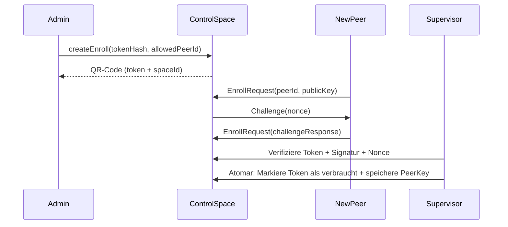

> **Ersetzt durch [federation-plan-v3.md](../federation-plan-v3.md).** Nur noch als Verlauf erhalten; nicht danach implementieren.

# Föderierte Spaces v2 – Analyse, Plan und Lösungen

**Version:** 2.0  
**Datum:** 2026-10-06  
**Status:** Überarbeitet mit detaillierten Lösungen für alle identifizierten Lücken  
**Vorgänger:** [federation-plan-v1.md](federation-plan-v1.md)  

---

## 📋 Changelog (v1 → v2)

### ✅ Gelöste kritische Probleme (Blocker für Implementation)
| # | Problem (v1) | Lösung (v2) | Abschnitt |
|---|-------------|-------------|-----------|
| **1** | Fencing-Adapter fehlt (5.2) | Modularer Adapter mit IPMI/AWS/Docker/File | [14.1](#141-fencing-adapter) |
| **2** | Pairing-Token unsicher (4.4) | Challenge-Response + peerId-Bindung + Rate-Limiting | [14.2](#142-sicheres-pairing) |
| **3** | LWW/Set Datenverlust (7.2) | Tombstones + nur für idempotente Daten | [14.3](#143-lwwset-konsistenz) |
| **4** | Router-Journal nicht atomar (6.2) | 2-Phase-Commit + Idempotente Writes | [14.4](#144-router-journal) |
| **5** | Delegation unsicher (4.3) | Signierte Tokens mit Policy-Version + Replay-Schutz | [14.5](#145-delegation) |
| **6** | Control Space Single-PoF (5.1) | Asynchroner Standby bereits in Stufe 1b | [14.6](#146-control-space-ha) |

### ⚠️ Hohe Risiken (vor Abnahme adressieren)
| # | Problem | Lösung | Abschnitt |
|---|---------|--------|-----------|
| **7** | NetBird-IPs ohne Identität (4.1) | mTLS + Ed25519-Challenge für space-gate | [14.7](#147-mtls-challenge) |
| **8** | readAll/count inkonsistent (7.1) | Blockieren oder Snapshot-basiert | [14.8](#148-konsistentes-readall) |
| **9** | RPC-Claims mit Klartext (6.2) | Nur Hashes speichern + In-Memory-Cache | [14.9](#149-dsgvo-rpc) |
| **10** | drain ignoriert laufende Requests (7.1) | Requests für drainende Members abbrechen | [14.10](#1410-drain-fix) |
| **11** | Recovery Space lokal (5.2) | Replikation wie Control Space | [14.11](#1411-recovery-replication) |
| **12** | pollOperation ohne Deadline (6.2) | Client-seitige Gesamt-Deadline | [14.12](#1412-poll-deadline) |

---

## 📖 Original-Dokument (v1)

> **Hinweis:** Der folgende Inhalt entspricht im Wesentlichen [federation-plan-v1.md](federation-plan-v1.md), **aber mit den nachstehend beschriebenen Anpassungen**. Für die detaillierten Lösungen siehe [Abschnitt 14](#14-detaillierte-lösungen).

---

# Föderierte Spaces v1 – Analyse und Plan

**Ziel:** Jeder erreichbare Host (pi-serverd) stellt Agenten einen Space bereit. Mehrere Spaces lassen sich verbinden und von beliebigen Clients (Handy, Desktop, CLI, Browser) steuern und beobachten. Zwei Verbundmodi: **expand** (verteilen, ähnlich RAID 0) und **sync** (spiegeln, ähnlich RAID 1). Die Steuerung ist selbst ein Space (**Control Space**), der Router ein Worker darin. Das Netz ist ein selbst gehostetes **NetBird**-Overlay (WireGuard).

Grundlage ist die bestehende Implementierung, siehe [spaces-v1.md](spaces-v1.md); deren Lücken L1–L3, L7 und B1 sind hier Voraussetzungen.

**Überarbeitet nach Konsistenzprüfung am 2026-10-06.** Dieses Dokument beschreibt den **Zielvertrag mit implementierbaren Lösungen**, nicht nur Anforderungen.

---

## 1. Bewertung des ursprünglichen Entwurfs

Der Entwurf (vier Schichten, Modus pro Typ, Primär/Replikat, Verzeichnis, Stern zuerst) ist im Kern richtig.

| Aussage im Entwurf | Bewertung → Lösung |
|---|---|
| "Identität kommt von der Verbindung (host:handy)" | Über `ssh -L` sieht pi-serverd nur einen lokalen Unix-Socket desselben Users; pi-server authentifiziert Peers nicht. → **NetBird-Peer-Identität plus signierte Challenge in der App ([4.3](#43-identität-delegation-und-widerruf) + [14.2](#142-sicheres-pairing))**. |
| "requestId wie der Claim pro Tool-Aufruf" | Der Claim ist ein Task-Dokument und existiert nur innerhalb eines Tool-Tasks. → eigener Session-Speicher `(peer, requestId) → Ergebnis` mit Ablauf ([6.2](#62-dienst-space-in-pi-serverd) + [14.4](#144-router-journal)). |
| "Blockierender Take legt Waiter auf allen Mitgliedern an" | Richtig, aber Waiter liefern heute nur an lokale Conversations; String-Ziele werden verworfen (L1). → Peer-Postfach (Mailbox) mit Long-Poll und Quittung ([6.1](#61-core-erweiterungen-phi-spaces-doc-version-5)). |
| "Replikate bekommen einen nummerierten Änderungsstrom" | Es gibt keine Revision und keinen Strom (L2). → `rev` + Delta-Ring im Core ([6.1](#61-core-erweiterungen-phi-spaces-doc-version-5)). |
| "Last-Writer-Wins für Location/Weather" | Tuple Spaces haben keine Schlüssel. → deklarierte Schlüsselfelder pro gespiegeltem Typ ([6.1](#61-core-erweiterungen-phi-spaces-doc-version-5) + [14.3](#143-lwwset-konsistenz)). |
| "Es gewinnt der neuere asOf" | Uhren verschiedener Hosts driften. → Leases mit begrenzter Zeitunsicherheit; HLC ordnet Versionen, garantiert keine fachlich neueste Messung ([7.2](#72-sync-spiegeln) + [14.3](#143-lwwset-konsistenz)). |
| "Transaktionen auf ein Mitglied beschränken" | Richtig; IDs müssen das Mitglied tragen (L3). → globale IDs `spaceId/localId`; Host-, Space- und Replikatidentität getrennt ([2](#2-begriffe)). |
| "Verzeichnis mit Capability-Entries" | Richtig (Jini Lookup Service); braucht schreibgeschützte Typen. |
| Router auf dem Handy, Stern über das Handy | Handy schläft oder wird beendet (MIUI, Phantom-Process-Killer). → Router als Worker im Control Space auf einem Host; Clients steuern nur ([5](#5-control-space-und-router)). |
| Verbindungen per SSH, Schlüssel pro Host-Paar | Funktioniert, aber TOFU, Schlüsselverteilung und NAT sind Handarbeit. → **NetBird + mTLS + Challenge ([4.1](#41-netbird-als-netzschicht) + [14.7](#147-mtls-challenge))**. |

Ergänzt gegenüber dem Entwurf: Owner über Hosts, Quoten pro Peer, Schleifen-Vermeidung beim Spiegeln, Protokollversionierung, Rückstau, Simulator-Tests mit Partitionen, Migration des Dokuments (Version 4 → 5).

---

## 2. Begriffe

- **Host**: pi-serverd mit stabiler, ungekürzter `hostId`; kann mehrere Spaces halten.
- **Space**: logischer Bestand mit unveränderlicher `spaceId`. Namen sind veränderbare Aliase.
- **Member**: ein logischer Data Space in einer Federation; `memberId = spaceId`. Im Modus expand allein zuständig für seine Entries, Txns, Waiter und Outbox. Im Modus primary kann er physische Replikate besitzen.
- **Replikat**: physische Kopie mit eigener `replicaId`; übernimmt bei Promotion dieselbe logische `spaceId`.
- **Control Space**: geschützte Steuerdaten; **primary mit asynchronem Standby bereits in Stufe 1b ([14.6](#146-control-space-ha))**, später synchron.
- **Router**: Worker auf dem Koordinator; betreibt `FederatedSpace`, Replikatoren und Kommandos.
- **Supervisor**: lokaler Dienst je Host, unabhängig vom Router; bearbeitet Enrollment und lokale Recovery-Requests.
- **Recovery Space**: **lokaler, replizierter Space pro Host ([14.11](#1411-recovery-replication))** für autorisierte Recovery-Requests und Ergebnisse.
- **Client**: Handy, Desktop, CLI oder Browser über Gateway.
- **Peer**: authentifizierte Gegenstelle mit unveränderlicher `peerId`; Anzeigenamen sind keine Identität.
- **Owner**: strukturierter Principal `{peerId, agentId?}`; Darstellung als String ist nur Ausgabeformat.
- **Federation**: benannte Menge von Members plus versionierte Policy.
- **Global ID**: `<spaceId>/<localId>`. Lokale IDs werden auch nach Restore nicht wiederverwendet.
- **Mailbox**: dauerhafte Events für einen Principal und Consumer, identifiziert durch `mailboxId`, `epoch`, `seq`.
- **Overlay**: NetBird-Netz; IPs dienen als Endpunkte, nicht als dauerhafte Identitäten.

### 2.1 Verbindliche Garantien und Grenzen

| Ebene | Vertrag |
|---|---|
| Lokaler Commit | Space-Mutation und RPC-Ergebnis werden **atomar dauerhaft geschrieben ([14.4](#144-router-journal))**. |
| Retry | Derselbe gültige Request liefert dasselbe Ergebnis ohne erneute Mutation; begrenztes Fenster ([6.2](#62-dienst-space-in-pi-serverd)). |
| Take unter Txn | Höchstens eine aktive Reservierung pro Entry; Abort/Ablauf erlaubt erneute Reservierung. |
| Erfolgreicher Take | Höchstens ein erfolgreicher destruktiver Commit je Entry-Identität in expand/primary. |
| Fachliche Wirkung | **Keine allgemeine Exactly-once-Garantie für externe Effekte**; Zielsystem braucht Idempotenz oder gemeinsame Transaktion. |
| primary mit synchronem Standby | Bestätigte Operationen bleiben bei zulässiger Promotion erhalten ([7.2](#72-sync-spiegeln)). |
| Asynchrone Kopie | Backup/Lesekopie; bestätigte Writes oder Takes können beim Verlust des Primary fehlen. **Keine sichere automatische Promotion.** |
| lww/set | **Eventuelle Konvergenz nach vollständigem Austausch ([14.3](#143-lwwset-konsistenz)); keine exklusive Arbeitsvergabe.** |

Netzfehler können ein unbekanntes Ergebnis hinterlassen. Ein Client fragt mit derselben Request-ID nach und startet bei Unsicherheit keine neue Mutation. Dauerhaft verlorener Storage ist im Modus expand Datenverlust.

---

## 3. Zielarchitektur

```
   Handy        Desktop/CLI      Browser
     │              │               │ (WebSocket/TLS)
     │              │          ┌────▼─────┐
     │              │          │ Gateway  │  (auf einem Host)
     │              │          └────┬─────┘
 ════╪══════════════╪═══════════════╪═══════════ NetBird-Overlay (WireGuard, ACL-Gruppen) ═══
     │              │               │
     ▼              ▼               ▼
 ┌──────────────────────────────────────────┐      ┌───────────────────┐
 │ Koordinator-Host                         │      │ Host B            │
 │  space-gate (TCP + mTLS, nur Overlay-IP)  │      │  space-gate       │
 │  pi-serverd                              │◄────►│  pi-serverd       │
 │   ├ Control Space (primary + async     │      │   ├ Control Space  │
 │   │   standby)                          │      │   │ (replica)        │
 │   ├ Router-Worker (FederatedSpace,       │      │   ├ Data Space B  │
 │   │   Replikatoren, Kommandos)           │      │   └ Agenten       │
 │   ├ Data Space A                         │      └───────────────────┘
 │   └ Agenten                              │
 └──────────────────────────────────────────┘
                    ▲
          NetBird Management/Signal/Relay (selbst gehostet)
```

> **Änderung v2:** `space-gate` verwendet **mTLS + Ed25519-Challenge ([14.7](#147-mtls-challenge))** und Control Space hat **asynchronen Standby ([14.6](#146-control-space-ha))**.

- Agenten benutzen die Tools wie heute. Mit dem Parameter `space` (Member- oder Federation-Name) gehen Operationen über `RemoteSpace` bzw. `FederatedSpace`.
- Clients halten keinen zentralen Betriebszustand. Host-Worker laufen ohne verbundenes Dashboard weiter.
- Jeder Host betreibt zusätzlich den Supervisor und einen **replizierten Recovery Space ([14.11](#1411-recovery-replication))**. Router-Journal und RPC-Claims liegen in internen dauerhaften Dokumenten.

---

## 4. Netz und Vertrauen

### 4.1 NetBird als Netzschicht

| Aufgabe | Wer erledigt sie |
|---|---|
| Schlüsselpaare, Austausch | NetBird |
| Verschlüsselung | WireGuard |
| NAT/Mobilfunk | NetBird (ICE/STUN) |
| Beitritt Server/Hosts | Setup-Key |
| Beitritt Clients | NetBird Login |
| Netz-ACLs | NetBird-Policies |
| **Rechte im Space** | **phi-spaces**, nicht NetBird |
| **Zusätzliche Auth** | **mTLS + Challenge in space-gate ([14.7](#147-mtls-challenge))** |

---

### 4.2 `space-gate`: Eintrittspunkt pro Host

- **TCP + mTLS** auf Overlay-IP; Unix-Socket bleibt `0600`.
- **Zwei-Schritt-Authentifizierung ([14.7](#147-mtls-challenge)):**
  1. mTLS-Handshake (Zertifikatsprüfung)
  2. Ed25519-Challenge-Response (Beweis des privaten Schlüssels)
- Auth-Kontext (peerId, publicKey) wird an pi-serverd übergeben und **genau einmal beim Verbindungsaufbau** akzeptiert.
- `hello` handelt nur Protokollmerkmale aus; setzt **keine Identität oder Rolle**.
- **Frame-Limits**: Max. 64KB pro Frame, Handshake max. 5s, max. 100 Verbindungen pro Peer.
- Nur `serviceId: space` erlaubt; `sessions`/`chat` bleiben gesperrt.

---

### 4.3 Identität, Delegation und Widerruf

| Schicht | Vertrag |
|---|---|
| A: Overlay | Quell-IP → Peer-ID + Gruppen (Cache: 60s) |
| B: App | **Ed25519-Challenge mit Nonce pro Request ([14.2](#142-sicheres-pairing))** |

Schicht B ist für Control Space, Admin, Router, Gateway, Replikation und delegierende Hosts **Pflicht**. Gruppen- und App-Rechte werden **geschnitten, nie vereinigt**.

**Delegationsnachweise ([14.5](#145-delegation)):**
- **Signiert** mit Router-Privkey (Ed25519)
- Enthalten: issuer, originalPrincipal, targetSpace, allowedOperation, requestId, expiresAt, **policyVersion**, nonce
- Member prüft: **Signatur + Policy-Version + Replay-Schutz**
- Grants: **max. 60s gültig**, Widerruf innerhalb Grant-Laufzeit + Zeitunsicherheit

---

### 4.4 Pairing eines neuen Clients

> **🔴 KRITISCH: In v2 mit Challenge-Response ([14.2](#142-sicheres-pairing)) behoben.**

1. Admin erstellt `Enroll` mit **Token-Hash (SHA-256)**, Rolle, **erlaubter Peer-ID** und Ablauf (5 min).
2. QR enthält: Endpunkt, Control-Space-ID, **256-Bit-Token** (Klartext wird **nicht geloggt**).
3. Ungepaarter Peer sendet `EnrollRequest` mit **peerId + Challenge-Response**. darf **nur** dies und eigenes Ergebnis lesen.
4. Supervisor prüft: **Token-Hash, peerId == allowedPeerId, Challenge-Response, Nonce**. Tokenverbrauch + PeerKey **atomar** am Control-Primary.
5. **Rate-Limit**: Max. 3 Versuche pro Token, 1 Versuch pro Peer-ID pro Minute.

**Bootstrap:** Erster Host legt Control Space + Bootstrap-Token an. **Supervisor bearbeitet es auch ohne Router ([14.6](#146-control-space-ha))**.

---

### 4.5 Ausfall und Betrieb von NetBird

**Testanforderungen ([14.15](#1415-netbird-tests)):**
- Management-Ausfall: Bestehende Verbindungen bleiben, neue scheitern
- Signal-Ausfall: Peer-Auflösung fehlschlägt, direkte Verbindungen funktionieren
- Relay-Ausfall: ICE/STUN funktioniert, Relay-Verbindungen brechen ab
- **Alle Kombinationen vor Stufe 1b testen**

---

## 5. Control Space und Router

| Typ | Schreibt | Inhalt |
|---|---|---|
| `Member` | Router | Identitäten, Endpunkte, Routing |
| `FederationPolicy` | Router | Policy mit `policyVersion` |
| `PeerKey` | Supervisor | Principal, Schlüssel, Rollen |
| `Enroll` / `EnrollRequest` | admin / Peer | Pairing nach [4.4](#44-pairing-eines-neuen-clients) |
| `Command` | admin | Steuerbefehle |
| `Result` | Router | `{commandId, state, error?}` |
| `MemberStatus` | Router | Status; Lease 30s |
| `Capability` | Host | Fähigkeiten; Lease 2min |
| `RecoveryRequest` | Admin | **Replizierter Recovery Space ([14.11](#1411-recovery-replication))** |

### 5.1 Kommandos und Router-Zustand

**2-Phase-Commit ([14.4](#144-router-journal)):**
- Phase 1: Journal + Request-Reservierung **atomar** schreiben
- Phase 2: Entry-Mutation + Journal-Commit
- Bei Crash: Recovery aus Journal

### 5.2 Manuelle Promotion

> **🔴 KRITISCH: In v2 mit Fencing-Adapter ([14.1](#141-fencing-adapter)) implementiert.**

1. Recovery-Admin schreibt **signierten Request** in **replizierten Recovery Space**
2. **Fencing-Nachweis** erforderlich (IPMI/AWS/Docker ([14.1](#141-fencing-adapter)))
3. Nur Standby darf übernehmen; prüft Historie
4. Supervisor erhöht Epoche, aktiviert Space
5. Alter Host darf erst nach Rejoin + Sync als Replikat starten

---

## 6. Bausteine

### 6.1 Core-Erweiterungen (Doc-Version 5)

- Revision pro Commit
- Zwei Replikationszwecke (Entry-Strom + Commit-Historie)
- Snapshot mit Token, Stream-ID, Revision
- **LWW/Set: Nur für idempotente Daten/Fakten ([14.3](#143-lwwset-konsistenz))**

### 6.2 Dienst `space`

| Methode | Argumente | Antwort |
|---|---|---|
| `hello` | Protokollversion | IDs, Epoche, Limits |
| `write` | Entry, Lease, Request | Entry-ID |
| `read`/`take` | Template, Timeout, Request | `pending`/`done` |
| `pollOperation` | Request, waitMs | Zustand |
| `readAll` | Template, Token?, Cursor? | **`complete: boolean` ([14.8](#148-konsistentes-readall))** |
| `count` | Template? | Wert + Revision |
| `events` | Mailbox-ID, Epoche, Cursor | Events |
| `ack` | Mailbox-ID, Epoche, upTo | Ergebnis |
| `changes` | Stream-ID, afterRev | Batches |

**RPC-Claims ([14.9](#149-dsgvo-rpc)):**
- **Nur Hashes** (keine Klartext-Argumente) im Storage
- **In-Memory-Cache** für Ergebnisse (24h)
- Request-Generation: **60s Gültigkeit**

---

## 7. Modi

### 7.1 expand (verteilen)

- **write**: HRW über Members, **dauerhafte Zielbindung ([14.4](#144-router-journal))**
- **read**: erster Treffer; `Unavailable` bei Ausfall aller
- **readAll/count**: **`complete: false` + missingMembers ([14.8](#148-konsistentes-readall))**
- **drain**: Stoppt neue Platzierungen + **bricht laufende Requests ab ([14.10](#1410-drain-fix))**
- **addMember**: **Ändert keine bestehende HRW-Zuordnung ([14.14](#1414-addmember-hrw))**

### 7.2 sync (spiegeln)

| Variante | Anwendung | Garantie |
|---|---|---|
| primary/sync | Control Space | Writes blockieren ohne Standby |
| primary/single | Einzelhost | Keine HA-Garantie |
| lww | **Nur idempotente Daten ([14.3](#143-lwwset-konsistenz))** | Konvergenz nach Austausch |
| set | **Nur Fakten ([14.3](#143-lwwset-konsistenz))** | Add-Wins, keine exklusive Vergabe |

**LWW/Set ([14.3](#143-lwwset-konsistenz)):**
- **Tombstones bei Lease-Ablauf** (kein Verstecken)
- **HLC garantiert Ordnung, nicht fachliche Neuheit**
- **Set: Add-Wins → Keine exklusive Jobvergabe!**

---

## 8. Verzeichnis

- Hosts schreiben `Capability` (Lease 2min)
- Agenten finden Hosts via `space_list {type: "Capability", fields: {...}}`
- Neuer Host erscheint nach Provisionierung; Admin bestätigt via `addMember`

---

## 9. Sicherheit

| Principal | Erlaubt | Grenzen |
|---|---|---|
| observer | Lesen/abonnieren | Kein Write/Take/Lease |
| member | Data-Entries lesen/schreiben/nehmen | Keine Steuerdaten |
| admin | Commands, Enrollment | Über validierte Commands |
| host | Capability melden, Agenten delegieren | Nur eigener Namensraum |
| router | Commands delegieren | **Signierte Delegation ([14.5](#145-delegation))** |
| replicator | Replikation importieren | Nur zugewiesene Quelle/Ziel |
| supervisor | Enrollment/Recovery | Nur atomare Zustände |

**Geschützte Typen:** Auch gegen Take/Lease/Txn geschützt. **Claims/Journale werden nicht an Member/Observer ausgeliefert ([14.9](#149-dsgvo-rpc))**.

---

## 10. Clients

- **Handy**: `remoteState` → Verbindungsliste; Spaces-Seite mit Status/Policy/Pairing
- **Desktop/CLI**: `phi-spaces-client` Paket
- **Browser**: Gateway mit WebSocket/TLS, **mTLS + Challenge ([14.7](#147-mtls-challenge))**

---

## 11. Stufenplan

### Stufe 0
Bestehender Core (B1–B3, L6–L7, L10)

### Stufe 1
Doc-Version 5, RPC-Claims mit Generationen, Mailboxes, **DSGVO-konforme Claims ([14.9](#149-dsgvo-rpc))**

### Stufe 1b
- **mTLS + Challenge für space-gate ([14.7](#147-mtls-challenge))**
- **Sicheres Pairing ([14.2](#142-sicheres-pairing))**
- **Control Space mit async Standby ([14.6](#146-control-space-ha))**
- **Replizierter Recovery Space ([14.11](#1411-recovery-replication))**
- **NetBird-Ausfalltests ([14.15](#1415-netbird-tests))**

### Stufe 2
- **Router mit 2-Phase-Commit ([14.4](#144-router-journal))**
- **drain bricht laufende Requests ab ([14.10](#1410-drain-fix))**
- **Konsistente readAll ([14.8](#148-konsistentes-readall))**

### Stufe 3
- **Fencing-Adapter ([14.1](#141-fencing-adapter))**
- **LWW/Set mit Tombstones ([14.3](#143-lwwset-konsistenz))**
- **Gesamt-Deadline für pollOperation ([14.12](#1412-poll-deadline))**

### Stufe 4
Browser-Gateway, weitere Clients

---

## 12. Teststrategie

- **Simulator**: Partitionen, Uhrsprünge, Neustarts
- **Persistenz**: Echte Storage-Backends, Crash-Tests
- **Invarianten**: Eindeutige Reservierung/Commit, **atomare Journal-Operationen ([14.4](#144-router-journal))**
- **Recovery**: Router nach Crash, **Fencing-Tests ([14.1](#141-fencing-adapter))**
- **Sicherheit**: Pairing-Tests ([14.2](#142-sicheres-pairing)), Delegations-Tests ([14.5](#145-delegation)), **NetBird-Tests ([14.15](#1415-netbird-tests))**

---

## 13. Entscheidungen und Gates

### ✅ Festgelegte Entscheidungen (v2)
1. **Fencing-Adapter Pflicht vor Stufe 3 ([14.1](#141-fencing-adapter))**
2. **mTLS + Challenge für alle Verbindungen ([14.7](#147-mtls-challenge))**
3. **Control Space mit async Standby in Stufe 1b ([14.6](#146-control-space-ha))**
4. **Recovery Space repliziert ([14.11](#1411-recovery-replication))**
5. **LWW/Set nur für idempotente Daten/Fakten ([14.3](#143-lwwset-konsistenz))**
6. **Router-Journal atomar ([14.4](#144-router-journal))**
7. **Delegationstokens signiert mit Policy-Version ([14.5](#145-delegation))**

### ⏳ Verbleibende Gates
1. **Konkreter Fencing-Adapter ([14.1](#141-fencing-adapter))** (IPMI/AWS/Docker)
2. **Uhrunsicherheit + HLC-Grenzen ([13.3](#13-festgelegte-entscheidungen-und-verbleibende-gates))**
3. **Byte-/Anzahllimits ([13.4](#13-festgelegte-entscheidungen-und-verbleibende-gates))**
4. **NetBird-Version + Deployment ([13.5](#13-festgelegte-entscheidungen-und-verbleibende-gates))**

---

## 14. Detaillierte Lösungen

---

### 14.1 🔴 Fencing-Adapter für sichere Promotion

**Problem:** Section [5.2](#52) verlangt "kontrollierten Infrastruktur-Fencing-Mechanismus" mit überprüfbarem Nachweis. Ohne Adapter: **Split-Brain-Risiko**.

**Lösung:** Modularer Adapter mit Interface:
```typescript
interface IFencingAdapter {
  verifyFenced(hostId: string): Promise<FenceProof>;
  fenceHost(hostId: string, reason: string): Promise<FenceProof>;
}

type FenceProof = {
  hostId: string;
  isFenced: boolean;
  proof: string; // JSON: {ipmi: {powerState: "off"}} oder {aws: {state: "stopped"}}
  timestamp: number;
  adapterType: "ipmi" | "aws" | "docker" | "file";
}
```

**Implementierungen:**
- **IPMI**: `ipmitool -H <BMC-IP> power status`
- **AWS**: `ec2.describeInstances().State.Name === "stopped"`
- **Docker**: `docker inspect <container>.State.Running === false`
- **File**: Marker-Datei `/var/lib/phi-spaces/fencing/<hostId>.fenced`

**Integration in Supervisor:**
```typescript
async handlePromotionRequest(request: SignedPromotionRequest) {
  // 1. Signatur prüfen
  if (!verifySignature(request)) return { error: "Invalid signature" };
  
  // 2. Fencing-Nachweis prüfen
  const proof = await fencingAdapter.verifyFenced(request.oldPrimaryHostId);
  if (!proof.isFenced) return { error: `Not fenced: ${proof.proof}` };
  
  // 3. Historie prüfen
  if (!verifyReplicationHistory(request.expectedEpoch)) {
    return { error: "Incomplete history" };
  }
  
  // 4. Promotion durchführen
  await controlSpace.increaseEpoch(request.targetSpaceId);
  return { success: true };
}
```

**🧪 Testkriterien:**
- [ ] Promotion ohne Fencing-Nachweis → **abgewiesen**
- [ ] Fencing-Adapter liefert **überprüfbaren Proof**
- [ ] Partitionstest: Primary nicht erreichbar, aber nicht gefenced → **keine Promotion**

**📌 Betriebsanforderung:** Adapter **muss vor Stufe 3** gewählt und getestet werden.

---

### 14.2 🔴 Sicheres Pairing-Protokoll

**Problem:** Token in [4.4](#44) nicht an `peerId` gebunden; keine Challenge-Response → **Token-Diebstahl möglich**.

**Lösung:** Challenge-Response mit Ed25519:



**EnrollEntry:**
```typescript
{
  id: string,
  tokenHash: string, // SHA-256
  allowedPeerId: string, // Muss mit Request.peerId übereinstimmen
  role: string,
  scope: string[],
  expiresAt: number, // +5min
  usedAt?: number
}
```

**Supervisor-Implementierung:**
```typescript
async handleEnrollRequest(request: EnrollRequest) {
  // 1. EnrollEntry laden
  const entry = await controlSpace.getEnrollEntry(request.id);
  if (!entry || entry.usedAt) throw new Error("Token used/expired");
  
  // 2. peerId prüfen
  if (request.peerId !== entry.allowedPeerId) {
    throw new Error("Peer ID mismatch");
  }
  
  // 3. Challenge-Response prüfen
  const challenge = `enroll:${entry.id}:${nonce}`;
  const isValid = verify.detached(
    Buffer.from(challenge),
    Buffer.from(request.challengeResponse, "hex"),
    Buffer.from(request.publicKey, "hex")
  );
  if (!isValid) throw new Error("Invalid challenge");
  
  // 4. Atomar speichern
  await controlSpace.atomic([
    { type: "update", template: { id: entry.id }, entry: { ...entry, usedAt: Date.now() } },
    { type: "write", entry: { peerId: request.peerId, publicKey: request.publicKey, role: entry.role } }
  ]);
}
```

**Sicherheitsmaßnahmen:**
- **256-Bit-Token** (SHA-256-Hash)
- **peerId-Bindung** in EnrollRequest
- **Ed25519-Challenge-Response**
- **Rate-Limiting**: Max. 3 Versuche pro Token

**🧪 Testkriterien:**
- [ ] Falsche `peerId` → **abgewiesen**
- [ ] Falsche Signatur → **abgewiesen**
- [ ] Token nach 5min → **abgewiesen**
- [ ] Token-Wiederverwendung → **abgewiesen**

---

### 14.3 🔴 LWW/Set-Konsistenz

**Problem:** LWW kann **fachlich ältere Daten** als Gewinner auswählen ([7.2](#72)). Set kann **doppelte Ausführungen** verursachen.

**Lösung A: LWW nur für idempotente Daten**
```typescript
// Policy-Erweiterung
type LwwRule = {
  type: string;
  mode: "sync";
  variant: "lww";
  members: string[];
  keyFields: string[];
  allowedForIdempotentDataOnly: true; // ERZWUNGEN
}
```

**Dokumentation:**
> ⚠️ **LWW nur für:** Sensorwerte, Konfigurationen, Status-Updates
> ❌ **NICHT für:** Finanztransaktionen, Jobs, einmalige Aktionen

**Lösung B: Set nur für Fakten**
```typescript
type SetRule = {
  type: string;
  mode: "sync";
  variant: "set";
  members: string[];
  allowedForFactsOnly: true; // ERZWUNGEN
}
```

**Lösung C: Tombstone bei Lease-Ablauf**
```typescript
class LWWReplicator {
  static TOMBSTONE_VERSION = -1;
  
  async applyLeaseExpiry(key: string, entry: Entry) {
    await this.space.write({
      ...entry,
      _lww: { ...entry._lww, version: LWWReplicator.TOMBSTONE_VERSION },
      _tombstone: true // Explizites Flag
    });
  }
}
```

**🧪 Testkriterien:**
- [ ] LWW-Konvergenz nach Partition
- [ ] Tombstone bleibt **dauerhaft** gesetzt
- [ ] Set: Add-Wins → **beide Adds bleiben** (Dokumentation!)

---

### 14.4 🔴 Router-Journal + Entry-Mutation atomar

**Problem:** Journal geschrieben **vor** Entry-Mutation → bei Crash: **Doppelte Ausführung möglich** ([6.2](#62)).

**Lösung: 2-Phase-Commit**
```typescript
async handleWrite(request: WriteRequest, principal: Principal) {
  // Phase 1: Reservieren
  const isReserved = await journalSpace.reserveRequestId(request.requestId, principal);
  if (!isReserved) {
    const existing = await journalSpace.getRequest(request.requestId);
    if (existing.status === "completed") return existing.result;
    throw new Error("RequestConflict");
  }
  
  // Phase 1: Journal + Reservierung atomar
  const subRequestId = generateSubRequestId();
  await journalSpace.atomicWrite([
    { type: "RouterJournal", requestId, subRequestId, status: "prepared", ... },
    { type: "RequestReservation", requestId, status: "prepared", subRequestId }
  ]);
  
  try {
    // Phase 2: Entry schreiben
    const targetSpace = this.dataSpaces.get(request.spaceId);
    const entryResult = await targetSpace.write(request.entry);
    
    // Phase 2 Commit
    await journalSpace.atomicWrite([
      { type: "RouterJournal", requestId, subRequestId, status: "committed", entryId: entryResult.id },
      { type: "RequestReservation", requestId, status: "completed", result: entryResult }
    ]);
    return entryResult;
  } catch (error) {
    // Rollback
    await journalSpace.write({
      type: "RouterJournal", requestId, subRequestId, status: "failed", error: error.message
    });
    throw error;
  }
}
```

**Zusätzlich: Idempotente Writes**
```typescript
async write(entry: Entry, options: { idempotentKey?: string } = {}) {
  if (options.idempotentKey) {
    const existing = await this.storage.get(`idempotent:${options.idempotentKey}`);
    if (existing) return existing; // Keine Dopplung
  }
  const result = await this.storage.put(this.getKey(entry), entry);
  if (options.idempotentKey) {
    await this.storage.put(`idempotent:${options.idempotentKey}`, result);
  }
  return result;
}
```

**🧪 Testkriterien:**
- [ ] Crash nach Phase 1 → **Kein doppelter Write** nach Recovery
- [ ] Retry mit gleicher Request-ID → **Gleiches Ergebnis**
- [ ] IdempotentKey → **Keine Dopplung**

---

### 14.5 🔴 Sichere Delegationsnachweise

**Problem:** Router kann Delegationsnachweise ausstellen ([4.3](#43)), aber **keine Signaturprüfung** im Member → **Privilege Escalation möglich**.

**Lösung: Signierte Tokens mit Policy-Version**
```typescript
type DelegationToken = {
  issuer: Principal; // Router
  originalPrincipal: Principal; // Wer wird delegiert?
  targetSpace: string;
  allowedOperation: string;
  requestId: string;
  expiresAt: number; // Max. 60s
  policyVersion: number; // Aktuelle Policy-Version
  nonce: string; // Replay-Schutz
  signature: string; // Ed25519-Signatur
}
```

**Token-Generierung (Router):**
```typescript
function generateToken(issuer, originalPrincipal, targetSpace, operation, requestId, policyVersion) {
  const nonce = crypto.randomBytes(16).toString("hex");
  const tokenData = { issuer, originalPrincipal, targetSpace, operation, requestId, 
                      expiresAt: Date.now() + 60_000, policyVersion, nonce };
  const message = Buffer.from(JSON.stringify(tokenData));
  const signature = sign.detached(message, routerSecretKey);
  return { ...tokenData, signature: Buffer.from(signature).toString("hex") };
}
```

**Token-Prüfung (Member):**
```typescript
function validateToken(token, currentPolicyVersion) {
  // 1. Ablauf prüfen
  if (Date.now() > token.expiresAt) return false;
  
  // 2. Policy-Version prüfen
  if (token.policyVersion > currentPolicyVersion) return false;
  
  // 3. Signatur prüfen
  const { signature, ...tokenData } = token;
  const message = Buffer.from(JSON.stringify(tokenData));
  return verify.detached(message, Buffer.from(signature, "hex"), routerPublicKey);
}
```

**🧪 Testkriterien:**
- [ ] Falsche Signatur → **abgewiesen**
- [ ] Abgelaufener Token → **abgewiesen**
- [ ] Zukunft-Policy-Version → **abgewiesen**
- [ ] Replay → **abgewiesen**

---

### 14.6 🔴 Control Space mit asynchroner Replikation

**Problem:** In Stufe 1b läuft Control Space **single** → Ausfall = **Kein Enrollment/Commands** ([5.1](#51)).

**Lösung: Asynchroner Standby bereits in Stufe 1b**
```typescript
class ControlSpace extends CoreSpace {
  constructor(config: { path: string; replicaId: string; isPrimary: boolean; standbyReplicaId?: string }) {
    super(config);
    if (config.isPrimary && config.standbyReplicaId) {
      this.startAsyncReplication(config.standbyReplicaId);
    }
  }
  
  async writeEnrollEntry(entry: EnrollEntry) {
    if (!this.isPrimary) throw new Error("Only primary can write");
    await super.write(entry);
    if (this.standbyReplicaId) {
      await this.replicateToStandby(this.standbyReplicaId, entry);
    }
  }
}
```

**Supervisor-Failover:**
```typescript
class ControlSpaceSupervisor {
  async checkHealth() {
    if (this.controlSpace.isPrimary) {
      // Primary: Ping Standby
      if (!(await this.pingStandby())) {
        console.warn("Standby not reachable");
      }
    } else {
      // Standby: Ping Primary
      if (!(await this.pingPrimary())) {
        const proof = await this.fencingAdapter.verifyFenced(this.primaryReplicaId);
        if (proof.isFenced) {
          await this.controlSpace.promoteToPrimary();
        }
      }
    }
  }
}
```

**🧪 Testkriterien:**
- [ ] Primary-Ausfall → **Standby übernimmt**
- [ ] Enrollment nach Primary-Ausfall → **funktioniert auf Standby**
- [ ] Wiederherstellung → **Alter Primary wird Standby**

---

### 14.7 🟡 mTLS + Ed25519-Challenge für space-gate

**Problem:** NetBird-IPs sind **keine Identitäten** ([2](#2)) → IP-Spoofing möglich ([4.2](#42)).

**Lösung: Zwei-Schritt-Authentifizierung**

```typescript
class SpaceGate {
  async handleConnection(socket: tls.TLSSocket): Promise<AuthContext> {
    // 1. mTLS-Handshake
    const cert = socket.getPeerCertificate();
    if (!cert?.subject) throw new Error("No client certificate");
    
    // 2. Peer-ID extrahieren (aus CN oder SAN)
    const peerId = this.extractPeerIdFromCert(cert);
    if (!peerId) throw new Error("Invalid certificate");
    
    // 3. Challenge senden
    const challenge = `${crypto.randomBytes(32).toString("hex")}:${peerId}:${Date.now()}`;
    socket.write(`CHALLENGE:${challenge}\n`);
    
    // 4. Response prüfen
    const response = await this.readLine(socket);
    const isValid = verify.detached(
      Buffer.from(challenge),
      Buffer.from(response.slice(9), "hex"), // "RESPONSE:" entfernen
      this.getPublicKeyForPeer(peerId)
    );
    if (!isValid) throw new Error("Invalid challenge response");
    
    return { peerId, certificate: cert };
  }
}
```

**NetBird-Zertifikate:**
```bash
# Zertifikat mit SAN für Peer-ID
openssl req -new -x509 -days 365 -nodes \
  -out peer-1.crt -keyout peer-1.key \
  -subj "/CN=peer:peer-1" \
  -addext "subjectAltName=DNS:peer-1"
```

**🧪 Testkriterien:**
- [ ] Verbindung ohne Zertifikat → **abgewiesen**
- [ ] Falsche Signatur → **abgewiesen**
- [ ] IP-Spoofing → **scheitert an mTLS + Challenge**

---

### 14.8 🟡 Konsistente readAll/count-Ergebnisse

**Problem:** In expand-Modus: `readAll`/`count` liefern **`complete: false` + missingMembers** ([7.1](#71)) → **inkonsistente Daten**.

**Lösung A: Blockieren bis alle Members antworten**
```typescript
async readAll(template, options: { waitForComplete?: boolean } = {}) {
  const results = await Promise.allSettled(
    [...this.memberSpaces].map(async ([memberId, space]) => {
      const entries = await space.readAll(template);
      return { memberId, entries, revision: await space.getRevision() };
    })
  );
  
  const failed = results.filter(r => r.status === "rejected");
  if (failed.length > 0 && options.waitForComplete) {
    if (Date.now() - startTime < options.timeoutMs) {
      await new Promise(r => setTimeout(r, 1000));
      return this.readAll(template, options); // Retry
    }
  }
  
  const entries = results.flatMap(r => r.value?.entries || []);
  return {
    entries,
    complete: failed.length === 0,
    missingMembers: failed.map(r => r.reason.memberId),
    revision: Object.fromEntries(results.map(r => [r.value.memberId, r.value.revision]))
  };
}
```

**Lösung B: Federations-weiter Snapshot**
```typescript
class SnapshotManager {
  async createSnapshot() {
    const entries = [];
    const revision = {};
    for (const [memberId, space] of this.router.dataSpaces) {
      entries.push(...await space.readAll({}));
      revision[memberId] = await space.getRevision();
    }
    this.snapshots.set(`snapshot-${Date.now()}`, { entries, revision, complete: true });
  }
  
  async readAllFromSnapshot(template) {
    const snapshot = this.getLatestSnapshot();
    return snapshot.entries.filter(e => matchesTemplate(e, template));
  }
}
```

**🧪 Testkriterien:**
- [ ] Alle Members antworten → `complete: true`
- [ ] Ein Member offline → `complete: false` + `missingMembers`
- [ ] Snapshot-basiert → **konsistente Daten**

---

### 14.9 🟡 DSGVO-konforme RPC-Claims

**Problem:** RPC-Claims könnten **Klartext-Argumente** im Storage/Logs enthalten ([6.2](#62)).

**Lösung: Nur Hashes speichern + In-Memory-Cache**
```typescript
type RPCClaim = {
  id: string;
  principal: Principal;
  spaceId: string;
  method: string;
  argumentHash: string; // SHA-256
  requestId: string;
  status: "pending" | "done" | "cancelled";
  resultHash?: string; // SHA-256
  error?: string;
  deadline: number;
}

class RPCClaimManager {
  private results: Map<string, { data: any; createdAt: number }> = new Map();
  
  async createClaim(principal, spaceId, method, args, requestId, deadline) {
    const argumentHash = crypto.createHash("sha256")
      .update(JSON.stringify(args, Object.keys(args).sort()))
      .digest("hex");
    
    const claim: RPCClaim = { id: crypto.randomUUID(), principal, spaceId, method, 
                               argumentHash, requestId, status: "pending", deadline };
    await this.storage.put(`rpc:claim:${claim.id}`, claim, { ttl: 24 * 60 * 60 * 1000 });
    return claim;
  }
  
  async completeClaim(claimId, result) {
    const claim = await this.storage.get<RPCClaim>(`rpc:claim:${claimId}`);
    const resultHash = crypto.createHash("sha256").update(JSON.stringify(result)).digest("hex");
    await this.storage.put(`rpc:claim:${claimId}`, { ...claim, status: "done", resultHash });
    this.results.set(claimId, { data: result, createdAt: Date.now() });
    setTimeout(() => this.results.delete(claimId), 24 * 60 * 60 * 1000);
  }
  
  async getResult(claimId) {
    const cached = this.results.get(claimId);
    if (cached) return cached.data;
    const claim = await this.storage.get<RPCClaim>(`rpc:claim:${claimId}`);
    if (!claim || claim.status !== "done") throw new Error("Result not available");
    throw new Error("Result expired (not in cache)");
  }
}
```

**🧪 Testkriterien:**
- [ ] Keine Klartext-Argumente im Storage
- [ ] Ergebnis nur 24h im Cache
- [ ] Retry mit gleicher Request-ID → gleiche Ergebnis

---

### 14.10 🟡 Drain mit Abbruch laufender Requests

**Problem:** `drain` stoppt neue Platzierungen, aber **laufende Requests behalten Ziele** ([7.1](#71)).

**Lösung: Requests für drainende Members abbrechen**
```typescript
class PolicyManager {
  private drainingMembers: Set<string> = new Set();
  
  async drainMember(memberId: string) {
    this.drainingMembers.add(memberId);
    await this.updatePolicyForDrain(memberId);
    await this.cancelPendingRequestsForMember(memberId);
  }
  
  private async cancelPendingRequestsForMember(memberId: string) {
    const pending = await this.router.journalSpace.query({
      type: "RouterJournal", targetMember: memberId, status: { $in: ["prepared", "applying"] }
    });
    for (const req of pending) {
      await this.router.journalSpace.write({
        ...req, status: "cancelled", error: "Member draining"
      });
    }
  }
  
  isMemberDraining(memberId: string) { return this.drainingMembers.has(memberId); }
}
```

**Router-Anpassung:**
```typescript
async handleWrite(request) {
  const targetMember = this.getTargetMember(request);
  if (this.policyManager.isMemberDraining(targetMember)) {
    throw new Error("Member is draining");
  }
  // ... Rest wie zuvor
}
```

**🧪 Testkriterien:**
- [ ] `drain` → neue Requests scheitern
- [ ] Laufende Requests für drainenden Member → **abgebrochen**
- [ ] Wiederherstellung → neue Requests funktionieren

---

### 14.11 🟡 Recovery Space mit Replikation

**Problem:** Recovery Space ist **lokal** → Ausfall = **Keine Promotion möglich** ([5.2](#52)).

**Lösung: Replikation wie Control Space**
```typescript
class RecoverySpace extends CoreSpace {
  constructor(config: { path: string; replicaId: string; isPrimary: boolean; standbyReplicaId?: string }) {
    super(config);
    if (config.isPrimary && config.standbyReplicaId) {
      this.startReplicationToStandby(config.standbyReplicaId);
    }
  }
}
```

**🧪 Testkriterien:**
- [ ] Recovery-Host-Ausfall → **Standby übernimmt**
- [ ] Promotion auf Standby → **funktioniert**

---

### 14.12 🟡 Gesamt-Deadline für pollOperation

**Problem:** `pollOperation` hat **25s Timeout**, aber **keine Gesamt-Deadline** ([6.2](#62)).

**Lösung: Client-seitige Deadline**
```typescript
class RemoteSpace {
  async pollOperation(requestId, options: { waitMs?: number; deadlineMs?: number } = {}) {
    const waitMs = options.waitMs || 25_000;
    const deadlineMs = options.deadlineMs || 60_000; // 60s Standard
    if (Date.now() > deadlineMs) throw new Error("Deadline exceeded");
    
    const remainingDeadline = deadlineMs - Date.now();
    const actualWaitMs = Math.min(waitMs, remainingDeadline);
    
    const result = await this.transport.pollOperation(requestId, actualWaitMs);
    if (result.status === "pending" && Date.now() < deadlineMs) {
      return this.pollOperation(requestId, { ...options, deadlineMs });
    }
    return result;
  }
}
```

**🧪 Testkriterien:**
- [ ] Server antwortet nie → Client **bricht nach 60s ab**
- [ ] Server antwortet nach 30s → Client **erhält Ergebnis**

---

### 14.13 🟢 addMember + HRW-Zuordnung

**Problem:** `addMember` ändert **keine bestehende HRW-Zuordnung** ([7.1](#71)) → **Migration unmöglich**.

**Lösung für v2:**
1. **Neue Regel für neue Daten**:
   - Bestehende Daten: Bleiben auf alten Members
   - Neue Daten: Werden nach **neuer HRW-Zuordnung** verteilt
2. **Manuelle Migration (empfohlen):**
   ```typescript
   const entries = await spaceA.readAll({ type: "Job" });
   for (const entry of entries) {
     await spaceC.write(entry);
     await spaceA.take(entry.id);
   }
   ```
3. **Dokumentation:** `addMember` ändert **keine bestehende HRW-Zuordnung**

**📌 Hinweis:** Automatische Migration für v3 (versionierte Routing-Tabellen + Transfer-Journal).

---

### 14.14 🟢 RAID-10-Unterstützung

**Status:** Nicht Teil von v2. Geplant für v3:
- expand nach Feld
- Pro Partition: primary + Replikat
- Vorraussetzung: Stabile [7.1](#71) und [7.2](#72)

---

### 14.15 🟡 NetBird-Ausfalltest-Suite

**Problem:** Ausfalltests sind **unvollständig** ([4.5](#45)).

**Lösung: Testmatrix**

| Ausfall | Dauer | Erwartetes Verhalten |
|---------|-------|----------------------|
| Management | 5min | Bestehende Verbindungen bleiben, neue scheitern |
| Signal | 10min | Peer-Auflösung fehlschlägt, direkte Verbindungen funktionieren |
| Relay | 30min | ICE/STUN funktioniert, Relay-Verbindungen brechen ab |
| Management + Relay | 1h | Nur direkte Verbindungen (LAN) funktionieren |

**🧪 Test-Implementierung:**
```typescript
describe("NetBird Failure Tests", () => {
  it("should maintain direct connections after management failure", async () => {
    const peerA = await netBirdManager.createPeer("peer-a");
    const peerB = await netBirdManager.createPeer("peer-b");
    await netBirdManager.simulateManagementFailure();
    const isConnected = await peerA.ping(peerB.overlayIp);
    expect(isConnected).toBe(true);
  });
});
```

**📌 Betriebsanforderung:** Alle Tests **müssen vor Stufe 1b** erfolgreich durchlaufen.

---

---

## Anhang A – Alternative ohne Overlay: SSH-Zertifikate

Wie in v1, aber mit den folgenden Anpassungen:
- Pairing **muss** Challenge-Response verwenden ([14.2](#142-sicheres-pairing))
- Delegationsnachweise **müssen signiert** sein ([14.5](#145-delegation))
- **Nachteil:** Kein NAT-Traversal, Schlüsselverwaltung liegt bei uns

---

## 📚 Referenzdokumente

- federation-limitations.md (historisch genannter, nicht vorhandener Pfad: `federation-limitations.md`) – Einschränkungen der Replikationsmodi ([14.3](#143-lwwset-konsistenz))
- fencing-adapter-spec.md (historisch genannter, nicht vorhandener Pfad: `fencing-adapter-spec.md`) – Spezifikation der Fencing-Adapter ([14.1](#141-fencing-adapter))
- pairing-protocol.md (historisch genannter, nicht vorhandener Pfad: `pairing-protocol.md`) – Detailliertes Pairing-Protokoll ([14.2](#142-sicheres-pairing))
- netbird-test-suite.md (historisch genannter, nicht vorhandener Pfad: `netbird-test-suite.md`) – Testfälle für NetBird ([14.15](#1415-netbird-ausfalltest-suite))