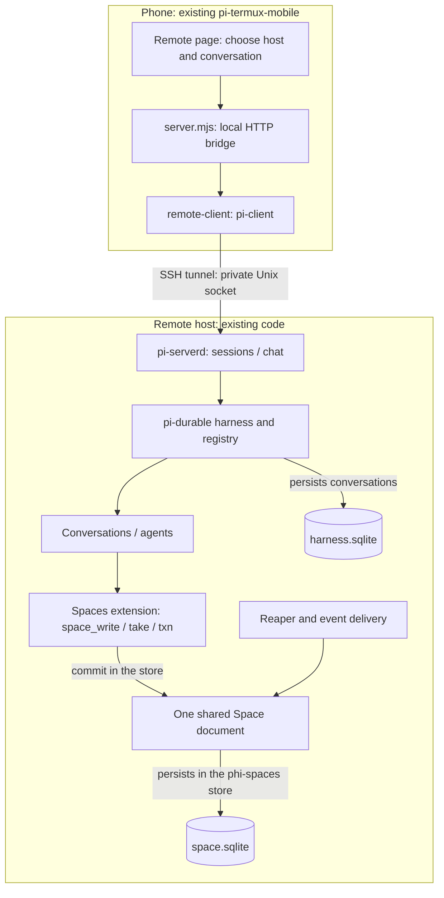
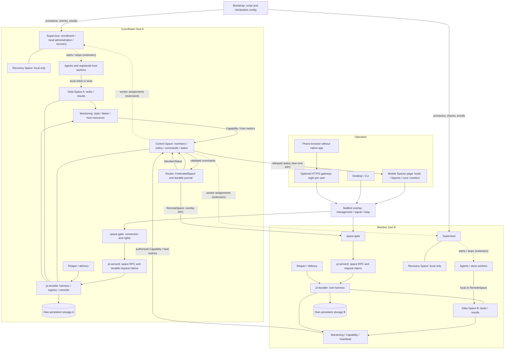
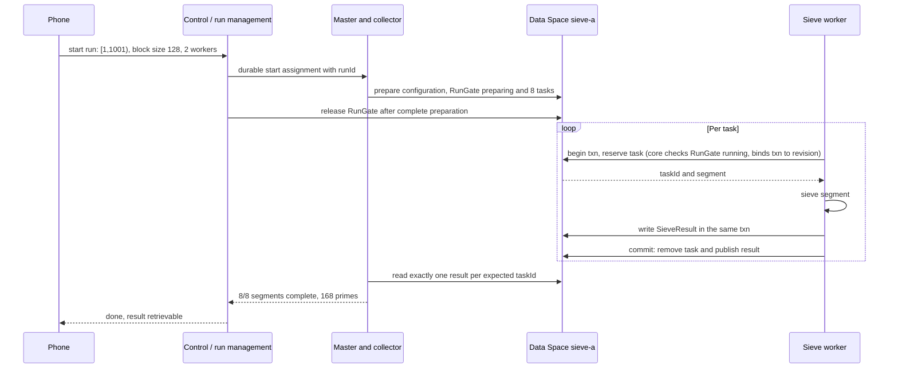

# Operating Spaces and controlling them from the phone

Status: 2026-10-16 (operations extension B1–B10 implemented, acceptance status in §7.6; before that: current state aligned with phase 1b/2 and the begun phase 3 building block; operations extension
extended by implementation order, additional functions and the first RunGate building block). Architecture and operating design
for [federation plan v3](federation-plan-v3.en.md). The reference for the current state remains the
[implementation status](implementierungsstand.en.md); this document describes the **operations extension** on top of it.
Bootstrap calls and new management commands below are proposals as long as section 8 does not list them as
implemented.

## 1. What exists today

| Component | Current state |
|---|---|
| pi-durable harness | in pi-serverd: runs conversations and stores them in `harness.sqlite`; since the [changeover](umstellung-ohne-pi-durable.en.md) the Spaces live in the phi-spaces store (`space.sqlite`), not in the harness |
| phi-spaces | library with its own store (`src/store/`); agent tools as an extension in the harness (`agent/`); default Space version 5; named Spaces through registry and document family |
| Clients | `PhiSpaces` locally, `RemoteSpace` over Unix socket/TCP/pi-server, `FederatedSpace` through the router |
| Reaper and delivery | `startService` handles expiry, follow-up work and events |
| Stage 1 (WP 1.1–1.9) | signed generations, claims, snapshot/byte pages, mailboxes, budgets, CompletionProfile |
| Stage 1b | gate (layer A NetBird, layer B key proof), enrollment, grants, rotation, supervisor (`createEnroll`, `revokePeer`, `rotateKey`), recovery register, control/data restore, boot authorization per Space; accepted live on big/vpsc and with the phone |
| Stage 2 (WP 2.1–2.9) | router with command journal, RouterLease/delegation, signed policy with HRW/type/capacity, `FederatedSpace`, membership (`addMember`, `drain`, `freeze`, `removeMember`, EmptyProof), admin commands `purgeTasks`/`deletePrincipal`; NetBird full load and process aborts accepted (exception: block 4 by decision) |
| Stage 3 (partial) | entry replication (LWW/add-wins), paged snapshots, stream transfer, snapshot maintenance, primary-sync building block; real ten-minute NetBird partition passed at component level; **not** integrated into policy, boot, deletion and promotion; `setStandby` missing |
| Monitoring | `stats`, `count`, `Meter`, `watchLive`, `Capability` directory, `MemberStatus`; read-only live dashboard ([dashboard.en.md](dashboard.en.md)) and TUI ([tui.en.md](tui.en.md)) |
| pi-termux-mobile | remote conversations over SSH/pi-serverd; Spaces page `spaces.html` with Android Keystore key, QR/token pairing, key proof, rotation and **read-only** object view of a data Space |
| pi-serverd | SQLite harness (sessions) and phi-spaces store (`space.sqlite`), Spaces/reaper/delivery, `sessions`/`chat` and opt-in `space` service; federation start through `startConfiguredFederation` |
| Run control | RunGate in the core, `RunController` with local and remote members, ACK barrier, run recovery after restore, preview, export, schedule (sections 6, 8) |
| Worker/Space lifecycle, bootstrap, mobile control UI | implemented (B6–B9); bootstrap without SSH/NetBird provisioning; workers as loops in the daemon process |

The federation exists as a runtime and is accepted; the **operating layer** above it (runs, workers,
Space creation/deletion, deployment bootstrap, mobile control) has been implemented since 2026-10-16. What of it is
accepted and what remains open is in §7.6 and §8.

The `space` service in the daemon is enabled explicitly with `PI_SERVERD_SPACE_PRINCIPAL` (peer ID) and
`PI_SERVERD_SPACE_ROLES` (comma-separated roles). Both are required; without them
the Space RPC stays unauthenticated, while sessions/chat remain available. The private socket carries
a locally configured identity for all authorized socket users; SSH alone creates no Space role.
Separate network peers and agent identities go through the gate (layer A/B).
`PI_SERVERD_STATE_DIR` and `PI_SERVERD_AUTH_FILE` allow isolated test runtimes.

The mobile sources examined are in the neighboring project: `runtime/server.mjs`, `runtime/pi-serverd.mjs`,
`runtime/common.mjs`, `runtime/remote-client.mjs`, `runtime/remote-provision.mjs`, `runtime/spaces-mobile.mjs`,
`runtime/public/spaces.html` and `runtime/public/constants.js`.
`npm run bundle` builds the library and automatically updates `runtime/phi-spaces.mjs` in the existing
neighboring project. Examples are bundled as executable JS modules into `runtime/space-examples/`.
Before packaging, the Android build calls `scripts/prepare-runtime.py`: it rebuilds phi-spaces from this
checkout, produces `runtime.bin` and a checksum of both app payloads. Changes are detected at
app installation through this checksum, without a manual runtime version bump.
Other paths can be selected through `PHI_SPACES_SOURCE` (mobile build) and `PHI_SPACES_MOBILE_ROOT` (bundle).
If the Android build finds no compatible source checkout, a warning appears; the build uses
the existing mobile bundles. Only missing required bundle files or errors while building an
existing checkout abort it. Without a source, no freshness relative to the checkout is claimed.
Remote provisioning includes the library and example modules in the release hash and transfers them
at the next installation/update run. That does not yet install a new APK on the phone and does not update
a running remote daemon without the existing release procedure. CLI examples create no new UI buttons.

The following diagram shows the **simple single-host path** over SSH, as the remote page uses it today.
Gate, router and membership from section 2 exist as code alongside it, but are not served by this remote page.



**Connection:** pi-durable is the runtime and persistence of the conversations. phi-spaces keeps the Space document
in a store of its own (`space.sqlite`) and adds tools to the runtime of the conversations. pi-serverd makes conversations reachable by protocol. A remote host is
not a central pi-durable cloud service: every host owns its own harness and storage.

The mobile UI also calls conversations "sessions". A new such session today creates
**no new Space**: all conversations of the same harness share the Space document of the daemon.
An additional independent server/harness owns a separate Space; that does not create a federation.

A Space is usable for different kinds of work. New sieve, pipeline or research tasks
need no new Space as long as entry contracts, rights, limits and routing/replication rules fit.
At the planned project start, selected existing Spaces are reused; only Spaces proven missing
are created. A stopped host service reopens its previous persistent
data on restart. The exact [reuse contract](_attic/projektstart-autoprovisionierung.en.md#reusing-existing-runtime-and-spaces)
prevents duplicate daemons and substitute Spaces when the remote state is unknown.

## 2. Overall picture for the planned administration

All blocks of this diagram depict the target. Existing harness/Space building blocks are extended for it.
A host can own several logical Spaces; an additional host and an additional Space are
different administrative actions.



Dashed arrows are **extensions relative to v3**. In v3 the supervisor handles only enrollment,
supervisor commands, lease signature, recovery, promotion and switchover, plus the limited cooperation
with the router for `setStandby` and the replica configuration reconciliation. General worker start assignments are
not yet part of v3.
Workers follow a contract of their own (7.3, implemented as B6): the desired state lives in the protected journal
`WorkerAssignments` of the control host, not as entries in the control Space, and is set by the admin command `setWorkers`.
Each host fetches through the gate method `workerAssignments` only its own share, signed by the control host; the host
follows from the proven connection, not from the request. The supervisor thus needs no
additional read permission in the control Space. The local `WorkerSupervisor` reconciles the most recently accepted list
(monotonic generation, bound to control authority and incarnation) with registered worker kinds and reports the
applied state as `metrics.workers` of its `Capability`. According to v3, only the router writes `MemberStatus`.

Note: since the changeover to the phi-spaces store, the data Spaces keep their store themselves (`space.sqlite`); the
pi-durable harness in the diagram carries only the conversations.

NetBird transports and limits reachability; app keys and roles authorize the operations.
The control Space holds control data, the data Space holds payload data. Journal and RPC claims are protected
internal documents. Recovery stays local to each host and is reachable through an out-of-band access, not through
the overlay. From stage 3, a fixed standby can mirror control and data members synchronously; a data
member mirrored this way may then only appear in local or primary rules, not in expand or lww/set (v3 6.4).
Replication is not required to get started.

If the coordinator fails, grants and router lease expire within their lifetime of at most 60 s plus permitted time uncertainty. After that all remote
Space operations of the federation stop, also between other hosts. Local workers on each host keep working
(v3 5.2). After a control promotion without a standby, the explicitly authorized recovery
switch to single is needed first; only then can `setStandby` set up a replacement. The UI shows the temporarily
weaker durability. With **control restore**, every member that participates again needs the locally confirmed new
authority; old key/group rights are not reactivated from the snapshot. Offline members stay
visible as `recoveryBlocked` and are included in the completeness check.
A **data restore** changes only the data incarnation of the affected Space. The control authority stays
the same; old pending work is blocked historically, restored tasks stay `restoredUnverified` until
release on the business side. Affected runs need the recovery reconciliation from section 6; other members keep
their authority and permissions. The boot evidence keeps these permissions per Space (v3 5.5).

A database directory is never opened jointly by several independent harness processes.
RemoteSpace calls the owning host; it does not open its SQLite files over the network.
The router keeps running on the coordinator when the phone page is closed.

## 3. Two paths from the phone

### Today: remote conversations over SSH

1. In the existing remote page, select `user@host` and set up SSH access.
2. Connect. The existing provisioner checks Node/tmux, transfers the runtime release and starts
   pi-serverd when needed. Credential transfer and updates follow the existing confirmation procedures.
3. Select or create a conversation; send a prompt, read history/status or abort a generation.
4. Disconnect separates the client; "stop server" ends the daemon and with it the running host execution.

`remoteState` holds one active remote connection today. The RPC services are `sessions` and `chat`.
Separate from this there is the **Spaces** page (`spaces.html`): pair the device in the Android Keystore
(QR or token), key proof, rotation, save a data host/Space and **read** its info, stats and up to
100 objects. The **Spaces control** page (`steuerung.html`, B9) controls runs
and workers as a paired admin and shows the user's own operations; addMember and drain have no forms yet.
The local phone HTTP interface listens on 127.0.0.1; it is not a publicly reachable dashboard.

### Goal: one Spaces page

Native mobile operation: connection list by hostId, NetBird, app pairing by QR, Space resolution by spaceId.
Browser operation: HTTPS gateway in the overlay with its own app login. The browser cannot use the TCP Space service
directly. A later gateway delivers the static UI and authorized backend calls.

| View | Display | Actions in the operating design |
|---|---|---|
| Hosts | reachable / stale / offline, resources, version | pairing, add host |
| Spaces | host, mode, contents, limits, membership | create, admit, drain, remove |
| Runs | runId, expected/finished tasks, errors, result, control revision/ACKs | start sieve, pause, resume, stop, download result |
| Workers / agents | host, target Space, role, active/reserved/stopped | set count, start, stop after task |
| Operations | commandId, accepted/applying/completed/failed/needsReview | follow progress, resolve outcome or document business clarification |

Observer read rights suffice for hosts, Spaces, runs and workers, as far as the data is released. The view
**Operations** shows commands and results; these are control data and, per v3 §9, readable only by admins. Observers
see at most a released summary there. Administrative actions need admin rights.
On reconnect, load snapshot/status first, then follow events. Stale measurements are shown
with their time; "offline" is no proof that workers on the host have ended.
UI long polls run only while the page is visible. The router keeps handling accepted operations including
delegation renewal on the server side. Closing the dashboard pauses no compute run.

## 4. Bootstrap: script plus config

For the desired one-click flow **select project → start → provision remote runtime, Spaces and monitoring
→ start workers**, the supplementary
[project start contract](_attic/projektstart-autoprovisionierung.en.md) applies. It describes automatic reuse,
multi-host readiness, partial failures and durable continuation. This one-click flow as a whole is still to be implemented.

The script (`scripts/bootstrap-spaces.ts`) and the config schema (`validateDeployment`) have been implemented since B8 (calls below);
the example shows its schema. The existing mobile SSH provisioning covers release transfer and
daemon start, but no federation bootstrap.

```json
{
  "schemaVersion": 1,
  "deployment": "prime-demo",
  "coordinator": "host-a",
  "hosts": [
    { "alias": "host-a", "ssh": "pi@vps-a", "role": "coordinator" },
    { "alias": "host-b", "ssh": "pi@vps-b", "role": "member-host" }
  ],
  "spaces": [
    { "alias": "control-demo", "host": "host-a", "purpose": "control" },
    { "alias": "sieve-a", "host": "host-a", "purpose": "data", "maxSpaceBytes": 67108864 }
  ],
  "routing": { "profile": "single-member-sieve", "member": "sieve-a" },
  "workers": [
    { "alias": "sieve-worker-a", "host": "host-a", "kind": "sieve", "targetSpace": "sieve-a", "count": 2 }
  ],
  "mobile": { "access": "native-overlay", "enrollmentRole": "admin" },
  "credentials": { "source": "host-secret-store" }
}
```

The config contains only **aliases**. According to v3, `hostId` and `spaceId` are immutable identities generated at creation, and names are changeable aliases. The bootstrap generates the IDs, persists the mapping
alias → ID on the server side, and rejects collisions or the reinterpretation of an alias as another ID. The examples above
are not Spaces that have already been created.
Do not write tokens or provider keys into the config. The sieve needs no provider key.
Host B is provisioned here, but receives its own data Space or remote worker only when needed.
The routing profile is translated into a valid v3 policy: SieveTask and SieveResult stay on the same member.

Implemented calls (B8, `scripts/bootstrap-spaces.ts`); all modes except `--check` run as a paired admin through
the gate and write an admin command into the control Space:

```text
npm run bootstrap -- --check --config deployment.json
npm run bootstrap -- --bind host-b=<hostId> <admin>
npm run bootstrap -- --plan  --config deployment.json <admin>
npm run bootstrap -- --apply --config deployment.json <admin>
npm run bootstrap -- --start-workers --config deployment.json <admin>
npm run bootstrap -- --export --config deployment.json <admin>
<admin> = --coordinator <host:port> --gate-host <hostId> --peer <eigene Peer-ID> --key <Schlüsseldatei> [--local-address <ip>]
```

The implemented part covers steps 1 (check), 7 (create or reuse Spaces), 8 (register workers,
start separate) and the feedback of step 9. Steps 2–6 (prepare hosts over SSH,
release, NetBird join, control/recovery initialization, pairing and enrollment) remain prerequisites:
`--bind` assigns an alias to an already enrolled host only, and the plan blocks as long as its
Capability heartbeat is not fresh.

The script contract:

1. Check config and supported features; stop if Space RPC/schema is missing.
2. Prepare hosts over SSH; secure stable IDs, private state directories and a unique storage owner.
   The host becomes active only with a valid external boot state; before the normal start of each Space, its own
   boot authorization must match the locally prepared configuration (v3 5.5). A repeated apply does not reactivate
   authorizations revoked by fencing.
3. Provide a versioned runtime release including the matching Spaces bundle; check health.
4. **Overlay join:** install the NetBird client on each host and join with a setup key from the
   host secret store; assign the group `space-hosts`. Determine each host's peer ID through the management API
   and record it for the bound tokens. The admin phone joins by NetBird login and receives
   `space-admin`; its peer ID is determined as well.
5. Initialize control/recovery/supervisor on A, including the out-of-band recovery access (v3 5.4)
   and the independent recovery register for uniquely serialized authority changes (v3 5.2.1).
   Show the one-time admin bootstrap token, bound to the phone's peer ID, transiently and complete the
   admin pairing **first**. The supervisor handles it without the router; successful consumption closes the
   local initial-setup authority permanently (v3 4.5). On an already initialized host, check the existing
   admin authorization; do not open a new bootstrap access.
6. As a paired admin, send `createEnroll` for B and enroll B with a bound one-time token through the sanitized
   enrollment RPC. Script commands need this admin context; SSH or the host role do not suffice.
7. Create named data Spaces locally through the authorized lifecycle path; a repeated apply recognizes
   already created aliases and IDs. Start the router, admit members through admin commands, validate policy;
   never redistribute existing HRW contents.
8. Register worker definitions; treat start separately from installation.
9. Check the released status from the phone. No compute run is started unintentionally. Token payloads are
   stored neither as control entries nor in requests, logs, snapshots or progress data.

The config describes the desired state. The state actually applied and its revision live on the server side.
Mobile changes must be exportable afterwards; a later script apply shows differences
and does not silently overwrite manual changes.

## 5. Adding and removing Spaces

### Adding

1. **Connect host:** provision/enroll. A host alone is not yet a federation member.
2. **Create Space:** choose host, alias and limits; create a new stable spaceId and persistent document.
3. **Admit to the federation:** `addMember` as a durable command; wait for success in the result.
4. **Define usage:** a new, empty rule or a permitted capacity/capability selection; then assign workers.

The v3 command list has addMember/removeMember, but no contract for Space creation/deletion. The
operations extension adds it (B7): `createSpace`, `archiveSpace`, `reactivateSpace`, `deleteSpace` as
admin commands, processed idempotently by the target host through signed instructions. This is not a v3 acceptance finding.

When an **existing** Space is admitted, `addMember` checks its contents (v3 7.1). Entries of a type that
the policy assigns to another member or to an HRW set without this Space lead to `RoutingConflict`.

`addMember` moves no existing entries and changes no existing HRW assignment.
With the simple sieve, a running pass keeps using its original member. More workers on
this member may suffice at first; a second task Space requires the split from section 6.

### Removing

1. `drain`: stop new independent placements. Existing work stays reachable; bound
   completion writes are allowed per v3 7.1. For sieve tasks a completion profile must be fixed before drain:
   only SieveResult of the same runId/taskId on the same member, bounded bytes/count and finite lease.
2. Stop workers after the running task. Existing tasks newly reserved during drain need the
   completion authorization of the member; without a profile no new processing take txns. Decide/abort open remote
   operations on the member; an unknown outcome stays visible and pending.
3. End runs, export results and deliberately retain or delete data. A non-empty
   set of contents that is to be retained prevents removal; removeMember is no substitute for archiving.
4. `removeMember` starts the durable local lock phase `removing` from v3 7.1. New business mutations,
   take claims and txns are then locked also for local workers. Emptying including invisible writes,
   txns/locks, waiters, active notify registrations, internal follow-up work and open RPCs is confirmed under this
   lock. Notify registrations end in an orderly way with the event `registrationClosed`; pending
   mailbox events stay retrievable until ACK/TTL (v3 7.1).
5. The router checks its open requests, routing references and worker/run bindings, commits the membership
   removal and confirms `detached` at the member. Wait for completed; a crash preserves lock and IDs.
   On an unknown outcome do not unlock locally. Historical manifests remain audit data, not an active binding.
6. Archive/delete separately. Closed claims and mailbox results remain reachable via Space ID until their
   deadline; storage must not be deleted without replacement before that. Host shutdown and key revocation
   are further separate actions.

A member of an HRW set (expand by field) cannot be removed **at all** in v3. `drain` rejects there
new independent writes for its key share; bound completion writes remain allowed. `removeMember` returns `MigrationRequired`. Only
members with a fixed type assignment and members of capacity/capability rules are removable.
An offline member with unresolved contents cannot be removed as "empty". If a change requires
data migration, it is rejected until the migration protocol is implemented. `take A → write B` is
no safe migration. `removeMember` is neither data deletion nor stopping the entire host.

## 6. Example: controlling the prime sieve

### Smallest sensible setup

One data Space `sieve-a`, one master/collector and two workers. At first all on host A, afterwards
remote workers can serve the same task Space. A task contains runId/taskId and a disjoint half-open interval.
Sieve workers are deterministic host code: an LLM is not required for it.



Five steps are planned on the phone for this:

1. Open **Spaces → sieve-a** and check reachability/limits.
2. **Start run → prime sieve**: start 1, exclusive upper bound 1001, block size 128, workers 2.
3. **Start**: backend assigns runId and journals the assignment; repeating the same request starts no second run.
4. **Progress**: show 0/8 to 8/8 finished segments, open reservations, worker status and errors.
5. **Result**: view/download prime list. Pause uses the confirmed lock phase below; resume keeps runId and raises the control revision.

**Binding pause/resume contract of the operations extension:** pause deletes no tasks and does not
take effect merely by a status read in the control Space. The manifest names all task members.
On each there is exactly one protected `RunGate {runId, controlRevision, state: preparing | running | paused | stopped}`,
managed by the run controller through an authorized local supervisor call. RunGate is local
control information of the respective data Space, not an additional HRW payload type; normal workers may only
read it. During run preparation, gate and tasks are created idempotently; until preparation is complete the gate
stays `preparing`, even if workers are already running on the host.

- The core checks the RunGate **at every task take** (direct take, waiting take, host code): tasks of a
  run whose gate is missing, not `running` or carries a fence are invisible to takes. The take
  binds the txn to `{runId, controlRevision}`; this binding replaces the originally planned read lock
  on a gate entry. Result writes of a locked type need a txn with matching binding; foreign
  runId/taskId fail on the CompletionProfile. Gates are not entries and not writable through Space RPC.
  The gate itself has no expiring lease; worker txns have finite leases.
- **Enforced completion:** the sieve's `CompletionProfile` (v3 6.4) applies to every commit: for each taken
  `SieveTask` exactly one `SieveResult` with the same runId/taskId and the expected `rangeStart`/`rangeEnd` in
  the same txn. A commit without a result, with two results or with wrong bounds fails with
  `CompletionViolation`; the txn remains abortable. Removing tasks without a result is possible only through the
  admin command `purgeTasks` with its own right and audit, never through worker rights.
- `pauseRun` journals a new monotonic control revision and sends it with stable sub-request IDs to
  all manifest members. Each member first installs a durable entry lock against new run txns
  and lease extensions of existing run txns. Txns already bound may complete within their remaining
  lease; afterwards the gate is changed exclusively, conflict-protected, to `paused`. A member
  confirms only after this commit and with no remaining run txns or sealed completion candidates.
- The controller reports `paused` globally only after all member ACKs. Meanwhile the UI shows `pausing`,
  and for unreachable members `pauseIncomplete` with the missing ACKs; work can continue there until the local lock.
  After a globally confirmed pause there are no further business run commits until resume.
  Pause can undo neither past commits nor external effects already executed.
- `resumeRun` is permitted only after a fully confirmed pause. It uses the same runId and a higher
  controlRevision. Members change gate and entry lock atomically to `running`. Older revisions are
  rejected. The UI shows `resuming` until all ACKs are present; work may begin earlier on members that have already
  confirmed. There is no atomic global start time.
- **Revisions and ACKs:** the same `controlRevision` is idempotent only with an identical command (`commandId`, kind and
  target state) and returns the stored confirmation. The same revision with a different command or
  content yields `RunGateConflict` without change. Each ACK attests `{runId, memberId, authorityId,
  dataIncarnation, controlRevision, state, commandId}`; the controller evaluates only ACKs whose authority and
  data incarnation match the member's current state.
- **Recovery view:** the member keeps gate, entry lock and running control assignment together durably, with revision,
  `commandId`, kind, argument hash and phase. An authorized `RunRecoveryView` contains
  this data, the completed stopped history, authority/data incarnation, member revision and open or
  sealed run txns. This makes e.g. an already installed pause lock of revision 11 visible, even
  if the gate still shows `running/10` because of a running txn. A snapshot of the gate alone is no
  recovery evidence.
- **Reconciliation after restore:** after a control restore (v3 5.2.1) or data restore (v3 5.2.2) the run is
  `reconciling`. The controller installs on every manifest member, with a stable sub-request ID, a
  durable recovery entry lock against new run txns and lease extensions. Existing txns are decided as
  with pause; sealed candidates of an intact history must be resolved. Then
  the member delivers a `RunRecoveryView` under this lock. Missing members prevent complete release.
  Restored views are marked as historical evidence; old pending assignments are not executed again per v3 5.2.2,
  their intended effect remains visible for business clarification.

  The controller reconciles **all** views with the manifest and the preserved command journal. The highest revision
  from gate, lock, control assignment and stopped history bounds new revisions from below; it does **not**
  automatically choose a target state. The same revision with different command identities/content,
  missing assignment origin or an incomplete pause/resume/stop transition yield `needsReview` with the
  lock remaining. A locally installed `running` is no authorization to resume other members automatically. Old control pending assignments are never automatically re-sent after a restore.

  If all current evidence is complete, stable and identically `paused` or `stopped`, the controller may
  confirm this state with fresh ACKs; stopped history remains terminal. For incomplete transitions
  or resuming `running`, a dedicated admin command is needed:
  `resolveRunRecovery {runId, expectedViewHash, decision: pause | stop | resume}` with audit. It binds the
  deliberate decision to the complete views; the hash refers to their stable control data,
  not to measurement times or business-independent Space mutations. It is checked before acceptance; then
  the controller persists decision, expected control states per member and sub-request IDs. Each
  member step checks its expected control state by compare-and-set. Changes caused by the already
  journaled own steps are progress of the same assignment and legitimize no second effect.
  Unexpected changes lead to renewed clarification, without hiding partial effects already applied.
  `resume` is impermissible with any proven stopped state. New control revisions lie above
  all observed revisions; pause/stop first use the full lock/ACK barrier. A resume
  first requires the fully confirmed paused state, then uses a further higher revision
  and follows the normal release with partial ACKs. Recovery lock and gate are reconciled atomically per member.
  A crash continues the same decision, not a new decision from a highest number.

  Only after complete reconciliation may a global stable state be reported; during the release,
  `resuming` and the normal partial-start semantics apply. `restoredUnverified` tasks stay locked also afterwards until
  `releaseRestored`. This command replaces neither the run recovery nor the check of a
  `CompletionProfile` and reactivates no historical RPCs.
- `stopRun` uses the same lock/ACK barrier and ends in `stopped`; this runId is not started again.
  Pause/resume/stop are serialized per run. New commands do not overtake an unclear outcome;
  restart reconstructs revisions and partial confirmations. Administrative clarification remains required if a
  member is permanently lost; the UI must then not claim a complete pause/termination.
- After a fully confirmed stop and export/deletion of the run data, the controller may transfer the RunGate into
  completed internal run history. The persistent stopped control revision is kept to reject
  late start/resume assignments; it counts like a closed claim, not as an active entry
  or worker binding for removeMember. Normal workers may not perform this cleanup.

A worker that stops cleanly finishes its current txn. On process loss the task becomes
available again after lease expiry. A successful commit means atomic task/result completion; CPU computation may
take place several times. The control barrier is to be implemented in addition to today's sieve.

**Executable today:** `npm run example:sieve -- 1001 2`. This uses the phi-spaces store in memory and ends after
the aggregation. `processSieveTask` and `collectSieveResults` work on every `SpaceLike`, thus also over
`RemoteSpace`/`FederatedSpace`; sieve runs over NetBird are accepted in phase 2. `prepareSieveRun`
still needs local host commits on the target member.

**Implemented (section 8):** the RunGate lives as protected control state in the Space document,
not as an entry. The core hides tasks of a locked run for every take, also for waiting takes and
host code; a txn is bound to `{runId, controlRevision}` at the take. Pause/stop first install
a fence (no new binding, no lease extension of bound txns) and change the gate only when
no bound txn is open any more. The `RunController` journals start/pause/resume/stop with monotonic
revisions and ACKs for local and remote members (B4), reconciles runs after restores (`reconcile`,
`resolveRunRecovery`, B5) and can be operated from the phone (B9).

### Later: several task Spaces

For this small example a split is unnecessary. For the later multi-host flow there are two ways.

**Expressible in v3: HRW by `taskId`.** `SieveTask` and `SieveResult` each receive an expand rule
`by: {field: "taskId"}` with the **same** fixed member set, e.g. `[sieve-a, sieve-b]`. Task and
result of the same `taskId` thus always land on the same member. A worker takes the task in a txn on member X and
writes the result with the same `taskId` to X, without `RoutingConflict`. HRW determines the distribution, not
the operator. The run manifest records the computed member for each `taskId`. Each task is prepared idempotently on its
member; there is no atomic commit across both hosts. Large preparations are split
under the v3 commit budget with a durable partial manifest; `preparing` RunGates prevent premature
processing by existing workers. Only after complete preparation are they released. Partial
preparation is shown and resumed. Pause/resume then uses all manifest members
according to the RunGate contract above. Limits:
- The member set is immutable (v3 7.1). New members cannot take over new runs for these types.
- None of these members can be removed.

**Extension, not part of v3:** targeted assignment of whole sub-ranges (e.g. [1,501) to sieve-a,
[501,1001) to sieve-b) and admission of new members for new runs. This needs a run-specific
routing table that uses the manifest as the routing source; v3 knows only one rule per type. As a substitute
this works today only with separate type names per sub-range and one `local` rule each, which quickly
exhausts the type limits.

In both cases: workers bind txn, task and SieveResult to the **same** member. Results are not
written afterwards to another member by an independent capacity rule. The collector checks the
manifest and all expected IDs on all members involved; a failed member yields "incomplete",
never "done". Running tasks are not migrated secretly. For real parallel CPU computation,
separate worker processes or hosts are required.

## 7. Monitoring and missing control contracts

### 7.1 Monitoring

| Level | Data | Origin and limit |
|---|---|---|
| Space | entries, locked/uncommitted, txns, waiters, returned | today's local stats/count; separate per named Space in future |
| Storage budget | entry bytes, claims/outbox/storage bytes and limits | maxSpaceBytes limits entry fields today; implement complete byte metrics in addition |
| Operations | writes/reads/takes per second, delivery errors | today's Meter; counters restart after a process restart |
| Sieve run | expected taskIds, committed results, run state | run manifest/controller required; total count alone is not enough |
| Workers | desired/active count, host, current task, last error | durable worker directory and heartbeat required |
| Host | CPU, RAM, disk, IOPS, commit latency, reachability | additional resource monitor; not yet part of the Space meter |
| Federation | policyVersion, members, open commands, revisions/lag | v3 target services; make completeness and timestamps visible |

`watchLive` delivers local snapshots. It does not measure an entire VPS and replaces no network/host health checks.
The read-only live dashboard (`npm run dashboard`) and the TUI show Spaces, objects and stats of a store;
they do not yet know runs, workers and operations.
A slowly updated MemberStatus lease is no authoritative task completion proof.
Bootstrap writes of the sieve use direct core commits and are not counted automatically as writes of the phi-spaces client;
progress is therefore derived from the actual run data.

### 7.2 Concrete operating elements on the mobile device

**The following views, input fields and buttons belong in the mobile app or its web
interface.** They send authorized assignments to the backend. The actual installation,
Space management and worker execution happen on the hosts. These are proposals for new
operating elements; the existing remote page does not yet have this project/federation control.

Mobile navigation begins with a **project list**. After selecting a project, four
main areas suffice: **Overview**, **Spaces**, **Runs** and **Agents/workers**. Host access and runtime updates
are under **Project settings → Hosts**; running administrative operations are reachable from the overview.

| Mobile view | Fields and display | Operating element | Required backend effect |
|---|---|---|---|
| Project list | name, config revision, ready/active/error | select project, import config | load/validate configuration; selection starts nothing yet |
| Overview | hosts, federation mode, readiness, resources, last status time | start project | durable deployment/start assignment; prepare runtime, monitoring and Spaces, then activate workers |
| Overview on partial failure | affected host, missing step, assignment ID | continue preparation | resume the same assignment with the same IDs; no second deployment |
| Hosts | alias, SSH target, identity/fingerprint, version, reachable/offline | add host, connect/pair | authorized provisioning and enrollment; no automatic member admission yet |
| Spaces | alias, spaceId, host, mode, entries, txns, limits | add Space | admit an existing Space or create a new Space on the chosen host and then admit it |
| Space details | contents, open work, membership | stop new assignments (drain) | block new placements; keep existing work and reads |
| Space details after drain | result retention, lock phase, EmptyProof | remove from federation | removeMember locks locally and checks emptying and bindings; no automatic data deletion; for HRW members disabled with the reason "migration required" |
| Space details without membership | archived/empty contents | archive or delete Space | separate lifecycle action; check references, rights and retention |
| New sieve run | start, exclusive upper bound, block size, worker count, target Space/federation | start run | create runId/manifest, validate ranges, prepare tasks idempotently and assign workers |
| Run details | segments, reservations, pausing/pauseIncomplete/paused/resuming/reconciling, member ACKs | pause, resume, stop run | RunGate barrier on all manifest members; success only after all ACKs, decide running txns beforehand |
| Run details after restore | gate/lock revisions, open control phase, origin, missing members, needsReview | confirm recovery decision | resolveRunRecovery binds admin decision to complete views; no automatic resume from highest gate revision |
| Run details | completeness and stored prime list | view result, download | authorized result export from committed results; mark partial result explicitly |
| Worker details | registered worker kind, host, member, desired/active count | change count, start, stop after task | store desired count and generation; supervisor starts/stops only the assigned workers |
| Agent details | conversation, model, target Space, status, budget | create agent, configure, abort generation | separately authorized conversation/model management; no change to other workers or hosts |
| Operations | accepted/applying/completed/failed/needsReview, last step, commandId | details, fetch status again, document clarification | query existing IDs; no automatic retry when history is lost; audit admin clarification |

"Add Space" opens a small choice: **admit existing Space** or **create new Space**.
A new member assignment is checked against v3 routing limits before execution. If an existing set of contents
cannot be redistributed safely, the UI shows the concrete conflict; it offers no seemingly successful
change of the HRW set. For a running sieve the manifest members stay unchanged.

The default action **Start project** bundles the flow from the
[auto-provisioning contract](_attic/projektstart-autoprovisionierung.en.md). Installation and monitoring need
no separate daily start button. Advanced details show the individual provisioning steps per host.
For a further compute run in an already ready project, **Start run** suffices.

On the mobile page, actions are shown as successful only after backend confirmation.
During a request the assignment ID is kept; double-tapping and reconnecting use the same
request identity. On timeout "Outcome being checked" appears instead of a prompt to start again.
The UI shows target project, host/Space and effect; destructive deletion needs a separate confirmation.
Actions without matching rights or without fulfilled prerequisites are disabled and show the reason.

**Workers and LLM agents are presented separately:** for the sieve there is a worker count and target member,
but no model choice. For LLM agents, model, conversation and budget are relevant.
"Abort generation" is no general Space txn or run abort operation; the responsible
controller must handle open tasks and reservations according to their actual state.
The existing "stop server" is not used as a project stop, since it could affect other projects.
Closing the phone page or disconnecting ends neither workers nor server-side monitoring.

### 7.3 Backend contracts required for it

The gaps previously named at the end of the document concern both the mobile interface and the backend.
In addition to the v3 network/Space protocol, the following are missing for the operating elements named above:

- **Run management:** startRun/pauseRun/resumeRun/stopRun; durable manifest, idempotent starts,
  protected local RunGates, RunRecoveryView/resolveRunRecovery and lock/ACK barrier per section 6,
  state transitions and result export.
- **Worker management:** registered worker kinds, desired count, generation and resumption. Local
  execution by the `WorkerSupervisor` through signed assignments fetched per host (section 2, B6); this
  extends the supervisor role from v3 and needs an acceptance of its own.
- **Run routing across several members:** run-specific routing table for targeted sub-range assignment (6).
- **Agent management:** create/configure/stop conversations, with separate rights and a fixed target Space.
- **Space lifecycle:** idempotent creation, registry/storage assignment, archiving and checked deletion.
- **Mobile interface and bridge:** new Spaces endpoints as well as connection list and snapshot/event recovery.

These administrative actions must not execute arbitrary shell commands. Host worker kinds are registered
code; start/stop assignments are journaled and applied idempotently at the target. Normal member rights
to write tasks grant no rights to start processes.
The planned space-gate allowlist permits only `serviceId: space`; existing `sessions`/`chat` are not
automatically made public there. Agent management needs an explicitly defined, authorized
control path through commands/supervisor or a separately secured service.

Implementation order following the v3 stages: named Spaces and RPC (stage 1) → overlay, enrollment and
recovery (1b) → router/membership (2) → replication and controlled takeover (3) → further clients and
optionally browser gateway (4). Run/worker control and the mobile Spaces page are extensions. They can
arise after stage 2 in parallel to stage 3, but presuppose router and membership. Replication is not needed to
get started, but is a prerequisite for high availability of the control Space.
The existing SSH remote interface remains the entry point for today's conversation control.

### 7.4 Acceptance of the operations extension

These cases are mandatory. The current state per case is in section 8; cases not named there
are neither implemented nor tested:

1. Interrupt the bootstrap after every step: first admin pairing before host enrollment and commands;
   repetition opens no new initial-setup authority and creates no second IDs.
2. Pause the worker between gate read, take, result write and commit: a running txn may complete before the pause ACK;
   after a confirmed `paused` no further run commit. Direct/local calls do not bypass the barrier.
3. One member offline during pause: `pauseIncomplete`, never globally `paused`; after return the same
   assignment. A late pause after a newer resume is rejected; controller restart preserves revisions and ACKs.
4. Existing workers during multi-part run preparation: no processing before the RunGates are released;
   abort/retry creates neither duplicate tasks nor missing manifest parts.
5. drain between task and result: permitted completion succeeds atomically; new tasks and unbound
   result writes fail. During removeMember not even a local writer can invalidate the EmptyProof.
6. Close the UI and restart the router with a FOREVER operation: handling continues on the server side,
   independent new work remains possible. After ResultExpired the UI shows needsReview without a restart button
   for an automatic substitute effect; admin clarification is documented separately.
7. Control promotion and restore: show durability, new authority, rights release and recoveryBlocked members
   correctly; derive no successful resumption from an old snapshot alone.
8. Same RunGate revision with a different command: `RunGateConflict`, gate unchanged; same revision with
   the same command: stored confirmation.
9. Control restore with older manifest, members with higher gate revisions; data restore of a member with
   an older gate: complete recovery views instead of gate maximum; lock until reconciliation, new revisions above
   all gate/lock/assignment revisions; running only after deliberate admin release.
10. Sieve worker commits without a result, with two results or wrong bounds: `CompletionViolation`;
    only `purgeTasks` with admin right empties tasks without a result.
11. Pause 11 has installed an entry lock, gate still at running/10; control restore: phase 11 stays
    visible, no automatic resume; admin clarification and complete barrier before resumption.
12. Partially applied resume, command journal lost at restore; stopped history on a member:
    needsReview with recovery lock; without complete views no release, stopped never running again.
13. Admin decides resolveRunRecovery, then ACK loss/controller restart or change of the views:
    the same decision is continued idempotently; new or contradictory views require a new check.

### 7.5 Additional functions (proposals outside v3)

These functions are not part of v3 and not a prerequisite of acceptance 7.4. They improve operation,
security and diagnostics and build on existing building blocks. Implemented with B10 (section 8) are plan preview,
audit view, alerting, result export with manifest hash and scheduled pause; the remaining rows are open.

| Area | Function | Benefit and limit |
|---|---|---|
| Security | **Plan preview** (`dryRun`) for every admin command | shows routing conflicts, affected entries, EmptyProof forecast and rights before journaling; changes nothing and is no proof of success |
| Security | **Finer roles**: `run-operator` (start/pause runs), `worker-operator`, `space-admin` (membership/deletion) | phone pairing need not automatically receive all admin rights |
| Security | **Two-person approval** or waiting period for `deleteSpace`, `purgeTasks`, `resolveRunRecovery` with `resume` | protects against operating errors and a stolen device; approval is audited in the command journal |
| Audit | **Audit view and export** over commands, results, admin clarifications | makes the repeatedly demanded audits readable; admins only, without token payloads |
| Monitoring | **Alerting** on `pauseIncomplete`, `needsReview`, `recoveryBlocked`, expiring RouterLease, quota pressure | push through the existing long poll or webhook (e.g. ntfy); an alert is a hint, not proof of state |
| Monitoring | **Persistent metric history** as bounded ring-buffer aggregates | trends survive restarts; today's `Meter` starts at 0 |
| Monitoring | **Budget/lease display**: commit budget consumption, remaining lifetime of grants/RouterLease per host | early warning of a standstill after coordinator failure |
| Runs | **Generic run templates** `RunTemplate {taskType, resultTypes, CompletionProfile, parameter schema, worker kind}` | sieve is the first template; Golomb/pipeline follow without a new controller |
| Runs | **Result export with manifest hash and checksum** | verifiably separates full and partial results |
| Runs | **Priorities and quotas per run** | several runs in one Space do not starve each other |
| Runs | **Scheduled pause** (maintenance window) | normal journaled `pauseRun` with start time; no semantics of its own |
| Operations | **Admin CLI** (`phi-spaces admin run start …`) with the same commands as the phone | bootstrap/tests without a phone; no shell commands on hosts |
| Operations | **Config export and diff** of the applied state | basis for section 4 "show differences, do not overwrite" |
| Test | **Simulator scenarios for 7.4** in the `federation-simulator` | deterministic pre-check before the test bed on big |

## 8. Implementation status and order of the operations extension

| Step | Content | Status |
|---|---|---|
| B1 | align document with current state | done (2026-10-15) |
| B2 | RunGate in the core (`core.applyRunGate`, `core.runGateView`): take lock also for waiters and host code, txn binding, fence against new binding and lease extension, revision history, `RunGateConflict`; locked tasks writable only in `preparing`, results only under a bound txn; sieve profile additionally checks `rangeStart`/`rangeEnd` | implemented; cases 2, 8, 10 as state tests, finite lease (`maxLeaseMs` mandatory for locked profiles), gate only with a locked profile, profile change during an active run rejected; `test/test-run-gate.test.ts` |
| B3 | `RunController` (`src/run-controller.ts`): start/pause/resume/stop, journal `phi-spaces.run-controller`, hashed command IDs, serialization per run (`RunBusy`), ACK check including incarnation/authority, `advance` after restart; `localRunMember`; `configureGatedSieveSpace` and `prepareSieveRun({gate})` | implemented; cases 2 and 4 with commit failure and restart on JSONL and SQLite; `stop` replaces a hanging preparation |
| B4 | Remote members (`src/run-member.ts`): the controller signs every gate instruction (`phi-spaces/run-gate-instruction/v1`), the member host checks it against the pinned controller key, authority and local Space, executes only **registered** preparers per run kind and signs its ACK; method `runGateInstruction` in the gate only for proven service peers (`RemoteSpace.requestRunGate`). Admin commands `startRun`/`pauseRun`/`resumeRun`/`stopRun` through the supervisor (`runCommands`, rejection as `failed` result); server-side continuation of open transitions in `startFederationHost` (`control.runs`). Federation profiles carry `gateField`; `MemberLifecycle` does not remove it under an active run | implemented; case 3 with two remote members, lost ACK and controller restart on JSONL/SQLite, TCP through the composed gate; `test/test-run-member.test.ts`. Case 3 additionally passed over the real NetBird overlay (controller and local member on the operator host, member container on big taken offline by `docker kill` and restarted on the same store; layer A as fixture pin), [evidence](../test/evidence/run-gate-overlay-2026-10-15/README.md). Open: automatic test of the server-side continuation loop |
| B5 | Recovery entry lock per gate (`core.recoverRunGate`, bound to a `recoveryId`: no new binding, no task writes, no lease extension) and `RunRecoveryView`; data restore turns local gates into historical evidence and imports the snapshot's gates as compact evidence (restore stage `gates`). Under recovery only the decision of this recovery applies, with compare-and-set on the checked gate state; old commands close no restored barrier. Controller: open transitions carry control authority/incarnation and are never re-sent after a change; `reconcile` parks them as evidence, collects all views, automatically confirms only identical stable paused/stopped views of known origin, otherwise `needsReview` with view hash; `resolve` (`resolveRunRecovery`) with pause barrier before resume, never resume on stopped evidence; deviations lead to a new check with visible partial effects. Admin commands `reconcileRun`/`resolveRunRecovery` | implemented; cases 9, 11, 12, 13 and the identity change on JSONL/SQLite, `restoredUnverified` stays locked after resume; `test/test-run-recovery.test.ts`. A control restore (new control incarnation) and a member under restore lock start `reconcile` themselves at the next `advance` or command; restore IDs are derived into valid gate IDs for this (`runRecoveryIdOf`). Open: active notice of a data restore to the controller without a following command |
| B6 | `src/workers.ts`: `WorkerAssignments` (journal, idempotent `setWorkers` with hashed command ID, generation per change, signed list per host), gate method `workerAssignments` only for proven active host keys with host from the connection, `WorkerSupervisor` (reconciliation of registered worker kinds, stop after the running task, restart on new target, rejection of unknown kinds and foreign Spaces, exponential backoff without spinning on a locked run or errors, persistence of the accepted list, lock on changed control identity until `acceptControlIdentity`), feedback as `metrics.workers` of the Capability heartbeat (`appliedWorkers`), sieve worker kind `SIEVE_WORKER_KIND` | implemented; `test/test-workers.test.ts` on JSONL/SQLite including a sieve run with pause/resume over workers and gate RPC over TCP. Limits: workers are loops in the daemon process (coordination, no CPU parallelism; `worker_threads`/processes open); the member side does not yet send the heartbeat from `startFederationHost`, the caller passes `publish` |
| B7 | `src/space-lifecycle.ts`: `SpaceLifecycle` per host, idempotent per command ID: `create` creates or reuses an existing alias unchanged (other limits/profiles: conflict), `archive` keeps data readable and locks writes, takes, txns, waiting takes and registrations (not for federation members, open txns or unstopped runs), `reactivate`, `delete` only if archived, empty, without membership, open work, retained claims, mailbox results or unstopped runs; the spaceId stays reserved as a tombstone, the alias becomes free. Default and control Space have no lifecycle. Signed instructions (`spaceLifecycleInstruction`, `SpaceLifecycleService`) and admin commands `createSpace`/`archiveSpace`/`reactivateSpace`/`deleteSpace` (`spaceCommands`; rejection as `failed`, unreachable host is retried) | implemented; `test/test-space-lifecycle.test.ts` on JSONL/SQLite including TCP through the gate. Limits: the control host recognizes the distinction between rejection and transport error by the error message; archive export of the data and automatic admission into the federation (`addMember`) are separate steps |
| B8 | `src/deployment.ts` and `scripts/bootstrap-spaces.ts`: config schema `schemaVersion: 1` with complete error list (no secrets, resolvable aliases, exactly one control Space on the coordinator, workers on the host of their target Space), hash of the normalized config; `DeploymentController` with server-side alias→ID mapping (hosts by `bindHost`, never silent rebinding; Spaces do not move), plan without effect (`blocked` without bound host or fresh heartbeat, `conflict`, `create`, `reuse`), idempotent apply per deployment and config hash with stable sub-request IDs through the Space lifecycle (B7), registration of workers with count 0 and separate `startWorkers` (B6); a new revision does not reset running workers, a changed definition of running workers is a conflict; blocked assignments can be continued by a corrected config; export of the applied state. Admin commands `planDeployment`, `applyDeployment`, `bindHostAlias`, `startWorkers`, `exportDeployment` | implemented; `test/test-deployment.test.ts` on JSONL/SQLite including crash and resumption with two stores and CLI as paired admin through the real gate. Open: acceptance 1 in the narrower sense (SSH provisioning, NetBird join, initial setup and pairing as part of the flow); routing profiles are checked but not applied as policy |
| B9 | Neighboring project `pi-termux-mobile`: page **Spaces control** (`runtime/public/steuerung.html`/`.js`, menu and link from the Spaces page) with operations, runs (state, open ACKs, recovery views, pause/resume/stop, recovery decision bound to the view hash, new sieve run) and workers (desired against reported state with age, set count). The bridge `spaces-mobile.mjs` sends only released admin commands (`admin`), stores the command ID before sending, reuses it on double-tap, timeout and reconnect and shows "outcome being checked" instead of a new start (`operations`, `result`). Read-only admin commands `listRuns`, `runStatus`, `listWorkers` on the coordinator | implemented; mobile tests for lost reply, restart, unsent assignments and resending with the same ID; accepted on the Xiaomi against a coordinator in production composition over WLAN: pairing as admin, start/pause/resume/stop sieve run, set workers, coordinator crash with resending of the same ID, results checked independently ([evidence](../test/evidence/b9-device-2026-10-16/README.md)). Additionally accepted over NetBird (coordinator on the NetBird address of the operator host, peer ID and connection from the real management API; group role for the initial pairing in the coordinator set to `space-enroll`). Open: coordinator on big, event tracking instead of polling, Space lifecycle and deployment as views of their own (the commands are released, the forms are missing) |
| B10 | **Result export** (`RunController.export`, admin command `exportRun`, registered exporters per run kind such as `SIEVE_EXPORTER`: completeness against the manifest, missing parts, manifest and result hash; partial results explicitly marked) and **scheduled pause/resume** (`schedule`, admin command `scheduleRun`; at the time a normal journaled command, unsuitable dates lapse). Mobile: "view result", "schedule pause/resume", areas "Spaces" (create, archive, reactivate, delete) and "Deployment" (plan, export). `src/alerts.ts`: **alerting** (`collectAlerts`: incomplete pause, recovery waiting/running, transition errors, worker without fresh report, rejected or blocked assignment, generation not taken over, worker errors, fetch errors and stale heartbeats; `startAlertMonitor` reports only changes and repeats failed deliveries; `webhookPublisher` for text webhooks such as ntfy), **audit view** (`auditLog`: results of the control Space without payloads), **plan preview** for run commands (`dryRun: true`, `RunController.preview`, nothing is journaled). Admin commands `listAlerts` and `auditLog`; mobile areas "Hints" and "Audit", stop only after preview with the revision named; page requests are serialized on the client side | implemented; `test/test-alerts.test.ts` and device check ([evidence](../test/evidence/b9-device-2026-10-16/README.md)). Finer roles (`run-operator`, `worker-operator`) and two-person approval are currently not planned and noted for later (they change the access rules of the control Space and need a security review of their own). Open from 7.5: persistent metric history, run templates, priorities/quotas per run, config diff in the UI, simulator scenarios for 7.4 |

Known limits of B2/B3: gate changes are charged at a fixed 1 KiB against commit and document budget;
the gate history keeps 32 revisions per run, older repetitions count as stale. Completed
`stopped` gates are not yet transferred into run history (at most 256 gates per Space). Profiles with `gateField`
distributed through a federation policy are not yet checked on members (B4).

B4–B5 presuppose only router/membership (stage 2); B6–B9 can arise in parallel to stage 3.

### 7.6 Status of the acceptance cases from 7.4 (2026-10-16)

| Case | Status | Evidence |
|---|---|---|
| 1 interrupt bootstrap, admin pairing first | partial: bootstrap token, initial pairing and closing the initial setup have been accepted since 1b; the deployment bootstrap (B8) is idempotent and continues after a crash. SSH/NetBird steps are not part of the flow | `test-supervisor`, `test-enroll`, `test-deployment` |
| 2 worker during pause | met | `test-run-gate` (state, JSONL/SQLite), device |
| 3 member offline during pause | met | `test-run-member`, NetBird test bed on big |
| 4 preparation with running workers | met | `test-run-gate` |
| 5 drain between task and result, EmptyProof under lock | partial: EmptyProof, lock of local writers and reference check are tested in `test-membership`; the bound completion of a locked run during `drain` is not tested specifically | `test-membership` |
| 6 close UI, router restart with FOREVER operation | partial: run and worker assignments continue on the server side without a client (device); router reconstruction and `ResultExpired` are tested in `test-router`/`test-claims`; the mobile display of `needsReview` for expired router results is missing | device, `test-router`, `test-claims` |
| 7 control promotion and restore in the UI | open: promotion is part of phase 3 and not released; the restore reconciliation of runs is implemented (cases 9–13) | — |
| 8–13 | met | `test-run-gate`, `test-run-recovery` |

Further contracts: [sieve](examples/sieve.en.md), [local core](implementierungsstand.en.md),
[v3 stage plan](federation-plan-v3.en.md#11-stage-plan).
