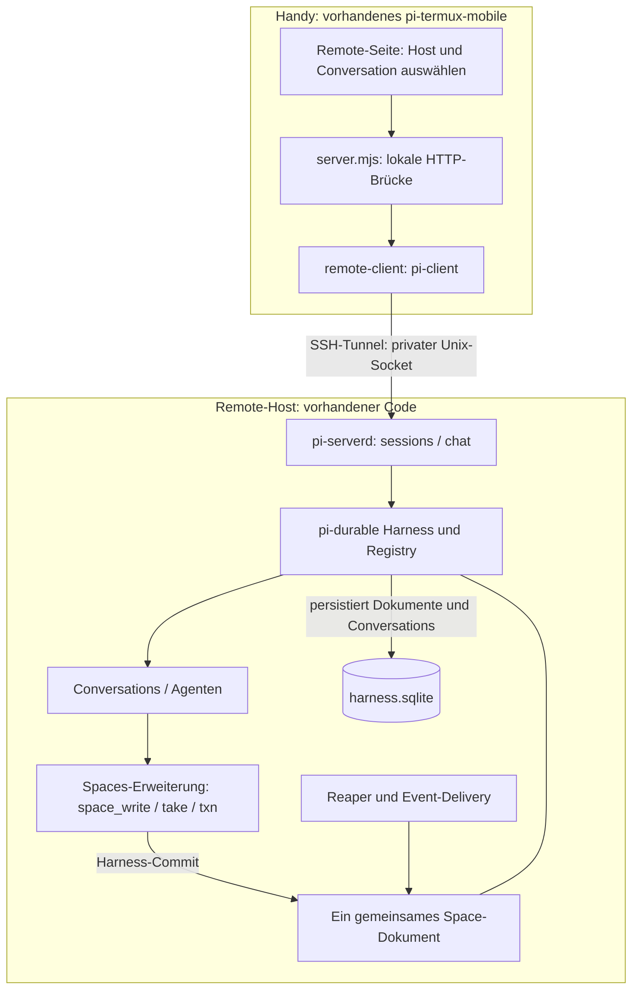
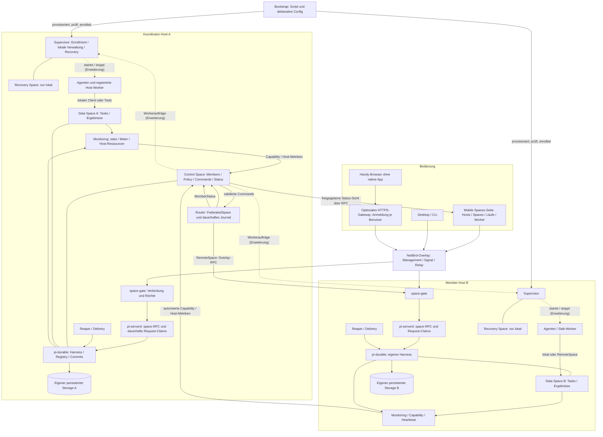
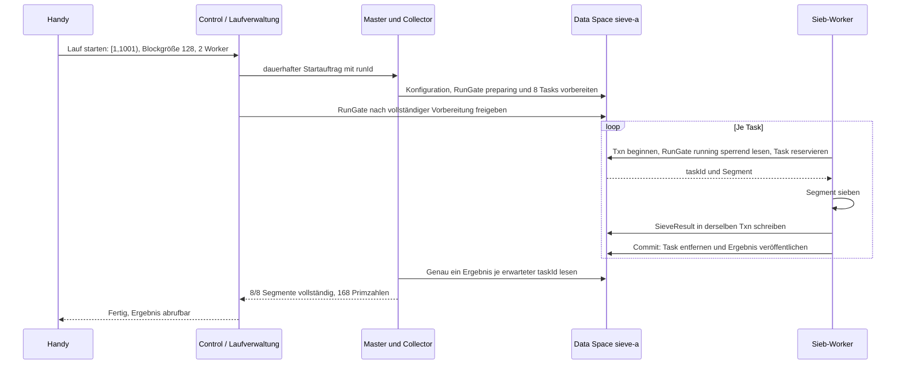

# Spaces betreiben und vom Handy steuern

Stand: 2026-10-07 (Recovery, Bootstrap, Drain, Pause und Folgeaufrufe mit dem präzisierten v3-Vertrag abgeglichen). Architektur und Bedienentwurf zum [Federation-Plan v3](federation-plan-v3.md).
Die Diagramme unterscheiden vorhandenen Code von geplanten Diensten. Bootstrap-Aufrufe und neue
Verwaltungskommandos unten sind Vorschläge, keine bereits ausführbare CLI.

## 1. Was heute vorhanden ist

| Komponente | Aktueller Stand |
|---|---|
| pi-durable Harness | führt Conversations/Tasks aus und speichert Dokumente über atomare Commits |
| pi-spaces | Erweiterung mit Agenten-Tools; Space-Dokument Version 4 im Scope der gesamten Harness-Session |
| Lokaler pi-spaces-Client | API-Klasse `PiSpaces` für dieses Dokument; kein Netzwerkclient |
| Reaper und Delivery | `startService` verarbeitet Ablauf und lokale Events |
| Monitoring | `stats`, `count`, `Meter`, `watchLive`; lokale Zustände und prozesslokale Raten |
| pi-termux-mobile | HTTP-Oberfläche auf dem Handy, Remote-Verbindung per SSH/Unix-Socket zu pi-serverd |
| pi-serverd im mobilen Projekt | SQLite-Harness, gebündelte Spaces-Erweiterung, Reaper/Delivery; Sessions-/Chat-Protokoll |
| Benannte Spaces, Federation und Spaces-Seite | v3-Zielbild; im geprüften Code nicht vorhanden |

Geprüfte mobile Quellen liegen im Nachbarprojekt: `runtime/server.mjs`, `runtime/pi-serverd.mjs`,
`runtime/common.mjs`, `runtime/remote-client.mjs`, `runtime/remote-provision.mjs` und
`runtime/public/constants.js`. Dies ist ein Codebefund, keine ausgeführte mobile E2E-Abnahme.
`npm run bundle` baut die Bibliothek und aktualisiert automatisch `runtime/pi-spaces.mjs` im vorhandenen
Nachbarprojekt. Beispiele werden als ausführbare JS-Module nach `runtime/space-examples/` gebündelt.
Der Android-Build ruft vor dem Verpacken `scripts/prepare-runtime.py` auf: Er baut pi-spaces aus diesem
Checkout erneut, erzeugt `runtime.bin` und eine Prüfsumme beider App-Payloads. Änderungen werden bei der
App-Installation über diese Prüfsumme erkannt, ohne manuellen Runtime-Versionsbump.
Andere Pfade lassen sich über `PI_SPACES_SOURCE` (mobiler Build) und `PI_SPACES_MOBILE_ROOT` (Bundle) wählen.
Fehlt beim Android-Build ein kompatibler Source-Checkout, erscheint eine Warnung; der Build verwendet
die vorhandenen mobilen Bundles. Nur fehlende notwendige Bundle-Dateien oder Fehler beim Bauen eines
vorhandenen Checkouts führen zum Abbruch. Ohne Source wird keine Aktualität gegenüber dem Checkout behauptet.
Remote-Provisionierung berücksichtigt Bibliothek und Beispielmodule im Release-Hash und überträgt sie
beim nächsten Installations-/Updateablauf. Das installiert noch keine neue APK auf dem Handy und aktualisiert
keinen laufenden Remote-Daemon ohne den vorhandenen Freigabeablauf. CLI-Beispiele erzeugen keine neuen UI-Buttons.



**Verknüpfung:** pi-durable ist die Laufzeit und Persistenz. pi-spaces ergänzt ein Dokument und Tools
innerhalb dieser Laufzeit. pi-serverd macht Conversations per Protokoll erreichbar. Ein Remote-Host ist
kein zentraler pi-durable-Cloud-Dienst: Jeder Host besitzt seinen eigenen Harness und Storage.

Die mobile UI nennt Conversations ebenfalls „Sessions“. Eine neue solche Session erzeugt heute
**keinen neuen Space**: Alle Conversations desselben Harness teilen das session-scoped Space-Dokument.
Ein zusätzlicher unabhängiger Server/Harness besitzt einen getrennten Space; es entsteht dadurch keine Federation.

Ein Space ist für unterschiedliche Arbeitsarten nutzbar. Neue Sieb-, Pipeline- oder Rechercheaufgaben
erfordern keinen neuen Space, sofern Entry-Verträge, Rechte, Limits und Routing-/Replikationsregeln passen.
Beim geplanten Projektstart werden ausgewählte vorhandene Spaces wiederverwendet; nur nachweislich fehlende
Spaces werden angelegt. Ein gestoppter Host-Dienst öffnet beim Neustart seinen bisherigen persistenten
Bestand. Der genaue [Wiederverwendungsvertrag](projektstart-autoprovisionierung.md#vorhandene-runtime-und-spaces-wiederverwenden)
verhindert doppelte Daemons und Ersatz-Spaces bei unbekanntem Remote-Zustand.

## 2. Gesamtbild für die geplante Verwaltung

Alle Blöcke dieses Diagramms bilden das Ziel ab. Vorhandene Harness-/Space-Bausteine werden dafür erweitert.
Ein Host kann mehrere logische Spaces besitzen; ein zusätzlicher Host und ein zusätzlicher Space sind
verschiedene Verwaltungsaktionen.



Gestrichelte Pfeile sind **Erweiterungen gegenüber v3**. In v3 bearbeitet der Supervisor nur Enrollment,
Supervisor-Commands, Lease-Signatur, Recovery, Promotion und Umschaltung sowie die begrenzte Zusammenarbeit
mit dem Router bei `setStandby` und beim Replikatkonfigurationsabgleich. Allgemeine Worker-Startaufträge sind
noch kein Bestandteil von v3.
Für Worker wird ein eigener Vertrag vorgeschlagen (7.3): Desired-State-Entries `WorkerAssignment` im Control Space,
die jeder Supervisor nur für seinen eigenen Host lesen darf. Der Router schreibt sie nach einem Admin-Command,
und der Supervisor gleicht sie lokal ab. Er erhält dafür eine zusätzliche, eng begrenzte Leseberechtigung, aber
keine Rechte auf andere Steuerdaten. `MemberStatus` schreibt nach v3 nur der Router. Host-Monitore
veröffentlichen Ressourcen und Gesundheit über ihre eigene `Capability`.

NetBird transportiert und begrenzt Erreichbarkeit; App-Schlüssel und Rollen autorisieren die Operationen.
Der Control Space enthält Steuerdaten, der Data Space Nutzdaten. Journal und RPC-Claims sind geschützte
interne Dokumente. Recovery bleibt je Host lokal und ist über einen Out-of-Band-Zugang erreichbar, nicht über
das Overlay. Ab Stufe 3 kann ein fester Standby Control- und Data-Members synchron spiegeln; ein so gespiegelter
Data Member darf dann nur in local- oder primary-Regeln stehen, nicht in expand oder lww/set (v3 6.4).
Replikation ist für den Einstieg nicht erforderlich.

Fällt der Koordinator aus, laufen Grants und Router-Lease innerhalb ihrer Laufzeit von höchstens 60 s plus zulässiger Zeitunsicherheit ab. Danach stehen alle entfernten
Space-Operationen der Federation, auch zwischen anderen Hosts. Lokale Worker auf jedem Host arbeiten weiter
(v3 5.2). Nach Control-Promotion ohne Standby ist zunächst die ausdrücklich autorisierte Recovery-
Umschaltung auf Single nötig; erst danach kann `setStandby` einen Ersatz einrichten. Die UI zeigt die zeitweise
schwächere Durability an. Bei Restore braucht jeder wieder teilnehmende Member die lokal bestätigte neue
Autorität; alte Schlüssel-/Gruppenrechte werden nicht aus dem Snapshot reaktiviert. Offline-Members bleiben
als `recoveryBlocked` sichtbar und in der Vollständigkeitsprüfung enthalten.

Ein Datenbankverzeichnis wird niemals von mehreren unabhängigen Harness-Prozessen gemeinsam geöffnet.
RemoteSpace ruft den besitzenden Host auf; es öffnet dessen SQLite-/JSONL-Dateien nicht über das Netzwerk.
Der Router läuft auf dem Koordinator weiter, wenn die Handyseite geschlossen wird.

## 3. Zwei Wege vom Handy

### Heute: Remote-Conversations über SSH

1. In der vorhandenen Remote-Seite `user@host` auswählen und SSH-Zugang einrichten.
2. Verbinden. Der vorhandene Provisionierer prüft Node/tmux, überträgt das Runtime-Release und startet
   pi-serverd bei Bedarf. Credential-Übertragung und Updates folgen den vorhandenen Bestätigungsabläufen.
3. Conversation auswählen oder anlegen; Prompt senden, Verlauf/Status lesen oder Generation abbrechen.
4. Disconnect trennt den Client; „stop server“ beendet den Daemon und damit die laufende Host-Ausführung.

`remoteState` hält heute eine aktive Remote-Verbindung. Die RPC-Dienste sind `sessions` und `chat`.
Ein Space-Inhaltsbrowser, addMember/drain oder ein Sieb-Startknopf sind dadurch noch nicht vorhanden.
Das lokale Handy-HTTP-Interface lauscht auf 127.0.0.1; es ist kein bereits öffentlich erreichbares Dashboard.

### Ziel: eine Spaces-Seite

Native mobile Bedienung: Verbindungsliste nach hostId, NetBird, App-Pairing per QR, Space-Auflösung nach spaceId.
Browserbedienung: HTTPS-Gateway im Overlay mit eigener App-Anmeldung. Der Browser kann den TCP-Space-Dienst
nicht direkt benutzen. Ein späteres Gateway liefert statische UI und autorisierte Backend-Aufrufe.

| Ansicht | Anzeige | Aktionen im Bedienentwurf |
|---|---|---|
| Hosts | erreichbar / veraltet / offline, Ressourcen, Version | Pairing, Host hinzufügen |
| Spaces | Host, Modus, Bestand, Limits, Membership | anlegen, aufnehmen, drain, entfernen |
| Läufe | runId, erwartete/fertige Tasks, Fehler, Ergebnis, Steuerrevision/ACKs | Sieb starten, pausieren, fortsetzen, stoppen, Ergebnis herunterladen |
| Worker / Agenten | Host, Ziel-Space, Rolle, aktiv/reserviert/gestoppt | Anzahl setzen, starten, nach Task stoppen |
| Vorgänge | commandId, accepted/applying/completed/failed/needsReview | Fortschritt verfolgen, Ausgang auflösen oder fachliche Klärung dokumentieren |

Observer-Leserechte genügen für Hosts, Spaces, Läufe und Worker, soweit die Daten freigegeben sind. Die Ansicht
**Vorgänge** zeigt Commands und Results; das sind Steuerdaten und nach v3 §9 nur für Admins lesbar. Observer
sehen dort höchstens eine freigegebene Zusammenfassung. Verwaltungsaktionen brauchen Admin-Rechte.
Beim Wiederverbinden zuerst Snapshot/Status laden, dann Events verfolgen. Veraltete Messwerte werden
mit Zeitpunkt angezeigt; „offline“ ist kein Beweis, dass Worker auf dem Host beendet sind.
UI-Long-Polls laufen nur bei sichtbarer Seite. Der Router betreut angenommene Operationen einschließlich
Delegationserneuerung serverseitig weiter. Dashboard-Schließen pausiert keinen Rechenlauf.

## 4. Bootstrap: Script plus Config

Für den gewünschten Ein-Klick-Ablauf **Projekt auswählen → Starten → Remote-Runtime, Spaces und Monitoring
bereitstellen → Worker starten** gilt der ergänzende
[Projektstart-Vertrag](projektstart-autoprovisionierung.md). Er beschreibt automatische Wiederverwendung,
Mehrhost-Bereitschaft, Teilfehler und dauerhafte Fortsetzung. Auch dieser Ablauf ist noch zu implementieren.

Die folgenden Namen definieren eine **vorgeschlagene Bedienoberfläche**. Script, Config-Schema und
Spaces-Seite müssen noch implementiert werden. Die bestehende mobile SSH-Provisionierung deckt bereits
Release-Übertragung und Daemon-Start ab, aber kein Federation-Bootstrap.

```json
{
  "schemaVersion": 1,
  "deployment": "prime-demo",
  "coordinator": "host-a",
  "hosts": [
    { "alias": "host-a", "ssh": "pi@vps-a", "role": "coordinator" },
    { "alias": "host-b", "ssh": "pi@vps-b", "role": "member-host" }
  ],
  "spaces": [
    { "alias": "control-demo", "host": "host-a", "purpose": "control" },
    { "alias": "sieve-a", "host": "host-a", "purpose": "data", "maxSpaceBytes": 67108864 }
  ],
  "routing": { "profile": "single-member-sieve", "member": "sieve-a" },
  "workers": [
    { "alias": "sieve-worker-a", "host": "host-a", "kind": "sieve", "targetSpace": "sieve-a", "count": 2 }
  ],
  "mobile": { "access": "native-overlay", "enrollmentRole": "admin" },
  "credentials": { "source": "host-secret-store" }
}
```

Die Config enthält nur **Aliase**. Nach v3 sind `hostId` und `spaceId` unveränderliche, beim Anlegen erzeugte
Identitäten, und Namen sind veränderbare Aliase. Der Bootstrap erzeugt die IDs, persistiert die Zuordnung
Alias → ID serverseitig und weist Kollisionen oder die Umdeutung eines Alias auf eine andere ID ab. Beispiele oben
sind keine bereits angelegten Spaces.
Keine Tokens oder Provider-Schlüssel in die Config schreiben. Das Sieb benötigt keinen Provider-Schlüssel.
Host B ist hier provisioniert, aber erhält erst bei Bedarf einen eigenen Data Space oder Remote-Worker.
Das Routing-Profil wird in eine gültige v3-Policy übersetzt: SieveTask und SieveResult bleiben auf demselben Member.

Vorgeschlagene Aufrufe nach Implementierung:

```text
./scripts/bootstrap-spaces.sh --config deployment.json --check
./scripts/bootstrap-spaces.sh --config deployment.json --apply
```

Der Script-Vertrag:

1. Config und unterstützte Features prüfen; bei fehlendem Space-RPC/Schema stoppen.
2. Hosts per SSH vorbereiten; stabile IDs, private State-Verzeichnisse und eindeutigen Storage-Besitzer sichern.
3. Versioniertes Runtime-Release inklusive passendem Spaces-Bundle bereitstellen; Gesundheit prüfen.
4. **Overlay-Beitritt:** NetBird-Client auf jedem Host installieren und mit einem Setup-Key aus dem
   Host-Secret-Store beitreten; Gruppe `space-hosts` zuweisen. Die Peer-ID jedes Hosts über die Management-API
   ermitteln und für die gebundenen Tokens festhalten. Das Admin-Handy tritt per NetBird-Login bei und erhält
   `space-admin`; auch seine Peer-ID wird ermittelt.
5. Control/Recovery/Supervisor auf A initialisieren, einschließlich Out-of-Band-Recovery-Zugang (v3 5.4)
   und unabhängigem Recovery-Register für eindeutig serialisierte Autoritätswechsel (v3 5.2.1).
   Den einmaligen, an die Handy-Peer-ID gebundenen Admin-Bootstrap-Token flüchtig anzeigen und **zuerst** das
   Admin-Pairing abschließen. Der Supervisor bearbeitet es ohne Router; erfolgreicher Verbrauch schließt die
   lokale Erstinitialisierungsbefugnis dauerhaft (v3 4.5). Bei bereits initialisiertem Host vorhandene
   Admin-Autorisierung prüfen, keinen neuen Bootstrap-Zugang öffnen.
6. Als gepairter Admin `createEnroll` für B senden und B mit gebundenem Einmal-Token über den bereinigten
   Enrollment-RPC enrollen. Script-Commands benötigen diesen Admin-Kontext; SSH oder Rolle host genügen nicht.
7. Benannte Data Spaces lokal über den autorisierten Lebenszykluspfad anlegen; wiederholter Apply erkennt
   bereits angelegte Aliase und IDs. Router starten, Members über Admin-Commands aufnehmen, Policy validieren;
   nie bestehende HRW-Bestände umverteilen.
8. Workerdefinitionen registrieren; Start getrennt von Installation behandeln.
9. Freigegebenen Status vom Handy prüfen. Kein Rechenlauf wird unbeabsichtigt gestartet. Token-Payloads werden
   weder als Control-Entries noch in Requests, Logs, Snapshots oder Fortschrittsdaten gespeichert.

Config beschreibt den gewünschten Zustand. Tatsächlich angewendeter Zustand und Revision liegen serverseitig.
Mobile Änderungen müssen sich anschließend exportieren lassen; ein späterer Script-Apply zeigt Differenzen
und überschreibt manuelle Änderungen nicht stillschweigend.

## 5. Spaces hinzufügen und entfernen

### Hinzufügen

1. **Host verbinden:** provisionieren/enrollen. Ein Host allein ist noch kein Federation-Member.
2. **Space anlegen:** Host, Alias und Limits wählen; neue stabile spaceId und persistentes Dokument erzeugen.
3. **Zur Federation aufnehmen:** `addMember` als dauerhaftes Command; Erfolg im Result abwarten.
4. **Nutzung festlegen:** neue, leere Regel oder zulässige capacity/capability-Auswahl; danach Worker zuweisen.

Die v3-Kommandoliste besitzt addMember/removeMember, aber noch keinen vollständigen Vertrag für
Space-Anlage/-Löschung. Dafür wird hier eine Ergänzung vorgeschlagen: `createSpace`/`deleteSpace`
mit idempotenter Verarbeitung durch Router und Host-Supervisor. Diese Ergänzung ist noch kein v3-Abnahmebefund.

Wird ein **vorhandener** Space aufgenommen, prüft `addMember` seinen Bestand (v3 7.1). Entries eines Typs, den
die Policy einem anderen Member oder einer HRW-Menge ohne diesen Space zuordnet, führen zu `RoutingConflict`.

`addMember` verschiebt keine vorhandenen Entries und verändert keine bestehende HRW-Zuordnung.
Beim einfachen Sieb nutzt ein laufender Durchgang weiter seinen ursprünglichen Member. Mehr Worker auf
diesen Member können zuerst genügen; ein zweiter Task-Space erfordert die Aufteilung aus Abschnitt 6.

### Entfernen

1. `drain`: neue unabhängige Platzierungen stoppen. Bestehende Arbeit bleibt erreichbar; gebundene
   Abschluss-Writes sind gemäß v3 7.1 erlaubt. Für Sieb-Tasks muss vor drain ein Abschlussprofil feststehen:
   nur SieveResult derselben runId/taskId auf demselben Member, begrenzte Bytes/Anzahl und endliche Lease.
2. Worker nach laufendem Task stoppen. Während drain neu reservierte bestehende Tasks benötigen die
   Abschlussberechtigung des Members; ohne Profil keine neuen verarbeitenden Take-Txns. Offene Remote-
   Operationen am Member entscheiden/abbrechen; unbekannter Ausgang bleibt sichtbar und ausstehend.
3. Läufe beenden, Ergebnisse exportieren und Daten bewusst aufbewahren oder löschen. Ein nicht leerer,
   weiter aufzubewahrender Bestand verhindert die Entfernung; removeMember ist kein Archivierungsersatz.
4. `removeMember` startet die dauerhafte lokale Sperrphase `removing` aus v3 7.1. Neue fachliche Mutationen,
   Take-Claims und Txns sind dann auch für lokale Worker gesperrt. Leerung einschließlich unsichtbarer Writes,
   Txns/Sperren, Waiter, aktiver Notify-Registrierungen, interner Folgearbeit und offener RPCs wird unter dieser
   Sperre bestätigt. Notify-Registrierungen enden geordnet mit dem Event `registrationClosed`; ausstehende
   Mailbox-Events bleiben bis ACK/TTL abrufbar (v3 7.1).
5. Router prüft seine offenen Requests, Routingreferenzen und Worker-/Run-Bindungen, committet Membership-
   Entfernung und bestätigt `detached` am Member. Auf completed warten; ein Absturz erhält Sperre und IDs.
   Bei unbekanntem Ausgang nicht lokal entsperren. Historische Manifeste bleiben Auditdaten, keine aktive Bindung.
6. Separat archivieren/löschen. Geschlossene Claims und Mailbox-Ergebnisse bleiben über Space-ID bis zu ihrer
   Frist erreichbar; Storage darf vorher nicht ersatzlos gelöscht werden. Host-Shutdown und Schlüsselwiderruf
   sind weitere getrennte Aktionen.

Ein Member einer HRW-Menge (expand nach Feld) lässt sich in v3 **gar nicht** entfernen. `drain` weist dort
neue unabhängige Writes für seinen Schlüsselanteil ab; gebundene Abschluss-Writes bleiben erlaubt. `removeMember` liefert `MigrationRequired`. Entfernbar sind nur
Members mit fester Typzuordnung und Members von capacity/capability-Regeln.
Ein offline Member mit ungeklärtem Bestand lässt sich nicht als „leer“ entfernen. Erfordert ein Wechsel
Datenmigration, wird er bis zur Umsetzung des Migrationsprotokolls abgewiesen. `take A → write B` ersetzt
keine sichere Migration. `removeMember` ist weder Datenlöschung noch das Stoppen des gesamten Hosts.

## 6. Beispiel: Primzahlsieb steuern

### Kleinster sinnvoller Aufbau

Ein Data Space `sieve-a`, ein Master/Collector und zwei Worker. Zunächst alle auf Host A, anschließend können
Remote-Worker denselben Task-Space bedienen. Ein Task enthält runId/taskId und ein disjunktes Halbintervall.
Sieb-Worker sind deterministischer Host-Code: Ein LLM ist dafür nicht erforderlich.



Am Handy sind dafür fünf Schritte vorgesehen:

1. **Spaces → sieve-a** öffnen und Erreichbarkeit/Limits prüfen.
2. **Lauf starten → Primzahlsieb**: Start 1, exklusive Obergrenze 1001, Blockgröße 128, Worker 2.
3. **Starten**: Backend vergibt runId und journalisiert den Auftrag; Wiederholung derselben Anfrage startet keinen zweiten Lauf.
4. **Fortschritt**: 0/8 bis 8/8 erledigte Segmente, offene Reservierungen, Workerstatus und Fehler anzeigen.
5. **Ergebnis**: Primzahlliste ansehen/herunterladen. Pause verwendet die bestätigte Sperrphase unten; Fortsetzen behält runId und erhöht die Steuerrevision.

**Verbindlicher Pause-/Fortsetzungsvertrag der Betriebserweiterung:** Pause löscht keine Tasks und wird
nicht allein durch einen gelesenen Status im Control Space wirksam. Das Manifest nennt alle Task-Members.
Auf jedem liegt genau ein geschützter `RunGate {runId, controlRevision, state: preparing | running | paused | stopped}`,
verwaltet durch den Run-Controller über einen autorisierten lokalen Supervisor-Aufruf. RunGate ist lokale
Steuerinformation des jeweiligen Data Space, kein zusätzlicher HRW-Nutzdatentyp; normale Worker dürfen ihn nur
lesen. Bei Run-Vorbereitung entstehen Gate und Tasks idempotent; vor vollständiger Vorbereitung bleibt das
Gate `preparing`, auch wenn auf dem Host bereits Worker laufen.

- Jeder Worker liest den RunGate **unter derselben Member-Txn vor dem Task-Take**, prüft `running` und hält
  dessen Lesesperre bis zum Commit/Abort. Task-Take ohne gültige Gate-Bindung sowie Result-Writes mit fremder
  runId/taskId werden serverseitig abgewiesen. Gate-Entfernung, Lease-Manipulation und direkte Host-Aufrufe dürfen
  diese Prüfung nicht umgehen. Der Gate selbst hat keine ablaufende Lease; Worker-Txns haben endliche Leases.
- **Erzwungener Abschluss:** Das `CompletionProfile` des Siebs (v3 6.4) gilt für jeden Commit: Pro genommenem
  `SieveTask` genau ein `SieveResult` mit gleicher runId/taskId und den erwarteten `rangeStart`/`rangeEnd` in
  derselben Txn. Commit ohne Ergebnis, mit zwei Ergebnissen oder mit falschen Grenzen scheitert mit
  `CompletionViolation`; die Txn bleibt abbrechbar. Tasks ohne Ergebnis zu entfernen ist nur über den
  Admin-Command `purgeTasks` mit eigenem Recht und Audit möglich, nie über Worker-Rechte.
- `pauseRun` journalisiert eine neue monotone Steuerrevision und sendet sie mit stabilen Unterrequest-IDs an
  alle Manifest-Members. Jeder Member installiert zuerst eine dauerhafte Eintrittssperre gegen neue Run-Txns
  und Lease-Verlängerungen bestehender Run-Txns. Bereits gebundene Txns dürfen innerhalb ihrer verbleibenden
  Lease abschließen; anschließend wird der Gate exklusiv, konfliktgesichert auf `paused` geändert. Ein Member
  bestätigt erst nach diesem Commit und ohne verbleibende Run-Txns oder versiegelte Abschlusskandidaten.
- Der Controller meldet global `paused` erst nach allen Member-ACKs. Währenddessen zeigt die UI `pausing`,
  bei unerreichbaren Members `pauseIncomplete` mit fehlenden ACKs; dort kann bis zur lokalen Sperre weiter
  gearbeitet werden. Nach global bestätigter Pause gibt es bis resume keine weiteren fachlichen Run-Commits.
  Pause kann weder zurückliegende Commits noch bereits ausgeführte externe Wirkungen rückgängig machen.
- `resumeRun` ist erst nach vollständig bestätigter Pause zulässig. Es verwendet dieselbe runId und eine höhere
  controlRevision. Members ändern Gate und Eintrittssperre atomar auf `running`. Ältere Revisionen werden
  abgewiesen. Die UI zeigt `resuming` bis alle ACKs vorliegen; auf bereits bestätigten
  Members kann Arbeit vorher beginnen. Es gibt keinen atomaren globalen Startzeitpunkt.
- **Revisionen und ACKs:** Dieselbe `controlRevision` ist nur bei identischem Command (`commandId`, Art und
  Zielzustand) idempotent und liefert die gespeicherte Bestätigung. Dieselbe Revision mit anderem Command oder
  Inhalt ergibt `RunGateConflict` ohne Änderung. Jedes ACK belegt `{runId, memberId, authorityId,
  dataIncarnation, controlRevision, state, commandId}`; der Controller wertet nur ACKs aus, deren Autorität und
  Dateninkarnation zum aktuellen Stand des Members passen.
- **Abgleich nach Restore:** Nach Control-Restore (v3 5.2.1) oder Data-Restore (v3 5.2.2) ist der Lauf
  `reconciling`. Der Controller liest zuerst alle RunGates der Manifest-Members. Höhere Gate-Revisionen auf einem
  Member haben Vorrang vor einem älteren Manifest: Der Controller übernimmt die höchste Revision und deren
  Zustand und vergibt neue Revisionen nur darüber. Ein restaurierter Member mit älterer Gate-Revision erhält den
  übernommenen Zustand mit neuer Revision. Erst wenn alle Members abgeglichen sind, darf global `paused`,
  `running` oder `stopped` gemeldet werden; fehlende Members halten den Lauf in `reconciling`. Auf einem
  restaurierten Member bleiben `restoredUnverified`-Tasks bis `releaseRestored` gesperrt.
- `stopRun` verwendet dieselbe Sperr-/ACK-Barriere und endet in `stopped`; diese runId wird nicht wieder
  gestartet. Pause/Resume/Stop werden pro Run serialisiert. Neue Kommandos überholen keinen unklaren Ausgang;
  Neustart rekonstruiert Revisionen und Teilbestätigungen. Administrative Klärung bleibt erforderlich, wenn ein
  Member dauerhaft verloren ist; die UI darf dann keine vollständige Pause/Beendigung behaupten.
- Nach vollständig bestätigtem Stop und Export/Löschung der Laufdaten darf der Controller den RunGate in
  abgeschlossene interne Laufhistorie überführen. Die persistente stopped-Steuerrevision bleibt zur Abweisung
  verspäteter Start-/Resume-Aufträge erhalten; sie zählt wie ein abgeschlossener Claim, nicht als aktiver Entry
  oder Workerbindung bei removeMember. Normale Worker dürfen diese Bereinigung nicht ausführen.

Ein sauber stoppender Worker beendet seine aktuelle Txn. Bei Prozessverlust wird der Task nach Lease-Ablauf
erneut verfügbar. Erfolgreicher Commit heißt atomarer Task-/Ergebnisabschluss; CPU-Berechnung kann mehrfach
stattfinden. Die Steuerbarriere ist zusätzlich zum heutigen Sieb zu implementieren.

**Heute ausführbar:** `npm run example:sieve -- 1001 2`. Dies benutzt MemoryStorage und beendet sich nach
der Aggregation. Die exportierten Funktionen können einen JSONL-Harness verwenden; es gibt noch keinen
dauerhaften Run-Controller, HTTP-Ergebnisdownload oder mobilen Start-/Pauseknopf.
`prepareSieveRun` benötigt lokale Host-Commits; der Worker ist auf den lokalen pi-spaces-Client
(API-Klasse `PiSpaces`) typisiert. Ein Remote-Adapter
und die Vorbereitung auf dem Zielhost sind für diesen Bedienablauf zusätzlich zu implementieren.

### Später mehrere Task-Spaces

Für dieses kleine Beispiel ist eine Aufteilung unnötig. Für den späteren Mehrhost-Ablauf gibt es zwei Wege.

**In v3 ausdrückbar: HRW nach `taskId`.** `SieveTask` und `SieveResult` erhalten je eine expand-Regel
`by: {field: "taskId"}` mit **derselben** festen Member-Menge, z.B. `[sieve-a, sieve-b]`. Damit landen Task und
Ergebnis derselben `taskId` immer auf demselben Member. Ein Worker nimmt den Task in einer Txn auf Member X und
schreibt das Ergebnis mit derselben `taskId` nach X, ohne `RoutingConflict`. Die Verteilung bestimmt HRW, nicht
der Betreiber. Das Lauf-Manifest hält für jede `taskId` den berechneten Member fest. Jeder Task wird auf seinem
Member idempotent vorbereitet; es gibt keinen atomaren Commit über beide Hosts. Große Vorbereitungen werden
unter dem v3-Commit-Budget mit dauerhaftem Teilmanifest aufgeteilt; `preparing`-RunGates verhindern vorzeitige
Bearbeitung durch vorhandene Worker. Erst nach vollständiger Vorbereitung werden sie freigegeben. Teilweise
Vorbereitung wird angezeigt und wiederaufgenommen. Pause/Resume verwendet anschließend alle Manifest-Members
nach dem RunGate-Vertrag oben. Grenzen:
- Die Member-Menge ist unveränderlich (v3 7.1). Neue Members können für diese Typen keine neuen Läufe übernehmen.
- Keiner dieser Members lässt sich entfernen.

**Erweiterung, nicht Teil von v3:** gezielte Zuordnung ganzer Teilbereiche (z.B. [1,501) auf sieve-a,
[501,1001) auf sieve-b) und Aufnahme neuer Members für neue Läufe. Das braucht eine laufbezogene
Routingtabelle, die das Manifest als Routingquelle verwendet; v3 kennt nur eine Regel pro Typ. Ersatzweise
geht das heute nur mit eigenen Typnamen je Teilbereich und je einer `local`-Regel, was die Typgrenzen schnell
erschöpft.

In beiden Fällen gilt: Worker binden Txn, Task und SieveResult an **denselben** Member. Ergebnisse werden nicht
nachträglich durch eine unabhängige capacity-Regel auf einen anderen Member geschrieben. Der Collector prüft das
Manifest und alle erwarteten IDs auf allen beteiligten Members; ein ausgefallener Member liefert „unvollständig“,
niemals „fertig“. Laufende Tasks werden nicht heimlich migriert. Für echte parallele CPU-Berechnung sind
getrennte Workerprozesse oder Hosts erforderlich.

## 7. Monitoring und fehlende Steuerverträge

### 7.1 Monitoring

| Ebene | Daten | Herkunft und Grenze |
|---|---|---|
| Space | Entries, locked/uncommitted, Txns, Waiter, returned | heutige lokale stats/count; pro benanntem Space künftig separat |
| Speicherbudget | Entry-Bytes, Claims/Outbox/Storage-Bytes und Limits | maxSpaceBytes begrenzt heute Entry-Felder; vollständige Byte-Metriken zusätzlich implementieren |
| Operationen | Writes/Reads/Takes pro Sekunde, Deliveryfehler | heutiger Meter; Zähler starten nach Prozessneustart neu |
| Sieblauf | erwartete taskIds, committed Ergebnisse, Laufzustand | Run-Manifest/-Controller erforderlich; Gesamtcount allein reicht nicht |
| Worker | gewünschte/aktive Anzahl, Host, aktueller Task, letzter Fehler | dauerhaftes Worker-Verzeichnis und Heartbeat erforderlich |
| Host | CPU, RAM, Disk, IOPS, Commit-Latenz, Erreichbarkeit | zusätzlicher Ressourcenmonitor; nicht bereits Teil des Space-Meters |
| Federation | policyVersion, Members, offene Commands, Revisionen/Lag | v3-Zieldienste; Vollständigkeit und Zeitstempel sichtbar machen |

`watchLive` liefert lokale Snapshots. Er misst keinen gesamten VPS und ersetzt keine Netzwerk-/Host-Healthchecks.
Eine langsam aktualisierte MemberStatus-Lease ist kein autoritativer Task-Abschlussbeleg.
Bootstrap-Writes des Siebs verwenden direkte Core-Commits und werden nicht automatisch als Writes des pi-spaces-Clients
gezählt; der Fortschritt wird deshalb aus den tatsächlichen Laufdaten abgeleitet.

### 7.2 Konkrete Bedienelemente auf dem mobilen Gerät

**Die folgenden Ansichten, Eingabefelder und Buttons gehören in die mobile App beziehungsweise
deren Web-Oberfläche.** Sie senden autorisierte Aufträge an das Backend. Die eigentliche Installation,
Space-Verwaltung und Worker-Ausführung erfolgt auf den Hosts. Es handelt sich um Vorschläge für neue
Bedienelemente; die vorhandene Remote-Seite besitzt diese Projekt-/Federation-Steuerung noch nicht.

Die mobile Navigation beginnt mit einer **Projektliste**. Nach Auswahl eines Projekts reichen vier
Hauptbereiche: **Übersicht**, **Spaces**, **Läufe** und **Agenten/Worker**. Host-Zugang und Runtime-Updates
liegen unter **Projekt-Einstellungen → Hosts**; laufende Verwaltungsvorgänge sind von der Übersicht erreichbar.

| Mobile Ansicht | Felder und Anzeige | Bedienelement | Benötigte Backend-Wirkung |
|---|---|---|---|
| Projektliste | Name, Config-Revision, bereit/aktiv/Fehler | Projekt auswählen, Config importieren | Konfiguration laden/validieren; Auswahl startet noch nichts |
| Übersicht | Hosts, Federation-Modus, Bereitschaft, Ressourcen, letzte Statuszeit | Projekt starten | dauerhafter Deployment-/Startauftrag; Runtime, Monitoring und Spaces vorbereiten, dann Worker aktivieren |
| Übersicht bei Teilfehler | betroffener Host, fehlender Schritt, Auftrags-ID | Vorbereitung fortsetzen | denselben Auftrag mit gleichen IDs wiederaufnehmen; kein zweites Deployment |
| Hosts | Alias, SSH-Ziel, Identität/Fingerprint, Version, erreichbar/offline | Host hinzufügen, verbinden/pairen | autorisierte Provisionierung und Enrollment; noch keine automatische Member-Aufnahme |
| Spaces | Alias, spaceId, Host, Modus, Entries, Txns, Limits | Space hinzufügen | bestehenden Space aufnehmen oder neuen Space auf gewähltem Host anlegen und anschließend aufnehmen |
| Space-Details | Bestand, offene Arbeit, Membership | Neue Zuweisungen stoppen (drain) | neue Platzierungen sperren; bestehende Arbeit und Reads erhalten |
| Space-Details nach drain | Ergebnisaufbewahrung, Sperrphase, EmptyProof | Aus Federation entfernen | removeMember sperrt lokal und prüft Leerung sowie Bindungen; keine automatische Datenlöschung; bei HRW-Members deaktiviert mit Grund „Migration erforderlich“ |
| Space-Details ohne Membership | archivierter/leerer Bestand | Archivieren oder Space löschen | getrennte Lebenszyklusaktion; Referenzen, Rechte und Aufbewahrung prüfen |
| Neuer Sieblauf | Start, exklusive Obergrenze, Blockgröße, Workerzahl, Ziel-Space/Federation | Lauf starten | runId/Manifest anlegen, Bereiche validieren, Tasks idempotent vorbereiten und Worker zuweisen |
| Lauf-Details | Segmente, Reservierungen, pausing/pauseIncomplete/paused/resuming/reconciling, Member-ACKs | Pausieren, Fortsetzen, Lauf stoppen | RunGate-Barriere auf allen Manifest-Members; Erfolg erst nach allen ACKs, laufende Txns vorher entscheiden |
| Lauf-Details | Vollständigkeit und gespeicherte Primzahlliste | Ergebnis ansehen, herunterladen | autorisierter Ergebnisexport aus committed Results; Teilresultat ausdrücklich kennzeichnen |
| Worker-Details | registrierte Workerart, Host, Member, gewünschte/aktive Anzahl | Anzahl ändern, Starten, Nach Task stoppen | gewünschte Anzahl und Generation speichern; Supervisor startet/stoppt nur die zugeordneten Worker |
| Agent-Details | Conversation, Modell, Ziel-Space, Status, Budget | Agent anlegen, konfigurieren, Generation abbrechen | getrennt autorisierte Conversation-/Modellverwaltung; keine Änderung fremder Worker oder Hosts |
| Vorgänge | accepted/applying/completed/failed/needsReview, letzter Schritt, commandId | Details, Status erneut abrufen, Klärung dokumentieren | bestehende IDs abfragen; bei verlorener Historie keine automatische Wiederholung; Admin-Klärung auditieren |

„Space hinzufügen“ öffnet eine kleine Auswahl: **vorhandenen Space aufnehmen** oder **neuen Space anlegen**.
Eine neue Member-Zuordnung wird vor Ausführung gegen v3-Routinggrenzen geprüft. Kann ein bestehender Bestand
nicht sicher umverteilt werden, zeigt die UI den konkreten Konflikt; sie bietet keinen scheinbar erfolgreichen
Wechsel der HRW-Menge an. Bei einem laufenden Sieb bleiben die Manifest-Member unverändert.

Die Standardaktion **Projekt starten** bündelt den Ablauf aus dem
[Autoprovisionierungsvertrag](projektstart-autoprovisionierung.md). Installation und Monitoring brauchen
keinen separaten täglichen Startknopf. Erweiterte Details zeigen pro Host die einzelnen Bereitstellungsschritte.
Für einen weiteren Rechenlauf in einem bereits bereiten Projekt genügt **Lauf starten**.

Auf der mobilen Seite werden Aktionen erst nach Backend-Bestätigung als erfolgreich angezeigt.
Während einer Anfrage bleibt die Auftrags-ID erhalten; Doppeltippen und Wiederverbindung verwenden dieselbe
Anfrageidentität. Bei Timeout erscheint „Ausgang wird geprüft“ statt einer Aufforderung zum erneuten Start.
Die UI zeigt Zielprojekt, Host/Space und Wirkung an; destruktive Löschung benötigt eine gesonderte Bestätigung.
Aktionen ohne passende Rechte oder ohne erfüllte Voraussetzungen sind deaktiviert und zeigen den Grund.

**Worker und LLM-Agenten werden getrennt dargestellt:** Beim Sieb gibt es Workerzahl und Ziel-Member,
aber keine Modellauswahl. Für LLM-Agenten sind Modell, Conversation und Budget relevant.
„Generation abbrechen“ ist keine allgemeine Space-Txn- oder Lauf-Abbruchoperation; der zuständige
Controller muss offene Aufgaben und Reservierungen anhand ihres tatsächlichen Zustands behandeln.
Das vorhandene „stop server“ wird nicht als Projekt-Stopp verwendet, da es andere Projekte treffen könnte.
Handyseite schließen oder Verbindung trennen beendet weder Worker noch serverseitiges Monitoring.

### 7.3 Dafür erforderliche Backend-Verträge

Die bisher am Dokumentende genannten Lücken betreffen sowohl mobile Oberfläche als auch Backend.
Zusätzlich zum v3-Netz-/Space-Protokoll fehlen für die oben genannten Bedienelemente:

- **Laufverwaltung:** startRun/pauseRun/resumeRun/stopRun; dauerhaftes Manifest, idempotente Starts,
  geschützte lokale RunGates und Sperr-/ACK-Barriere nach Abschnitt 6, Zustandsübergänge und Ergebnisexport.
- **Workerverwaltung:** registrierte Workerarten, gewünschte Anzahl, Generation und Wiederaufnahme. Lokale
  Ausführung durch den Supervisor über `WorkerAssignment`-Entries (Abschnitt 2); das erweitert die
  Supervisor-Rolle aus v3 und braucht eine eigene Abnahme.
- **Lauf-Routing über mehrere Members:** laufbezogene Routingtabelle für gezielte Teilbereichszuordnung (6).
- **Agentenverwaltung:** Conversations anlegen/konfigurieren/stoppen, mit getrennten Rechten und festem Ziel-Space.
- **Space-Lebenszyklus:** idempotente Anlage, Registry/Storage-Zuordnung, Archivierung und geprüfte Löschung.
- **Mobile Oberfläche und Brücke:** neue Spaces-Endpunkte sowie Verbindungsliste und Snapshot-/Event-Recovery.

Diese Verwaltungsaktionen dürfen keine beliebigen Shellbefehle ausführen. Host-Workerarten sind registrierter
Code; Start-/Stopaufträge werden journalisiert und am Ziel idempotent angewendet. Normale member-Rechte
zum Schreiben von Tasks gewähren keine Rechte zum Starten von Prozessen.
Die geplante space-gate-Allowlist erlaubt nur `serviceId: space`; vorhandene `sessions`/`chat` werden dort
nicht automatisch öffentlich. Agentenverwaltung benötigt einen ausdrücklich definierten, autorisierten
Steuerpfad über Commands/Supervisor oder einen separat abgesicherten Dienst.

Reihenfolge der Umsetzung nach den v3-Stufen: benannte Spaces und RPC (Stufe 1) → Overlay, Enrollment und
Recovery (1b) → Router/Membership (2) → Replikation und kontrollierte Übernahme (3) → weitere Clients und
optional Browser-Gateway (4). Lauf-/Workersteuerung und die mobile Spaces-Seite sind Erweiterungen. Sie können
nach Stufe 2 parallel zu Stufe 3 entstehen, setzen aber Router und Membership voraus. Replikation ist für den
Einstieg nicht nötig, aber Voraussetzung für Hochverfügbarkeit des Control Space.
Die vorhandene SSH-Remote-Oberfläche bleibt der Einstieg für heutige Conversation-Steuerung.

### 7.4 Abnahme der Betriebserweiterung

Diese Fälle sind verpflichtend und noch nicht als implementiert oder getestet anzusehen:

1. Bootstrap nach jedem Schritt unterbrechen: erstes Admin-Pairing vor Host-Enrollment und Commands;
   Wiederholung öffnet keine neue Erstinitialisierungsbefugnis und erzeugt keine zweiten IDs.
2. Worker zwischen Gate-Read, Take, Result-Write und Commit pausieren: laufende Txn darf vor dem Pause-ACK
   abschließen; nach bestätigtem `paused` kein weiterer Run-Commit. Direkte/local Calls umgehen die Barriere nicht.
3. Ein Member während Pause offline: `pauseIncomplete`, niemals global `paused`; nach Wiederkehr derselbe
   Auftrag. Verspätete Pause nach neuerem Resume wird abgewiesen; Controller-Neustart erhält Revisionen und ACKs.
4. Bestehende Worker während mehrteiliger Run-Vorbereitung: keine Bearbeitung vor Freigabe der RunGates;
   Abbruch/Retry erzeugt weder doppelte Tasks noch fehlende Manifestteile.
5. drain zwischen Task und Ergebnis: zulässiger Abschluss gelingt atomar; neue Tasks und ungebundene
   Ergebnis-Writes scheitern. Während removeMember kann auch ein lokaler Writer den EmptyProof nicht entwerten.
6. UI schließen und Router neu starten mit FOREVER-Operation: Betreuung läuft serverseitig weiter,
   unabhängige neue Arbeit bleibt möglich. Nach ResultExpired zeigt die UI needsReview ohne Neustartknopf
   für eine automatische Ersatzwirkung; Admin-Klärung ist separat dokumentiert.
7. Control-Promotion und Restore: Durability, neue Autorität, Rechtefreigabe und recoveryBlocked-Members
   korrekt anzeigen; keine erfolgreiche Wiederaufnahme allein aus einem alten Snapshot ableiten.
8. Gleiche RunGate-Revision mit anderem Command: `RunGateConflict`, Gate unverändert; gleiche Revision mit
   gleichem Command: gespeicherte Bestätigung.
9. Control-Restore mit älterem Manifest, Members mit höheren Gate-Revisionen; Data-Restore eines Members mit
   älterem Gate: Lauf bleibt `reconciling`, bis alle Gates abgeglichen sind; danach keine niedrigere Revision.
10. Sieb-Worker committet ohne Ergebnis, mit zwei Ergebnissen oder falschen Grenzen: `CompletionViolation`;
    nur `purgeTasks` mit Admin-Recht leert Tasks ohne Ergebnis.

Weitere Verträge: [Sieb](examples/sieve.md), [lokaler Core](spaces-v1.md),
[v3-Stufenplan](federation-plan-v3.md#11-stufenplan).
