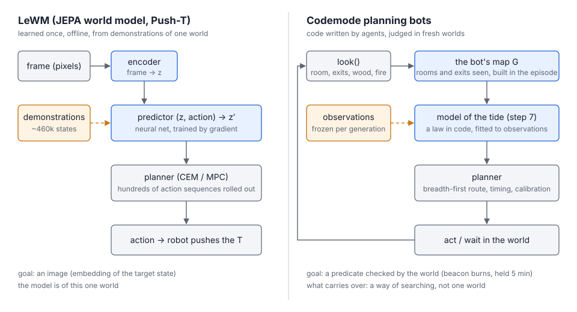
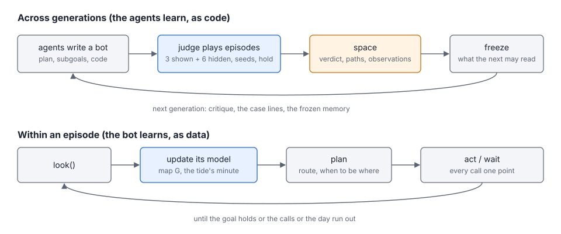
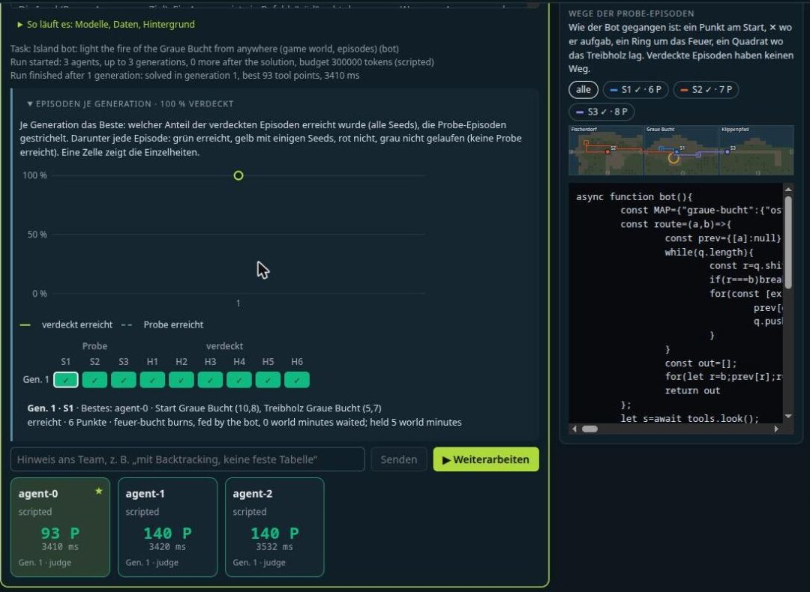
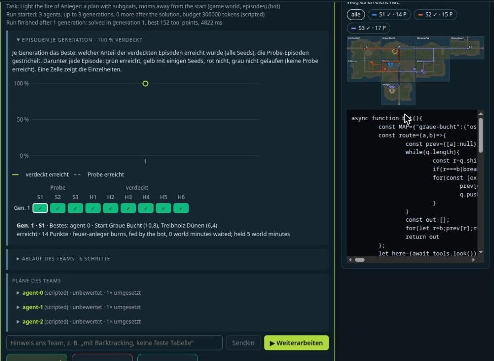
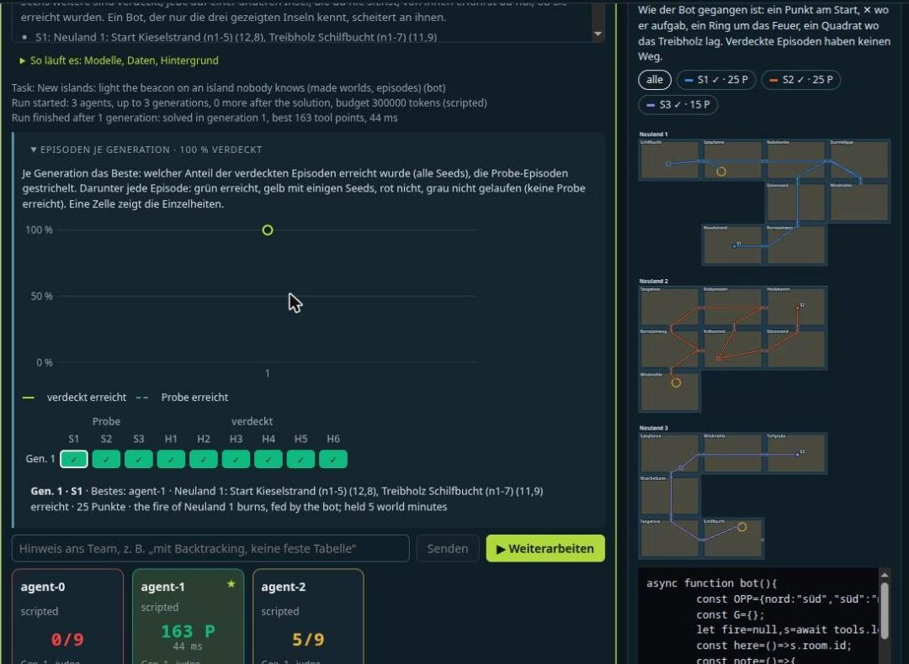
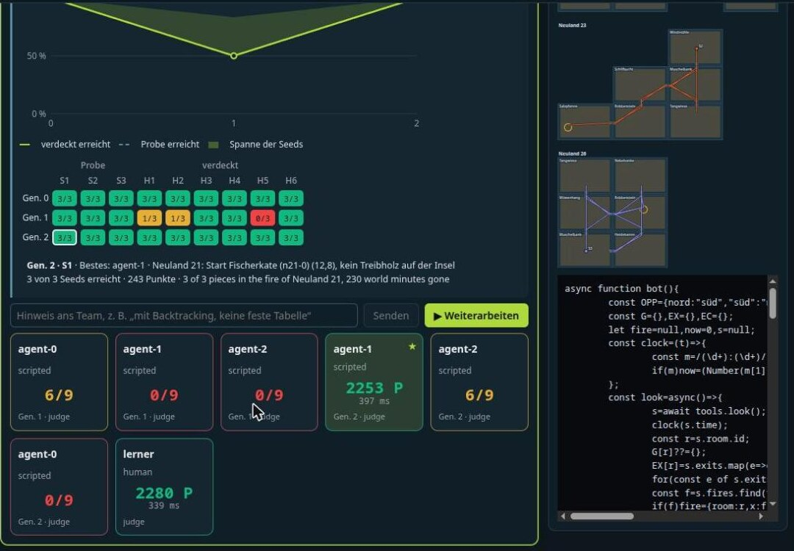

# Planning bots without a learned world model: notes for an article

Status (2026-11-14): material for an article. It records the approach, how it compares with the JEPA world model of
Haddy Alchaer's post, every development step with its numbers, the detours and what is still open. The plan with every
detail is [codemode-planung.en.md](codemode-planung.en.md). The figures are in `docs/img/codemode-planung/`.

## The question

Haddy Alchaer's post "After 600 experiments, here's what I discovered about JEPA world models"
(haddyalchaer.com/jepa, November 2026) studies LeWM (LeWorldModel, Maes et al., 2026) on Push-T, where a robot pushes
a T-shaped block onto a target. A JEPA world model has three parts:

1. an encoder that turns a frame into an embedding;
2. a predictor that predicts the next embedding from the current one and an action;
3. a planner that rolls many action sequences through the predictor and keeps the one ending nearest the goal.

The post's findings (paraphrased; its numbers are its own, nothing of it was run here):

- the model is not the limit, the planning horizon is;
- subgoals help a lot;
- a memory of demonstration states, with a cost on every jump between demonstrations, helps;
- scoring only what matters helps;
- the usual evaluation flatters: fresh start and goal pairs, other seeds and a goal that must hold for a while bring
  the numbers down.

Codemode chat is a space where agents (scripted or model) write code, a judge runs it in a sandbox and ranks it, and
the next generation builds on the best. Its bot lane already let agents write bots for spaces-mmo, a small online game
whose arena opens a fresh world for every contribution. The question was: what of the post carries over to
bots written as code, and does such a bot need a learned world model at all?

## The approach in one paragraph

The agents do not train a model. They write a bot, a JavaScript function that plays a figure through three tools:

- `look()` shows the room, its exits, the things in it and the fires;
- `act({ line })` types a command as a player would;
- `wait({ minutes })` lets world time pass.

Every call costs one point. The judge plays each bot in several episodes, each a world of its own: three shown, six
hidden, one or three seeds each, and the goal must still hold some minutes after the bot is done. What the bot learns,
it learns while it plays: its map of the rooms it has seen, and, in the last step, the law of the tide fitted to
observations that earlier generations collected. What the agents learn, they learn as code: the next generation reads
the verdicts, the case lines and the frozen memory, and writes a better bot.

*Figure 1. Left: LeWM, a model of one world learned offline. Right: a codemode bot. Its map and its model of the tide
are built from what it sees and from the frozen observations; its goal is a predicate the world checks.*

*Figure 2. Two loops. Across generations the agents learn, as code. Within an episode the bot learns, as data.*

## The mapping, part by part

| LeWM | Codemode | Same or different |
|---|---|---|
| Encoder: pixels → embedding | `look()` returns symbols already | Different: no perception is learned |
| Predictor: (state, action) → next state, a neural net trained on demonstrations | The bot's map: "room A, exit ost → room B", built during one episode. Since step 7 also a model of the tide, fitted to observations | Same role. Different form: code and data, exact where the rules are exact, fitted where they are hidden |
| Planner: CEM or MPC over hundreds of rolled-out sequences | Breadth-first route over the map, timing against the clock, calibration on the first piece seen | Same role. Simpler, because the model is exact |
| Goal: an image of the target state | A predicate the world checks (`beacon:island` held 5 minutes, `feed:island:3`) | The post's own advice: score what matters |
| Horizon as the limit; subgoals | Goals several rooms away; subgoals as data in a plan (step 4) | Carried over |
| Memory graph with a jump cost | `recall` over the frozen paths of earlier generations, a jump between paths costing 10 cells (step 3) | Carried over |
| Fresh episodes, seeds, a held goal | 3 shown and 6 hidden episodes, 1 or 3 seeds, `hold`; since step 6 hidden islands no shown episode enters | Carried over and pushed further: hidden worlds, not only hidden start and goal pairs |
| Learning: gradient descent on weights, offline | Agents rewrite code across generations; the bot fits a small hypothesis space at run time | Different |

## Why no learned model

A bot has to find its way in worlds it has not seen. A model trained on one island learns that island: its rooms, its
exits, where its fire stands. On another island that is the mistake of a bot that carries the first island's map, and
step 6 measures it: such a bot reaches 0 of 9 episodes on made islands. What carries over to a new world is a way of
searching:

1. look;
2. remember what was seen;
3. plan over that.

The judge's worlds are exact simulators, so nothing needs to be predicted that the rules already say. A learned
predictor would pay off only for planners that roll out many sequences in a world too slow to simulate. A neural
model would also need Python or ONNX, weights that are not published, and a GPU that neither of the project's
servers has.

What a bot cannot see has to be learned, though. Step 7 adds such a dynamic, the tide, and the bot learns it from data,
as code. That is the part of a world model that carries over.

## What carries over, what does not

**Codemode is stronger where:**
- the model is exact and readable: the map, the route, the subgoals and the fitted law can be printed and drawn;
- no training data, no GPU and no weights are needed;
- generalisation is tested on worlds the bot has never seen, not only on new start and goal pairs in one world;
- the evaluation lessons are a task of their own: "Rate planners" asks agents to write a judge that is not fooled.

**LeWM can do what codemode does not:**
- perception from raw pixels: codemode's world is already cut into symbols;
- dynamics nobody can write down, such as contact and friction: codemode's rules are discrete and known, except the
  one law step 7 hides;
- continuous control and uncertainty: the bots assume a deterministic world. The tide's seed is the only chance they
  meet, and they handle it by calibration, not by a distribution.

**Honest limits of what was shown:**
- The scripted agents are fixed hypotheses. They demonstrate that the judge, the data and the tasks separate good bots
  from bad ones, not that agents learn. Learning across generations needs model agents, which cost tokens and were not
  run for these steps.
- The learner of step 7 fits a hypothesis space its author wrote. It finds which hypothesis the data support; it does
  not invent new ones. An agent reading the observations could; that is the open experiment.
- The toy islands are small: 5 to 8 rooms, one fire, four exit directions.

## Development log

All steps were built on 2026-11-14 after the plan of 2026-11-13. The commits are on master. The numbers are the
scripted variants' results, judged as in the tests.

| Step | Commit | What was built | Measured |
|---|---|---|---|
| Plan | cd17ffe, 385b95b | The plan after the post, the values (3 + 6 episodes, seeds 1 or 3, hold 5 minutes) | — |
| 1. Evaluation | 13d818f | Episodes with sample and holdout, seeds, `hold`; the arena's `start`, `seed`, `setup`; the progress curve and the episode matrix; the task "Island bot" | Hidden episodes run only when a shown one was reached |
| 2. Paths on the map | 5db6a5a | The arena records every cell; `path`, `map`; paths in `BotEpisode`; the atlas with paths | A test: no hidden episode lies on a shown one's way |
| 3. Memory | 03395d3 | `PlanMemory`, `MemoryFreeze` per generation, `recall` with a jump cost, coverage, the memory view | Real arena: the first generation covers no hidden start, later ones 1 of 6; a replayer reaches the shown episodes and no hidden one |
| 4. Subgoals | 49e9fb6 | Plans name subgoals as data; the arena marks where each was reached; the subgoal chain; the task "Light the fire of Anleger" | Real arena: the search plan 9/9 (152 points), the Dünen plan 1/9, the fire-first plan 9/9 (195) |
| 5. Rate planners | 7d50eea | A harness task: agents write `rate()`, which must rank good island bots above bad ones; played on a toy copy of the island in the judge | Two correct harnesses; four blind ones, each misranking exactly the bot of its lesson |
| 6. New worlds | e44f11d | Islands made from a number; the toy arena in the judge; the task "New islands" without a map; "Rate planners" on made islands | Mapless explorer 9/9 (163), the Graue Insel's map 0/9, the shown islands by heart 3/9; real arena: the mapless explorer 9/9 (111) |
| 7. The tide | 2412979 | A hidden law of the tide; walking takes time; observations logged into the memory and frozen; the task "Learn the tide" | The law in code 9/9 (2253); the learner 9/9 with observations, 6/9 without; no model 6/9 (4603); without calibration 0/9; by room ids 3/9 |

### The detours worth telling

- **A seed did not fix a world (step 1).** The game's ticks draw chance at moments of real time. The same seed gave
  the same world once and another the next time, so a task with `wait` can see two seeds disagree.
- **Fog made a test flaky (step 4).** A fire gone out lets dense fog close the ways leading away from it. A test that
  crossed into the next room after the judge's hold failed whenever the fog was dense.
- **Not the arena for harnesses (step 5).** A harness plays each bot dozens of times. Real worlds cost seconds each
  and are not fixed by a seed after a wait, so the bots play on a toy copy of the island in the judge.
- **The learned model was dropped (step 6).** It had been planned as step 6, "only with a decision". The question
  "does a bot need a learned model to find its way in new worlds?" turned it into new worlds without one.
- **Rooms stored after the verdict (step 6).** The page could see a verdict before all the rooms its paths cross were
  stored. A test with 21 rooms caught it; the judge now stores the rooms first.
- **The near searcher became a far searcher (step 6).** Made mapless, the bot that searches only near its start also
  stopped finding the fire. It now limits only its search for wood, so it still fails only by its lesson.

## Step 7 in detail: a world model from observations

**The law**, which no prompt states:
- on a made island the tide washes up one piece an hour, in the island's dead ends in turn, by their number;
- a dead end is a room with one exit, the fire's room left out;
- each piece lands 3 cells in from the room's exit;
- the first piece lands at minute 30 + 10·(seed mod 3), the j-th 60·j minutes later;
- a piece lies 30 minutes;
- an exit takes 5 minutes, and the day ends after 480.

**The data.** In every shown episode, under all three seeds, the judge logs each landing: island, seed, piece,
minute, room, cell, the room's exits and its distance from the fire. These go into the block's memory, are frozen when
a generation begins, and a bot reads them with `observations()`. They are facts about the world, like the
demonstrations a JEPA model is trained on, not the law.

**What the learner does with them.** It holds a few hypotheses:
- do pieces land only in rooms with one exit, never in the fire's room?
- in which order: by room number up or down, checked against each logged world's sequence of pieces?
- how far in from the exit?
- at which minutes of the hour?

It keeps the hypotheses the data support, explores its island, and plays the model. It goes to the next dead end
before the earliest minute the data allow, and waits in 10-minute steps until the piece comes. The first piece it sees
tells it its world's minute, and from then on it arrives on time. Without observations, or when no hypothesis fits, it
falls back to searching.

**What the variants show.**
- The model needs the data. Without them the learner is a searcher: 6 of 9, at twice the points.
- The model must speak of shape, not names. Replaying the observed room ids reaches the three shown islands and none
  of the hidden ones.
- The model must hold for every seed. The law without calibration assumes minute 30 and reaches nothing, since every
  episode runs three seeds.
- A model that is learned and one that is written are equally good. The law written by hand (9/9, 2253 points) and the
  law fitted to the data (9/9, 2280 points) differ by the one `observations()` call per run.

## Figures

The diagrams are hand-drawn SVG that follow the reader's light or dark theme. The screenshots come from a local run
with scripted agents under a neutral judge name, with no addresses and no machine data in view (dark theme, German
interface). All paths are relative to `docs/`.

*Figure 3 (steps 1 and 2), "Island bot". The progress curve shows the share of hidden episodes reached per
generation. The matrix shows each episode, shown (S) and hidden (H). The right column draws the best contribution's
sample paths on the Graue Insel, one colour per episode, with the fire ringed.*

*Figure 4 (step 4), "Light the fire of Anleger". The team's plans, and the paths with the numbered marks where each
subgoal was reached. Two of the three contributions reached all nine episodes (152 points); one reached none.*

*Figure 5 (step 6), "New islands". Three made islands in the atlas, one under the other, with the explorer's paths. On
the cards: the explorer reaches 9/9 (163 points), the walker without a memory 5/9, and the Graue Insel's map 0/9.*

*Figure 6 (step 7), "Learn the tide".*
- *Generation 1: the tour without a model (6/9, yellow where only some seeds worked) and the camper (0/9).*
- *Generation 2: the law in code (9/9, 2253 points).*
- *The card "lerner": the learner handed in afterwards. It read the observations the run had logged and reached 9/9
  (2280 points). The page counts a contribution handed in by hand as generation 0, so it is the top row of the
  matrix.*

## Open

- A run with model agents on "Learn the tide": do they read the law off the observations, and how many generations
  does it take? It costs tokens and needs a decision.
- Goals as sets ("any fire of the island burns") and goals against the usual direction. The post leaves both open too.
- Chance a bot must reason about, not only calibrate: a tide whose landing is a distribution, and a bot that plans for
  the expected number of pieces.
