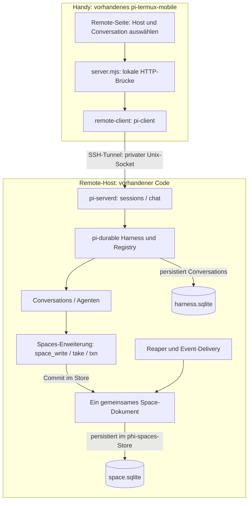
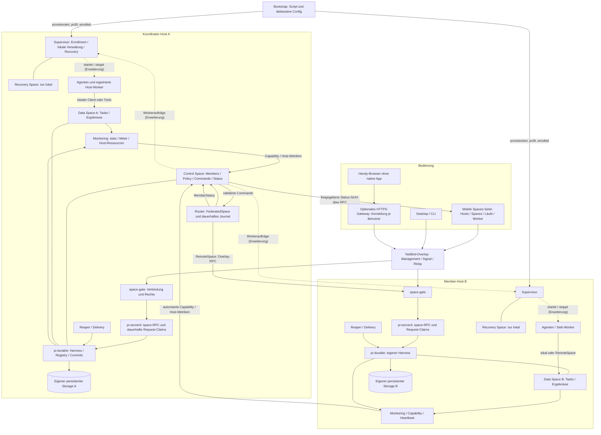
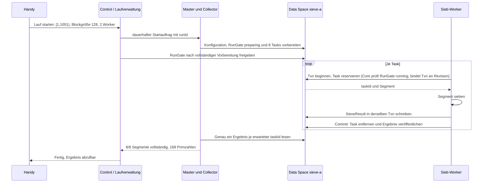

# Spaces betreiben und vom Handy steuern

Stand: 2026-10-16 (Betriebserweiterung B1–B10 umgesetzt, Abnahmestand in §7.6; zuvor: Ist-Stand an Phase 1b/2 und den begonnenen Phase-3-Baustein angepasst; Betriebserweiterung
um Umsetzungsreihenfolge, Zusatzfunktionen und ersten RunGate-Baustein ergänzt). Architektur und Bedienentwurf
zum [Federation-Plan v3](../federation-plan-v3.en.md). Die Ist-Stand-Referenz bleibt der
[Implementierungsstand](../implementierungsstand.en.md); dieses Dokument beschreibt die **Betriebserweiterung** darüber.
Bootstrap-Aufrufe und neue Verwaltungskommandos unten sind Vorschläge, solange Abschnitt 8 sie nicht als
umgesetzt führt.

## 1. Was heute vorhanden ist

| Komponente | Aktueller Stand |
|---|---|
| pi-durable Harness | in pi-serverd: führt Conversations aus und speichert sie in `harness.sqlite`; die Spaces liegen seit der [Umstellung](../umstellung-ohne-pi-durable.en.md) im phi-spaces-Store (`space.sqlite`), nicht im Harness |
| phi-spaces | Bibliothek mit eigenem Store (`src/store/`); Agenten-Tools als Erweiterung im Harness (`agent/`); Default-Space Version 5; benannte Spaces über Registry und Dokumentfamilie |
| Clients | `PhiSpaces` lokal, `RemoteSpace` über Unix-Socket/TCP/pi-server, `FederatedSpace` über den Router |
| Reaper und Delivery | `startService` verarbeitet Ablauf, Folgeaufträge und Events |
| Stufe 1 (AP 1.1–1.9) | signierte Generationen, Claims, Snapshot-/Byte-Seiten, Mailboxes, Budgets, CompletionProfile |
| Stufe 1b | Gate (Schicht A NetBird, Schicht B Schlüsselbeweis), Enrollment, Grants, Rotation, Supervisor (`createEnroll`, `revokePeer`, `rotateKey`), Recovery-Register, Control-/Data-Restore, Boot-Berechtigung je Space; live auf big/vpsc und mit dem Handy abgenommen |
| Stufe 2 (AP 2.1–2.9) | Router mit Command-Journal, RouterLease/Delegation, signierte Policy mit HRW/Typ/Capacity, `FederatedSpace`, Membership (`addMember`, `drain`, `freeze`, `removeMember`, EmptyProof), Admin-Commands `purgeTasks`/`deletePrincipal`; NetBird-Volllast und Prozessabbrüche abgenommen (Ausnahme Block 4 per Entscheidung) |
| Stufe 3 (teilweise) | Entry-Replikation (LWW/Add-Wins), gepagte Snapshots, Stream-Transfer, Snapshot-Pflege, Primary-Sync-Baustein; reale zehnminütige NetBird-Partition auf Komponentenebene bestanden; **nicht** in Policy, Boot, Löschung und Promotion eingebunden; `setStandby` fehlt |
| Monitoring | `stats`, `count`, `Meter`, `watchLive`, `Capability`-Verzeichnis, `MemberStatus`; lesendes Live-Dashboard ([dashboard.md](../dashboard.en.md)) und TUI ([tui.md](../tui.en.md)) |
| pi-termux-mobile | Remote-Conversations über SSH/pi-serverd; Spaces-Seite `spaces.html` mit Android-Keystore-Schlüssel, QR-/Token-Pairing, Schlüsselbeweis, Rotation und **lesender** Objektansicht eines Data Space |
| pi-serverd | SQLite-Harness (Sessions) und phi-spaces-Store (`space.sqlite`), Spaces/Reaper/Delivery, `sessions`/`chat` und opt-in `space`-Dienst; Federation-Start über `startConfiguredFederation` |
| Laufsteuerung | RunGate im Core, `RunController` mit lokalen und entfernten Members, ACK-Barriere, Lauf-Recovery nach Restore, Vorschau, Export, Zeitplan (Abschnitt 6, 8) |
| Worker-/Space-Lebenszyklus, Bootstrap, mobile Steuer-UI | umgesetzt (B6–B9); Bootstrap ohne SSH-/NetBird-Provisionierung; Worker als Schleifen im Daemon-Prozess |

Die Federation ist als Laufzeit vorhanden und abgenommen; die **Bedienschicht** darüber (Läufe, Worker,
Space-Anlage/-Löschung, Deployment-Bootstrap, mobile Steuerung) ist seit 2026-10-16 umgesetzt. Was davon
abgenommen ist und was offen bleibt, steht in §7.6 und §8.

Der `space`-Dienst im Daemon wird ausdrücklich mit `PI_SERVERD_SPACE_PRINCIPAL` (Peer-ID) und
`PI_SERVERD_SPACE_ROLES` (kommagetrennte Rollen) freigeschaltet. Beide Angaben sind erforderlich; ohne sie
bleibt Space-RPC unauthentifiziert, während Sessions/Chat weiter verfügbar sind. Der private Socket trägt
eine lokal konfigurierte Identität für alle berechtigten Socket-Benutzer; SSH allein erzeugt keine Space-Rolle.
Getrennte Netzwerk-Peers und Agentenidentitäten laufen über das Gate (Schicht A/B).
`PI_SERVERD_STATE_DIR` und `PI_SERVERD_AUTH_FILE` erlauben isolierte Test-Runtimes.

Geprüfte mobile Quellen liegen im Nachbarprojekt: `runtime/server.mjs`, `runtime/pi-serverd.mjs`,
`runtime/common.mjs`, `runtime/remote-client.mjs`, `runtime/remote-provision.mjs`, `runtime/spaces-mobile.mjs`,
`runtime/public/spaces.html` und `runtime/public/constants.js`.
`npm run bundle` baut die Bibliothek und aktualisiert automatisch `runtime/phi-spaces.mjs` im vorhandenen
Nachbarprojekt. Beispiele werden als ausführbare JS-Module nach `runtime/space-examples/` gebündelt.
Der Android-Build ruft vor dem Verpacken `scripts/prepare-runtime.py` auf: Er baut phi-spaces aus diesem
Checkout erneut, erzeugt `runtime.bin` und eine Prüfsumme beider App-Payloads. Änderungen werden bei der
App-Installation über diese Prüfsumme erkannt, ohne manuellen Runtime-Versionsbump.
Andere Pfade lassen sich über `PHI_SPACES_SOURCE` (mobiler Build) und `PHI_SPACES_MOBILE_ROOT` (Bundle) wählen.
Fehlt beim Android-Build ein kompatibler Source-Checkout, erscheint eine Warnung; der Build verwendet
die vorhandenen mobilen Bundles. Nur fehlende notwendige Bundle-Dateien oder Fehler beim Bauen eines
vorhandenen Checkouts führen zum Abbruch. Ohne Source wird keine Aktualität gegenüber dem Checkout behauptet.
Remote-Provisionierung berücksichtigt Bibliothek und Beispielmodule im Release-Hash und überträgt sie
beim nächsten Installations-/Updateablauf. Das installiert noch keine neue APK auf dem Handy und aktualisiert
keinen laufenden Remote-Daemon ohne den vorhandenen Freigabeablauf. CLI-Beispiele erzeugen keine neuen UI-Buttons.

Das folgende Diagramm zeigt den **einfachen Single-Host-Weg** über SSH, wie ihn die Remote-Seite heute nutzt.
Gate, Router und Membership aus Abschnitt 2 existieren als Code daneben, werden von dieser Remote-Seite aber
nicht bedient.



**Verknüpfung:** pi-durable ist die Laufzeit und Persistenz der Conversations. phi-spaces hält das Space-Dokument
in einem eigenen Store (`space.sqlite`) und ergänzt Tools in der Laufzeit der Conversations. pi-serverd macht Conversations per Protokoll erreichbar. Ein Remote-Host ist
kein zentraler pi-durable-Cloud-Dienst: Jeder Host besitzt seinen eigenen Harness und Storage.

Die mobile UI nennt Conversations ebenfalls „Sessions“. Eine neue solche Session erzeugt heute
**keinen neuen Space**: Alle Conversations desselben Harness teilen das Space-Dokument des Daemons.
Ein zusätzlicher unabhängiger Server/Harness besitzt einen getrennten Space; es entsteht dadurch keine Federation.

Ein Space ist für unterschiedliche Arbeitsarten nutzbar. Neue Sieb-, Pipeline- oder Rechercheaufgaben
erfordern keinen neuen Space, sofern Entry-Verträge, Rechte, Limits und Routing-/Replikationsregeln passen.
Beim geplanten Projektstart werden ausgewählte vorhandene Spaces wiederverwendet; nur nachweislich fehlende
Spaces werden angelegt. Ein gestoppter Host-Dienst öffnet beim Neustart seinen bisherigen persistenten
Bestand. Der genaue [Wiederverwendungsvertrag](../_attic/projektstart-autoprovisionierung.en.md#reusing-existing-runtime-and-spaces)
verhindert doppelte Daemons und Ersatz-Spaces bei unbekanntem Remote-Zustand.

## 2. Gesamtbild für die geplante Verwaltung

Alle Blöcke dieses Diagramms bilden das Ziel ab. Vorhandene Harness-/Space-Bausteine werden dafür erweitert.
Ein Host kann mehrere logische Spaces besitzen; ein zusätzlicher Host und ein zusätzlicher Space sind
verschiedene Verwaltungsaktionen.



Gestrichelte Pfeile sind **Erweiterungen gegenüber v3**. In v3 bearbeitet der Supervisor nur Enrollment,
Supervisor-Commands, Lease-Signatur, Recovery, Promotion und Umschaltung sowie die begrenzte Zusammenarbeit
mit dem Router bei `setStandby` und beim Replikatkonfigurationsabgleich. Allgemeine Worker-Startaufträge sind
noch kein Bestandteil von v3.
Für Worker gilt ein eigener Vertrag (7.3, umgesetzt als B6): Der Soll-Zustand liegt im geschützten Journal
`WorkerAssignments` des Control-Hosts, nicht als Entries im Control Space, und wird per Admin-Command `setWorkers`
gesetzt. Jeder Host holt über die Gate-Methode `workerAssignments` nur seinen eigenen, vom Control-Host signierten
Anteil; der Host ergibt sich aus der bewiesenen Verbindung, nicht aus der Anfrage. Damit braucht der Supervisor keine
zusätzliche Leseberechtigung im Control Space. Der lokale `WorkerSupervisor` gleicht die zuletzt angenommene Liste
(monotone Generation, gebunden an Control-Autorität und -Inkarnation) mit registrierten Workerarten ab und meldet den
angewendeten Stand als `metrics.workers` seiner `Capability`. `MemberStatus` schreibt nach v3 nur der Router.

Hinweis: Seit der Umstellung auf den phi-spaces-Store halten die Data Spaces ihren Store selbst (`space.sqlite`); der
pi-durable-Harness im Diagramm trägt nur die Conversations.

NetBird transportiert und begrenzt Erreichbarkeit; App-Schlüssel und Rollen autorisieren die Operationen.
Der Control Space enthält Steuerdaten, der Data Space Nutzdaten. Journal und RPC-Claims sind geschützte
interne Dokumente. Recovery bleibt je Host lokal und ist über einen Out-of-Band-Zugang erreichbar, nicht über
das Overlay. Ab Stufe 3 kann ein fester Standby Control- und Data-Members synchron spiegeln; ein so gespiegelter
Data Member darf dann nur in local- oder primary-Regeln stehen, nicht in expand oder lww/set (v3 6.4).
Replikation ist für den Einstieg nicht erforderlich.

Fällt der Koordinator aus, laufen Grants und Router-Lease innerhalb ihrer Laufzeit von höchstens 60 s plus zulässiger Zeitunsicherheit ab. Danach stehen alle entfernten
Space-Operationen der Federation, auch zwischen anderen Hosts. Lokale Worker auf jedem Host arbeiten weiter
(v3 5.2). Nach Control-Promotion ohne Standby ist zunächst die ausdrücklich autorisierte Recovery-
Umschaltung auf Single nötig; erst danach kann `setStandby` einen Ersatz einrichten. Die UI zeigt die zeitweise
schwächere Durability an. Bei **Control-Restore** braucht jeder wieder teilnehmende Member die lokal bestätigte neue
Autorität; alte Schlüssel-/Gruppenrechte werden nicht aus dem Snapshot reaktiviert. Offline-Members bleiben
als `recoveryBlocked` sichtbar und in der Vollständigkeitsprüfung enthalten.
Ein **Data-Restore** wechselt nur die Dateninkarnation des betroffenen Space. Die Control-Autorität bleibt
gleich; alte Pending-Arbeit wird historisch gesperrt, restaurierte Tasks bleiben `restoredUnverified` bis zur
fachlichen Freigabe. Betroffene Läufe benötigen den Recovery-Abgleich aus Abschnitt 6; andere Members behalten
ihre Autorität und Berechtigungen. Die Boot-Nachweise führen diese Berechtigungen je Space (v3 5.5).

Ein Datenbankverzeichnis wird niemals von mehreren unabhängigen Harness-Prozessen gemeinsam geöffnet.
RemoteSpace ruft den besitzenden Host auf; es öffnet dessen SQLite-Dateien nicht über das Netzwerk.
Der Router läuft auf dem Koordinator weiter, wenn die Handyseite geschlossen wird.

## 3. Zwei Wege vom Handy

### Heute: Remote-Conversations über SSH

1. In der vorhandenen Remote-Seite `user@host` auswählen und SSH-Zugang einrichten.
2. Verbinden. Der vorhandene Provisionierer prüft Node/tmux, überträgt das Runtime-Release und startet
   pi-serverd bei Bedarf. Credential-Übertragung und Updates folgen den vorhandenen Bestätigungsabläufen.
3. Conversation auswählen oder anlegen; Prompt senden, Verlauf/Status lesen oder Generation abbrechen.
4. Disconnect trennt den Client; „stop server“ beendet den Daemon und damit die laufende Host-Ausführung.

`remoteState` hält heute eine aktive Remote-Verbindung. Die RPC-Dienste sind `sessions` und `chat`.
Getrennt davon existiert die Seite **Spaces** (`spaces.html`): Gerät im Android-Keystore koppeln
(QR oder Token), Schlüsselbeweis, Rotation, einen Data Host/Space speichern und dessen Info, Stats und bis zu
100 Objekte **lesen**. Die Seite **Spaces-Steuerung** (`steuerung.html`, B9) steuert als gepairter Admin Läufe
und Worker und zeigt die eigenen Vorgänge; addMember und drain haben noch keine Formulare.
Das lokale Handy-HTTP-Interface lauscht auf 127.0.0.1; es ist kein bereits öffentlich erreichbares Dashboard.

### Ziel: eine Spaces-Seite

Native mobile Bedienung: Verbindungsliste nach hostId, NetBird, App-Pairing per QR, Space-Auflösung nach spaceId.
Browserbedienung: HTTPS-Gateway im Overlay mit eigener App-Anmeldung. Der Browser kann den TCP-Space-Dienst
nicht direkt benutzen. Ein späteres Gateway liefert statische UI und autorisierte Backend-Aufrufe.

| Ansicht | Anzeige | Aktionen im Bedienentwurf |
|---|---|---|
| Hosts | erreichbar / veraltet / offline, Ressourcen, Version | Pairing, Host hinzufügen |
| Spaces | Host, Modus, Bestand, Limits, Membership | anlegen, aufnehmen, drain, entfernen |
| Läufe | runId, erwartete/fertige Tasks, Fehler, Ergebnis, Steuerrevision/ACKs | Sieb starten, pausieren, fortsetzen, stoppen, Ergebnis herunterladen |
| Worker / Agenten | Host, Ziel-Space, Rolle, aktiv/reserviert/gestoppt | Anzahl setzen, starten, nach Task stoppen |
| Vorgänge | commandId, accepted/applying/completed/failed/needsReview | Fortschritt verfolgen, Ausgang auflösen oder fachliche Klärung dokumentieren |

Observer-Leserechte genügen für Hosts, Spaces, Läufe und Worker, soweit die Daten freigegeben sind. Die Ansicht
**Vorgänge** zeigt Commands und Results; das sind Steuerdaten und nach v3 §9 nur für Admins lesbar. Observer
sehen dort höchstens eine freigegebene Zusammenfassung. Verwaltungsaktionen brauchen Admin-Rechte.
Beim Wiederverbinden zuerst Snapshot/Status laden, dann Events verfolgen. Veraltete Messwerte werden
mit Zeitpunkt angezeigt; „offline“ ist kein Beweis, dass Worker auf dem Host beendet sind.
UI-Long-Polls laufen nur bei sichtbarer Seite. Der Router betreut angenommene Operationen einschließlich
Delegationserneuerung serverseitig weiter. Dashboard-Schließen pausiert keinen Rechenlauf.

## 4. Bootstrap: Script plus Config

Für den gewünschten Ein-Klick-Ablauf **Projekt auswählen → Starten → Remote-Runtime, Spaces und Monitoring
bereitstellen → Worker starten** gilt der ergänzende
[Projektstart-Vertrag](../_attic/projektstart-autoprovisionierung.en.md). Er beschreibt automatische Wiederverwendung,
Mehrhost-Bereitschaft, Teilfehler und dauerhafte Fortsetzung. Dieser Ein-Klick-Ablauf als Ganzes ist noch zu implementieren.

Script (`scripts/bootstrap-spaces.ts`) und Config-Schema (`validateDeployment`) sind seit B8 umgesetzt (Aufrufe unten);
das Beispiel zeigt dessen Schema. Die bestehende mobile SSH-Provisionierung deckt Release-Übertragung und
Daemon-Start ab, aber kein Federation-Bootstrap.

```json
{
  "schemaVersion": 1,
  "deployment": "prime-demo",
  "coordinator": "host-a",
  "hosts": [
    { "alias": "host-a", "ssh": "pi@vps-a", "role": "coordinator" },
    { "alias": "host-b", "ssh": "pi@vps-b", "role": "member-host" }
  ],
  "spaces": [
    { "alias": "control-demo", "host": "host-a", "purpose": "control" },
    { "alias": "sieve-a", "host": "host-a", "purpose": "data", "maxSpaceBytes": 67108864 }
  ],
  "routing": { "profile": "single-member-sieve", "member": "sieve-a" },
  "workers": [
    { "alias": "sieve-worker-a", "host": "host-a", "kind": "sieve", "targetSpace": "sieve-a", "count": 2 }
  ],
  "mobile": { "access": "native-overlay", "enrollmentRole": "admin" },
  "credentials": { "source": "host-secret-store" }
}
```

Die Config enthält nur **Aliase**. Nach v3 sind `hostId` und `spaceId` unveränderliche, beim Anlegen erzeugte
Identitäten, und Namen sind veränderbare Aliase. Der Bootstrap erzeugt die IDs, persistiert die Zuordnung
Alias → ID serverseitig und weist Kollisionen oder die Umdeutung eines Alias auf eine andere ID ab. Beispiele oben
sind keine bereits angelegten Spaces.
Keine Tokens oder Provider-Schlüssel in die Config schreiben. Das Sieb benötigt keinen Provider-Schlüssel.
Host B ist hier provisioniert, aber erhält erst bei Bedarf einen eigenen Data Space oder Remote-Worker.
Das Routing-Profil wird in eine gültige v3-Policy übersetzt: SieveTask und SieveResult bleiben auf demselben Member.

Umgesetzte Aufrufe (B8, `scripts/bootstrap-spaces.ts`); alle Modi außer `--check` laufen als gepairter Admin über
das Gate und schreiben ein Admin-Command in den Control Space:

```text
npm run bootstrap -- --check --config deployment.json
npm run bootstrap -- --bind host-b=<hostId> <admin>
npm run bootstrap -- --plan  --config deployment.json <admin>
npm run bootstrap -- --apply --config deployment.json <admin>
npm run bootstrap -- --start-workers --config deployment.json <admin>
npm run bootstrap -- --export --config deployment.json <admin>
<admin> = --coordinator <host:port> --gate-host <hostId> --peer <eigene Peer-ID> --key <Schlüsseldatei> [--local-address <ip>]
```

Der umgesetzte Teil deckt die Schritte 1 (Prüfung), 7 (Spaces anlegen oder wiederverwenden), 8 (Worker
registrieren, Start getrennt) und die Rückmeldung von Schritt 9 ab. Die Schritte 2–6 (Hosts per SSH vorbereiten,
Release, NetBird-Beitritt, Control-/Recovery-Initialisierung, Pairing und Enrollment) bleiben Voraussetzungen:
`--bind` ordnet einen Alias erst einem bereits enrollten Host zu, und der Plan blockiert, solange dessen
Capability-Heartbeat nicht frisch ist.

Der Script-Vertrag:

1. Config und unterstützte Features prüfen; bei fehlendem Space-RPC/Schema stoppen.
2. Hosts per SSH vorbereiten; stabile IDs, private State-Verzeichnisse und eindeutigen Storage-Besitzer sichern.
   Der Host wird nur mit gültigem externem Boot-Zustand aktiv; vor normalem Start jedes Space muss dessen eigene
   Boot-Berechtigung zur lokal vorbereiteten Konfiguration passen (v3 5.5). Ein wiederholter Apply reaktiviert
   keine durch Fencing widerrufenen Berechtigungen.
3. Versioniertes Runtime-Release inklusive passendem Spaces-Bundle bereitstellen; Gesundheit prüfen.
4. **Overlay-Beitritt:** NetBird-Client auf jedem Host installieren und mit einem Setup-Key aus dem
   Host-Secret-Store beitreten; Gruppe `space-hosts` zuweisen. Die Peer-ID jedes Hosts über die Management-API
   ermitteln und für die gebundenen Tokens festhalten. Das Admin-Handy tritt per NetBird-Login bei und erhält
   `space-admin`; auch seine Peer-ID wird ermittelt.
5. Control/Recovery/Supervisor auf A initialisieren, einschließlich Out-of-Band-Recovery-Zugang (v3 5.4)
   und unabhängigem Recovery-Register für eindeutig serialisierte Autoritätswechsel (v3 5.2.1).
   Den einmaligen, an die Handy-Peer-ID gebundenen Admin-Bootstrap-Token flüchtig anzeigen und **zuerst** das
   Admin-Pairing abschließen. Der Supervisor bearbeitet es ohne Router; erfolgreicher Verbrauch schließt die
   lokale Erstinitialisierungsbefugnis dauerhaft (v3 4.5). Bei bereits initialisiertem Host vorhandene
   Admin-Autorisierung prüfen, keinen neuen Bootstrap-Zugang öffnen.
6. Als gepairter Admin `createEnroll` für B senden und B mit gebundenem Einmal-Token über den bereinigten
   Enrollment-RPC enrollen. Script-Commands benötigen diesen Admin-Kontext; SSH oder Rolle host genügen nicht.
7. Benannte Data Spaces lokal über den autorisierten Lebenszykluspfad anlegen; wiederholter Apply erkennt
   bereits angelegte Aliase und IDs. Router starten, Members über Admin-Commands aufnehmen, Policy validieren;
   nie bestehende HRW-Bestände umverteilen.
8. Workerdefinitionen registrieren; Start getrennt von Installation behandeln.
9. Freigegebenen Status vom Handy prüfen. Kein Rechenlauf wird unbeabsichtigt gestartet. Token-Payloads werden
   weder als Control-Entries noch in Requests, Logs, Snapshots oder Fortschrittsdaten gespeichert.

Config beschreibt den gewünschten Zustand. Tatsächlich angewendeter Zustand und Revision liegen serverseitig.
Mobile Änderungen müssen sich anschließend exportieren lassen; ein späterer Script-Apply zeigt Differenzen
und überschreibt manuelle Änderungen nicht stillschweigend.

## 5. Spaces hinzufügen und entfernen

### Hinzufügen

1. **Host verbinden:** provisionieren/enrollen. Ein Host allein ist noch kein Federation-Member.
2. **Space anlegen:** Host, Alias und Limits wählen; neue stabile spaceId und persistentes Dokument erzeugen.
3. **Zur Federation aufnehmen:** `addMember` als dauerhaftes Command; Erfolg im Result abwarten.
4. **Nutzung festlegen:** neue, leere Regel oder zulässige capacity/capability-Auswahl; danach Worker zuweisen.

Die v3-Kommandoliste besitzt addMember/removeMember, aber keinen Vertrag für Space-Anlage/-Löschung. Die
Betriebserweiterung ergänzt ihn (B7): `createSpace`, `archiveSpace`, `reactivateSpace`, `deleteSpace` als
Admin-Commands, idempotent verarbeitet vom Ziel-Host über signierte Anweisungen. Das ist kein v3-Abnahmebefund.

Wird ein **vorhandener** Space aufgenommen, prüft `addMember` seinen Bestand (v3 7.1). Entries eines Typs, den
die Policy einem anderen Member oder einer HRW-Menge ohne diesen Space zuordnet, führen zu `RoutingConflict`.

`addMember` verschiebt keine vorhandenen Entries und verändert keine bestehende HRW-Zuordnung.
Beim einfachen Sieb nutzt ein laufender Durchgang weiter seinen ursprünglichen Member. Mehr Worker auf
diesen Member können zuerst genügen; ein zweiter Task-Space erfordert die Aufteilung aus Abschnitt 6.

### Entfernen

1. `drain`: neue unabhängige Platzierungen stoppen. Bestehende Arbeit bleibt erreichbar; gebundene
   Abschluss-Writes sind gemäß v3 7.1 erlaubt. Für Sieb-Tasks muss vor drain ein Abschlussprofil feststehen:
   nur SieveResult derselben runId/taskId auf demselben Member, begrenzte Bytes/Anzahl und endliche Lease.
2. Worker nach laufendem Task stoppen. Während drain neu reservierte bestehende Tasks benötigen die
   Abschlussberechtigung des Members; ohne Profil keine neuen verarbeitenden Take-Txns. Offene Remote-
   Operationen am Member entscheiden/abbrechen; unbekannter Ausgang bleibt sichtbar und ausstehend.
3. Läufe beenden, Ergebnisse exportieren und Daten bewusst aufbewahren oder löschen. Ein nicht leerer,
   weiter aufzubewahrender Bestand verhindert die Entfernung; removeMember ist kein Archivierungsersatz.
4. `removeMember` startet die dauerhafte lokale Sperrphase `removing` aus v3 7.1. Neue fachliche Mutationen,
   Take-Claims und Txns sind dann auch für lokale Worker gesperrt. Leerung einschließlich unsichtbarer Writes,
   Txns/Sperren, Waiter, aktiver Notify-Registrierungen, interner Folgearbeit und offener RPCs wird unter dieser
   Sperre bestätigt. Notify-Registrierungen enden geordnet mit dem Event `registrationClosed`; ausstehende
   Mailbox-Events bleiben bis ACK/TTL abrufbar (v3 7.1).
5. Router prüft seine offenen Requests, Routingreferenzen und Worker-/Run-Bindungen, committet Membership-
   Entfernung und bestätigt `detached` am Member. Auf completed warten; ein Absturz erhält Sperre und IDs.
   Bei unbekanntem Ausgang nicht lokal entsperren. Historische Manifeste bleiben Auditdaten, keine aktive Bindung.
6. Separat archivieren/löschen. Geschlossene Claims und Mailbox-Ergebnisse bleiben über Space-ID bis zu ihrer
   Frist erreichbar; Storage darf vorher nicht ersatzlos gelöscht werden. Host-Shutdown und Schlüsselwiderruf
   sind weitere getrennte Aktionen.

Ein Member einer HRW-Menge (expand nach Feld) lässt sich in v3 **gar nicht** entfernen. `drain` weist dort
neue unabhängige Writes für seinen Schlüsselanteil ab; gebundene Abschluss-Writes bleiben erlaubt. `removeMember` liefert `MigrationRequired`. Entfernbar sind nur
Members mit fester Typzuordnung und Members von capacity/capability-Regeln.
Ein offline Member mit ungeklärtem Bestand lässt sich nicht als „leer“ entfernen. Erfordert ein Wechsel
Datenmigration, wird er bis zur Umsetzung des Migrationsprotokolls abgewiesen. `take A → write B` ersetzt
keine sichere Migration. `removeMember` ist weder Datenlöschung noch das Stoppen des gesamten Hosts.

## 6. Beispiel: Primzahlsieb steuern

### Kleinster sinnvoller Aufbau

Ein Data Space `sieve-a`, ein Master/Collector und zwei Worker. Zunächst alle auf Host A, anschließend können
Remote-Worker denselben Task-Space bedienen. Ein Task enthält runId/taskId und ein disjunktes Halbintervall.
Sieb-Worker sind deterministischer Host-Code: Ein LLM ist dafür nicht erforderlich.



Am Handy sind dafür fünf Schritte vorgesehen:

1. **Spaces → sieve-a** öffnen und Erreichbarkeit/Limits prüfen.
2. **Lauf starten → Primzahlsieb**: Start 1, exklusive Obergrenze 1001, Blockgröße 128, Worker 2.
3. **Starten**: Backend vergibt runId und journalisiert den Auftrag; Wiederholung derselben Anfrage startet keinen zweiten Lauf.
4. **Fortschritt**: 0/8 bis 8/8 erledigte Segmente, offene Reservierungen, Workerstatus und Fehler anzeigen.
5. **Ergebnis**: Primzahlliste ansehen/herunterladen. Pause verwendet die bestätigte Sperrphase unten; Fortsetzen behält runId und erhöht die Steuerrevision.

**Verbindlicher Pause-/Fortsetzungsvertrag der Betriebserweiterung:** Pause löscht keine Tasks und wird
nicht allein durch einen gelesenen Status im Control Space wirksam. Das Manifest nennt alle Task-Members.
Auf jedem liegt genau ein geschützter `RunGate {runId, controlRevision, state: preparing | running | paused | stopped}`,
verwaltet durch den Run-Controller über einen autorisierten lokalen Supervisor-Aufruf. RunGate ist lokale
Steuerinformation des jeweiligen Data Space, kein zusätzlicher HRW-Nutzdatentyp; normale Worker dürfen ihn nur
lesen. Bei Run-Vorbereitung entstehen Gate und Tasks idempotent; vor vollständiger Vorbereitung bleibt das
Gate `preparing`, auch wenn auf dem Host bereits Worker laufen.

- Der Core prüft den RunGate **bei jedem Task-Take** (direkter Take, wartender Take, Host-Code): Tasks eines
  Laufs, dessen Gate fehlt, nicht `running` ist oder einen Fence trägt, sind für Takes unsichtbar. Der Take
  bindet die Txn an `{runId, controlRevision}`; diese Bindung ersetzt die ursprünglich vorgesehene Lesesperre
  auf einem Gate-Entry. Result-Writes eines gesperrten Typs brauchen eine Txn mit passender Bindung; fremde
  runId/taskId scheitern am CompletionProfile. Gates sind kein Entry und über Space-RPC nicht schreibbar.
  Der Gate selbst hat keine ablaufende Lease; Worker-Txns haben endliche Leases.
- **Erzwungener Abschluss:** Das `CompletionProfile` des Siebs (v3 6.4) gilt für jeden Commit: Pro genommenem
  `SieveTask` genau ein `SieveResult` mit gleicher runId/taskId und den erwarteten `rangeStart`/`rangeEnd` in
  derselben Txn. Commit ohne Ergebnis, mit zwei Ergebnissen oder mit falschen Grenzen scheitert mit
  `CompletionViolation`; die Txn bleibt abbrechbar. Tasks ohne Ergebnis zu entfernen ist nur über den
  Admin-Command `purgeTasks` mit eigenem Recht und Audit möglich, nie über Worker-Rechte.
- `pauseRun` journalisiert eine neue monotone Steuerrevision und sendet sie mit stabilen Unterrequest-IDs an
  alle Manifest-Members. Jeder Member installiert zuerst eine dauerhafte Eintrittssperre gegen neue Run-Txns
  und Lease-Verlängerungen bestehender Run-Txns. Bereits gebundene Txns dürfen innerhalb ihrer verbleibenden
  Lease abschließen; anschließend wird der Gate exklusiv, konfliktgesichert auf `paused` geändert. Ein Member
  bestätigt erst nach diesem Commit und ohne verbleibende Run-Txns oder versiegelte Abschlusskandidaten.
- Der Controller meldet global `paused` erst nach allen Member-ACKs. Währenddessen zeigt die UI `pausing`,
  bei unerreichbaren Members `pauseIncomplete` mit fehlenden ACKs; dort kann bis zur lokalen Sperre weiter
  gearbeitet werden. Nach global bestätigter Pause gibt es bis resume keine weiteren fachlichen Run-Commits.
  Pause kann weder zurückliegende Commits noch bereits ausgeführte externe Wirkungen rückgängig machen.
- `resumeRun` ist erst nach vollständig bestätigter Pause zulässig. Es verwendet dieselbe runId und eine höhere
  controlRevision. Members ändern Gate und Eintrittssperre atomar auf `running`. Ältere Revisionen werden
  abgewiesen. Die UI zeigt `resuming` bis alle ACKs vorliegen; auf bereits bestätigten
  Members kann Arbeit vorher beginnen. Es gibt keinen atomaren globalen Startzeitpunkt.
- **Revisionen und ACKs:** Dieselbe `controlRevision` ist nur bei identischem Command (`commandId`, Art und
  Zielzustand) idempotent und liefert die gespeicherte Bestätigung. Dieselbe Revision mit anderem Command oder
  Inhalt ergibt `RunGateConflict` ohne Änderung. Jedes ACK belegt `{runId, memberId, authorityId,
  dataIncarnation, controlRevision, state, commandId}`; der Controller wertet nur ACKs aus, deren Autorität und
  Dateninkarnation zum aktuellen Stand des Members passen.
- **Recovery-Sicht:** Der Member hält Gate, Eintrittssperre und laufenden Steuerauftrag samt Revision,
  `commandId`, Art, Argument-Hash und Phase dauerhaft zusammen. Eine autorisierte `RunRecoveryView` enthält
  diese Daten, abgeschlossene stopped-Historie, Autorität/Dateninkarnation, Member-Revision und offene bzw.
  versiegelte Run-Txns. Damit ist z.B. eine bereits installierte Pause-Sperre der Revision 11 sichtbar, auch
  wenn der Gate wegen einer laufenden Txn noch `running/10` zeigt. Ein Snapshot des Gates allein ist kein
  Recovery-Nachweis.
- **Abgleich nach Restore:** Nach Control-Restore (v3 5.2.1) oder Data-Restore (v3 5.2.2) ist der Lauf
  `reconciling`. Der Controller installiert auf jedem Manifest-Member mit stabiler Unterrequest-ID eine
  dauerhafte Recovery-Eintrittssperre gegen neue Run-Txns und Lease-Verlängerungen. Bestehende Txns werden wie
  bei Pause entschieden; versiegelte Kandidaten einer intakten Historie müssen aufgelöst sein. Dann liefert
  der Member unter dieser Sperre eine `RunRecoveryView`. Fehlende Members verhindern vollständige Freigabe.
  Restaurierte Views sind als historische Nachweise markiert; alte Pending-Aufträge werden nach v3 5.2.2
  nicht wieder ausgeführt, ihre beabsichtigte Wirkung bleibt zur fachlichen Klärung sichtbar.

  Der Controller gleicht **alle** Views mit Manifest und erhaltenem Command-Journal ab. Die höchste Revision
  aus Gate, Sperre, Steuerauftrag und stopped-Historie begrenzt neue Revisionen nach unten; sie wählt **nicht**
  automatisch einen Zielzustand. Gleiche Revision mit verschiedenen Command-Identitäten/Inhalten,
  fehlende Auftragsherkunft oder ein unvollständiger Pause-/Resume-/Stop-Übergang ergeben `needsReview` bei
  weiter bestehender Sperre. Ein lokal installiertes `running` ist keine Freigabe, andere Members automatisch
  fortzusetzen. Alte Control-Pending-Aufträge werden nach Restore nie automatisch neu ausgesendet.

  Sind alle aktuellen Nachweise vollständig, stabil und identisch `paused` oder `stopped`, darf der Controller
  diesen Zustand mit frischen ACKs bestätigen; stopped-Historie bleibt terminal. Für unvollständige Übergänge
  oder Wiederaufnahme von `running` braucht es einen eigenen Admin-Command
  `resolveRunRecovery {runId, expectedViewHash, decision: pause | stop | resume}` mit Audit. Er bindet die
  bewusste Entscheidung an die vollständigen Views; der Hash bezieht sich auf deren stabile Steuerdaten,
  nicht auf Messzeitpunkte oder fachlich unabhängige Space-Mutationen. Vor Annahme wird er geprüft; dann
  persistiert der Controller Entscheidung, erwartete Steuerstände je Member und Unterrequest-IDs. Jeder
  Member-Schritt prüft seinen erwarteten Steuerstand per Compare-and-Set. Änderungen durch die bereits
  journalisierten eigenen Schritte sind Fortschritt desselben Auftrags und legitimieren keine zweite Wirkung.
  Unerwartete Änderungen führen zu erneuter Klärung, ohne angewendete Teilwirkungen zu verschweigen.
  `resume` ist bei irgendeinem nachgewiesenen stopped-Zustand unzulässig. Neue Steuerrevisionen liegen über
  allen beobachteten Revisionen; Pause/Stop verwenden zuerst die vollständige Sperr-/ACK-Barriere. Ein Resume
  setzt erst den vollständig bestätigten paused-Zustand voraus, verwendet danach eine weitere höhere Revision
  und folgt der normalen Freigabe mit Teil-ACKs. Recovery-Sperre und Gate werden dabei atomar je Member
  abgeglichen. Ein Absturz setzt dieselbe Entscheidung fort, nicht eine neue Entscheidung aus einer höchsten Zahl.

  Erst nach vollständigem Abgleich darf ein globaler stabiler Zustand gemeldet werden; während der Freigabe
  gelten `resuming` und die normale Teilstart-Semantik. `restoredUnverified`-Tasks bleiben auch danach bis
  `releaseRestored` gesperrt. Dieser Command ersetzt weder die Lauf-Recovery noch die Prüfung eines
  `CompletionProfile` und reaktiviert keine historischen RPCs.
- `stopRun` verwendet dieselbe Sperr-/ACK-Barriere und endet in `stopped`; diese runId wird nicht wieder
  gestartet. Pause/Resume/Stop werden pro Run serialisiert. Neue Kommandos überholen keinen unklaren Ausgang;
  Neustart rekonstruiert Revisionen und Teilbestätigungen. Administrative Klärung bleibt erforderlich, wenn ein
  Member dauerhaft verloren ist; die UI darf dann keine vollständige Pause/Beendigung behaupten.
- Nach vollständig bestätigtem Stop und Export/Löschung der Laufdaten darf der Controller den RunGate in
  abgeschlossene interne Laufhistorie überführen. Die persistente stopped-Steuerrevision bleibt zur Abweisung
  verspäteter Start-/Resume-Aufträge erhalten; sie zählt wie ein abgeschlossener Claim, nicht als aktiver Entry
  oder Workerbindung bei removeMember. Normale Worker dürfen diese Bereinigung nicht ausführen.

Ein sauber stoppender Worker beendet seine aktuelle Txn. Bei Prozessverlust wird der Task nach Lease-Ablauf
erneut verfügbar. Erfolgreicher Commit heißt atomarer Task-/Ergebnisabschluss; CPU-Berechnung kann mehrfach
stattfinden. Die Steuerbarriere ist zusätzlich zum heutigen Sieb zu implementieren.

**Heute ausführbar:** `npm run example:sieve -- 1001 2`. Dies benutzt den phi-spaces-Store im Speicher und beendet sich nach
der Aggregation. `processSieveTask` und `collectSieveResults` arbeiten auf jedem `SpaceLike`, also auch über
`RemoteSpace`/`FederatedSpace`; Sieb-Läufe über NetBird sind in Phase 2 abgenommen. `prepareSieveRun`
benötigt weiterhin lokale Host-Commits auf dem Ziel-Member.

**Umgesetzt (Abschnitt 8):** Der RunGate liegt als geschützter Steuerzustand im Space-Dokument,
nicht als Entry. Der Core blendet Tasks eines gesperrten Laufs für jeden Take aus, auch für wartende Takes und
Host-Code; eine Txn wird beim Take an `{runId, controlRevision}` gebunden. Pause/Stop installieren zuerst
einen Fence (keine neue Bindung, keine Lease-Verlängerung gebundener Txns) und wechseln den Gate erst, wenn
keine gebundene Txn mehr offen ist. Der `RunController` journalisiert Start/Pause/Resume/Stop mit monotonen
Revisionen und ACKs für lokale und entfernte Members (B4), gleicht Läufe nach Restores ab (`reconcile`,
`resolveRunRecovery`, B5) und ist vom Handy aus bedienbar (B9).

### Später mehrere Task-Spaces

Für dieses kleine Beispiel ist eine Aufteilung unnötig. Für den späteren Mehrhost-Ablauf gibt es zwei Wege.

**In v3 ausdrückbar: HRW nach `taskId`.** `SieveTask` und `SieveResult` erhalten je eine expand-Regel
`by: {field: "taskId"}` mit **derselben** festen Member-Menge, z.B. `[sieve-a, sieve-b]`. Damit landen Task und
Ergebnis derselben `taskId` immer auf demselben Member. Ein Worker nimmt den Task in einer Txn auf Member X und
schreibt das Ergebnis mit derselben `taskId` nach X, ohne `RoutingConflict`. Die Verteilung bestimmt HRW, nicht
der Betreiber. Das Lauf-Manifest hält für jede `taskId` den berechneten Member fest. Jeder Task wird auf seinem
Member idempotent vorbereitet; es gibt keinen atomaren Commit über beide Hosts. Große Vorbereitungen werden
unter dem v3-Commit-Budget mit dauerhaftem Teilmanifest aufgeteilt; `preparing`-RunGates verhindern vorzeitige
Bearbeitung durch vorhandene Worker. Erst nach vollständiger Vorbereitung werden sie freigegeben. Teilweise
Vorbereitung wird angezeigt und wiederaufgenommen. Pause/Resume verwendet anschließend alle Manifest-Members
nach dem RunGate-Vertrag oben. Grenzen:
- Die Member-Menge ist unveränderlich (v3 7.1). Neue Members können für diese Typen keine neuen Läufe übernehmen.
- Keiner dieser Members lässt sich entfernen.

**Erweiterung, nicht Teil von v3:** gezielte Zuordnung ganzer Teilbereiche (z.B. [1,501) auf sieve-a,
[501,1001) auf sieve-b) und Aufnahme neuer Members für neue Läufe. Das braucht eine laufbezogene
Routingtabelle, die das Manifest als Routingquelle verwendet; v3 kennt nur eine Regel pro Typ. Ersatzweise
geht das heute nur mit eigenen Typnamen je Teilbereich und je einer `local`-Regel, was die Typgrenzen schnell
erschöpft.

In beiden Fällen gilt: Worker binden Txn, Task und SieveResult an **denselben** Member. Ergebnisse werden nicht
nachträglich durch eine unabhängige capacity-Regel auf einen anderen Member geschrieben. Der Collector prüft das
Manifest und alle erwarteten IDs auf allen beteiligten Members; ein ausgefallener Member liefert „unvollständig“,
niemals „fertig“. Laufende Tasks werden nicht heimlich migriert. Für echte parallele CPU-Berechnung sind
getrennte Workerprozesse oder Hosts erforderlich.

## 7. Monitoring und fehlende Steuerverträge

### 7.1 Monitoring

| Ebene | Daten | Herkunft und Grenze |
|---|---|---|
| Space | Entries, locked/uncommitted, Txns, Waiter, returned | heutige lokale stats/count; pro benanntem Space künftig separat |
| Speicherbudget | Entry-Bytes, Claims/Outbox/Storage-Bytes und Limits | maxSpaceBytes begrenzt heute Entry-Felder; vollständige Byte-Metriken zusätzlich implementieren |
| Operationen | Writes/Reads/Takes pro Sekunde, Deliveryfehler | heutiger Meter; Zähler starten nach Prozessneustart neu |
| Sieblauf | erwartete taskIds, committed Ergebnisse, Laufzustand | Run-Manifest/-Controller erforderlich; Gesamtcount allein reicht nicht |
| Worker | gewünschte/aktive Anzahl, Host, aktueller Task, letzter Fehler | dauerhaftes Worker-Verzeichnis und Heartbeat erforderlich |
| Host | CPU, RAM, Disk, IOPS, Commit-Latenz, Erreichbarkeit | zusätzlicher Ressourcenmonitor; nicht bereits Teil des Space-Meters |
| Federation | policyVersion, Members, offene Commands, Revisionen/Lag | v3-Zieldienste; Vollständigkeit und Zeitstempel sichtbar machen |

`watchLive` liefert lokale Snapshots. Er misst keinen gesamten VPS und ersetzt keine Netzwerk-/Host-Healthchecks.
Das lesende Live-Dashboard (`npm run dashboard`) und die TUI zeigen Spaces, Objekte und Stats eines Stores;
Läufe, Worker und Vorgänge kennen sie noch nicht.
Eine langsam aktualisierte MemberStatus-Lease ist kein autoritativer Task-Abschlussbeleg.
Bootstrap-Writes des Siebs verwenden direkte Core-Commits und werden nicht automatisch als Writes des phi-spaces-Clients
gezählt; der Fortschritt wird deshalb aus den tatsächlichen Laufdaten abgeleitet.

### 7.2 Konkrete Bedienelemente auf dem mobilen Gerät

**Die folgenden Ansichten, Eingabefelder und Buttons gehören in die mobile App beziehungsweise
deren Web-Oberfläche.** Sie senden autorisierte Aufträge an das Backend. Die eigentliche Installation,
Space-Verwaltung und Worker-Ausführung erfolgt auf den Hosts. Es handelt sich um Vorschläge für neue
Bedienelemente; die vorhandene Remote-Seite besitzt diese Projekt-/Federation-Steuerung noch nicht.

Die mobile Navigation beginnt mit einer **Projektliste**. Nach Auswahl eines Projekts reichen vier
Hauptbereiche: **Übersicht**, **Spaces**, **Läufe** und **Agenten/Worker**. Host-Zugang und Runtime-Updates
liegen unter **Projekt-Einstellungen → Hosts**; laufende Verwaltungsvorgänge sind von der Übersicht erreichbar.

| Mobile Ansicht | Felder und Anzeige | Bedienelement | Benötigte Backend-Wirkung |
|---|---|---|---|
| Projektliste | Name, Config-Revision, bereit/aktiv/Fehler | Projekt auswählen, Config importieren | Konfiguration laden/validieren; Auswahl startet noch nichts |
| Übersicht | Hosts, Federation-Modus, Bereitschaft, Ressourcen, letzte Statuszeit | Projekt starten | dauerhafter Deployment-/Startauftrag; Runtime, Monitoring und Spaces vorbereiten, dann Worker aktivieren |
| Übersicht bei Teilfehler | betroffener Host, fehlender Schritt, Auftrags-ID | Vorbereitung fortsetzen | denselben Auftrag mit gleichen IDs wiederaufnehmen; kein zweites Deployment |
| Hosts | Alias, SSH-Ziel, Identität/Fingerprint, Version, erreichbar/offline | Host hinzufügen, verbinden/pairen | autorisierte Provisionierung und Enrollment; noch keine automatische Member-Aufnahme |
| Spaces | Alias, spaceId, Host, Modus, Entries, Txns, Limits | Space hinzufügen | bestehenden Space aufnehmen oder neuen Space auf gewähltem Host anlegen und anschließend aufnehmen |
| Space-Details | Bestand, offene Arbeit, Membership | Neue Zuweisungen stoppen (drain) | neue Platzierungen sperren; bestehende Arbeit und Reads erhalten |
| Space-Details nach drain | Ergebnisaufbewahrung, Sperrphase, EmptyProof | Aus Federation entfernen | removeMember sperrt lokal und prüft Leerung sowie Bindungen; keine automatische Datenlöschung; bei HRW-Members deaktiviert mit Grund „Migration erforderlich“ |
| Space-Details ohne Membership | archivierter/leerer Bestand | Archivieren oder Space löschen | getrennte Lebenszyklusaktion; Referenzen, Rechte und Aufbewahrung prüfen |
| Neuer Sieblauf | Start, exklusive Obergrenze, Blockgröße, Workerzahl, Ziel-Space/Federation | Lauf starten | runId/Manifest anlegen, Bereiche validieren, Tasks idempotent vorbereiten und Worker zuweisen |
| Lauf-Details | Segmente, Reservierungen, pausing/pauseIncomplete/paused/resuming/reconciling, Member-ACKs | Pausieren, Fortsetzen, Lauf stoppen | RunGate-Barriere auf allen Manifest-Members; Erfolg erst nach allen ACKs, laufende Txns vorher entscheiden |
| Lauf-Details nach Restore | Gate-/Sperrrevisionen, offene Steuerphase, Herkunft, fehlende Members, needsReview | Recovery-Entscheidung bestätigen | resolveRunRecovery bindet Admin-Entscheidung an vollständige Views; kein automatisches Resume aus höchster Gate-Revision |
| Lauf-Details | Vollständigkeit und gespeicherte Primzahlliste | Ergebnis ansehen, herunterladen | autorisierter Ergebnisexport aus committed Results; Teilresultat ausdrücklich kennzeichnen |
| Worker-Details | registrierte Workerart, Host, Member, gewünschte/aktive Anzahl | Anzahl ändern, Starten, Nach Task stoppen | gewünschte Anzahl und Generation speichern; Supervisor startet/stoppt nur die zugeordneten Worker |
| Agent-Details | Conversation, Modell, Ziel-Space, Status, Budget | Agent anlegen, konfigurieren, Generation abbrechen | getrennt autorisierte Conversation-/Modellverwaltung; keine Änderung fremder Worker oder Hosts |
| Vorgänge | accepted/applying/completed/failed/needsReview, letzter Schritt, commandId | Details, Status erneut abrufen, Klärung dokumentieren | bestehende IDs abfragen; bei verlorener Historie keine automatische Wiederholung; Admin-Klärung auditieren |

„Space hinzufügen“ öffnet eine kleine Auswahl: **vorhandenen Space aufnehmen** oder **neuen Space anlegen**.
Eine neue Member-Zuordnung wird vor Ausführung gegen v3-Routinggrenzen geprüft. Kann ein bestehender Bestand
nicht sicher umverteilt werden, zeigt die UI den konkreten Konflikt; sie bietet keinen scheinbar erfolgreichen
Wechsel der HRW-Menge an. Bei einem laufenden Sieb bleiben die Manifest-Member unverändert.

Die Standardaktion **Projekt starten** bündelt den Ablauf aus dem
[Autoprovisionierungsvertrag](../_attic/projektstart-autoprovisionierung.en.md). Installation und Monitoring brauchen
keinen separaten täglichen Startknopf. Erweiterte Details zeigen pro Host die einzelnen Bereitstellungsschritte.
Für einen weiteren Rechenlauf in einem bereits bereiten Projekt genügt **Lauf starten**.

Auf der mobilen Seite werden Aktionen erst nach Backend-Bestätigung als erfolgreich angezeigt.
Während einer Anfrage bleibt die Auftrags-ID erhalten; Doppeltippen und Wiederverbindung verwenden dieselbe
Anfrageidentität. Bei Timeout erscheint „Ausgang wird geprüft“ statt einer Aufforderung zum erneuten Start.
Die UI zeigt Zielprojekt, Host/Space und Wirkung an; destruktive Löschung benötigt eine gesonderte Bestätigung.
Aktionen ohne passende Rechte oder ohne erfüllte Voraussetzungen sind deaktiviert und zeigen den Grund.

**Worker und LLM-Agenten werden getrennt dargestellt:** Beim Sieb gibt es Workerzahl und Ziel-Member,
aber keine Modellauswahl. Für LLM-Agenten sind Modell, Conversation und Budget relevant.
„Generation abbrechen“ ist keine allgemeine Space-Txn- oder Lauf-Abbruchoperation; der zuständige
Controller muss offene Aufgaben und Reservierungen anhand ihres tatsächlichen Zustands behandeln.
Das vorhandene „stop server“ wird nicht als Projekt-Stopp verwendet, da es andere Projekte treffen könnte.
Handyseite schließen oder Verbindung trennen beendet weder Worker noch serverseitiges Monitoring.

### 7.3 Dafür erforderliche Backend-Verträge

Die bisher am Dokumentende genannten Lücken betreffen sowohl mobile Oberfläche als auch Backend.
Zusätzlich zum v3-Netz-/Space-Protokoll fehlen für die oben genannten Bedienelemente:

- **Laufverwaltung:** startRun/pauseRun/resumeRun/stopRun; dauerhaftes Manifest, idempotente Starts,
  geschützte lokale RunGates, RunRecoveryView/resolveRunRecovery und Sperr-/ACK-Barriere nach Abschnitt 6,
  Zustandsübergänge und Ergebnisexport.
- **Workerverwaltung:** registrierte Workerarten, gewünschte Anzahl, Generation und Wiederaufnahme. Lokale
  Ausführung durch den `WorkerSupervisor` über signierte, per Host abgerufene Zuweisungen (Abschnitt 2, B6); das
  erweitert die Supervisor-Rolle aus v3 und braucht eine eigene Abnahme.
- **Lauf-Routing über mehrere Members:** laufbezogene Routingtabelle für gezielte Teilbereichszuordnung (6).
- **Agentenverwaltung:** Conversations anlegen/konfigurieren/stoppen, mit getrennten Rechten und festem Ziel-Space.
- **Space-Lebenszyklus:** idempotente Anlage, Registry/Storage-Zuordnung, Archivierung und geprüfte Löschung.
- **Mobile Oberfläche und Brücke:** neue Spaces-Endpunkte sowie Verbindungsliste und Snapshot-/Event-Recovery.

Diese Verwaltungsaktionen dürfen keine beliebigen Shellbefehle ausführen. Host-Workerarten sind registrierter
Code; Start-/Stopaufträge werden journalisiert und am Ziel idempotent angewendet. Normale member-Rechte
zum Schreiben von Tasks gewähren keine Rechte zum Starten von Prozessen.
Die geplante space-gate-Allowlist erlaubt nur `serviceId: space`; vorhandene `sessions`/`chat` werden dort
nicht automatisch öffentlich. Agentenverwaltung benötigt einen ausdrücklich definierten, autorisierten
Steuerpfad über Commands/Supervisor oder einen separat abgesicherten Dienst.

Reihenfolge der Umsetzung nach den v3-Stufen: benannte Spaces und RPC (Stufe 1) → Overlay, Enrollment und
Recovery (1b) → Router/Membership (2) → Replikation und kontrollierte Übernahme (3) → weitere Clients und
optional Browser-Gateway (4). Lauf-/Workersteuerung und die mobile Spaces-Seite sind Erweiterungen. Sie können
nach Stufe 2 parallel zu Stufe 3 entstehen, setzen aber Router und Membership voraus. Replikation ist für den
Einstieg nicht nötig, aber Voraussetzung für Hochverfügbarkeit des Control Space.
Die vorhandene SSH-Remote-Oberfläche bleibt der Einstieg für heutige Conversation-Steuerung.

### 7.4 Abnahme der Betriebserweiterung

Diese Fälle sind verpflichtend. Der aktuelle Stand je Fall steht in Abschnitt 8; nicht dort genannte Fälle
sind weder implementiert noch getestet:

1. Bootstrap nach jedem Schritt unterbrechen: erstes Admin-Pairing vor Host-Enrollment und Commands;
   Wiederholung öffnet keine neue Erstinitialisierungsbefugnis und erzeugt keine zweiten IDs.
2. Worker zwischen Gate-Read, Take, Result-Write und Commit pausieren: laufende Txn darf vor dem Pause-ACK
   abschließen; nach bestätigtem `paused` kein weiterer Run-Commit. Direkte/local Calls umgehen die Barriere nicht.
3. Ein Member während Pause offline: `pauseIncomplete`, niemals global `paused`; nach Wiederkehr derselbe
   Auftrag. Verspätete Pause nach neuerem Resume wird abgewiesen; Controller-Neustart erhält Revisionen und ACKs.
4. Bestehende Worker während mehrteiliger Run-Vorbereitung: keine Bearbeitung vor Freigabe der RunGates;
   Abbruch/Retry erzeugt weder doppelte Tasks noch fehlende Manifestteile.
5. drain zwischen Task und Ergebnis: zulässiger Abschluss gelingt atomar; neue Tasks und ungebundene
   Ergebnis-Writes scheitern. Während removeMember kann auch ein lokaler Writer den EmptyProof nicht entwerten.
6. UI schließen und Router neu starten mit FOREVER-Operation: Betreuung läuft serverseitig weiter,
   unabhängige neue Arbeit bleibt möglich. Nach ResultExpired zeigt die UI needsReview ohne Neustartknopf
   für eine automatische Ersatzwirkung; Admin-Klärung ist separat dokumentiert.
7. Control-Promotion und Restore: Durability, neue Autorität, Rechtefreigabe und recoveryBlocked-Members
   korrekt anzeigen; keine erfolgreiche Wiederaufnahme allein aus einem alten Snapshot ableiten.
8. Gleiche RunGate-Revision mit anderem Command: `RunGateConflict`, Gate unverändert; gleiche Revision mit
   gleichem Command: gespeicherte Bestätigung.
9. Control-Restore mit älterem Manifest, Members mit höheren Gate-Revisionen; Data-Restore eines Members mit
   älterem Gate: vollständige Recovery-Views statt Gate-Maximum; Sperre bis zum Abgleich, neue Revisionen oberhalb
   aller Gate-/Sperr-/Auftragsrevisionen; running nur nach bewusster Admin-Freigabe.
10. Sieb-Worker committet ohne Ergebnis, mit zwei Ergebnissen oder falschen Grenzen: `CompletionViolation`;
    nur `purgeTasks` mit Admin-Recht leert Tasks ohne Ergebnis.
11. Pause 11 hat Eintrittssperre installiert, Gate steht noch auf running/10; Control-Restore: Phase 11 bleibt
    sichtbar, kein automatisches Resume; Admin-Klärung und vollständige Barriere vor Wiederaufnahme.
12. Teilweise angewendetes Resume, Command-Journal beim Restore verloren; stopped-Historie auf einem Member:
    needsReview mit Recovery-Sperre; ohne vollständige Views keine Freigabe, stopped niemals wieder running.
13. Admin entscheidet resolveRunRecovery, dann ACK-Verlust/Controller-Neustart oder Änderung der Views:
    dieselbe Entscheidung wird idempotent fortgesetzt; neue oder widersprüchliche Views erfordern neue Prüfung.

### 7.5 Zusätzliche Funktionen (Vorschläge außerhalb v3)

Diese Funktionen sind nicht Teil von v3 und nicht Voraussetzung der Abnahme 7.4. Sie verbessern Bedienung,
Sicherheit und Diagnose und bauen auf vorhandenen Bausteinen auf. Mit B10 (Abschnitt 8) umgesetzt sind Plan-Vorschau,
Audit-Ansicht, Alarmierung, Ergebnisexport mit Manifest-Hash und zeitgesteuerte Pause; die übrigen Zeilen sind offen.

| Bereich | Funktion | Nutzen und Grenze |
|---|---|---|
| Sicherheit | **Plan-Vorschau** (`dryRun`) für jedes Admin-Command | zeigt Routing-Konflikte, betroffene Entries, EmptyProof-Prognose und Rechte vor der Journalisierung; ändert nichts und ist kein Erfolgsnachweis |
| Sicherheit | **Feinere Rollen**: `run-operator` (Läufe starten/pausieren), `worker-operator`, `space-admin` (Membership/Löschung) | Handy-Pairing muss nicht automatisch alle Admin-Rechte bekommen |
| Sicherheit | **Zwei-Personen-Freigabe** oder Wartezeit für `deleteSpace`, `purgeTasks`, `resolveRunRecovery` mit `resume` | schützt vor Fehlbedienung und gestohlenem Gerät; Freigabe wird im Command-Journal auditiert |
| Audit | **Audit-Ansicht und Export** über Commands, Results, Admin-Klärungen | macht die mehrfach geforderten Audits lesbar; nur für Admins, ohne Token-Payloads |
| Monitoring | **Alarmierung** bei `pauseIncomplete`, `needsReview`, `recoveryBlocked`, ablaufender RouterLease, Quota-Druck | Push über vorhandenen Long-Poll oder Webhook (z. B. ntfy); Alarm ist Hinweis, kein Zustandsbeweis |
| Monitoring | **Persistente Metrik-Historie** als begrenzte Ringpuffer-Aggregate | Trends überstehen Neustarts; heutiger `Meter` beginnt bei 0 |
| Monitoring | **Budget-/Lease-Anzeige**: Commit-Budget-Verbrauch, Restlaufzeit von Grants/RouterLease je Host | frühe Warnung vor Stillstand nach Koordinatorausfall |
| Läufe | **Generische Laufvorlagen** `RunTemplate {taskType, resultTypes, CompletionProfile, Parameter-Schema, Workerart}` | Sieb ist die erste Vorlage; Golomb/Pipeline folgen ohne neuen Controller |
| Läufe | **Ergebnisexport mit Manifest-Hash und Prüfsumme** | trennt nachweisbar Voll- und Teilresultat |
| Läufe | **Prioritäten und Quoten je Lauf** | mehrere Läufe in einem Space hungern sich nicht aus |
| Läufe | **Zeitgesteuerte Pause** (Wartungsfenster) | normales journalisiertes `pauseRun` mit Startzeit; keine eigene Semantik |
| Betrieb | **Admin-CLI** (`phi-spaces admin run start …`) mit denselben Commands wie das Handy | Bootstrap/Tests ohne Handy; keine Shell-Befehle auf Hosts |
| Betrieb | **Config-Export und Diff** des angewendeten Zustands | Grundlage für Abschnitt 4 „Differenzen zeigen, nicht überschreiben“ |
| Test | **Simulator-Szenarien für 7.4** im `federation-simulator` | deterministische Vorprüfung vor dem Testbed auf big |

## 8. Umsetzungsstand und Reihenfolge der Betriebserweiterung

| Schritt | Inhalt | Stand |
|---|---|---|
| B1 | Dokument an Ist-Stand angleichen | erledigt (2026-10-15) |
| B2 | RunGate im Core (`core.applyRunGate`, `core.runGateView`): Take-Sperre auch für Waiter und Host-Code, Txn-Bindung, Fence gegen neue Bindung und Lease-Verlängerung, Revisionshistorie, `RunGateConflict`; gesperrte Tasks nur in `preparing` schreibbar, Ergebnisse nur unter gebundener Txn; Sieb-Profil prüft zusätzlich `rangeStart`/`rangeEnd` | umgesetzt; Fälle 2, 8, 10 als Zustandstests, endliche Lease (`maxLeaseMs` Pflicht für gesperrte Profile), Gate nur mit gesperrtem Profil, Profilwechsel bei aktivem Lauf abgewiesen; `test/test-run-gate.test.ts` |
| B3 | `RunController` (`src/run-controller.ts`): start/pause/resume/stop, Journal `phi-spaces.run-controller`, gehashte Command-IDs, Serialisierung je Lauf (`RunBusy`), ACK-Prüfung inklusive Inkarnation/Autorität, `advance` nach Neustart; `localRunMember`; `configureGatedSieveSpace` und `prepareSieveRun({gate})` | umgesetzt; Fälle 2 und 4 mit Commit-Fehler und Neustart auf JSONL und SQLite; `stop` ersetzt eine hängende Vorbereitung |
| B4 | Remote-Members (`src/run-member.ts`): der Controller signiert jede Gate-Anweisung (`phi-spaces/run-gate-instruction/v1`), der Member-Host prüft sie gegen den gepinnten Controller-Schlüssel, Autorität und lokalen Space, führt nur **registrierte** Vorbereiter je Laufart aus und signiert sein ACK; Methode `runGateInstruction` im Gate nur für bewiesene Service-Peers (`RemoteSpace.requestRunGate`). Admin-Commands `startRun`/`pauseRun`/`resumeRun`/`stopRun` über den Supervisor (`runCommands`, Ablehnung als `failed`-Result); serverseitige Fortsetzung offener Übergänge in `startFederationHost` (`control.runs`). Federation-Profile tragen `gateField`; `MemberLifecycle` entfernt es nicht unter einem aktiven Lauf | umgesetzt; Fall 3 mit zwei entfernten Members, verlorenem ACK und Controller-Neustart auf JSONL/SQLite, TCP über das zusammengesetzte Gate; `test/test-run-member.test.ts`. Fall 3 zusätzlich über das echte NetBird-Overlay bestanden (Controller und lokaler Member am Operator-Host, Member-Container auf big per `docker kill` offline und auf demselben Store neu gestartet; Schicht A als Fixture-Pin), [Nachweis](../../test/evidence/run-gate-overlay-2026-10-15/README.md). Offen: automatischer Test der serverseitigen Fortsetzungsschleife |
| B5 | Recovery-Eintrittssperre je Gate (`core.recoverRunGate`, gebunden an eine `recoveryId`: keine neue Bindung, keine Task-Writes, keine Lease-Verlängerung) und `RunRecoveryView`; Data-Restore macht lokale Gates zu historischen Nachweisen und importiert die Gates des Snapshots als kompakte Evidenz (Restore-Stufe `gates`). Unter Recovery gilt nur die Entscheidung dieser Recovery, mit Compare-and-Set auf den geprüften Gate-Stand; alte Kommandos schließen keine restaurierte Barriere ab. Controller: offene Übergänge tragen Control-Autorität/-Inkarnation und werden nach Wechsel nie erneut gesendet; `reconcile` parkt sie als Nachweis, sammelt alle Views, bestätigt nur identische stabile paused/stopped-Views bekannter Herkunft automatisch, sonst `needsReview` mit View-Hash; `resolve` (`resolveRunRecovery`) mit Pause-Barriere vor Resume, nie Resume bei stopped-Evidenz; Abweichungen führen zu neuer Prüfung mit sichtbaren Teilwirkungen. Admin-Commands `reconcileRun`/`resolveRunRecovery` | umgesetzt; Fälle 9, 11, 12, 13 und der Identitätswechsel auf JSONL/SQLite, `restoredUnverified` bleibt nach Resume gesperrt; `test/test-run-recovery.test.ts`. Ein Control-Restore (neue Control-Inkarnation) und ein Member unter Restore-Sperre starten `reconcile` beim nächsten `advance` bzw. Befehl selbst; Restore-IDs werden dafür in gültige Gate-IDs abgeleitet (`runRecoveryIdOf`). Offen: aktiver Hinweis eines Data-Restores an den Controller ohne folgenden Befehl |
| B6 | `src/workers.ts`: `WorkerAssignments` (Journal, idempotentes `setWorkers` mit gehashter Command-ID, Generation je Änderung, signierte Liste je Host), Gate-Methode `workerAssignments` nur für bewiesene aktive Host-Schlüssel mit Host aus der Verbindung, `WorkerSupervisor` (Abgleich registrierter Workerarten, Stopp nach dem laufenden Task, Neustart bei neuem Ziel, Ablehnung unbekannter Arten und fremder Spaces, exponentieller Backoff ohne Spinnen bei gesperrtem Lauf oder Fehlern, Persistenz der angenommenen Liste, Sperre bei geänderter Control-Identität bis `acceptControlIdentity`), Rückmeldung als `metrics.workers` des Capability-Heartbeats (`appliedWorkers`), Sieb-Workerart `SIEVE_WORKER_KIND` | umgesetzt; `test/test-workers.test.ts` auf JSONL/SQLite inklusive Sieblauf mit Pause/Resume über Worker und Gate-RPC über TCP. Grenzen: Worker sind Schleifen im Daemon-Prozess (Koordination, keine CPU-Parallelität; `worker_threads`/Prozesse offen); die Member-Seite sendet den Heartbeat noch nicht aus `startFederationHost` heraus, der Aufrufer übergibt `publish` |
| B7 | `src/space-lifecycle.ts`: `SpaceLifecycle` je Host, idempotent je Command-ID: `create` legt an oder verwendet einen vorhandenen Alias unverändert wieder (andere Limits/Profile: Konflikt), `archive` hält Daten lesbar und sperrt Writes, Takes, Txns, wartende Takes und Registrierungen (nicht für Federation-Members, offene Txns oder ungestoppte Läufe), `reactivate`, `delete` nur archiviert, leer, ohne Mitgliedschaft, offene Arbeit, aufbewahrte Claims, Mailbox-Ergebnisse oder ungestoppte Läufe; die spaceId bleibt als Grabstein reserviert, der Alias wird frei. Default- und Control-Space haben keinen Lebenszyklus. Signierte Anweisungen (`spaceLifecycleInstruction`, `SpaceLifecycleService`) und Admin-Commands `createSpace`/`archiveSpace`/`reactivateSpace`/`deleteSpace` (`spaceCommands`; Ablehnung als `failed`, unerreichbarer Host wird wiederholt) | umgesetzt; `test/test-space-lifecycle.test.ts` auf JSONL/SQLite inklusive TCP über das Gate. Grenzen: die Zuordnung Ablehnung/Transportfehler erkennt der Control-Host an der Fehlermeldung; Archivexport der Daten und automatische Aufnahme in die Federation (`addMember`) sind getrennte Schritte |
| B8 | `src/deployment.ts` und `scripts/bootstrap-spaces.ts`: Config-Schema `schemaVersion: 1` mit vollständiger Fehlerliste (keine Geheimnisse, auflösbare Aliase, genau ein Control Space am Koordinator, Worker am Host ihres Ziel-Space), Hash der normalisierten Config; `DeploymentController` mit serverseitiger Alias→ID-Zuordnung (Hosts per `bindHost`, nie stilles Umhängen; Spaces wandern nicht), Plan ohne Wirkung (`blocked` ohne gebundenen Host oder frischen Heartbeat, `conflict`, `create`, `reuse`), idempotentem Apply je Deployment und Config-Hash mit stabilen Unterrequest-IDs über den Space-Lebenszyklus (B7), Registrierung der Worker mit Anzahl 0 und getrenntem `startWorkers` (B6); eine neue Revision setzt laufende Worker nicht zurück, eine geänderte Definition laufender Worker ist ein Konflikt; blockierte Aufträge lassen sich durch eine korrigierte Config fortsetzen; Export des angewendeten Zustands. Admin-Commands `planDeployment`, `applyDeployment`, `bindHostAlias`, `startWorkers`, `exportDeployment` | umgesetzt; `test/test-deployment.test.ts` auf JSONL/SQLite inklusive Absturz und Wiederaufnahme mit zwei Stores und CLI als gepairter Admin über das echte Gate. Offen: Abnahme 1 im engeren Sinn (SSH-Provisionierung, NetBird-Beitritt, Erstinitialisierung und Pairing als Teil des Ablaufs); Routing-Profile werden geprüft, aber nicht als Policy angewendet |
| B9 | Nachbarprojekt `pi-termux-mobile`: Seite **Spaces-Steuerung** (`runtime/public/steuerung.html`/`.js`, Menü und Link von der Spaces-Seite) mit Vorgängen, Läufen (Zustand, offene ACKs, Recovery-Views, Pause/Fortsetzen/Stopp, Recovery-Entscheidung an den View-Hash gebunden, neuer Sieblauf) und Workern (Soll gegen gemeldeten Stand mit Alter, Anzahl setzen). Die Brücke `spaces-mobile.mjs` sendet nur freigegebene Admin-Commands (`admin`), speichert die Command-ID vor dem Senden, verwendet sie bei Doppeltippen, Timeout und Wiederverbinden erneut und zeigt „Ausgang wird geprüft“ statt eines neuen Starts (`operations`, `result`). Lesende Admin-Commands `listRuns`, `runStatus`, `listWorkers` auf dem Koordinator | umgesetzt; mobile Tests für verlorene Antwort, Neustart, nicht gesendete Aufträge und erneutes Senden mit gleicher ID; auf dem Xiaomi gegen einen Koordinator in Produktionskomposition per WLAN abgenommen: Kopplung als Admin, Sieblauf starten/pausieren/fortsetzen/stoppen, Worker setzen, Koordinator-Absturz mit erneutem Senden derselben ID, Ergebnisse unabhängig geprüft ([Nachweis](../../test/evidence/b9-device-2026-10-16/README.md)). Zusätzlich über NetBird abgenommen (Koordinator auf der NetBird-Adresse des Operator-Hosts, Peer-ID und Verbindung aus der echten Management-API; Gruppenrolle für die Erstkopplung im Koordinator auf `space-enroll` gesetzt). Offen: Koordinator auf big, Event-Verfolgung statt Abfrage, Space-Lebenszyklus und Deployment als eigene Ansichten (die Commands sind freigegeben, die Formulare fehlen) |
| B10 | **Ergebnisexport** (`RunController.export`, Admin-Command `exportRun`, registrierte Exporter je Laufart wie `SIEVE_EXPORTER`: Vollständigkeit gegen das Manifest, fehlende Teile, Manifest- und Ergebnis-Hash; Teilresultate ausdrücklich gekennzeichnet) und **zeitgesteuerte Pause/Fortsetzung** (`schedule`, Admin-Command `scheduleRun`; zum Zeitpunkt ein normales journalisiertes Command, unpassende Termine verfallen). Mobile: „Ergebnis ansehen“, „Pause/Fortsetzen planen“, Bereiche „Spaces“ (anlegen, archivieren, reaktivieren, löschen) und „Deployment“ (Plan, Export). `src/alerts.ts`: **Alarmierung** (`collectAlerts`: unvollständige Pause, Recovery wartet/läuft, Übergangsfehler, Worker ohne frischen Bericht, abgelehnte oder blockierte Zuweisung, nicht übernommene Generation, Worker-Fehler, Abruffehler und veraltete Heartbeats; `startAlertMonitor` meldet nur Änderungen und wiederholt fehlgeschlagene Zustellungen; `webhookPublisher` für Text-Webhooks wie ntfy), **Audit-Ansicht** (`auditLog`: Results des Control Space ohne Payloads), **Plan-Vorschau** für Laufbefehle (`dryRun: true`, `RunController.preview`, nichts wird journalisiert). Admin-Commands `listAlerts` und `auditLog`; mobile Bereiche „Hinweise“ und „Audit“, Stopp nur nach Vorschau mit genannter Revision; Seitenaufrufe werden clientseitig serialisiert | umgesetzt; `test/test-alerts.test.ts` und Geräteprüfung ([Nachweis](../../test/evidence/b9-device-2026-10-16/README.md)). Feinere Rollen (`run-operator`, `worker-operator`) und Zwei-Personen-Freigabe sind derzeit nicht angedacht und für später notiert (sie verändern die Zugriffsregeln des Control Space und brauchen eine eigene Sicherheitsprüfung). Offen aus 7.5: persistente Metrik-Historie, Laufvorlagen, Prioritäten/Quoten je Lauf, Config-Diff in der UI, Simulator-Szenarien für 7.4 |

Bekannte Grenzen von B2/B3: Gate-Änderungen werden mit festen 1 KiB gegen Commit- und Dokumentbudget
gerechnet; die Gate-Historie hält 32 Revisionen je Lauf, ältere Wiederholungen gelten als veraltet. Abgeschlossene
`stopped`-Gates werden noch nicht in Laufhistorie überführt (höchstens 256 Gates je Space). Über eine
Federation-Policy verteilte Profile mit `gateField` sind noch nicht auf Members geprüft (B4).

B4–B5 setzen nur Router/Membership (Stufe 2) voraus; B6–B9 können parallel zu Stufe 3 entstehen.

### 7.6 Stand der Abnahmefälle aus 7.4 (2026-10-16)

| Fall | Stand | Nachweis |
|---|---|---|
| 1 Bootstrap unterbrechen, Admin-Pairing zuerst | teilweise: Bootstrap-Token, Erst-Pairing und Schließen der Erstinitialisierung sind seit 1b abgenommen; der Deployment-Bootstrap (B8) ist idempotent und setzt nach Absturz fort. SSH-/NetBird-Schritte gehören nicht zum Ablauf | `test-supervisor`, `test-enroll`, `test-deployment` |
| 2 Worker während Pause | erfüllt | `test-run-gate` (Zustand, JSONL/SQLite), Gerät |
| 3 Member offline während Pause | erfüllt | `test-run-member`, NetBird-Testbed auf big |
| 4 Vorbereitung mit laufenden Workern | erfüllt | `test-run-gate` |
| 5 drain zwischen Task und Ergebnis, EmptyProof unter Sperre | teilweise: EmptyProof, Sperre lokaler Writer und Referenzprüfung sind in `test-membership` geprüft; der gebundene Abschluss eines gesperrten Laufs während `drain` ist nicht eigens getestet | `test-membership` |
| 6 UI schließen, Router-Neustart mit FOREVER-Operation | teilweise: Lauf- und Worker-Aufträge laufen ohne Client serverseitig weiter (Gerät); Router-Rekonstruktion und `ResultExpired` sind in `test-router`/`test-claims` geprüft; die mobile Anzeige von `needsReview` für abgelaufene Router-Ergebnisse fehlt | Gerät, `test-router`, `test-claims` |
| 7 Control-Promotion und Restore in der UI | offen: Promotion ist Teil von Phase 3 und nicht freigegeben; Restore-Abgleich der Läufe ist umgesetzt (Fälle 9–13) | — |
| 8–13 | erfüllt | `test-run-gate`, `test-run-recovery` |

Weitere Verträge: [Sieb](../examples/sieve.en.md), [lokaler Core](../implementierungsstand.en.md),
[v3-Stufenplan](../federation-plan-v3.en.md#11-stage-plan).
