# Planungsbots ohne gelerntes Weltmodell: Notizen für einen Artikel

Stand (2026-11-14): Material für einen Artikel. Es hält den Ansatz fest, wie er sich zum JEPA-Weltmodell aus Haddy
Alchaers Beitrag verhält, jeden Entwicklungsschritt mit seinen Zahlen, die Umwege und was noch offen ist. Der Plan mit
allen Einzelheiten ist [codemode-planung.en.md](../codemode-planung.en.md). Die Abbildungen liegen in
`docs/img/codemode-planung/`.

## Die Frage

Haddy Alchaers Beitrag "After 600 experiments, here's what I discovered about JEPA world models"
(haddyalchaer.com/jepa, November 2026) untersucht LeWM (LeWorldModel, Maes et al., 2026) auf Push-T: Ein Roboter
schiebt einen T-förmigen Block auf ein Ziel. Ein JEPA-Weltmodell hat drei Teile:

1. einen Encoder, der ein Bild in ein Embedding verwandelt;
2. einen Prädiktor, der aus dem aktuellen Embedding und einer Aktion das nächste vorhersagt;
3. einen Planer, der viele Aktionsfolgen durch den Prädiktor rollt und die behält, die dem Ziel am nächsten endet.

Die Befunde des Beitrags (sinngemäß; seine Zahlen sind seine eigenen, nichts davon wurde hier ausgeführt):

- nicht das Modell ist die Grenze, sondern der Planungshorizont;
- Zwischenziele helfen viel;
- ein Gedächtnis aus Demonstrationszuständen, mit Kosten für jeden Sprung zwischen Demonstrationen, hilft;
- nur zu bewerten, worauf es ankommt, hilft;
- die übliche Auswertung schmeichelt: neue Paare aus Start und Ziel, andere Seeds und ein Ziel, das eine Weile halten
  muss, drücken die Zahlen.

Codemode-Chat ist ein Space, in dem Agenten (geskriptet oder Modell) Code schreiben, ein Bewerter ihn in einer Sandbox
ausführt und einordnet und die nächste Generation auf dem besten aufbaut. Seine Bot-Spur ließ Agenten schon Bots für
spaces-mmo schreiben, ein kleines Onlinespiel, dessen Arena für jeden Beitrag eine neue Welt öffnet. Die Frage war: Was
vom Beitrag lässt sich auf Bots übertragen, die als Code geschrieben sind, und braucht ein solcher Bot überhaupt ein
gelerntes Weltmodell?

## Der Ansatz in einem Absatz

Die Agenten trainieren kein Modell. Sie schreiben einen Bot, eine JavaScript-Funktion, die eine Figur über drei Tools
spielt:

- `look()` zeigt den Raum, seine Ausgänge, die Dinge darin und die Feuer;
- `act({ line })` tippt einen Befehl, wie ein Spieler es täte;
- `wait({ minutes })` lässt Weltzeit vergehen.

Jeder Aufruf kostet einen Punkt. Der Bewerter spielt jeden Bot in mehreren Episoden, jede eine eigene Welt: drei
gezeigte, sechs verdeckte, je ein oder drei Seeds, und das Ziel muss noch einige Minuten nach dem Ende des Bots halten.
Was der Bot lernt, lernt er beim Spielen: seine Karte der Räume, die er gesehen hat, und im letzten Schritt das Gesetz
der Flut, angepasst an Beobachtungen, die frühere Generationen gesammelt haben. Was die Agenten lernen, lernen sie als
Code: Die nächste Generation liest die Urteile, die Fallzeilen und das eingefrorene Gedächtnis und schreibt einen
besseren Bot.

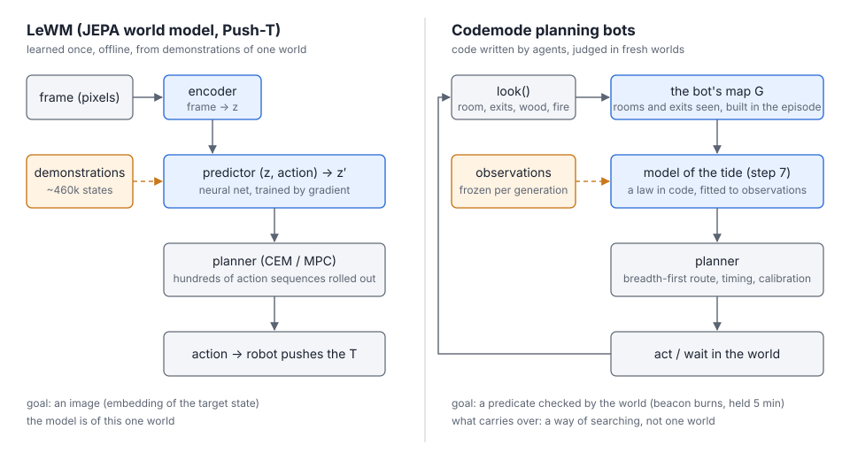

*Abbildung 1. Links: LeWM, ein offline gelerntes Modell einer Welt. Rechts: ein Codemode-Bot. Seine Karte und sein
Modell der Flut entstehen aus dem, was er sieht, und aus den eingefrorenen Beobachtungen; sein Ziel ist ein Prädikat,
das die Welt prüft.*

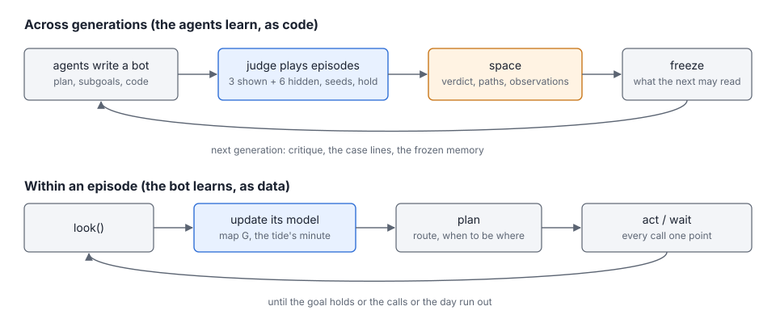

*Abbildung 2. Zwei Schleifen. Über die Generationen lernen die Agenten, als Code. Innerhalb einer Episode lernt der Bot,
als Daten.*

## Die Zuordnung, Teil für Teil

| LeWM | Codemode | Gleich oder anders |
|---|---|---|
| Encoder: Pixel → Embedding | `look()` liefert schon Symbole | Anders: keine Wahrnehmung wird gelernt |
| Prädiktor: (Zustand, Aktion) → nächster Zustand, ein neuronales Netz, trainiert auf Demonstrationen | Die Karte des Bots: "Raum A, Ausgang ost → Raum B", aufgebaut während einer Episode. Seit Schritt 7 auch ein Modell der Flut, angepasst an Beobachtungen | Gleiche Rolle. Andere Form: Code und Daten, exakt, wo die Regeln exakt sind, angepasst, wo sie verborgen sind |
| Planer: CEM oder MPC über Hunderte ausgerollter Folgen | Breitensuche über die Karte, Timing gegen die Uhr, Kalibrierung am ersten gesehenen Stück; seit Schritt 8 eine Suche über Runden nach ihren erwarteten Stücken | Gleiche Rolle. Einfacher, weil das Modell klein ist und seine Chancen, einmal geschätzt, bekannt sind |
| Ziel: ein Bild des Zielzustands | Ein Prädikat, das die Welt prüft (`beacon:island` 5 Minuten gehalten, `feed:island:3`) | Der eigene Rat des Beitrags: bewerten, worauf es ankommt |
| Horizont als Grenze; Zwischenziele | Ziele mehrere Räume entfernt; Zwischenziele als Daten in einem Plan (Schritt 4) | Übernommen |
| Gedächtnisgraph mit Sprungkosten | `recall` über die eingefrorenen Wege früherer Generationen, ein Sprung zwischen Wegen kostet 10 Zellen (Schritt 3) | Übernommen |
| Neue Episoden, Seeds, ein gehaltenes Ziel | 3 gezeigte und 6 verdeckte Episoden, 1 oder 3 Seeds, `hold`; seit Schritt 6 verdeckte Inseln, die keine gezeigte Episode betritt | Übernommen und weitergetrieben: verdeckte Welten, nicht nur verdeckte Paare aus Start und Ziel |
| Lernen: Gradientenabstieg auf Gewichten, offline | Agenten schreiben Code über Generationen neu; der Bot passt zur Laufzeit einen kleinen Hypothesenraum an | Anders |

## Warum kein gelerntes Modell

Ein Bot muss sich in Welten zurechtfinden, die er nicht gesehen hat. Ein Modell, das auf einer Insel trainiert ist,
lernt diese Insel: ihre Räume, ihre Ausgänge, wo ihr Feuer steht. Auf einer anderen Insel ist das der Fehler eines Bots,
der die Karte der ersten Insel mitbringt, und Schritt 6 misst ihn: Ein solcher Bot erreicht 0 von 9 Episoden auf
erzeugten Inseln. Was sich auf eine neue Welt überträgt, ist eine Art zu suchen:

1. schauen;
2. sich merken, was man gesehen hat;
3. darüber planen.

Die Welten des Bewerters sind exakte Simulatoren, also muss nichts vorhergesagt werden, was die Regeln schon sagen. Ein
gelernter Prädiktor würde sich nur für Planer lohnen, die viele Folgen in einer Welt ausrollen, die zu langsam zum
Simulieren ist. Ein neuronales Modell bräuchte außerdem Python oder ONNX, Gewichte, die nicht veröffentlicht sind, und
eine GPU, die keiner der beiden Server des Projekts hat.

Was ein Bot nicht sehen kann, muss aber gelernt werden. Schritt 7 fügt eine solche Dynamik hinzu, die Flut, und der Bot
lernt sie aus Daten, als Code. Das ist der Teil eines Weltmodells, der sich überträgt.

## Was sich überträgt, was nicht

**Codemode ist stärker, wo:**
- das Modell exakt und lesbar ist: Karte, Route, Zwischenziele und das angepasste Gesetz lassen sich ausgeben und
  zeichnen;
- keine Trainingsdaten, keine GPU und keine Gewichte nötig sind;
- die Verallgemeinerung auf Welten geprüft wird, die der Bot nie gesehen hat, nicht nur auf neuen Paaren aus Start und
  Ziel in einer Welt;
- die Lehren über die Auswertung eine eigene Aufgabe sind: "Planer bewerten" verlangt von Agenten einen Bewerter, der
  sich nicht täuschen lässt.

**LeWM kann, was Codemode nicht kann:**
- Wahrnehmung aus rohen Pixeln: Die Welt von Codemode ist schon in Symbole zerlegt;
- Dynamik, die niemand aufschreiben kann, etwa Kontakt und Reibung: Die Regeln von Codemode sind diskret und bekannt,
  bis auf das eine Gesetz, das Schritt 7 verbirgt;
- stetige Steuerung und Unsicherheit: Die Bots nehmen eine deterministische Welt an. Der Seed der Flut ist der einzige
  Zufall, dem sie begegnen, und sie behandeln ihn durch Kalibrierung, nicht durch eine Verteilung.

**Ehrliche Grenzen dessen, was gezeigt wurde:**
- Die geskripteten Agenten sind feste Hypothesen. Sie zeigen, dass Bewerter, Daten und Aufgaben gute Bots von schlechten
  trennen, nicht, dass Agenten lernen. Die Modellläufe (Haiku, Sonnet und Opus 5.5, GPT-6.1 Sol, 2026-11-14, unten)
  zeigen Lernen über Generationen. Bevor die Beobachtungen im Prompt standen, löste Opus "Die Flut lernen" mit einer
  Statistik über sie, nicht mit dem Gesetz. Mit ihnen im Prompt las Opus das Gesetz in einer Generation aus den Daten
  ab und schrieb es in seinen Bot; Sonnet, Opus und GPT lösten "Die Chancen der Flut", nur GPT mit den Chancen, die
  diese Aufgabe, wie sich zeigte, nicht verlangt. Haiku kam bei keiner der beiden Aufgaben über die Spielregeln hinaus.
- Der Lerner von Schritt 7 passt einen Hypothesenraum an, den sein Autor geschrieben hat. Er findet heraus, welche
  Hypothese die Daten stützen; neue erfindet er nicht. Ein Agent, der die Beobachtungen liest, kann das: Opus 5.5 fand
  das Gesetz von Schritt 7 auf diesem Weg (unten), n = 1.
- Die Spielzeuginseln sind klein: 5 bis 8 Räume, ein Feuer, vier Ausgangsrichtungen.

## Entwicklungsprotokoll

Alle Schritte wurden am 2026-11-14 nach dem Plan vom 2026-11-13 gebaut. Die Commits liegen auf master. Die Zahlen sind
die Ergebnisse der geskripteten Varianten, bewertet wie in den Tests.

| Schritt | Commit | Was gebaut wurde | Gemessen |
|---|---|---|---|
| Plan | cd17ffe, 385b95b | Der Plan nach dem Beitrag, die Werte (3 + 6 Episoden, Seeds 1 oder 3, 5 Minuten halten) | — |
| 1. Auswertung | 13d818f | Episoden mit Stichprobe und Holdout, Seeds, `hold`; `start`, `seed`, `setup` der Arena; die Fortschrittskurve und die Episodenmatrix; die Aufgabe "Inselbot" | Verdeckte Episoden laufen nur, wenn eine gezeigte erreicht wurde |
| 2. Wege auf der Karte | 5db6a5a | Die Arena zeichnet jede Zelle auf; `path`, `map`; Wege in `BotEpisode`; der Atlas mit Wegen | Ein Test: Keine verdeckte Episode liegt auf dem Weg einer gezeigten |
| 3. Gedächtnis | 03395d3 | `PlanMemory`, `MemoryFreeze` pro Generation, `recall` mit Sprungkosten, Abdeckung, die Gedächtnisansicht | Echte Arena: Die erste Generation deckt keinen verdeckten Start ab, spätere 1 von 6; ein Wiederabspieler erreicht die gezeigten Episoden und keine verdeckte |
| 4. Zwischenziele | 49e9fb6 | Pläne nennen Zwischenziele als Daten; die Arena markiert, wo jedes erreicht wurde; die Kette der Zwischenziele; die Aufgabe "Den Feuerkorb am Anleger entzünden" | Echte Arena: der Suchplan 9/9 (152 Punkte), der Dünen-Plan 1/9, der Plan „erst das Feuer“ 9/9 (195) |
| 5. Planer bewerten | 7d50eea | Eine Harness-Aufgabe: Agenten schreiben `rate()`, das gute Inselbots über schlechte stellen muss; gespielt auf einer Spielzeugkopie der Insel im Bewerter | Zwei richtige Harnesses; vier blinde, jedes ordnet genau den Bot seiner Lektion falsch ein |
| 6. Neue Welten | e44f11d | Inseln, aus einer Zahl erzeugt; die Spielzeugarena im Bewerter; die Aufgabe "Neue Inseln" ohne Karte; "Planer bewerten" auf erzeugten Inseln | Erkunder ohne Karte 9/9 (163), die Karte der Grauen Insel 0/9, die gezeigten Inseln auswendig 3/9; echte Arena: der Erkunder ohne Karte 9/9 (111) |
| 7. Die Flut | 2412979 | Ein verborgenes Gesetz der Flut; Gehen kostet Zeit; Beobachtungen ins Gedächtnis protokolliert und eingefroren; die Aufgabe "Die Flut lernen" | Das Gesetz im Code 9/9 (2253); der Lerner 9/9 mit Beobachtungen, 6/9 ohne; kein Modell 6/9 (4603); ohne Kalibrierung 0/9; nach Raum-IDs 3/9 |
| 8. Die Chancen der Flut | 0ea9172 | Jede Sackgasse zieht jede Stunde ein Stück, mit Chancen, die mit ihrer Entfernung vom Feuer wachsen; das Urteil fragt den Mittelwert über 8 Seeds gegen einen Zielwert pro Episode; eine Beobachtung pro beobachtetem Tag, jeder Raum mit seinen Stücken; die Aufgabe "Die Chancen der Flut" | Das Gesetz im Code und der Lerner mit Beobachtungen 9/9; Zählungen statt Raten 2/9; der wahrscheinlichste Ort 0/9; jede Sackgasse jede Stunde 2/9; das Gesetz von Schritt 7 0/9; nach Raum-IDs 3/9; der Lerner ohne Beobachtungen 1/9 |
| 9. Die Ufer der Flut | e26c34d | Jeder Raum außer dem des Feuers zieht mit eigenen Chancen, gezogen pro Insel und Raum; ein Logbuch-Tool mit 6 früheren Tagen der eigenen Insel des Bots; keine Beobachtungen; die Aufgabe "Die Ufer der Flut" | Der Lerner mit dem Logbuch 9/9; das Gesetz von Schritt 8, der Rundgang, nur Sackgassen, der wahrscheinlichste Raum, jeder Raum gleich 0/9; die drei Modellsieger von Schritt 8 0/9 |

### Die Umwege, die sich zu erzählen lohnen

- **Ein Seed legte keine Welt fest (Schritt 1).** Die Ticks des Spiels ziehen Zufall zu Zeitpunkten der echten Zeit.
  Derselbe Seed ergab einmal dieselbe Welt und beim nächsten Mal eine andere, also kann eine Aufgabe mit `wait` zwei
  Seeds uneins sehen.
- **Nebel machte einen Test wackelig (Schritt 4).** Ein erloschenes Feuer lässt dichten Nebel die Wege schließen, die von
  ihm wegführen. Ein Test, der nach dem Halten des Bewerters in den nächsten Raum ging, scheiterte, wann immer der Nebel
  dicht war.
- **Nicht die Arena für Harnesses (Schritt 5).** Ein Harness spielt jeden Bot dutzende Male. Echte Welten kosten jede
  Sekunden und sind nach einem Warten nicht durch einen Seed festgelegt, also spielen die Bots auf einer Spielzeugkopie
  der Insel im Bewerter.
- **Das gelernte Modell fiel weg (Schritt 6).** Es war als Schritt 6 geplant, „nur mit einer Entscheidung“. Die Frage
  „braucht ein Bot ein gelerntes Modell, um sich in neuen Welten zurechtzufinden?“ machte daraus neue Welten ohne eines.
- **Räume nach dem Urteil gespeichert (Schritt 6).** Die Seite konnte ein Urteil sehen, bevor alle Räume, die seine Wege
  kreuzen, gespeichert waren. Ein Test mit 21 Räumen fing das; der Bewerter speichert die Räume jetzt zuerst.
- **Der nahe Sucher wurde zum fernen Sucher (Schritt 6).** Ohne Karte fand auch der Bot, der nur nahe seinem Start
  sucht, das Feuer nicht mehr. Er begrenzt jetzt nur seine Suche nach Holz, also scheitert er weiterhin nur an seiner
  Lektion.

## Schritt 7 im Einzelnen: ein Weltmodell aus Beobachtungen

**Das Gesetz**, das kein Prompt nennt:
- auf einer erzeugten Insel spült die Flut ein Stück pro Stunde an, der Reihe nach in die Sackgassen der Insel, nach
  ihrer Nummer;
- eine Sackgasse ist ein Raum mit einem Ausgang, der Raum des Feuers ausgenommen;
- jedes Stück landet 3 Zellen vom Ausgang des Raums entfernt;
- das erste Stück landet in Minute 30 + 10·(seed mod 3), das j-te 60·j Minuten später;
- ein Stück liegt 30 Minuten;
- ein Ausgang kostet 5 Minuten, und der Tag endet nach 480.

**Die Daten.** In jeder gezeigten Episode protokolliert der Bewerter unter allen drei Seeds jede Landung: Insel, Seed,
Stück, Minute, Raum, Zelle, die Ausgänge des Raums und seine Entfernung vom Feuer. Sie gehen ins Gedächtnis des Blocks,
werden zu Beginn einer Generation eingefroren, und ein Bot liest sie mit `observations()`. Sie sind Tatsachen über die
Welt, wie die Demonstrationen, auf denen ein JEPA-Modell trainiert wird, nicht das Gesetz.

**Was der Lerner damit macht.** Er hält einige Hypothesen:
- landen Stücke nur in Räumen mit einem Ausgang, nie im Raum des Feuers?
- in welcher Reihenfolge: nach Raumnummer auf- oder absteigend, geprüft an der Folge der Stücke jeder protokollierten
  Welt?
- wie weit vom Ausgang entfernt?
- in welchen Minuten der Stunde?

Er behält die Hypothesen, die die Daten stützen, erkundet seine Insel und spielt das Modell. Er geht zur nächsten
Sackgasse, bevor die früheste Minute kommt, die die Daten zulassen, und wartet in Schritten von 10 Minuten, bis das Stück
kommt. Das erste Stück, das er sieht, verrät ihm die Minute seiner Welt, und von da an kommt er pünktlich. Ohne
Beobachtungen, oder wenn keine Hypothese passt, fällt er aufs Suchen zurück.

**Was die Varianten zeigen.**
- Das Modell braucht die Daten. Ohne sie ist der Lerner ein Sucher: 6 von 9, bei doppelten Punkten.
- Das Modell muss von der Form sprechen, nicht von Namen. Wer die beobachteten Raum-IDs wiederholt, erreicht die drei
  gezeigten Inseln und keine der verdeckten.
- Das Modell muss für jeden Seed gelten. Das Gesetz ohne Kalibrierung nimmt Minute 30 an und erreicht nichts, da jede
  Episode drei Seeds läuft.
- Ein gelerntes und ein geschriebenes Modell sind gleich gut. Das von Hand geschriebene Gesetz (9/9, 2253 Punkte) und
  das an die Daten angepasste (9/9, 2280 Punkte) unterscheiden sich um den einen Aufruf von `observations()` pro Lauf.

## Schritt 8 im Einzelnen: Chancen, kein Gesetz

**Was sich gegenüber Schritt 7 ändert.** In Schritt 7 war die Flut ein Gesetz: Wer es kannte, wusste, wo jedes Stück
landen würde. In Schritt 8 folgen nur die Chancen einem Gesetz. Jede Stunde um halb zieht jede Sackgasse für sich. Sie
bekommt ein Stück mit der Chance 0.15 für jeden Ausgang zwischen ihr und dem Feuer, höchstens 0.9. Der Prompt nennt die
Stunden, nicht die Chancen.

**Womit ein Plan rechnen muss.** Ein Stück liegt 30 Minuten, und ein Ausgang kostet 5. In einer Stunde erreicht ein Bot
nur die Sackgassen, die höchstens 5 Ausgänge auseinanderliegen. Die erwarteten Stücke einer solchen Runde sind die
Summe ihrer Chancen. Die wahrscheinlichste Sackgasse ist die vom Feuer am weitesten entfernte und oft auch weit von den
anderen. Zwei nähere zusammen sind mehr wert. „Wo ist ein Stück am wahrscheinlichsten?“ und „welche Runde bringt die
meisten Stücke?“ sind verschiedene Fragen, und die Aufgabe stellt die zweite.

**Was bewertet wird.** Der Mittelwert über 8 Seeds, nicht „jeder Seed“. Was eine gute Runde bringt, reicht auf den
Kandidateninseln von 2.6 bis 10.5 Stücken, also hat jede Episode ihren eigenen Zielwert: 90 % dessen, was der
Gesetzesbot dort im Mittel bringt. Der Gesetzesbot besteht nach Konstruktion; der Lerner und die falschen Bots sind die
aufschlussreichen Zeilen. Die Ziehungen sind ein Hash aus Insel, Seed, Stunde und Raum, also trifft jeder Bot auf
dieselben Stücke.

**Was die Daten enthalten müssen.** Eine Beobachtung pro beobachtetem Tag: die Stunden, zu denen die Flut kam, und jeder
Raum der Insel mit seinen Ausgängen, seiner Entfernung vom Feuer und den Stücken, die er bekam. Räume, die nichts
bekamen, stehen auch darin, denn wer Chancen schätzt, braucht die Gelegenheiten ebenso wie die Treffer.

**Was die Varianten zeigen.** Die sechs verdeckten Inseln wurden mit Blick auf die Ergebnisse der falschen Bots gewählt,
sodass jeder mindestens einmal scheitert; über alle 97 Kandidaten, die nicht gezeigt sind, steht der Anteil unter dem
Zielwert in Klammern.
- **Raten, nicht Zählungen.** Die gezeigten Inseln haben viele Sackgassen in Entfernung 2, zwei in 4, keine in 3. Ein
  Bot, der Landungen pro Entfernung zählt, hält 2 für besser als 4 und hat keine Zahl für 3, 5 oder 6. Er besteht die
  zwei gezeigten Inseln, auf denen das keine Rolle spielt, und keine der verdeckten. Der Lerner teilt durch die
  Gelegenheiten, passt eine Steigung an, und sein Gesetz trägt bis zu Entfernungen, die er nie sah: 9/9 (Zählungen
  unter dem Zielwert auf 64 % der Kandidaten, der Lerner auf keinem).
- **Die erwartete Anzahl, nicht der wahrscheinlichste Ort.** Wer jede Stunde an der Sackgasse mit den besten Chancen
  wartet, bringt ein Drittel bis zwei Drittel dessen, was die Runde des Gesetzesbots bringt: 0/9 (82 %).
- **Innerhalb der Zeit, die das Stück liegt.** Jede Sackgasse jede Stunde in fester Reihenfolge zu besuchen ist zu
  langsam, wo immer sie weit auseinanderliegen: 2/9 (34 %). Ein gieriger Rundgang, der auslässt, was er nicht erreicht,
  ist es nicht; Sonnet 5.5 schrieb einen, und er besteht ohne die Chancen (siehe die Läufe nach den vier Änderungen
  unten).
- **Daten, dann ein Modell.** Ohne Beobachtungen weiß der Lerner nicht einmal, dass nur Sackgassen Stücke bekommen:
  1/9. Mit ihnen 9/9. Über alle Kandidaten ist der Abstand kleiner (27 % unter dem Zielwert ohne Beobachtungen): Auf
  vielen Inseln deckt eine Runde über alle Räume zufällig die guten Sackgassen ab.

**Wo es gegenüber dem Beitrag steht.** Der Planer von LeWM rollt seinen gelernten Prädiktor über viele gezogene
Aktionsfolgen aus und behält die beste. Hier ist der Prädiktor die geschätzten Chancen, und der Planer durchsucht die
Runden einer Stunde exakt. Das geht, weil das Modell klein ist. Was der Beitrag über ein Weltmodell sagt, gilt auch
hier: Gelernt wird, wie sich die Welt verhält, hier wie wahrscheinlich, und der Plan wird gegen dieses Modell gemacht,
nicht direkt gegen die Daten.

## Ein Lauf mit Modellagenten auf "Die Flut lernen" (2026-11-14)

**Aufbau.** Ein Lauf, also n = 1:
- 3 Agenten, alle `anthropic/claude-haiku-5-5`, höchstens 5 Generationen, 2 Verbesserungsrunden, Obergrenze 1 $;
- keine geskripteten Agenten, denn zu ihren Varianten gehört das Gesetz im Code, das die Aufgabe in Generation 1 lösen
  würde;
- ein Modellaufruf pro Beitrag, bewertet wie üblich (`CODEMODE_DURABLE_AGENT=0`, siehe die Umwege unten);
- der Prompt nennt `observations()`, seine Felder und seine Kosten und nennt kein Gesetz.

**Ergebnis.** Nicht gelöst: 15 Beiträge, alle 0 von 9, 86 733 Tokens, 0,017 $.

| Generation | Woran es scheiterte |
|---|---|
| 1 | Zwei warteten über den Tag von 480 Minuten hinaus; einer ging über die 300 Tool-Aufrufe (1954 Looks). |
| 2–3 | Dieselben Grenzen, die Looks von etwa 1000 auf etwa 300 gesenkt. |
| 4–5 | Jeder Bot innerhalb der Grenzen, jeder mit 0 von 3 Stücken im Feuer. |

**Was das Team lernte, nach seinen Notizen:**
- die Spielregeln (ein Look pro Entscheidung, Ausgänge und Warten teilen sich den Tag, nahe 455 Minuten aufhören);
- nicht das Gesetz.

**Wo die Beobachtungen ins Spiel kamen:**
- Die Bots von Generation 1 warteten über Minute 30 hinaus, also protokollierte der Bewerter Landungen, und Generation 2
  hatte Beobachtungen.
- Eine Notiz von Generation 1 sagt das Richtige ("cluster landing rooms by fromFire/exit distance to predict where to
  wait"), aber kein späterer Bot tut es.
- Drei der 15 Bots riefen `observations()` auf (einer in Generation 1, wo es leer ist, und zwei später), und keiner
  passte etwas an das Ergebnis an. Die Generationen 4 und 5 riefen es nicht mehr auf.

**Warum, soweit ein Lauf es zeigt.** Ein Modell sieht die Versuche seines Teams als Code, Fehlschläge und Punkte. Es
sieht nie, was `observations()` zurückgab. Um das Gesetz aus den Daten abzulesen, müsste es einen Bot schreiben, der zur
Laufzeit Hypothesen anpasst (der geskriptete Lerner tut das), ohne eine einzige Beobachtung gesehen zu haben. Das
JEPA-Modell im Beitrag sieht seine Demonstrationen; diese Agenten sehen nur ihre Wirkung.

**Nächstes Experiment.** Die eingefrorenen Beobachtungen auch im Prompt zeigen, als Daten, die der Agent liest, bevor er
schreibt. Das trennt „kann das Modell das Gesetz in den Daten sehen“ von „kann es einen Bot schreiben, der das Gesetz
blind findet“.

**Umwege dieses Laufs:**
- **Die Modellliste wuchs über ihren Eintrag hinaus.** Mit dem Katalog jedes Anbieters (etwa 500 Modelle) war der
  ModelInfo-Eintrag des Modellprozesses 65 550 Bytes groß, über den 64 KiB des Space, also sah die Seite keine Modelle.
  Er trägt jetzt die Admin-Liste gepackt (Anbieter, id, Name, wo er abweicht), etwa 32 KB.
- **Der geskriptete Ersatz.** Ein Modellaufruf, der scheitert (Mistral antwortete 429 für codestral), wird durch einen
  geskripteten Agenten ersetzt. Für eine Messung ist das eine Verunreinigung, also wurde der erste Lauf, mit codestral
  und haiku, nach einer Generation angehalten.
- **Dem dauerhaften Agentenpfad gingen die Anfragen aus.** Standardmäßig bekommt ein Modellbeitrag 4 Anfragen zu 1500
  Tokens und testet sich mit `verify_code` selbst. Bei dieser Aufgabe besteht der Bot nie, die vierte Anfrage endet in
  "Agent model request budget exhausted", kein Code wird abgegeben, und der geskriptete Agent springt ein. Der gemessene
  Lauf nutzte den einfachen Pfad.

## Ein Lauf mit Claude Opus 5.5 auf beiden Flutaufgaben (2026-11-14)

**Aufbau.** Wie bei haiku, n = 1 pro Aufgabe:
- 3 Agenten, alle `anthropic/claude-opus-5-5`, höchstens 5 Generationen, 2 Verbesserungsrunden, Obergrenze 5 $;
- der einfache Pfad (`CODEMODE_DURABLE_AGENT=0`), keine geskripteten Agenten, dieselben Prompts;
- ein Lauf auf "Die Flut lernen" (`tide-law`), einer auf "Die Chancen der Flut" (`tide-odds`), nebeneinander.

**Ergebnis.**

| Aufgabe | Gelöst | Bestanden pro Generation | Kosten |
|---|---|---|---|
| Die Flut lernen | Generation 5 | 0, 0, 6 · 6, 5, 6 · 6, 6, 6 · 6, 7, 5 · 7, 7, **9** von 9 | 1.24 $ |
| Die Chancen der Flut | nein | jeder Beitrag 0 von 9; der beste Mittelwert 2.93 Stücke gegen einen Zielwert von im Mittel 6.19 (Generation 5), der blinde Bot von Generation 1 2.40 | 1.37 $ |

**Was der Sieger tut.** Er fand das Gesetz nicht (Sackgassen nach Nummer, 3 Zellen vom Ausgang, die kalibrierte
Minute). Er patrouilliert: Er bewertet jeden Raum danach, wie lange er ihn nicht gesehen hat, gewichtet damit, wie oft
die Entfernung des Raums vom Feuer in den Beobachtungen vorkommt, und sammelt bis zu drei Stücke, bevor er zum Feuer
geht. Danach noch einmal bewertet (ohne Modellaufrufe):

| Bot | Ohne Beobachtungen | Mit den Beobachtungen des Gesetzesbots | Punkte mit Beobachtungen |
|---|---|---|---|
| Das Gesetz im Code (geskriptet) | 9 von 9 | 9 von 9 | 2253 |
| Der Sieger von Opus | 7 von 9 | 9 von 9 | 3258 |

Die Beobachtungen halfen also messbar (7 → 9), aber als Statistik, nicht als Gesetz, und die Aufgabe ließ das
durchgehen: "Die Flut lernen" verlangt das Ziel in jeder Episode, nicht Kosten nahe denen des Gesetzes. Ein guter Sucher
mit einer groben Vorannahme genügt. Das ist die Warnung des Beitrags vor schmeichelnden Auswertungen, gefunden von einem
Modell in der eigenen Aufgabe dieses Projekts. Eine Kostengrenze pro Episode schließt die Lücke (nächster Abschnitt);
der Sieger gibt das 1.45-Fache der Punkte des Gesetzes aus.

**Auf "Die Chancen der Flut"** ging Opus den Weg, den haiku in Schritt 7 ging: Die Generationen 1 und 2 lernten die
Grenzen des Spiels (`bot()` nimmt keine Argumente, `tools` ist global, `wait` nimmt 1 bis 120 Minuten, höchstens 300
Aufrufe), und spätere Bots lasen aus `observations()` die mittleren Stücke nach Entfernung vom Feuer, aber keiner
erreichte die Hälfte des Zielwerts.

**Umweg: jede Antwort leer.** Das erste Paar Läufe maß nichts: Jede Antwort von Opus kam ohne Text zurück, und der
geskriptete Ersatz spielte jeden Beitrag (1,29 $ für das Denken). Opus 5.5 kann sein Denken nicht abschalten (adaptives
Denken, die Stufe "off" fehlt), und ein Aufruf ohne Denkstufe wird von pi-ai als Effort "high" markiert; das Denken
verbrauchte die ganzen 1500 Tokens. Die Grenze auf 13 500 Tokens anzuheben half nicht (158 s, alles Denken).
`guardedCall` (`server/llm.ts`) fragt ein solches Modell jetzt mit Effort "low" und gibt ihm 4000 Tokens und 180 s
dazu: Derselbe Prompt antwortet dann in 21 s mit Code, für 0,04 $.

## Nach vier Änderungen: vier Modelle auf beiden Flutaufgaben (2026-11-14)

**Warum die Opus-Läufe Fragen offenließen.** Jeder Modellaufruf beginnt ohne Gespräch: Der Modellprozess baut seinen
Prompt aus dem Space neu auf (`server/context.ts`): die Aufgabe, der beste Versuch des Teams mit seinen Fallergebnissen,
bis zu drei andere Versuche, bis zu drei abgelehnte, jede Notiz des Teams, der gewählte Plan. So baut eine Generation auf
der letzten auf. Vier Lücken kamen aus den Opus-Läufen:
1. **Das Modell sah die Beobachtungen nie.** Nur der Bot las sie, zur Laufzeit, über `observations()`. Ein Agent musste
   ein Gesetz in Daten finden, die er nie gesehen hatte.
2. **Bots wurden halbiert.** Der Prompt zeigte höchstens 4000 Zeichen des bearbeiteten Versuchs und 1500 der anderen,
   Grenzen vom 2026-10-19 für kleine Funktionsaufgaben, damit ein Aufruf bei einigen tausend Eingabetokens bleibt. Der
   Sieger von Opus hatte 4129 Zeichen. Und eine Bot-Antwort hatte 1500 Ausgabetokens, etwa 4500 Zeichen.
3. **Ein Fehlschlag sagte wenig.** Ein Bot, der nichts brachte, bekam "goal not reached", ohne Hinweis darauf, was er
   sah oder nahm.
4. **"Die Flut lernen" ließ einen Sucher bestehen** (oben).

**Was sich änderte, alle vier auf einmal** (sodass sich ihre Wirkungen nicht trennen lassen):
1. Der Prompt des Teams und der Prompt des Plans zeigen, was `observations()` den Bots dieser Generation zurückgibt, aus
   derselben Einfrierung: eine Zeile pro Landung (Schritt 7) oder pro Tag (Schritt 8), höchstens 12 000 Zeichen.
2. Ein Bot, ein Tool-Programm oder ein Harness wird mit bis zu 12 000 Zeichen gezeigt (die anderen 6000, abgelehnte
   3000), und seine Antwort darf 3000 Ausgabetokens haben.
3. Die Spielzeugwelt zählt die Stücke, die ein Look zeigte, und die aufgenommenen; der Fehlschlag sagt es ("0 of 3
   pieces in the fire (3 seen in a look, 2 picked up)"), und eine Aufgabe, die den Mittelwert bewertet, sagt, was ihr
   erster Seed tat.
4. Jede Episode von "Die Flut lernen" hat eine Punktgrenze, das 1.3-Fache dessen, was das Gesetz im Code dort über seine
   Seeds ausgibt (`TIDE_LAW_COST`); der Episodentext nennt sie. Der Lerner, der das Gesetz anpasst, gibt pro Episode 3
   Punkte mehr aus als das Gesetz und besteht. Der Sieger von Opus besteht jetzt höchstens 1 von 9 (ein Test hält das
   fest, `tests/fixtures/opus-tide-patrol.js`).

**Aufbau.** Für jedes Modell derselbe: 3 Agenten eines Modells, höchstens 5 Generationen, 2 Verbesserungsrunden, 1
Beitrag pro Agent und Generation, Obergrenze 5 $, der Planschritt an, der deutsche Aufgabentext, der einfache Pfad
(`CODEMODE_DURABLE_AGENT=0`), keine geskripteten Agenten, kein tägliches Tokenkontingent
(`CODEMODE_TOKENS_PER_IP_DAY=0`). Ein Lauf pro Modell und Aufgabe, also jeweils n = 1: Ein Lauf sagt, was ein Modell hier
kann, nicht wie oft. Die Kosten sind die Listenpreise aus dem Modellkatalog von pi-ai (Haiku 5.5: 0,10 $ pro Million
Eingabetokens, 0,50 $ pro Million Ausgabetokens), keine Rechnung.

| Modell | Die Flut lernen | Die Chancen der Flut | Kosten (Gesetz + Chancen) |
|---|---|---|---|
| Haiku 5.5 | nicht gelöst; alle 15 Beiträge 0 von 9 | nicht gelöst; alle 15 Beiträge 0 von 9 | 0.03 $ + 0.03 $ |
| Sonnet 5.5 | nicht gelöst; bestes 3 von 9 (Generation 5) | **gelöst in Generation 4**, 6493 Punkte | 0.57 $ + 0.88 $ |
| Opus 5.5 | **gelöst in Generation 3**, 1371 Punkte | **gelöst in Generation 3**, 6304 Punkte | 1.47 $ + 1.68 $ |
| GPT-6.1 Sol | nicht gelöst; bestes 7 von 9 (Generationen 4 und 5) | **gelöst in Generation 4**, 6305 Punkte | 0.64 $ + 0.78 $ |

Zum Vergleich: Das Gesetz im Code gibt auf "Die Flut lernen" 2253 Punkte aus und auf "Die Chancen der Flut" 7627.

Bestanden pro Generation (je drei Beiträge; eine Zahl in Klammern sind die Punkte eines Beitrags, der alle bestand):

| Lauf | 1 | 2 | 3 | 4 | 5 |
|---|---|---|---|---|---|
| Haiku, Gesetz | 0, 0, 0 | 0, 0, 0 | 0, 0, 0 | 0, 0, 0 | 0, 0, 0 |
| Haiku, Chancen | 0, 0, 0 | 0, 0, 0 | 0, 0, 0 | 0, 0, 0 | 0, 0, 0 |
| Sonnet, Gesetz | 0, 0, 0 | 0, 0, 0 | 0, 1, 1 | 2, 0, 0 | 3, 3, 3 |
| Sonnet, Chancen | 0, 0, 0 | 0, 0, 0 | 0, 0, 0 | 9 (7947), 0, 9 (6493) | 0, 9 (6493), 9 (7947) |
| Opus, Gesetz | 0, 0, 0 | 7, 0, 7 | 7, 7, 9 (1371) | 9, 9, 9 (je 1371) | 9 (1371), 8, 8 |
| Opus, Chancen | 0, 0, 0 | 0, 0, 0 | 0, 9 (8636), 9 (6304) | 0, 9 (8480), 0 | 0, 0, 0 |
| GPT, Gesetz | 0, 0, 0 | 0, 0, 0 | 6, 0, 6 | 7, 7, 0\* | 7, 6, 7 |
| GPT, Chancen | 0, 0, 0 | 0, 0, 0 | 0, 0, 0 | 9 (6305), 9 (6627), 9 (8401) | 9 (6507), 9 (6305), 9 (6337) |
| GPT (2. Lauf), Gesetz | 0, 0, 0 | 0, 0, 0 | 2, 2, 1 | 2, 2, 2 | 1, 2, 2 |
| GPT (2. Lauf), Chancen | 0, 0, 0 | 0, 0, 0 | 0, 0, 0 | 0, 0, 0 | 9 (8071), 7, 0 |

\* Eine Antwort von GPT brach ab ("Stream ended before a terminal response event", OpenRouter), und der geskriptete
Agent spielte diesen Beitrag; es ist der einzige Ersatz in den acht Läufen. GPT-6.1 Sol lief über OpenRouter
(`openrouter/openai/gpt-6.1-sol`): Der direkte Weg über OpenAI scheiterte an einem abgelaufenen Login (`invalid_grant`).
Es ist ein Modell, das denken muss, wie Opus und Sonnet, und bekommt dasselbe Effort "low" mit 4000 Tokens dazu.

**Ein zweiter Lauf von GPT-6.1 Sol** ging den direkten Weg, `openai/gpt-6.1-sol` über den Login der pi-CLI, nachdem
dieser Login erneuert war; jeder seiner 30 Beiträge war der eigene des Modells. Gleiche Bedingungen, andere Ergebnisse:
"Die Flut lernen" höchstens 2 von 9 (0,50 $), gegen 7 von 9 im ersten Lauf; "Die Chancen der Flut" gelöst in Generation
5 (8071 Punkte, 0,58 $), gegen Generation 4 (6305). Sein Sieger liest wieder zur Laufzeit `observations()`. Ein Lauf pro
Paar sagt, was ein Modell erreichen kann, nicht was es im Mittel erreicht.

Ein früheres Paar Haiku-Läufe am selben Tag endete in Generation 5, als das tägliche Tokenkontingent pro Adresse
aufgebraucht war (13 und 12 Beiträge, alle 0 von 9); die Läufe oben wiederholen sie ohne das Kontingent.

**Die Daten im Prompt werden gelesen.** Die Notizen von Sonnet in Generation 2, der ersten, die Beobachtungen sah:
- auf "Die Chancen der Flut": "Driftwood only washes up in dead-end rooms (one exit), at the exit-side spot …, about
  0.5 per tide". Der Aufgabentext sagt nicht, dass nur Sackgassen Stücke bekommen;
- auf "Die Flut lernen": "Landings alternate between two dead-end rooms every 60 min, first at minute 30-50". Das ist
  der größte Teil des Gesetzes (die Reihenfolge nach Nummer und die drei Zellen vom Ausgang fehlen).

Auch Haiku las Muster ("every 60 min at fixed rooms per island", "the fire room itself rarely gets any"), hielt aber
die Entfernung vom Feuer für den Schlüssel, nicht die Sackgassen.

**Der Sieger von Sonnet auf "Die Chancen der Flut".** Er ruft `observations()` nicht auf: Was er gelernt hat, steht in
seinem Code. Jede Stunde um halb geht er zur nächsten Sackgasse, die er noch erreicht, bevor das Stück weg ist, dann zur
nächstnächsten, nimmt auf, was dort liegt, und legt am Ende des Tages alles ins Feuer. Er schätzt die Chancen nie. Die
Verbesserungsrunden brachten ihn auf 6493 Punkte; das Gesetz im Code gibt 7627 aus. Auf den 91 Inseln, die weder gezeigt
noch verdeckt sind, bleibt er auf 8 % unter dem Zielwert (der geskriptete Rundgang von Schritt 8 auf 32 %), und er
bringt im Median das 1.07-Fache dessen, was der Gesetzesbot bringt.

**Was das an Schritt 8 berichtigt.** „Jede Sackgasse jede Stunde zu besuchen ist zu langsam“ galt für den geskripteten
Rundgang, der in der Reihenfolge der Namen geht und den Tag aufgibt, sobald die ganze Runde nicht mehr passt. Ein
gieriger Rundgang, der auslässt, was er nicht erreicht, ist nicht zu langsam, und er schlägt den Referenzplan (die beste
Runde einer Stunde nach erwarteten Stücken) auf den meisten Inseln, weil er sich nicht auf eine Runde festlegen muss.
"Die Chancen der Flut" fragt also, wo und wann die Flut kommt, nicht nach ihren Chancen; ein Zielwert, den nur ein Plan
mit den Chancen erreicht, bräuchte einen optimalen Referenzplan oder eine Welt, in der der Rundgang nicht mithält.

**Was Sonnet auf "Die Flut lernen" aufhielt.** Nicht das Gesetz, sondern das Handwerk und die neue Grenze: Bots, die über
den Tag von 480 Minuten hinaus warteten, und Bots, die das Ziel teurer als die Grenze erreichten ("3 of 3 pieces in the
fire …; 359 points, over the limit of 316"). Ohne die Grenze hätten mehrere von ihnen mehr Episoden bestanden; mit ihr
muss ein Bot das Gesetz nutzen, und keiner tat es innerhalb von 5 Generationen.

**Opus 5.5 auf "Die Flut lernen": das Gesetz, in den Code geschrieben.** Generation 1 hatte keine Beobachtungen im Prompt
(die erste Einfrierung ist leer) und patrouillierte; ihre Notizen baten die nächste Generation, die Beobachtungen zu
lesen. Generation 2, die erste, die sie sah, schrieb das Gesetz auf: "landings only in 1-exit rooms, alternating between
2 of them every 60 min, first at minute 30-50 (seed); each piece lasts 30 min". Generation 3 machte daraus einen
Fahrplan: In Minute 55 + 60k liegt genau ein Stück irgendwo, also schaut der Bot einmal pro Stunde, in einer Sackgasse,
die nach der Parität der Stunde gewählt ist, und ein leerer Look schließt diesen Raum für diese Parität aus. Der Sieger
ruft `observations()` nie auf; das Gesetz steht in seinem Code, die Suche, welche Sackgasse zu welcher Parität gehört,
ist das Einzige, was er pro Insel lernt. Er gibt über die neun Episoden 1371 Punkte aus, weniger als das Gesetz im Code
(2253), weil er wartet, statt zu schauen (`wait` von bis zu 120 Minuten kostet einen Punkt), und die Reihenfolge nach
Nummer und die drei Zellen vom Ausgang nicht kennen muss. Die Verbesserungsrunden versuchten, an der Zuordnung zu sparen
(aufhören, sobald zwei Sackgassen bekannt sind), und verloren je eine Episode (8 von 9).

**Opus 5.5 auf "Die Chancen der Flut".** Generation 2 las die Tage: "wood only lands in dead-end rooms (1 exit), … more
often the further the room is from the fire". Der Sieger von Generation 3 kartiert die Insel, gewichtet jede Sackgasse
nach ihrer Entfernung vom Feuer (das wahre Gesetz: Die Chancen sind 0.15 pro Ausgang vom Feuer) und sucht vor jeder Flut
die Runde aus bis zu sechs Sackgassen mit dem höchsten Gewicht, die er zwischen halb und dem Ende des Stücks erreichen
kann. Auch er ruft `observations()` nicht auf. 6304 Punkte gegen 7627 des Gesetzes. Die Generationen 4 und 5 versuchten,
den Look vor dem Nehmen zu sparen ("nimm without look"); ihre Notizen vermuten, dass die Figur beim Betreten auf dem Stück
landet, was sie nicht tut, und jeder solche Bot brachte nichts. Der Lauf behält den Sieger von Generation 3.

**GPT-6.1 Sol: erst das Handwerk, dann die Daten.** Drei Generationen lang nahmen seine Bots Holz auf und legten keins
ins Feuer: Sie gingen auf das Feld des Feuers selbst, das nicht begehbar ist. Seine Notizen, oft leer, nennen die
Lösung erst in Generation 3 ("approaches adjacent tiles"). Danach:
- auf "Die Chancen der Flut" bestand jeder Beitrag der Generationen 4 und 5. Sein Sieger ist der einzige der acht Läufe,
  der die Chancen schätzt: Er ruft `observations()` auf und zählt für jedes Paar aus Ausgängen und Entfernung vom Feuer,
  wie viele Stücke die protokollierten Tage pro Flut hatten; dann plant er mit diesen Raten (6305 Punkte);
- auf "Die Flut lernen" lesen seine Bots die Landezeiten aus `observations()`, nehmen daraus die Periode und "camp a
  confirmed landing site at 120-minute intervals". Sieben von neun Episoden; zwei verdeckte Inseln scheitern, wo die
  Parität der Sackgassen nicht zu seiner Vermutung passte ("Hidden-island leaf numbering cannot safely predict tidal
  parity").

**Haiku 5.5: die Spielregeln, nicht die Flut.** Auf "Die Flut lernen" warteten die ersten Beiträge über den Tag von 480
Minuten hinaus; die späteren beendeten den Tag, ohne etwas gesehen zu haben ("0 seen in a look, 0 picked up"); einer von
15 nahm drei Stücke auf und brachte sie nicht zum Feuer. Auf "Die Chancen der Flut" deklarierten 9 von 15 Beiträgen
`bot(tools)` und stürzten an `tools.look` ab (der Prompt schreibt `await tools.look()`: `tools` ist global), in jeder
Generation wieder. Seine Notizen sahen Muster in den Beobachtungen, aber kein Bot kam weit genug, dass ein Gesetz eine
Rolle gespielt hätte. Jeder Beitrag kostete etwa 0,002 $.

**Was der Vergleich zeigt.**
- Der Schritt von den Daten zum Code gelingt, wenn das Modell dorthin kommt. Opus schrieb das Gesetz von "Die Flut
  lernen" eine Generation, nachdem es die Beobachtungen zum ersten Mal sah, in Code; auch die Notizen von Sonnet hielten
  das meiste davon fest. Dass die Beobachtungen im Prompt stehen, hat das möglich gemacht: Vor der Änderung war der
  Sieger von Opus eine Patrouille (7 von 9 ohne Beobachtungen).
- Wo das Gesetz landet, ist verschieden: Opus und Sonnet legen das Gelernte als Konstanten in den Code, GPT liest es zur
  Laufzeit aus `observations()`. Beide bestehen die verdeckten Inseln; nur das Zweite würde einer Flut folgen, die sich
  zwischen Generationen ändert.
- Die Decke ist das Handwerk, nicht das Modell der Welt. Haiku kam nie über die Spielregeln hinaus; GPT verlor drei
  Generationen auf einem Feld; die Bots von Sonnet auf "Die Flut lernen" warteten zu lange oder gaben zu viel aus. Was
  ein Modell über die Flut weiß, zeigt sich erst, wenn sein Bot gehen, nehmen und legen kann.
- Die Punktgrenze tut ihre Arbeit. Der Gesetzesbot von Opus besteht sie mit Abstand (etwa 150 Punkte pro Episode über
  drei Seeds, gegen Grenzen von 248 bis 417); was sie aufhält, sind die Patrouille, die vorher bestand (der erste Sieger
  von Opus), und die Bots von Sonnet, die das Ziel zu teuer erreichten.
- "Die Chancen der Flut" trennt die Modelle, die gehen können, nicht: Alle drei bestehen, und nur GPT nutzt die Chancen.
  Der gierige Rundgang genügt (oben), also brauchte die Aufgabe einen härteren Zielwert, bevor sie etwas über Planen
  unter Zufall sagte: Schritt 9 (unten).
- Kosten und Ergebnis gehen zusammen, aber nicht linear: Opus löste beide für 3,15 $, GPT eine für 1,42 $, Sonnet eine
  für 1,45 $, Haiku keine für 0,06 $. Mit n = 1 pro Paar könnte ein zweiter Lauf jede einzelne Zeile verschieben, und
  bei GPT tat er es (7 von 9 auf "Die Flut lernen" im ersten Lauf, 2 von 9 im zweiten).

## Schritt 9 im Einzelnen: Chancen, die jede Insel anders hat

**Warum.** "Die Chancen der Flut" trennte die drei Modelle nicht, die gehen konnten. Zwei von ihnen bestanden mit einer
Vorannahme im Code: Der Sieger von Sonnet geht die Sackgassen ab, der von Opus gewichtet sie nach ihrer Entfernung vom
Feuer; nur der von GPT schätzt Chancen, aus `observations()`. Alle drei Vorannahmen halten, weil das Gesetz auf jeder
Insel dasselbe ist. Eine Punktgrenze, die auf "Die Flut lernen" die Lücke schloss, hilft hier nicht: Die Rundgänge gaben
weniger Punkte aus (6304 bis 6493) als das Gesetz im Code (7627).

**Was sich änderte.** Die Aufgabe "Die Ufer der Flut" behält Welt und Urteil von Schritt 8 und nimmt weg, wovon die
Vorannahmen leben:
- jeder Raum außer dem des Feuers kann Stücke bekommen, jeder mit eigenen Chancen, einmal pro Insel und Raum gezogen (0
  auf etwa der Hälfte, sonst 0.1, 0.35 oder 0.7). Keine Form, keine Entfernung und kein Name verrät sie, also trägt
  kein Gesetz von einer Insel zur nächsten;
- ein Logbuch (`logbook()`, 1 Punkt) listet 6 frühere Tage der Flut auf der eigenen Insel des Bots, jeden Raum mit seinen
  Stücken; die eigenen Tage der Episode erscheinen nie darin;
- keine Beobachtungen anderer Inseln und kein Gedächtnis: Was ein Bot lernen kann, lernt er zur Laufzeit, aus den Daten
  seiner Insel;
- der Zielwert ist 90 % eines Referenzplans, der die wahren Chancen kennt; keine Punktgrenze, weil kein scheiternder Bot
  mehr Punkte ausgibt als die Referenz.

Das ist der Rahmen des Weltmodells aus dem Beitrag im Kleinen: Daten einer Welt, vorher gesammelt, und ein Plan aus
einem Modell, das an sie angepasst ist. Hier ist das Modell eine Tabelle von Raten, die der Bot selbst füllt.

**Ergebnis** (geskriptete Bots und die drei Modellsieger von Schritt 8, auf den neun Episoden und auf 95 nicht gewählten
Inseln):

| Bot | Episoden | Unter dem Zielwert, von 95 |
|---|---|---|
| Der Lerner: die Rate des Logbuchs pro Raum, dann die Runde mit den meisten erwarteten Stücken | 9 von 9 | 1 % |
| Kein Logbuch, jeder Raum gleich | 0 von 9 | 41 % |
| Jeder Raum, jede Stunde | 0 von 9 | 88 % |
| Das Gesetz von Schritt 8 (Sackgassen nach Entfernung) | 0 von 9 | 97 % |
| Das Logbuch, aber nur Sackgassen (die Vorannahme von Schritt 8) | 0 von 9 | 97 % |
| Nur der wahrscheinlichste Raum | 0 von 9 | 100 % |
| Der Sieger von Sonnet 5.5 aus Schritt 8 | 0 von 9 | 97 % |
| Der Sieger von Opus 5.5 aus Schritt 8 | 0 von 9 | 97 % |
| Der Sieger von GPT-6.1 Sol aus Schritt 8 | 0 von 9 | 100 % (er ruft `observations()` auf, das diese Aufgabe nicht hat) |

Die neun Inseln wurden dort gewählt, wo jeder falsche Bot scheitert, also ist das 0 von 9 nach Konstruktion; die letzte
Spalte ist es nicht. Ohne sein Tool scheitert der Sieger von GPT sofort; mit umbenanntem Tool würde er das Logbuch lesen,
wie er die Beobachtungen las, und das ist der Bot, den dieser Schritt verlangt. Die Sieger von Sonnet und Opus scheitern
aus dem Grund, für den der Schritt gebaut wurde: Ihre Vorannahme ist auf fast jeder Insel falsch. Der Lerner bringt auf
den 95 Inseln das 0.87- bis 1.0-Fache des Mittelwerts des Referenzplans (Median 1.0).

## Vier Modelle auf "Die Ufer der Flut" (2026-11-14)

Dieselben Bedingungen wie bei den vier Läufen oben: 3 Agenten, 5 Generationen, ein Beitrag je Agent, 2
Verbesserungsrunden, Budget $5, deutsche Prompts. GPT-6.1 Sol lief über OpenRouter: Sein erster Start über den
pi-Zugang verlor während des Laufs sein Token (`invalid_grant`), und ein Skript-Ersatz spielte; dieser Lauf wurde
gestoppt und zählt nicht.

| Modell | Gelöst | Beste Tool-Punkte (die neun Episoden) | Kosten | Unter dem Ziel, von den 95 nicht gewählten Inseln |
|---|---|---|---|---|
| Claude Haiku 5.5 | nein (0/9 in allen 5 Generationen) | | $0.02 | |
| Claude Sonnet 5.5 | nein (0/9 in allen 5 Generationen) | | $0.43 | |
| Claude Opus 5.5 | Generation 2 (9/9; ein Bot 4/9) | 9516 | $1.51 | 9 (9 %) |
| GPT-6.1 Sol | Generation 2 (9/9; ein Bot 8/9) | 8793 | $0.61 | 0 |
| Zum Vergleich: der Lerner (Skript) | | 9105 | | 1 (1 %) |
| Zum Vergleich: der Referenzplan (wahre Chancen) | | 9033 | | (legt die Ziele fest) |

**Beide Sieger lesen das Logbuch, keine Vorannahme.** Der Bot von Opus zählt die Stücke jedes Raums über die
verzeichneten Tage als seine Chance und sucht vor jeder Flut von seinem Standort aus den Weg über höchstens fünf Räume
mit den meisten erwarteten Stücken; in einem Raum mit einer Chance unter einhalb schaut er, bevor er greift. Der Bot von
GPT plant ebenfalls vor jeder Flut neu, mit einer geglätteten Rate ((Stücke + 0.5) / (8 · Tage + 1)) und einem Weg so
lang, wie die halbe Stunde der Flut erlaubt, und nimmt auch die Karte aus dem Logbuch (den Weg jedes Raums vom Feuer),
erkundet also weniger. Beide weichen vom Referenzplan ab, der bei jeder Flut eine feste Runde geht. Der Bot von GPT
verbraucht weniger Punkte als die Referenz und bringt mehr Stücke: auf den 95 Inseln das 1.00- bis 1.41-Fache des
Mittelwerts der Referenz (Median 1.09). Der Sieger von Opus bringt das 0.75- bis 1.24-Fache (Median 1.00) und bleibt
auf 9 davon unter dem Ziel, öfter als der Lerner (1). Das Ziel ist ein Maßstab, nicht der beste Plan.

**Woran die zwei Fehlschläge scheiterten, ist die Schnittstelle, nicht die Chancen.** Jeder Bot von Haiku rief entweder
ein Tool auf einem undefinierten Objekt auf oder endete nach einem Blick und dem Logbuch, bei 0 Weltminuten. Die Bots von
Sonnet lasen das Logbuch und warteten dann bis zu 451 Weltminuten, ohne je ein Stück zu sehen: Ihre eigenen Notizen
sagen, das Format von `fromFire` und `exits` sei "noch nicht geprüft", und fünf Generationen prüften es nicht. Die
ersten Bots von Opus scheiterten genauso; ab Generation 2 lasen seine Bots das Logbuch in jeder der Formen, die sie
vermuteten.

Schritt 9 trennt also, wo Schritt 8 es nicht tat: Die zwei Modelle, die einen Schätzer schrieben, bestehen, und keine
Vorannahme besteht. Mit n = 1 je Modell ist "Sonnet kann es nicht" nicht gezeigt; "Sonnet tat es nicht, aus diesem
Grund" schon.

## Abbildungen

Die Diagramme sind handgezeichnete SVG, die dem hellen oder dunklen Thema des Lesers folgen. Die Bildschirmfotos stammen
aus einem lokalen Lauf mit geskripteten Agenten unter einem neutralen Bewerternamen, ohne Adressen und ohne
Maschinendaten im Bild (dunkles Thema, deutsche Oberfläche); die Abbildungen 8 bis 15 zeigen Modellläufe. Die Bilder
liegen in `docs/img/codemode-planung/`.

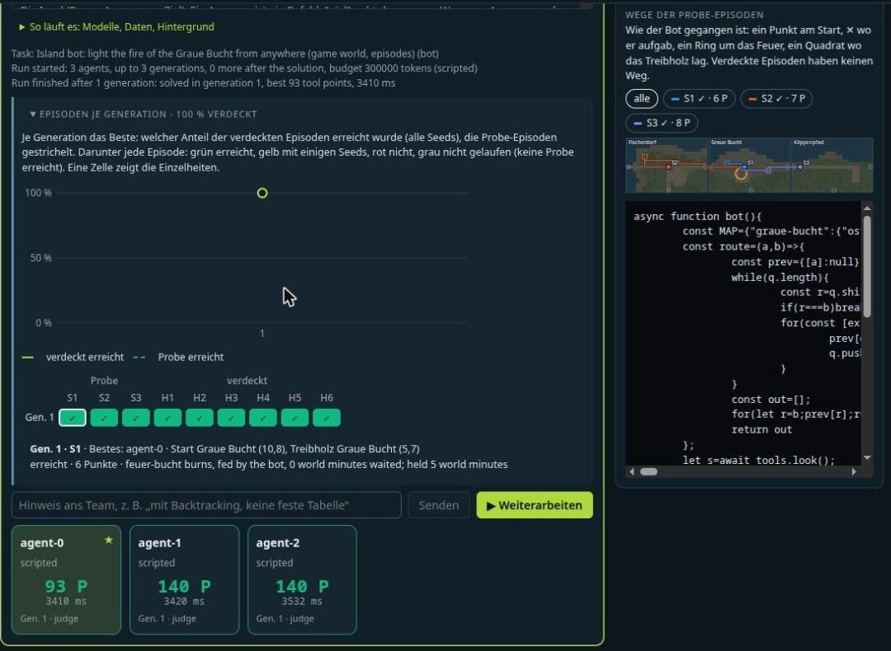

*Abbildung 3 (Schritte 1 und 2), "Inselbot". Die Fortschrittskurve zeigt den Anteil der erreichten verdeckten Episoden
pro Generation. Die Matrix zeigt jede Episode, gezeigt (S) und verdeckt (H). Die rechte Spalte zeichnet die
Stichprobenwege des besten Beitrags auf der Grauen Insel, eine Farbe pro Episode, das Feuer umringt.*

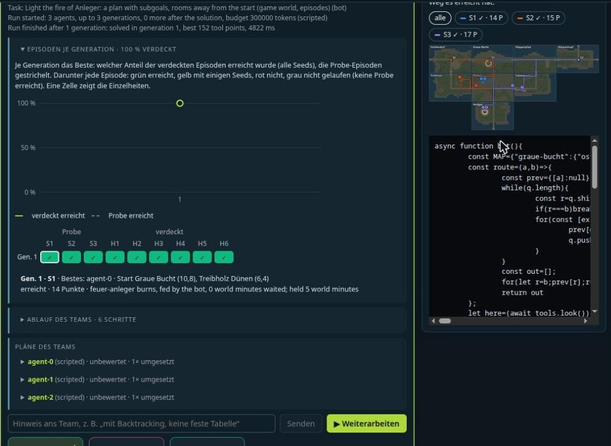

*Abbildung 4 (Schritt 4), "Den Feuerkorb am Anleger entzünden". Die Pläne des Teams und die Wege mit den nummerierten
Marken, wo jedes Zwischenziel erreicht wurde. Zwei der drei Beiträge erreichten alle neun Episoden (152 Punkte); einer
erreichte keine.*

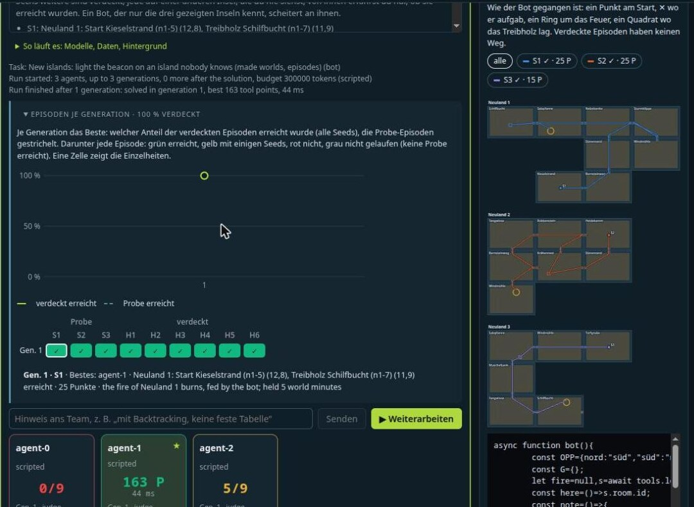

*Abbildung 5 (Schritt 6), "Neue Inseln". Drei erzeugte Inseln im Atlas, untereinander, mit den Wegen des Erkunders. Auf
den Karten: Der Erkunder erreicht 9/9 (163 Punkte), der Wanderer ohne Gedächtnis 5/9 und die Karte der Grauen Insel
0/9.*

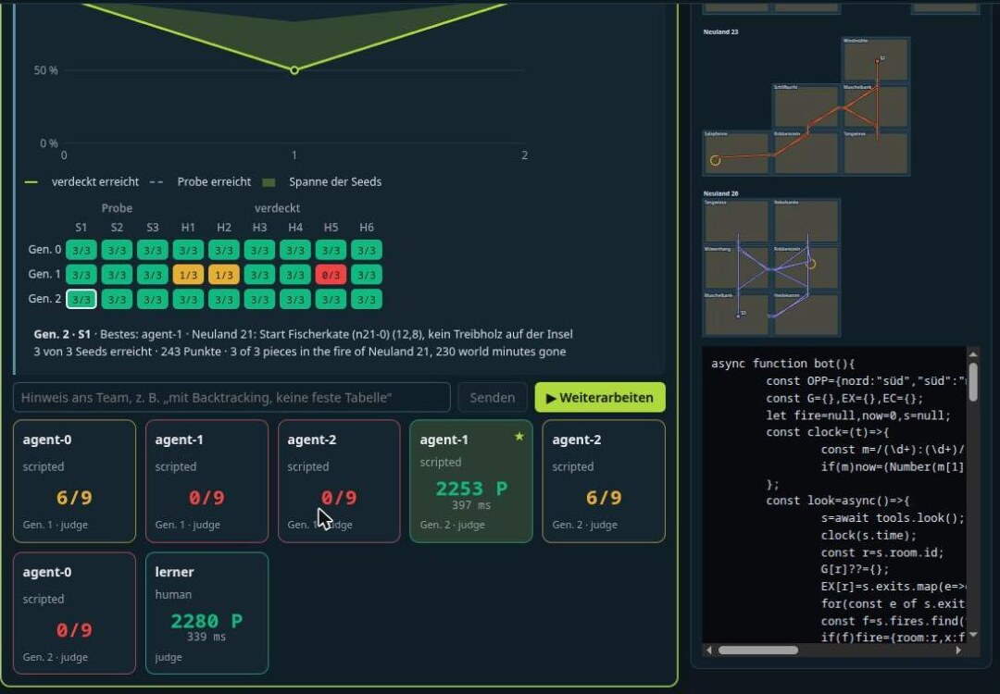

*Abbildung 6 (Schritt 7), "Die Flut lernen".*
- *Generation 1: die Tour ohne Modell (6/9, gelb, wo nur einige Seeds gelangen) und der Camper (0/9).*
- *Generation 2: das Gesetz im Code (9/9, 2253 Punkte).*
- *Die Karte "lerner": der nachträglich abgegebene Lerner. Er las die Beobachtungen, die der Lauf protokolliert hatte,
  und erreichte 9/9 (2280 Punkte). Die Seite zählt einen von Hand abgegebenen Beitrag als Generation 0, also ist er die
  oberste Zeile der Matrix.*

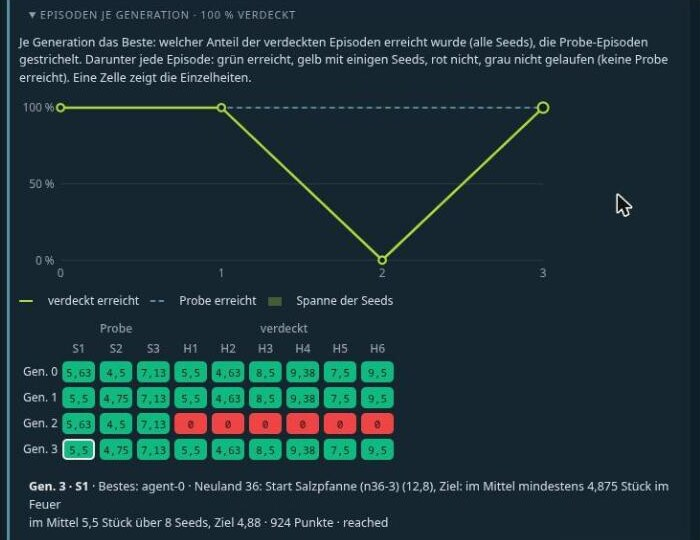

*Abbildung 7 (Schritt 8), "Die Chancen der Flut". In dieser Aufgabe zeigt eine Zelle die mittlere Zahl der Stücke über
die 8 Seeds; grün, wo sie den Zielwert der Episode erreicht. Die Detailzeile darunter nennt den Mittelwert, die Seeds und
den Zielwert.*
- *Generation 1: Das Gesetz im Code erreicht jeden Zielwert.*
- *Generation 2: die beobachteten Raum-IDs. Sie erreichen die drei gezeigten Inseln und bringen auf den verdeckten
  nichts.*
- *Generation 3: wieder das Gesetz, von einem anderen Agenten.*
- *Generation 0 (oberste Zeile): der nachträglich abgegebene Lerner. Er schätzte die Chancen aus den 24 Tagen, die der
  Lauf protokolliert hatte, und erreichte jeden Zielwert (7714 Punkte).*

Die Modellläufe vom 2026-11-14 (Abbildungen 8 bis 15) liefen alle unter denselben Bedingungen, nach den vier
Änderungen; sie zeigen die deutsche Oberfläche, und dieselbe Ansicht auf Englisch liegt jeweils daneben als
`*-en.jpg`. Jede zeigt die Zusammenfassung des Laufs, die Kurve der erreichten verdeckten Episoden und die Matrix jeder
Episode pro Generation (der beste Beitrag jeder Generation); die Detailzeile darunter ist die Zelle mit dem weißen
Rahmen.

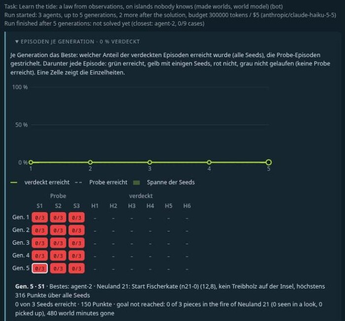

*Abbildung 8. Haiku 5.5 auf "Die Flut lernen": in fünf Generationen keine gezeigte Episode, also lief keine verdeckte.*

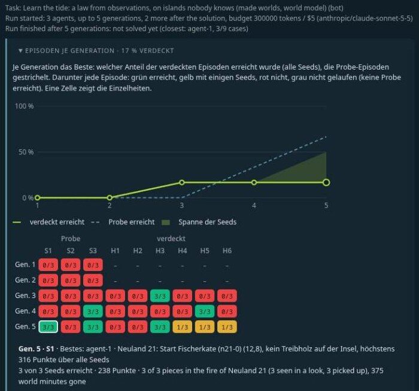

*Abbildung 9. Sonnet 5.5 auf "Die Flut lernen": einzelne Episoden ab Generation 3, höchstens 3 von 9; gelb, wo nur
einige Seeds erreicht wurden.*

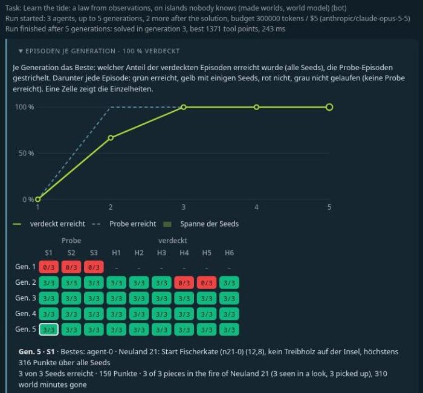

*Abbildung 10. Opus 5.5 auf "Die Flut lernen": 7 von 9 in Generation 2, der ersten, die die Beobachtungen sah; 9 von 9
ab Generation 3, mit dem Gesetz in seinem Code (1371 Punkte).*

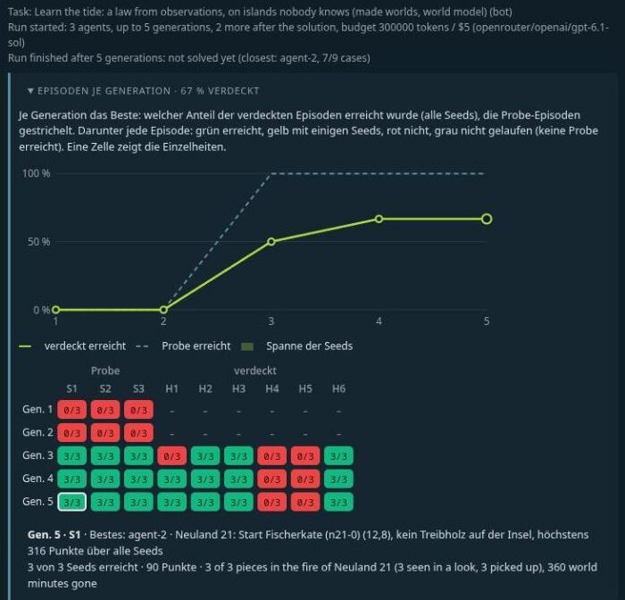

*Abbildung 11. GPT-6.1 Sol auf "Die Flut lernen": nichts bis Generation 3 (die Bots standen auf dem Feld des Feuers),
dann 6 und 7 von 9; die verdeckten H4 und H5 bleiben rot.*

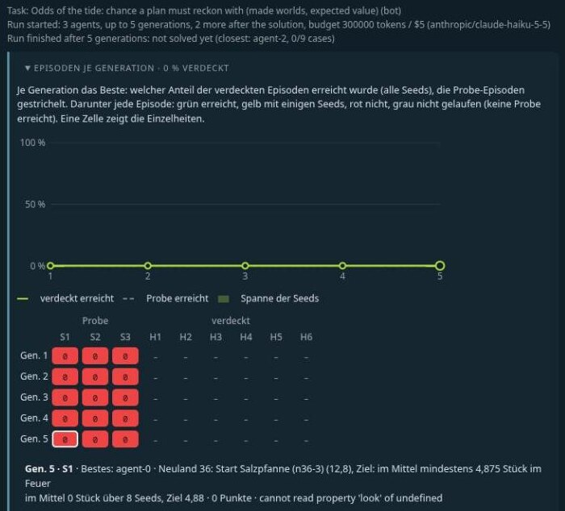

*Abbildung 12. Haiku 5.5 auf "Die Chancen der Flut": Eine Zelle ist die mittlere Zahl der Stücke über 8 Seeds; jede
gezeigte Episode 0. Die Detailzeile zeigt den häufigsten Fehlschlag, `bot(tools)` mit undefiniertem `tools`.*

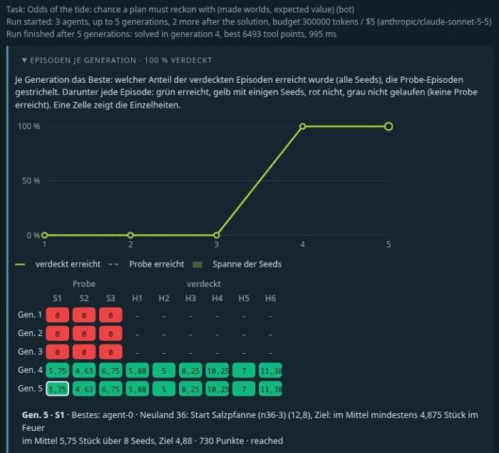

*Abbildung 13. Sonnet 5.5 auf "Die Chancen der Flut": nichts in den Generationen 1 bis 3 (die Bots scheiterten an den
Grenzen des Spiels und am Ausgangsbefehl), jeder Zielwert ab Generation 4.*

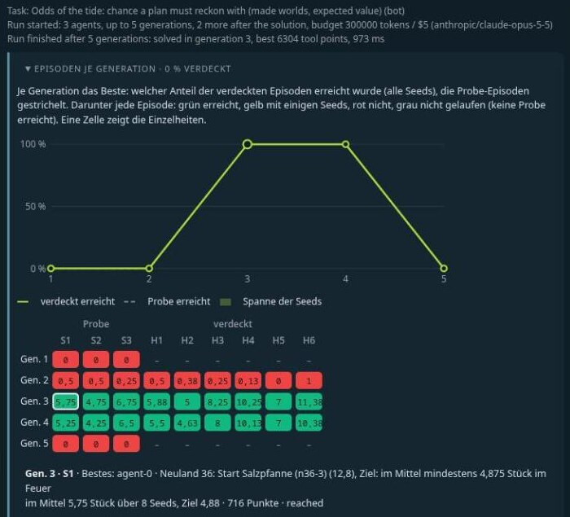

*Abbildung 14. Opus 5.5 auf "Die Chancen der Flut": jeder Zielwert in den Generationen 3 und 4; die Bots von Generation
5 ließen den Look vor dem Nehmen weg und brachten nichts. Der Sieger des Laufs ist der von Generation 3 (6304 Punkte,
die gerahmte Zelle).*

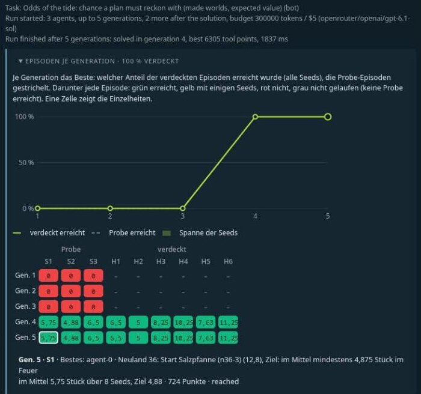

*Abbildung 15. GPT-6.1 Sol auf "Die Chancen der Flut": jeder Zielwert ab Generation 4, mit den aus `observations()`
gezählten Chancen (6305 Punkte).*

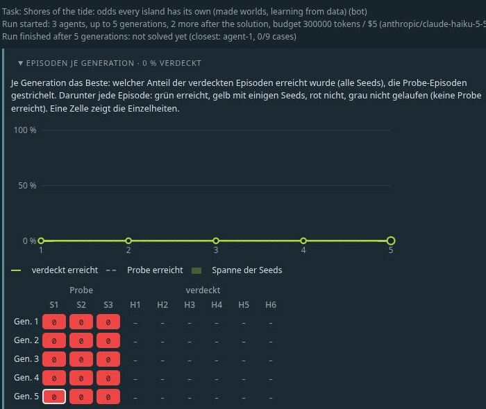

*Abbildung 16. Haiku 5.5 auf "Die Ufer der Flut": 0 in jeder Episode jeder Generation; die Bots endeten nach einem Blick
und dem Logbuch.*

*Abbildung 17. Sonnet 5.5 auf "Die Ufer der Flut": durchweg 0; seine Bots lasen das Logbuch und warteten, erreichten aber
nie einen Raum mit Stücken.*

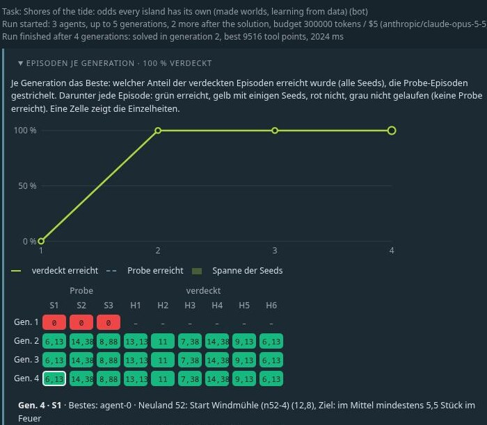

*Abbildung 18. Opus 5.5 auf "Die Ufer der Flut": jeder Zielwert ab Generation 2, mit der Chance jedes Raums aus dem
Logbuch gezählt (9516 Punkte).*

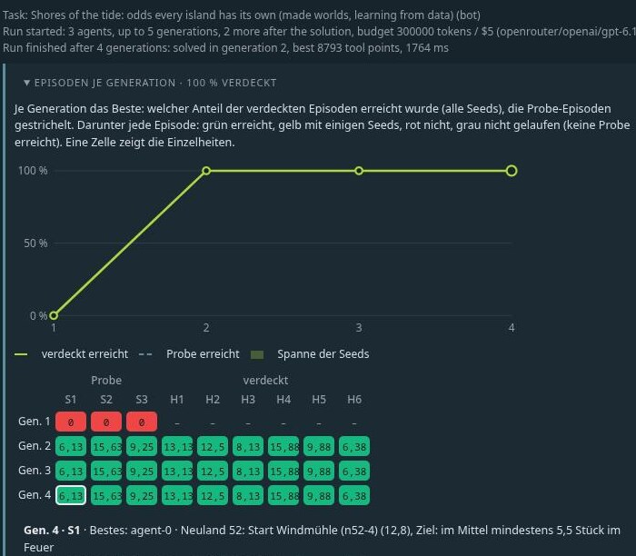

*Abbildung 19. GPT-6.1 Sol auf "Die Ufer der Flut": jeder Zielwert ab Generation 2; Karte und Chancen aus dem Logbuch,
eine neue Runde vor jeder Flut (8793 Punkte, weniger als die 9033 des Referenzplans).*

## Offen

- Wiederholungen auf "Die Ufer der Flut": das Scheitern von Sonnet am Format des Logbuchs, und ob ein Hinweis im
  Prompt (die Form des Logbuchs) es ändert.
- Wiederholungen: Jedes Modell und jede Aufgabe lief einmal, GPT zweimal (7 und 2 von 9 auf "Die Flut lernen"). Die
  zwei Lösungen von Opus und die zwei Fehlschläge von Haiku sehen nach ihren Kurven stabil aus; der Rest braucht mehr
  Läufe.
- Ein Gesetz, das sich zwischen Generationen ändert: Dann besteht nur noch ein Bot, der `observations()` zur Laufzeit
  liest (der Weg von GPT), und ein Gesetz, das als Konstanten in den Code geschrieben ist (der Weg von Opus und Sonnet),
  scheitert.
- Die Wirkung jeder der vier Änderungen für sich (Beobachtungen im Prompt, längerer Code, reichere Fehlschläge, die
  Grenze).
- Der dauerhafte Agentenpfad bei einer Aufgabe, die seine eigene Prüfung nie besteht: den letzten Code abgeben, statt zu
  scheitern.
- Ziele als Mengen („irgendein Feuer der Insel brennt“) und Ziele gegen die übliche Richtung. Auch der Beitrag lässt
  beides offen.
- Risiko über den Mittelwert hinaus: ein Zielwert, der auch die schlechten Tage begrenzt (ein Quantil, nicht nur der
  Mittelwert), sodass ein Plan auch die Streuung abwägen muss.
