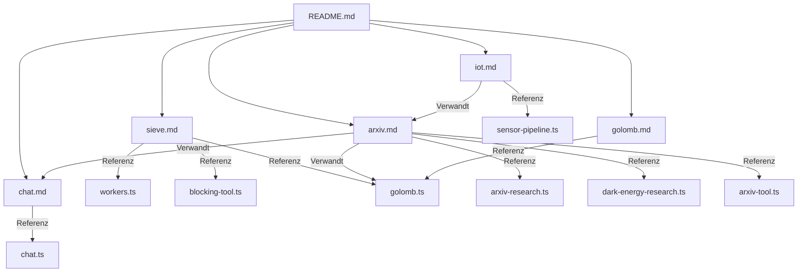

# 📚 pi-spaces Beispiele – Index & Lernpfad

**Version:** 1.0  
**Datum:** 2026-10-06  
**Status:** Vollständig  
**Zweck:** Zentrale Übersicht aller pi-spaces Beispiele mit Lernpfad und Schnellstart-Anleitung.

---

## 📋 Inhaltsverzeichnis

1. [Übersicht aller Beispiele](#1-übersicht-aller-beispiele)
2. [Schnellstart](#2-schnellstart)
3. [Lernpfad](#3-lernpfad)
4. [Anwendungsfälle](#4-anwendungsfälle)
5. [Technische Klassifizierung](#5-technische-klassifizierung)
6. [Implementierungs-Status](#6-implementierungs-status)
7. [Test-Suite](#7-test-suite)
8. [Performance-Benchmarks](#8-performance-benchmarks)
9. [Fehlende Beispiele](#9-fehlende-beispiele)
10. [Historische Referenzen](#10-historische-referenzen)

---

---

## 1. Übersicht aller Beispiele

### 1.1 Implementierte Beispiele

| **Name** | **Datei** | **Dokumentation** | **Pattern** | **Agenten** | **LLM** | **Storage** | **Komplexität** |
|----------|-----------|------------------|-------------|-------------|---------|-----------|----------------|
| **Einfaches Master-Worker** | [`workers.ts`](../../examples/workers.ts) | [sieve.md](sieve.md) | Master-Worker | Boss, Worker | ❌ | Memory | ⭐ |
| **Blockierende Operationen** | [`blocking-tool.ts`](../../examples/blocking-tool.ts) | [sieve.md](sieve.md) | Timeout-Handhabung | 1 Agent | ❌ | Memory | ⭐ |
| **IoT-Pipeline** | [`sensor-pipeline.ts`](../../examples/sensor-pipeline.ts) | [iot.md](iot.md) | Pipeline | Window, Collector×3, Analyst×2, Presenter | ❌ | Memory | ⭐⭐ |
| **arXiv API Tool** | [`arxiv-tool.ts`](../../examples/arxiv-tool.ts) | [arxiv.md](arxiv.md) | Externes Tool | - | ❌ | Memory | ⭐⭐ |
| **Space-basierter Chat** | [`chat.ts`](../../examples/chat.ts) | [chat.md](chat.md) | Publish-Subscribe | Host, Alice, Bob, Carol | ⚠️ | Memory | ⭐⭐ |
| **LLM-Papers Pipeline** | [`arxiv-research.ts`](../../examples/arxiv-research.ts) | [arxiv.md](arxiv.md) | Forschungs-Pipeline | Collector×3, Analyst, Presenter | ✅ | JSONL | ⭐⭐⭐ |
| **Dunkle Energie Pipeline** | [`dark-energy-research.ts`](../../examples/dark-energy-research.ts) | [arxiv.md](arxiv.md) | Erweiterte Pipeline | Crawler, Classifier, Summarizer, Analyst, Presenter, Monitor (+Chat mit `--query`) | ✅ | JSONL | ⭐⭐⭐⭐ |
| **Golomb-Lineal** | [`golomb.ts`](../../examples/golomb.ts) | [golomb.md](golomb.md) | Verteilte Suche | Master, Worker×N, Monitor | ❌ | JSONL | ⭐⭐⭐⭐ |

**Legende:**
- **Komplexität**: ⭐ = einfach (1–2 Stunden), ⭐⭐⭐⭐ = sehr komplex (8–16 Stunden)
- **LLM**: ✅ = notwendig, ⚠️ = optional, ❌ = nicht verwendet
- **Storage**: JSONL = dauerhaft, Memory = flüchtig

> **API-Konvention:** Alle Space-Einträge haben die Form `{type: "Name", fields: {...}}` — auch beim
> Lesen kommen die Nutzdaten in `entry.fields`. Die `interface`-Blöcke in den Spec-Dokumenten sind
> logische Schemata: ihr `type`-Feld wird zum Entry-Typ, die restlichen Felder landen in `fields`.
> Templates matchen als `{type: "Name", fields: {…Teilmenge…}}`; ein Feldwert `null` im Template
> **matcht nicht** „Feld fehlt", sondern nur ein explizit auf `null` gesetztes Feld (Abwesenheit
> lässt sich nicht ausdrücken — stattdessen das Ergebnis von `space_list` clientseitig filtern).

### 1.2 Dokumentations-Struktur

```
docs/examples/
├── README.md                    ← Sie sind hier
├── sieve.md                     # Master-Worker-Pattern
│   ├── workers.ts                # Einfaches Master-Worker
│   ├── blocking-tool.ts           # Blockierende Operationen
│   └── golomb.ts                 # Verteilte kombinatorische Suche
├── iot.md                       # Pipeline-Architektur
│   └── sensor-pipeline.ts        # IoT-Daten-Pipeline
├── chat.md                      # Space-basierte Kommunikation
│   └── chat.ts                   # Ring-Chat
├── arxiv.md                     # LLM-Agenten-Szenarien
│   ├── arxiv-research.ts         # LLM-Papers-Pipeline
│   ├── dark-energy-research.ts  # Dunkle Energie-Pipeline
│   └── arxiv-tool.ts             # arXiv API Tool
└── golomb.md                    # Verteilte kombinatorische Optimierung
    └── golomb.ts                 # Golomb-Lineal-Suche
```

### 1.3 Querverweise



---

---

## 2. Schnellstart

### 2.1 Voraussetzungen

```bash
# Node.js (empfohlen: v20+)
node --version

# Paketmanager
npm --version

# pi-spaces installieren
cd /media/data/programming/pi-spaces
git pull
npm install
```

### 2.2 Einfaches Beispiel ausführen

**Master-Worker Grundlagen:**
```bash
# Einfaches Task-Verteilungsbeispiel (30 Sekunden)
node --experimental-strip-types examples/workers.ts
```

**Space-basierter Chat:**
```bash
# Ring-Chat mit 3 Agenten (30 Sekunden, deterministisch)
node --experimental-strip-types examples/chat.ts

# Mit eigenem Thema
node --experimental-strip-types examples/chat.ts "Diskutiert KI-Ethik"
```

**IoT-Pipeline:**
```bash
# Sensor-Daten-Pipeline (1 Sekunde)
node --experimental-strip-types examples/sensor-pipeline.ts
```

**Golomb-Lineal:**
```bash
# Suche nach optimalem Lineal der Ordnung 8 (Sekunden bis Minuten;
# die Laufzeit wächst exponentiell mit der Ordnung)
node --experimental-strip-types examples/golomb.ts 8

# Mit 4 Workern
node --experimental-strip-types examples/golomb.ts 8 --workers 4
```

### 2.3 LLM-Beispiele ausführen

**Voraussetzung:**
```bash
# Umgebungsvariablen für LLM-Zugang
export PI_PROVIDER=mistral
export PI_MODEL=mistral-medium

# Oder in ~/.pi/agent/auth.json:
# {"mistral": {"apiKey": "sk-..."}}
```

**LLM-Papers:**
```bash
# Forschungs-Pipeline für LLM-Entwicklung (15–30 Minuten)
node --experimental-strip-types examples/arxiv-research.ts
```

**Dunkle Energie:**
```bash
# Vollständige Forschungs-Pipeline (60–120 Minuten)
node --experimental-strip-types examples/dark-energy-research.ts

# Mit eigenem Thema
node --experimental-strip-types examples/dark-energy-research.ts "Supernova-Kosmologie"

# Mit Output-Dateien
node --experimental-strip-types examples/dark-energy-research.ts --out report.md --out-json dashboard.json
```

---

---

## 3. Lernpfad

### 3.1 Level 1: Grundlagen (1–2 Stunden)

**Ziel:** Space-Konzepte verstehen: `write`, `take`, `readAll`, `notify`

| **Schritt** | **Beispiel** | **Dokumentation** | **Dauer** | **Lernziele** |
|------------|--------------|------------------|-----------|----------------|
| 1 | `workers.ts` | [sieve.md §7.1](sieve.md#71-einfaches-master-worker-workersts) | 30 Min. | Grundlegendes Master-Worker |
| 2 | `blocking-tool.ts` | [sieve.md §7.2](sieve.md#72-blockierende-operationen-blocking-toolts) | 30 Min. | Timeout-Handhabung |
| 3 | `chat.ts` | [chat.md](chat.md) | 1 Stunde | Publish-Subscribe, Space-Events |

**Übungen:**
- [ ] `workers.ts` ausführen und Output analysieren
- [ ] `blocking-tool.ts` modifizieren: Timeout auf 1 Sekunde setzen
- [ ] `chat.ts` mit eigenem Thema ausführen
- [ ] `chat.ts` um 4. Agenten erweitern

### 3.2 Level 2: Pipeline-Architektur (2–4 Stunden)

**Ziel:** Komplexere Muster verstehen: Transaktionen, Deduplizierung, mehrstufige Verarbeitung

| **Schritt** | **Beispiel** | **Dokumentation** | **Dauer** | **Lernziele** |
|------------|--------------|------------------|-----------|----------------|
| 1 | `sensor-pipeline.ts` | [iot.md](iot.md) | 1 Stunde | Pipeline-Muster |
| 2 | Vertiefung: Transaktionen | [iot.md §7](iot.md#7-transaktionen--atomare-operationen) | 30 Min. | Atomare Operationen |
| 3 | Vertiefung: Deduplizierung | [iot.md §8](iot.md#8-deduplizierung--datenqualität) | 30 Min. | Duplicate Detection |

**Übungen:**
- [ ] `sensor-pipeline.ts` modifizieren: 4. Collector hinzufügen
- [ ] Alert-Agent für `sensor-pipeline.ts` implementieren (Spezifikation: [iot.md §3](iot.md#3-space-typen); die Alarm-Stufe ist dort bewusst nicht implementiert)
- [ ] TTL für Sensor-Daten in `sensor-pipeline.ts` hinzufügen

### 3.3 Level 3: Verteilte Suche (4–8 Stunden)

**Ziel:** Master-Worker mit Task-Verteilung und Branch-and-Bound verstehen

| **Schritt** | **Beispiel** | **Dokumentation** | **Dauer** | **Lernziele** |
|------------|--------------|------------------|-----------|----------------|
| 1 | `golomb.ts` | [golomb.md](golomb.md) | 2 Stunden | Verteilte kombinatorische Suche |
| 2 | Vertiefung: BitSet-Optimierung | [golomb.md §7.2](golomb.md#72-bitset-optimierung) | 1 Stunde | Effiziente Datenstrukturen |
| 3 | Vertiefung: Branch-and-Bound | [golomb.md §7.1](golomb.md#71-branch-and-bound-dfs) | 1 Stunde | Pruning-Strategien |
| 4 | Vertiefung: Checkpointing | [golomb.md §9.3](golomb.md#93-checkpointing) | 30 Min. | Resume-Fähigkeit |

**Übungen:**
- [ ] `golomb.ts` mit Ordnung 10 ausführen und Ergebnisse prüfen
- [ ] Checkpointing aktivieren und Test mit Unterbrechung durchführen
- [ ] Monitor-Funktionalität um Metriken erweitern
- [ ] Validator um zusätzliche Prüfungen erweitern

### 3.4 Level 4: LLM-Integration (4–8 Stunden)

**Ziel:** Sprachmodelle in Space-Architekturen integrieren

| **Schritt** | **Beispiel** | **Dokumentation** | **Dauer** | **Lernziele** |
|------------|--------------|------------------|-----------|----------------|
| 1 | `arxiv-research.ts` | [arxiv.md §9.2](arxiv.md#92-llm-papers-implementierung-arxiv-researchts) | 2 Stunden | Forschungs-Pipeline |
| 2 | `arxiv-tool.ts` | [arxiv.md §9.3](arxiv.md#93-arxiv-api-tool-arxiv-toolts) | 1 Stunde | Externe Tools |
| 3 | `chat.ts` mit LLM | [chat.md §9.2](chat.md#92-live-modus-echte-llms) | 1 Stunde | Interaktive Kommunikation |
| 4 | Vertiefung: Prompt Engineering | [arxiv.md §9.2](arxiv.md#92-llm-papers-implementierung-arxiv-researchts) | 1 Stunde | Agenten-Instructions |

**Übungen:**
- [ ] `arxiv-research.ts` mit eigenem Thema ausführen
- [ ] Collector-Agent um weitere Suchbegriffe erweitern
- [ ] Analyst-Agent um neue Analyse-Typen erweitern
- [ ] Chat-Agent mit eigenem Knowledge-Base verbinden

### 3.5 Level 5: Komplettes System (8–16 Stunden)

**Ziel:** Vollständige mehrstufige Pipeline mit allen Features

| **Schritt** | **Beispiel** | **Dokumentation** | **Dauer** | **Lernziele** |
|------------|--------------|------------------|-----------|----------------|
| 1 | `dark-energy-research.ts` | [arxiv.md §9.5](arxiv.md#95-dunkle-energie-implementierung-dark-energy-researchts) | 4 Stunden | Erweiterte Pipeline |
| 2 | Vertiefung: Phasen-Management | [arxiv.md §9.5](arxiv.md#95-dunkle-energie-implementierung-dark-energy-researchts) | 2 Stunden | Koordinierte Agenten |
| 3 | Vertiefung: Monitoring | [arxiv.md §9.5](arxiv.md#95-dunkle-energie-implementierung-dark-energy-researchts) | 1 Stunde | System-Status |
| 4 | Vertiefung: Chat-Integration | [arxiv.md §9.5](arxiv.md#95-dunkle-energie-implementierung-dark-energy-researchts) | 1 Stunde | Interaktive Abfragen |

**Übungen:**
- [ ] `dark-energy-research.ts` mit eigenem Thema ausführen
- [ ] Dashboard-Daten visualisieren (z. B. mit Python/Plotly)
- [ ] Neue Analyse-Typen hinzufügen (z. B. Keyword-Koioaquenz)
- [ ] Chat-Agent um Memory/Conversations erweitern
- [ ] Monitoring um Performance-Metriken erweitern

---

---

## 4. Anwendungsfälle

### 4.1 Master-Worker-Pattern

**Verwendung:** Verteilte Berechnungen, Task-Verteilung, Batch Processing

| **Anwendungsfall** | **Beispiel** | **Beschreibung** | **Komplexität** |
|-------------------|--------------|----------------|----------------|
| Einfache Task-Verteilung | `workers.ts` | Job-Erstellung und -Ausführung | ⭐ |
| Primzahlsieb | [sieve.md](sieve.md) | Verteilte Primzahlberechnung | ⭐⭐⭐ |
| Golomb-Lineal | `golomb.ts` | Verteilte kombinatorische Suche | ⭐⭐⭐⭐ |
| Batch Processing | - | Generische Batch-Verarbeitung | ⭐⭐ |

**Einsatzmuster:**
```typescript
// Master
master.write({ type: "Task", fields: { id, data } });

// Worker
worker.take({ type: "Task" });
worker.write({ type: "Result", fields: { taskId: id, result } });
```

### 4.2 Pipeline-Architektur

**Verwendung:** Datenverarbeitung, ETL, Multi-Stage Processing

| **Anwendungsfall** | **Beispiel** | **Beschreibung** | **Komplexität** |
|-------------------|--------------|----------------|----------------|
| IoT-Monitoring | `sensor-pipeline.ts` | Sensor-Daten → Aggregation → Bericht | ⭐⭐ |
| LLM-Forschung | `arxiv-research.ts` | Crawl → Classify → Analyze → Present | ⭐⭐⭐ |
| Dunkle Energie | `dark-energy-research.ts` | Crawl → Classify → Summarize → Analyze → Present + Chat + Monitor | ⭐⭐⭐⭐ |
| Bildverarbeitung | - | Upload → Process → Store → Notify | ⭐⭐ |

**Einsatzmuster:**
```typescript
// Stage 1: Collector
collector.write({ type: "RawData", fields: data });

// Stage 2: Processor
processor.take({ type: "RawData" });
processor.write({ type: "ProcessedData", fields: processed });

// Stage 3: Aggregator
aggregator.readAll({ type: "ProcessedData" });
aggregator.write({ type: "Result", fields: aggregated });
```

### 4.3 Publish-Subscribe

**Verwendung:** Echtzeit-Kommunikation, Event-Driven Architektur, Chat

| **Anwendungsfall** | **Beispiel** | **Beschreibung** | **Komplexität** |
|-------------------|--------------|----------------|----------------|
| Space-basierter Chat | `chat.ts` | Ring-Chat mit 3+ Agenten | ⭐⭐ |
| Alert-System | [iot.md §8.2](iot.md#82-unterschiede-zum-iot-monitoring-dokument) | Benachrichtigungen bei Grenzwertüberschreitung | ⭐⭐ |
| Event-Log | - | System-Events verteilen | ⭐ |
| Collaboration | - | Multi-Agenten-Koordination | ⭐⭐ |

**Einsatzmuster:**
```typescript
// Publisher
space.write({ type: "Event", fields: { to: "agent-1", message: "..." } });

// Subscriber
space.notify({ type: "Event", fields: { to: "agent-1" } }, { target: conv.id });
```

### 4.4 Verteilte kombinatorische Suche

**Verwendung:** Optimierungsprobleme, kombinatorische Suche, wissenschaftliche Berechnungen

| **Anwendungsfall** | **Beispiel** | **Beschreibung** | **Komplexität** |
|-------------------|--------------|----------------|----------------|
| Golomb-Lineal | `golomb.ts` | Optimaler Massstab mit eindeutigen Abständen | ⭐⭐⭐⭐ |
| Primzahlsieb | [sieve.md](sieve.md) | Verteilte Primzahlsuche | ⭐⭐⭐ |
| N-Königinnen | - | Lösung des N-Königinnen-Problems | ⭐⭐⭐ |
| Sudoku-Löser | - | Verteilter Sudoku-Löser | ⭐⭐⭐ |

**Einsatzmuster:**
```typescript
// Master: Aufgaben aufteilen
master.write({ type: "SearchTask", fields: { range: [start, end] } });

// Worker: Suche durchführen
worker.take({ type: "SearchTask" });
worker.write({ type: "Solution", fields: solution });

// Validator: Lösung prüfen
validator.readAll({ type: "Solution" });
validator.write({ type: "ValidSolution", fields: validated });
```

---

---

## 5. Technische Klassifizierung

### 5.1 Nach Space-Operationen

| **Operation** | **Beispiele** | **Häufigkeit** | **Komplexität** |
|---------------|---------------|----------------|----------------|
| `write` | Alle | ★★★★★ | ⭐ |
| `take` | `workers.ts`, `golomb.ts`, `sensor-pipeline.ts` | ★★★★☆ | ⭐ |
| `read` / `readAll` | `chat.ts`, `arxiv-research.ts`, `sensor-pipeline.ts` | ★★★★☆ | ⭐ |
| `notify` | `chat.ts` | ★★☆☆☆ | ⭐⭐ |
| `txn` / `commit` / `abort` | `sensor-pipeline.ts`, `arxiv-research.ts` | ★★★☆☆ | ⭐⭐ |
| `space_wait` | `arxiv-research.ts`, `dark-energy-research.ts` | ★★★☆☆ | ⭐⭐ |
| `count` | Alle mit Monitoring | ★★☆☆☆ | ⭐ |
| `stats` | Alle mit Monitoring | ★☆☆☆☆ | ⭐ |

### 5.2 Nach Modus

> Die Modi `expand` und `sync` beschreiben das **Zielbild** der Federation (v3, Stufe 2–3) und sind
> noch nicht implementiert. Alle Beispiele laufen heute lokal auf einem Host (`local`).

| **Modus (Zielbild)** | **Beispiele** | **Beschreibung** | **Space-Typen** |
|-----------|---------------|----------------|------------------|
| `local` | `workers.ts`, `blocking-tool.ts`, `chat.ts` | Ein Host, keine Federation | Alle Typen lokal |
| `expand` | `sensor-pipeline.ts`, `golomb.ts`, `arxiv-research.ts` | Verteilung auf mehrere Members | Nach Typ oder Kapazität |
| `sync` (lww) | `dark-energy-research.ts` (Alerts, SystemStatus) | Spiegelung mit Last-Writer-Wins | Schlüsselbasiert |

### 5.3 Nach Komplexität

| **Komplexitäts-Level** | **Beispiele** | **Merkmale** | **Lernzeit** |
|----------------------|---------------|--------------|--------------|
| ⭐ Einfach | `workers.ts`, `blocking-tool.ts` | 1–2 Agenten, Grundoperationen | 1–2 Std. |
| ⭐⭐ Mittel | `chat.ts`, `sensor-pipeline.ts` | 3–4 Agenten, Pipeline oder Events | 2–4 Std. |
| ⭐⭐⭐ Komplex | `arxiv-research.ts`, `golomb.ts` | 5+ Agenten, LLM oder Branch-and-Bound | 4–8 Std. |
| ⭐⭐⭐⭐ Sehr komplex | `dark-energy-research.ts` | 7+ Agenten, Phasen, LLM, Monitoring | 8–16 Std. |

### 5.4 Nach Storage

| **Storage-Typ** | **Beispiele** | **Verwendung** | **Persistenz** |
|----------------|---------------|----------------|----------------|
| MemoryStorage | `workers.ts`, `blocking-tool.ts`, `chat.ts` | Tests, Entwicklung | ❌ Flüchtig |
| NodeJsonlStorage | `golomb.ts`, `arxiv-research.ts`, `dark-energy-research.ts` | Production, Resume | ✅ Dauerhaft |

---

---

## 6. Implementierungs-Status

### 6.1 Abgeschlossen ✅

| **Beispiel** | **Datei** | **Dokumentation** | **Status** | **Tests** |
|--------------|-----------|------------------|------------|-----------|
| Einfaches Master-Worker | `workers.ts` | [sieve.md](sieve.md) | ✅ läuft | ✅ `test/examples/workers.test.ts` |
| Blockierende Operationen | `blocking-tool.ts` | [sieve.md](sieve.md) | ✅ läuft | ✅ `test/examples/blocking-tool.test.ts` |
| IoT-Pipeline | `sensor-pipeline.ts` | [iot.md](iot.md) | ✅ läuft | ✅ `integration.test.ts` (3 Tests) + `test/examples/sensor-pipeline.test.ts` |
| Space-basierter Chat | `chat.ts` | [chat.md](chat.md) | ✅ läuft (geskriptet); Live-Modus nicht erprobt | ✅ `test/examples/chat.test.ts` |
| arXiv API Tool | `arxiv-tool.ts` | [arxiv.md](arxiv.md) | ✅ einmal gegen arXiv geprüft | ✅ `test/examples/arxiv-research.test.ts` (Feed-Parsing) |
| LLM-Papers Pipeline | `arxiv-research.ts` | [arxiv.md](arxiv.md) | ⚠️ noch nie mit echtem Modell gelaufen | ✅ `test/examples/arxiv-research.test.ts` (Faux-Provider) |
| Dunkle Energie Pipeline | `dark-energy-research.ts` | [arxiv.md](arxiv.md) | ⚠️ noch nie mit echtem Modell gelaufen | ✅ `test/examples/dark-energy-research.test.ts` (Faux-Provider) |
| Golomb-Lineal | `golomb.ts` | [golomb.md](golomb.md) | ✅ läuft (Ordnung ≤ ~10 realistisch) | ✅ `test/examples/golomb.test.ts` |

Benchmarks: keine vorhanden (siehe §8).

### 6.2 Geplant 📋

| **Beispiel** | **Datei** | **Dokumentation** | **Priorität** | **Abhängigkeiten** |
|--------------|-----------|------------------|--------------|-------------------|
| Primzahlsieb | `sieve.ts` | [sieve.md](sieve.md) | ⭐⭐ | `workers.ts` |
| Distributed Cache | `cache.ts` | [cache.md](cache.md) | ⭐⭐ | Lease/TTL, `sync`-Modus (v3 Stufe 3) |
| Mandelbrot-Rendering | `mandelbrot.ts` | - | ⭐ | `sensor-pipeline.ts` |
| Order-Matching | `order-matching.ts` | - | ⭐⭐ | `workers.ts` |
| N-Königinnen | `n-queens.ts` | - | ⭐ | `golomb.ts` |

---

---

## 7. Test-Suite

### 7.1 Test-Organisation

```
test/examples/
├── workers.test.ts          # Master-Worker Tests
├── blocking-tool.test.ts    # Timeout Tests
├── sensor-pipeline.test.ts  # Pipeline Tests
├── chat.test.ts             # Chat Tests (Publish-Subscribe, Ring-Kommunikation, Determinismus)
├── arxiv-research.test.ts   # LLM Pipeline Tests (Collection, Analyse, Präsentation)
├── dark-energy-research.test.ts # Erweiterte Pipeline Tests (Crawling, Klassifizierung, Analyse, Chat, Monitoring)
├── golomb.test.ts           # Golomb-Lineal Tests (BitSet, Validierung, Branch-and-Bound)
├── compat.ts                # Shim: vitest-Oberfläche auf node:test + node:assert
└── utils/                   # Test-Hilfsfunktionen (Harness, Assertions, Fixtures, Mocks)
```

Stand: **132 Tests, alle grün** (~11 s).

Die Suite läuft mit dem eingebauten Test-Runner (`node --test`, wie die Kern-Tests in
`test-core.test.ts`, `test-meter.test.ts`, `integration.test.ts`). Sie braucht kein Vitest.

### 7.2 Test-Kategorien

| **Kategorie** | **Beispiele** | **Runner** | **Status** |
|--------------|---------------|-----------|----------------|
| Unit-Tests | Golomb (BitSet, Validierung, DFS), Fixtures | `node:test` | ✅ |
| Integration-Tests | Pipelines, Chat (Faux-Provider, echter Space) | `node:test` | ✅ |
| E2E-Tests mit echtem Modell | `arxiv-research.ts`, `dark-energy-research.ts`, `chat.ts --live` | manuell | ❌ noch nicht gelaufen |
| Performance-/Fuzz-Tests | - | - | ❌ nicht vorhanden |

### 7.3 Test-Ausführung

```bash
# Kern-Tests (immer vor Commits)
npm test

# Beispiel-Tests
npm run test:examples

# Einzelne Datei
node --experimental-strip-types --test test/examples/golomb.test.ts

# Typecheck (deckt src/, examples/, *.test.ts ab; test/ ist ausgenommen)
npm run typecheck
```

### 7.4 Test-Beispiele

**golomb.test.ts** testet die echten, aus `examples/golomb.ts` exportierten Klassen:
```typescript
import { test } from "node:test";
import assert from "node:assert/strict";
import { GolombRuler } from "../../examples/golomb.ts";

test("golomb: Validierung", () => {
  assert.equal(GolombRuler.isValid([0, 1, 4, 6]), true);   // Ordnung 4, optimal
  assert.equal(GolombRuler.isValid([0, 1, 2, 4]), false);  // Abstand 1 doppelt
});
```

**Sensor-Pipeline** wird im Kern (`integration.test.ts`, Präfix `pipeline:`) gegen die
exportierten Rollenfunktionen `collect`/`analyse`/`present` getestet: konkurrierende Analysten,
Transaktions-Abbruch eines abgestürzten Analysten, fehlende Quelle → `missing`.

---

---

## 8. Performance-Benchmarks

> **Status: nicht implementiert.** Es gibt weder ein `benchmarks/`-Verzeichnis noch ein
> `npm run bench:examples`-Skript. Dieser Abschnitt beschreibt das Zielbild.

### 8.1 Benchmark-Organisation (geplant)

```
benchmarks/examples/
├── workers.bench.ts       # Master-Worker Benchmarks
├── sensor-pipeline.bench.ts # Pipeline Benchmarks
├── chat.bench.ts          # Chat Benchmarks
├── arxiv-research.bench.ts # LLM Pipeline Benchmarks
└── golomb.bench.ts        # Golomb-Lineal Benchmarks
```

### 8.2 Benchmark-Metriken

| **Metrik** | **Beispiele** | **Tool** | **Zielwert** |
|------------|---------------|----------|--------------|
| Durchsatz (Tasks/s) | `workers.ts`, `golomb.ts` | Custom | ≥ 100 Tasks/s |
| Latenz (Task → Result) | Alle | Custom | ≤ 1s (p99) |
| Speichernutzung | Alle | `htop` | ≤ 1GB pro Host |
| CPU-Auslastung | Alle | Prometheus | ≤ 80% |
| LLM-Inferenzzeit | `arxiv-research.ts`, `dark-energy-research.ts` | Custom | ≤ 30s pro Aufruf |
| LLM-Kosten | `arxiv-research.ts`, `dark-energy-research.ts` | Custom | ≤ $0.10 pro Paper |

### 8.3 Benchmark-Ergebnisse

Noch nicht gemessen. Die folgenden Werte sind grobe **Erwartungen**, keine Messungen:

| **Beispiel** | **Ordnung/Größe** | **Worker** | **Erwartung** |
|--------------|-------------------|------------|---------------|
| `golomb.ts` | Ordnung 8 | 4 | Sekunden bis wenige Minuten |
| `golomb.ts` | Ordnung 12 | 4 | Stunden bis Tage (Suchraum wächst exponentiell) |
| `arxiv-research.ts` | ~30 Papers | 3 Collector | ~15–30 min, mehrere 100k Tokens |

### 8.4 Benchmark-Ausführung

```bash
# Derzeit: Beispiele direkt ausführen und Zeit messen
time node --experimental-strip-types examples/golomb.ts 8 --workers 4
```

---

---

## 9. Fehlende Beispiele

### 9.0 Distributed Cache (`cache.ts`)

**Beschreibung:** Verteilter Key-Value-Cache mit TTL und automatischem Ablauf (Spezifikation:
[cache.md](cache.md)). Der sinnvolle Teil (`sync`/lww-Replikation, Tombstones) hängt an
Federation-Stufe 3; eine lokale Variante (TTL via Leases) wäre schon jetzt möglich.

**Implementierung:**
- [ ] `cache.ts` erstellen (lokal, TTL über `ttlMs`)
- [ ] lww/Tombstones erst nach Stufe 3

---

### 9.1 Primzahlsieb (`sieve.ts`)

**Beschreibung:** Verteilte Berechnung von Primzahlen nach dem Sieve-of-Eratosthenes-Algorithmus

**Pattern:** Master-Worker mit Task Bag

**Agenten:**
- `Master`: Teilt Zahlenbereich in Blöcke auf
- `Worker`: Berechnet Primzahlen in einem Block
- `Collector`: Aggregiert Ergebnisse

**Space-Typen:**
```typescript
interface SieveTask {
  type: "SieveTask";
  taskId: string;
  rangeStart: number;
  rangeEnd: number;
  status: "pending" | "processing" | "done";
  workerId?: string;
  lease: Lease;
}

interface SieveResult {
  type: "SieveResult";
  taskId: string;
  primes: number[];
  workerId: string;
  durationMs: number;
}

interface SieveSummary {
  type: "SieveSummary";
  totalPrimes: number;
  range: [number, number];
  completed: boolean;
}
```

**Implementierung:**
- [ ] `sieve.ts` erstellen
- [ ] Tests in `sieve.test.ts`
- [ ] Benchmarks in `sieve.bench.ts`
- [ ] Referenz in [sieve.md](sieve.md) hinzufügen

**Verwandte Beispiele:**
- `workers.ts` – Grundlegendes Master-Worker
- `golomb.ts` – Verteilte Suche

---

### 9.2 Mandelbrot-Rendering (`mandelbrot.ts`)

**Beschreibung:** Verteilte Berechnung und Rendering der Mandelbrot-Menge

**Pattern:** Pipeline + Master-Worker

**Agenten:**
- `Master`: Teilt Bild in Regionen auf
- `Worker`: Berechnet Farbwerte für eine Region
- `Compositor`: Setzt Teilbilder zusammen
- `Presenter`: Speichert fertiges Bild

**Space-Typen:**
```typescript
interface MandelbrotTask {
  type: "MandelbrotTask";
  taskId: string;
  xStart: number;
  xEnd: number;
  yStart: number;
  yEnd: number;
  width: number;
  height: number;
  maxIterations: number;
  status: "pending" | "processing" | "done";
}

interface MandelbrotTile {
  type: "MandelbrotTile";
  taskId: string;
  pixels: Uint8ClampedArray; // RGBA-Daten
  width: number;
  height: number;
}

interface MandelbrotImage {
  type: "MandelbrotImage";
  width: number;
  height: number;
  data: Uint8ClampedArray; // Vollständiges Bild
}
```

**Implementierung:**
- [ ] `mandelbrot.ts` erstellen
- [ ] PNG-Export implementieren
- [ ] Tests in `mandelbrot.test.ts`
- [ ] Benchmarks in `mandelbrot.bench.ts`
- [ ] Referenz in [iot.md](iot.md) hinzufügen

**Verwandte Beispiele:**
- `sensor-pipeline.ts` – Pipeline-Architektur
- `workers.ts` – Master-Worker

---

### 9.3 Order-Matching (`order-matching.ts`)

**Beschreibung:** Order-Matching-System für Börsen (Trading)

**Pattern:** Master-Worker + Transaktionen

**Agenten:**
- `OrderBook`: Verwaltet Buy/Sell Orders
- `Matcher`: Führt Matching durch
- `Trader`: Sendet Orders
- `Auditor`: Prüft Transaktionen

**Space-Typen:**
```typescript
interface Order {
  type: "Order";
  orderId: string;
  userId: string;
  side: "buy" | "sell";
  price: number;
  quantity: number;
  timestamp: Date;
}

interface Trade {
  type: "Trade";
  tradeId: string;
  buyOrderId: string;
  sellOrderId: string;
  price: number;
  quantity: number;
  timestamp: Date;
}

interface OrderBookSnapshot {
  type: "OrderBookSnapshot";
  bids: Array<{ price: number; quantity: number }>;
  asks: Array<{ price: number; quantity: number }>;
  timestamp: Date;
}
```

**Implementierung:**
- [ ] `order-matching.ts` erstellen
- [ ] Transaktionssicherheit implementieren
- [ ] Tests in `order-matching.test.ts`
- [ ] Benchmarks in `order-matching.bench.ts`
- [ ] Referenz in [sieve.md](sieve.md) hinzufügen

**Verwandte Beispiele:**
- `workers.ts` – Master-Worker
- `sensor-pipeline.ts` – Pipeline

---

### 9.4 N-Königinnen-Problem (`n-queens.ts`)

**Beschreibung:** Verteilte Lösung des N-Königinnen-Problems (Platzierung von N Damen auf einem Schachbrett ohne Bedrohung)

**Pattern:** Master-Worker + Backtracking

**Agenten:**
- `Master`: Teilt Suchraum nach Zeilen auf
- `Worker`: Führt Backtracking durch
- `Validator`: Prüft Lösungen

**Space-Typen:**
```typescript
interface QueensTask {
  type: "QueensTask";
  taskId: string;
  n: number; // Brettgröße
  startRow: number; // Startzeile
  endRow: number; // Endzeile
  status: "pending" | "processing" | "done";
}

interface QueensSolution {
  type: "QueensSolution";
  taskId: string;
  n: number;
  positions: number[]; // Spaltenpositionen pro Zeile
  isValid: boolean;
}
```

**Implementierung:**
- [ ] `n-queens.ts` erstellen
- [ ] BitSet-Optimierung implementieren
- [ ] Tests in `n-queens.test.ts`
- [ ] Benchmarks in `n-queens.bench.ts`
- [ ] Referenz in [golomb.md](golomb.md) hinzufügen

**Verwandte Beispiele:**
- `golomb.ts` – Branch-and-Bound
- `workers.ts` – Master-Worker

---

---

## 10. Historische Referenzen

### 10.1 Linda Tuple-Spaces (1989)

**Paper:** [How to Write Parallel Programs](https://dl.acm.org/doi/10.1145/62548.65543) – Carriero & Gelernter

**Konzept:**
- **`out(t)`**: Schreibe Tuple t (entspricht `write`)
- **`in(t)`**: Nimm und entferne Tuple t (entspricht `take`)
- **`rd(t)`**: Lese Tuple t (entspricht `read`)
- **`eval(t)`**: Führe Agenten aus

**Beispiele in pi-spaces:**
- `workers.ts`: `out(Job)`, `in(Job)`
- `chat.ts`: `out(Msg)`, `rd(Msg)`

---

### 10.2 JavaSpaces (1999)

**Buch:** [JavaSpaces Principles, Patterns, and Practice](https://www.informit.com/store/java-spaces-principles-patterns-and-practice-9780201309883) – Freeman, Hupfer, Arnold

**Beispiele:**
- **Messenger/Chat**: [`chat.ts`](chat.md)
- **Generischer Compute Server**: [`workers.ts`](sieve.md), [`arxiv-research.ts`](arxiv.md)
- **Processing Unit Pipelines**: [`sensor-pipeline.ts`](iot.md), [`dark-energy-research.ts`](arxiv.md)

**JavaSpaces vs. pi-spaces:**
| **Aspekt** | **JavaSpaces** | **pi-spaces** |
|------------|----------------|---------------|
| Sprache | Java | TypeScript |
| Entry-Typen | Java Classes | TypeScript Interfaces |
| Notify | `Notify` + `RemoteEventListener` | `notify` + Conversation Target |
| Transaktionen | `TransactionManager` | Integriert in Space |
| Template-Matching | Java Reflection | Structured Templates |

---

### 10.3 Jini / GigaSpaces

**Tutorials:** Mandelbrot-Rendering, Order-Matching, Trading

**Beispiele in pi-spaces:**
- **Mandelbrot-Rendering**: Geplant (`mandelbrot.ts`)
- **Order-Matching**: Geplant (`order-matching.ts`)
- **Processing Pipelines**: [`sensor-pipeline.ts`](iot.md), [`dark-energy-research.ts`](arxiv.md)

---

### 10.4 Outrigger / Apache River

**Fokus:** Stress-Tests, Konformitätstests

**Test-Kategorien:**
- Parallele Takes
- Lease-Ablauf
- Transaktions-Abort
- Netzwerk-Partitionen

**pi-spaces Äquivalent:**
- [Test-Suite §7](README.md#7-test-suite)
- [Performance-Benchmarks §8](README.md#8-performance-benchmarks)

---

---

## Zusammenfassung

### Aktueller Status

✅ **8 Beispiele implementiert**, alle kompilieren (`npm run typecheck`)
✅ **Test-Suite** unter `test/examples/` (`node:test`, `npm run test:examples`)
✅ **5 Spec-Dokumente** (sieve.md, iot.md, chat.md, arxiv.md, golomb.md) + cache.md (nur Spec)
⚠️ **Live-LLM-Läufe** (`arxiv-research`, `dark-energy-research`, `chat --live`) noch nie ausgeführt
❌ **Benchmarks** nicht vorhanden

### Nächste Schritte

1. **🤖 Live-Läufe durchführen** (PRIO: ⭐⭐⭐)
   - `chat.ts --live` mit günstigem Modell
   - `arxiv-research.ts` einmal vollständig
   - Ergebnisse in den Spec-Dokumenten vermerken

2. **⚡ Performance-Benchmarks durchführen** (PRIO: ⭐⭐)
   - Durchsatz und Latenz messen (§8)

3. **📝 Fehlende Beispiele implementieren** (PRIO: ⭐⭐)
   - `sieve.ts` (Primzahlsieb), `cache.ts` (Distributed Cache, lokal)
   - `mandelbrot.ts`, `order-matching.ts`, `n-queens.ts`

---

**Dokument erstellt am 2026-10-06**
**Verantwortlich:** pi-spaces Team
**Version:** 1.0

---

*Für Fragen und Diskussionen: Siehe [federation-plan-v3.md](../federation-plan-v3.md)*
