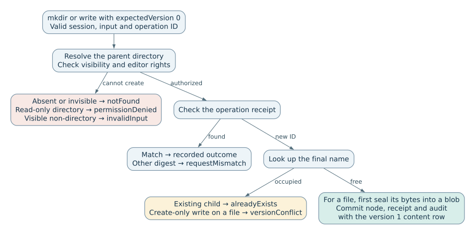
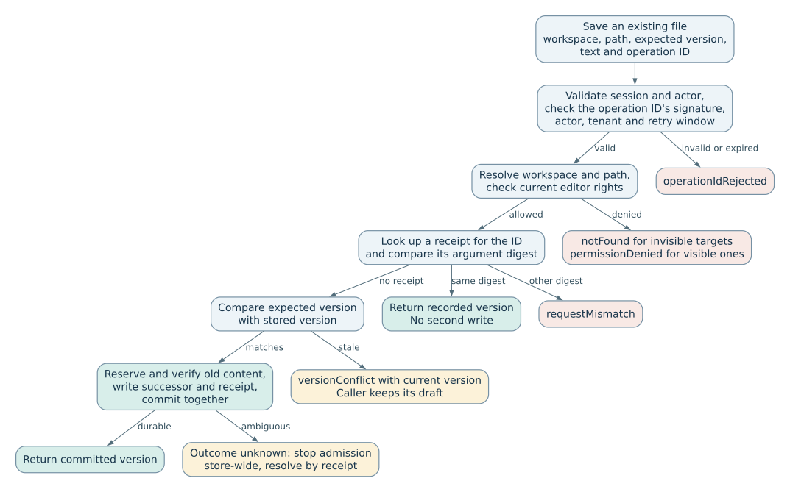

# A Zanzibar-style agent filesystem on phi-spaces

**Status.** Proposed implementation plan, 2026-11-24. The first release serves persistent UTF-8 text files to human users and individual agent instances. The acceptance target is a local service on one host with SQLite persistence.

## 1. User journey and design boundary

Lea and the team's planning agent both open `brief.md` in the shared workspace `dispatch`. Lea saves version 4. The agent's attempt to save over version 3 returns a version conflict, so it can read Lea's changes before editing. The tenant administrator then removes Lea from the group North, which gave her editor rights on `dispatch`. A save from her already-open editor must recheck her rights. If North was also her only access to `dispatch`, her next workspace listing must omit `dispatch`, and every path inside it must answer exactly like an absent path.

Two sources shape the design. Zontally describes an agent filesystem built on Zanzibar-style relationships: each authenticated session gets its own home, each operation evaluates relationships afresh, and directory rights are inherited. We adopt an automatically provisioned home for every actor, the inherited directory rights and the separate identity of each agent instance. Google's Zanzibar paper requires that a revocation be respected by every later check, and it motivates the revocation test above. A single authority per tenant gives the first release a tractable ordering guarantee. Multi-host authorization, POSIX mounts, binary blobs, arbitrary user-defined policies, virtual mounts, move and delete are outside its acceptance scope (section 8). [Zontally design](https://www.zontally.com/blogs/technical/why-we-built-a-zanzibar-agent-filesystem) · [Zanzibar paper](https://research.google/pubs/zanzibar-googles-consistent-global-authorization-system/)

**Terms.** A *tenant* is an isolated customer with its own private Space. A *workspace* is a named top-level directory of a tenant. A *home* is the workspace created in the same transaction as its actor, with that actor as its first direct owner. An *actor* is a user or an agent instance. The *tenant administrator* manages actors, groups and workspaces of one tenant. The *host operator* runs the service and manages tenants, keys, backups and limits.

## 2. Application and trust boundary

Create a sibling application under `agent-filesystem/`. Give it its own manifest, typecheck, tests and README. Import the existing public package through `phi-spaces` and its exported subpaths. Keep file semantics in the application. Use the own SQLite store for persistence and the in-memory host for fast contract tests. [Package and service contracts](api.en.md) · [Space client](../spaces/src/client.ts)

**Repository integration.**

- Add `agent-filesystem` to `APPS` in `checks/roots.mjs`. Then `checks/layering.mjs` keeps the core from naming it, and `checks/package-imports.mjs` requires its `package.json` and holds it to the exported subpaths.
- Add root scripts on the pattern of codemode-forum (`agent-filesystem`, `agent-filesystem:dev`, `test:agent-filesystem`). `checks/root-scripts.mjs` verifies them.
- Do not add the application to `dashboard.apps.json`. The dashboard would expose the tenant Spaces (see below).
- Document the commands in AGENTS.md when the application exists.

**Deliberate deviation.** The other applications run their Space as a process of its own, and on big and nano only the Rust space servers run (R-D12). The pilot instead embeds a TypeScript Space host in the filesystem service and runs only on this machine, without Docker and without a Rust Space server. A separate Space process, a Rust port and a server deployment are later decisions (section 8).


The local deployment runs one filesystem service with an embedded Space host and one SQLite store. That store holds a private named Space per tenant.

- Browser, agent and admin adapters call the operations of section 5. Only the service opens the store.
- Restrict the data directory to the service account.
- No end-user connection, dashboard feed, generic Space tool, event subscription or snapshot endpoint may expose these Spaces. Raw entry access would bypass object authorization.
- The host operator's interface is local and separately authenticated. It offers no file operations.

**Confidentiality boundary.** The local pilot trusts the host operator, the service account and the running host with plaintext. The existing store serializes entry values into SQLite. File text, filenames and grants can occur in the database and its WAL. An operation-ID signing key authenticates retry tokens only. Require an encrypted volume for the data directory, WAL, temporary backup staging and swap, and authenticated encryption for every exported backup with the backup key held separately. Restore directly into protected storage. Check these deployment conditions before admitting real data. A logical database copy from the unlocked volume remains readable. Browser and network agent connections require authenticated TLS, including local browser use. Local non-network adapters use OS-protected sockets. Exclude request bodies, credentials and private paths from proxy logs and crash reports. Per-file encryption and secrecy from a running host operator are outside the pilot. [SQLite write path](../spaces/src/store/sqlite.ts)

**Identity.** A trusted session adapter validates the session against the current deployment session epoch and supplies tenant ID, actor kind and stable actor ID. The session carries no workspace: which workspaces an actor reaches follows from relationships alone (section 4).

- For a browser, authenticate through a configured identity provider using an authorization-code flow with PKCE, state and nonce. Validate issuer, audience, expiry and signature on the server. Map the verified issuer/subject pair through an operator-managed tenant membership binding to a stable user actor. A tenant selector may choose only among those bindings. Never accept actor or tenant authority from JSON, URL parameters or proxy identity headers sent by the browser.
- Issue a rotated opaque session handle in a Secure, HttpOnly, SameSite cookie scoped to the service. Store its actor, tenant, expiry and deployment epoch server-side. Enforce idle and absolute expiry, invalidate on logout, and check current actor state inside the queue. Require same-origin checks and a session-bound CSRF token on browser mutations, including admin calls. Tenant switching creates a freshly bound session. The security tests exercise two tenants with the same local username.
- Bind each agent instance to the pair `(enrolledHostPeerId, agentId)`. The enrolled host peer is authenticated and has the `agentHost` role; it asserts `agentId` as `frame.agent` for one of its conversations. This host assertion is trusted, while a conversation label supplied directly by an untrusted client or a shared agent archetype establishes no identity. [Agent-host contract](m1-mobile.en.md)
- Each `(enrolledHostPeerId, agentId)` pair maps to at most one agent actor per tenant, including deleted actor tombstones, checked inside the tenant queue on registration. Session lookup is therefore unambiguous. Two conversations of one host have different agent IDs; equal agent IDs on different host peers have different identities. Re-enrollment after deletion requires a new pair, because neither actor IDs nor identity bindings are reused.
- Every actor has an FsActor row. Unknown, disabled and deleted actors fail closed with `unauthenticated`.
- Select the tenant Space and require its committed initialization before resolving any path or relationship.
- The session epoch lives in deployment configuration outside the restorable data directory. The adapter rejects every session from an older epoch; the host operator advances the epoch on restore, not on ordinary key rotation.

**Provisioning.** Creating the named Space and initializing the tenant are two store commits; phi-spaces does not make them one transaction. The host operator first reserves the named Space, then commits the tenant initialization inside it: FsMeta, the first administrator's FsActor and home root, their `tenant#admin` relation, the home's direct owner relation and the initial FsAudit row. A named Space without the committed FsMeta remains in provisioning and admits no sessions or regular operations. Repeating `createTenant` for that name resumes initialization; after initialization it returns `alreadyExists`.

The recovery-bootstrap exception in section 6.5 uses independently verified authority and the same actor and home invariants. Every later actor registration likewise creates the FsActor, its home root and the home's first direct owner relation in one transaction. The administrator supplies a unique `homeName`; the service generates the root's node ID and stores it as `homeNodeId` on the actor. Home names use the same canonical syntax and uniqueness rules as every workspace name. The home starts private to its actor and remains an ordinary workspace: disabling or deleting the actor does not delete it, and the final-owner rules in section 3 name replacement owners where needed.

Everything else in a tenant goes through the authenticated admin operations of section 5:
- additional workspaces, each with its first enabled direct owner in one transaction;
- group membership and tenant-administrator grants.

## 3. Persistent model and invariants

| Entry | Fields and creation key | Invariant |
|---|---|---|
| FsMeta | tenantId, schemaVersion, formatVersion. Unique creation key (tenantId). | One per tenant Space. The service refuses to open a Space with an unknown version. |
| FsActor | actorKind, actorId, state (enabled, disabled, deleted), homeNodeId; for agents enrolledHostPeerId and agentId. Unique creation key (actorKind, actorId). | Actor IDs are never reused. A deleted actor keeps its row, homeNodeId and identity binding as a tombstone. The pair (enrolledHostPeerId, agentId) is unique per tenant among agent rows, checked inside the tenant queue before creation. |
| FsNode | nodeId, parentId, name, kind. Unique creation key (parentId, name). | A workspace root is a directory whose parent is the reserved workspace sentinel, so workspace names are unique per tenant. Every other node has a directory parent. Service-generated immutable IDs identify grant targets and homes. |
| FsContent | nodeId, version, text. Unique creation key (nodeId). | Every file has one content row, including empty files. Directories have none. Version starts at 1 and increases on each successful save. |
| FsRelation | objectKind, objectId, relation, subjectKind, subjectId, subjectRelation. Unique creation key over all six fields. | Valid combinations are listed in section 4. Use one canonical stored sentinel for a direct subject's empty subjectRelation. |
| FsReceipt | actorKind, actorId, operationId, argument digest, outcome, expiry. Unique creation key (actorKind, actorId, operationId). | Every successful tenant file or admin mutation, including an idempotent no-op, commits its receipt together with any changed rows and audit row. Expiry is the operation ID's issue time plus the retry window. Persist only the minimum successful result needed to answer a retry. Failed mutations have no receipt and do not consume the ID. Host-operator operations have no tenant receipt. |
| FsAudit | time, actor, operation, target IDs, operationId, outcome. No creation key. | A successful tenant file or admin mutation includes its audit row in the same transaction; tenant initialization writes one for the host operator with an empty operationId. After session and actor authentication, a denied administrative operation writes its audit row in a separate transaction containing no object mutation or receipt. Never holds file text or names. The host operator sets a maximum retention age and a hard count. At the cap, replace the oldest row atomically as described in section 4. |

**Leases and uniqueness.** Use durable entry leases for all of these entries. A transaction's short lease has a different purpose. Generate collision-resistant node IDs and check for collisions inside the tenant queue before creating a node. phi-spaces checks a single declared uniqueness key per write, including against reserved and uncommitted entries. Every creation path, provisioning included, must therefore specify the same key for its type. In-place replacements (`FsContent` version updates and `FsActor` state transitions) reserve the old row with a transactional take and write the successor without a uniqueness check: a check would find the row being replaced. [Uniqueness and transactions](api.en.md)

**Actor lifecycle.**
- Disabling an actor keeps its relations but makes them inert until it is enabled again.
- Deleting an actor removes its relations and leaves the tombstone, in one transaction. If an actor holds more relations than fit in one Space transaction's step or byte budget, `deleteActor` fails with `capacityExceeded`; the tenant administrator disables the actor first (making its relations inert immediately) and revokes excess relations before retrying deletion.
- Both operations refuse with `lastOwner` while the actor is the last enabled direct owner of a workspace root, unless the call names a replacement owner for each such workspace. Each replacement owner must be an enabled direct user or agent instance distinct from the actor being disabled or deleted (never a `group#member`); the replacement is granted in the same transaction.
- Both operations also refuse with `lastAdmin` while the actor is the last enabled `tenant#admin` user.
- The replacement-owner preflight covers every affected workspace root before any row changes. If the required replacements do not fit together with the state transition, the operation fails with `capacityExceeded` and changes nothing. Existing workspace owners can grant replacements in advance through ordinary `grant` calls. Without a cooperating owner, the host operator enters maintenance mode and a tenant administrator uses bounded `maintenancePutGrant` batches (section 5) to install enabled replacement owners while preserving `lastOwner` in every batch. Once no replacements remain in the state-transition transaction, disabling needs only the actor row, receipt and audit.
- After such a disable, group memberships are removed in bounded admin batches and excess file grants in bounded `maintenancePutGrant` batches before retrying deletion. These metadata operations give no file-content access. This runbook covers both the relation-removal budget and the replacement-owner budget rather than assuming that either always fits.

## 4. Relationship evaluation

| Object | Relations | Allowed subjects |
|---|---|---|
| tenant | admin | user |
| group | member | user, agent (no nested groups in the pilot) |
| directory, file | owner, editor, viewer | user, agent, group#member |

The three roles on files and directories are ordered:
- An owner can administer grants and has editor rights.
- An editor can modify content and has viewer rights.
- A viewer can read.

A role can come from a direct grant on the object, a grant to a group the actor belongs to, or a grant inherited from any ancestor up to the workspace root. Use the parent recorded on FsNode as the only containment edge. Inheritance stops at the workspace root, and group membership resolves only inside the same tenant. Effective rights are the union of all valid paths. Revoking a tuple removes that source only. The tenant-administrator relation grants no file rights: a tenant administrator who wants to read files needs a grant like anyone else.

Example persisted relationships:

```text
group:north#member@user:lea
directory:dispatch#editor@group:north#member
directory:dispatch#owner@agent:planner-17
```


Read the arrows from actor to file. Lea can edit through North. The planning agent can edit and administer grants through its own owner relation.

**Visibility is decided per workspace.** To reach a node, an actor needs viewer on every directory along its path, starting at the workspace root. Viewer is inherited downward, so viewer on the root already gives viewer on every descendant. It follows that:

- An actor sees either a whole workspace or none of it. A workspace is visible exactly when the actor has an effective viewer role on its root, through a direct or a group grant.
- `list` never filters children: every child of a visible directory is visible.
- Grants below a workspace root can only raise rights to editor or owner. A viewer grant below the root would be redundant, because anyone who can reach the node already inherits viewer, so the validator rejects it with `invalidInput`.
- An editor or owner grant below the root has no effect while its subject cannot see the workspace. It takes effect if the subject gains access later.
- Private material belongs in a separate workspace, for example the actor's home. Hiding individual children of a visible directory would need a traversal-only relation or a different inheritance rule (section 8).


In the journey, removing Lea from North ends all her rights on `dispatch`. `dispatch` disappears from her workspace list, and `brief.md` answers like an absent path. A direct editor grant to Lea on `brief.md` would not change that, because she can no longer see the workspace.

**Final owner and final administrator.** Every workspace root keeps at least one direct owner tuple whose subject is an enabled user or agent instance. An owner grant to a group is allowed but does not count. `revoke`, `maintenancePutGrant` with action `revoke`, disabling an actor and deleting an actor refuse with `lastOwner` when they would break this rule. Likewise, every tenant keeps at least one enabled `tenant#admin` user; `revokeTenantAdmin`, disabling an actor and deleting an actor refuse with `lastAdmin` when they would remove the last one.

**Validation and budgets.**
- Groups have no separate `FsGroup` entry: a group is identified implicitly by its NFC-normalized, case-sensitive canonical group ID in `FsRelation`, validated for syntax and byte limits like names. A group exists for administration while at least one relation either names it as the membership object or uses it as a grant subject. `listGroups` returns that union. Removing the last member does not remove grants on the group and therefore does not necessarily make it disappear; with no referencing relation, an empty group has no persistent row and is no longer listed.
- Reject unknown relations, invalid subject/object combinations, and unknown or deleted `user`/`agent` subjects before persistence (`invalidInput`). Existing relations of a disabled actor remain stored but inert. Reject paths that leave their workspace.
- Bound path depth, relationship work, directory size, direct grants per target, actors, groups, workspaces, nodes, relations and total content bytes per tenant. Configure creation limits so every retained listing remains within its response limit. Audit retention is a maximum age. When inserting at the positive hard count limit, reserve and remove the oldest audit row and insert its successor in the same transaction as the mutation and receipt. Use insertion order to break timestamp ties. Apply the same rotation to denied-admin audits. Budget space and transaction headroom for a largest permitted replacement. At physical storage failure, fail closed, suspend admission and require operator recovery. Never acknowledge an uncommitted revoke.
- Limit unexpired receipts by count and encoded bytes per tenant. Budget ordinary mutations separately from a reserved security pool for revocations, membership removal and actor disablement. Charge idempotent no-ops to the ordinary pool. Reserve the security pool and its recovery path for authorized, state-changing removals that pass every other precondition. Check limits before mutation, permit authorized replays without allocating a new receipt, and never evict a live receipt. Publish the retry window, capacity and admission rates together. If even the reserve cannot accommodate a required security action, close admission for the affected tenant, persist the closure and pending security action outside the store, alert the operator and keep the tenant closed across restarts until the action has durably succeeded. Only the operator-assisted, separately authenticated repair path may complete this action while closed. Revalidate the initiating authority, record the repair identity and issue a fresh ID if the original has expired. Recovery may free expired receipts or increase the limit within the physical store budget. Do not substitute a successful reply for a pending action.
- Detect repeated parent IDs and missing parents.
- Corrupt graphs produce `inconsistentState`, suspend admission for that tenant pending operator repair, and emit a diagnostic without private paths or text. Ordinary quota failures return `capacityExceeded` and leave admission open. Exhaustion of the security reserve for a required removal triggers the tenant closure above and returns `unavailable`.
- No decision cache in the pilot.

## 5. Operations

Every tenant file or admin mutation carries an operation ID that the service has issued (section 6.2). Paths are relative to the named workspace. Host-operator operations use the separately authenticated, serialized local interface instead; they do not use tenant-bound operation IDs.

**File operations** (browser and agent adapters):

| Operation | Required effective rights | Contract |
|---|---|---|
| workspaces() | Valid session | Return the names of the workspaces whose root the actor can view, in deterministic name order. Bound the number of workspaces per actor and the response like `list`; no partial success. |
| issueOperationIds(count) | Valid session | Return exactly `count` signed operation IDs for this actor. Writes nothing. A count outside the published inclusive range gives `invalidInput`. Tenant administrators may also use this in maintenance mode. |
| list(workspace, path) | Viewer on the directory | Return the immediate children in deterministic name order. Bound the response and directory cardinality in the pilot. No partial success when a limit is exceeded. |
| read(workspace, path) | Viewer on the file | Return UTF-8 text and version from the same ordered operation. |
| write(workspace, path, text, expectedVersion, operationId) | Editor on parent for version 0, editor on existing file for positive versions | Version 0 means create only. A positive expected version must match. Return the committed version. No implicit parent creation. |
| mkdir(workspace, path, operationId) | Editor on the parent | Create exactly one directory. An existing child of either kind gives `alreadyExists`. |
| grant(workspace, path, relation, subject, operationId) | Owner on the target | Add one validated tuple for an existing non-deleted user, agent or canonical group#member subject. An identical existing grant succeeds idempotently and records a receipt and audit row. |
| revoke(workspace, path, relation, subject, operationId) | Owner on the target | Remove that exact tuple. A tuple that is not present succeeds idempotently and records a receipt and audit row. Preserve the final owner (section 4). |
| listGrants(workspace, path) | Owner on the target | Return the direct relation tuples on that target in deterministic order. Bounded like `list`. |

**Admin operations** (admin adapter; they require `tenant#admin` and pass through the tenant queue; mutations carry operation IDs like file mutations):

| Operation | Contract |
|---|---|
| createWorkspace(name, owner, operationId) | Create an additional workspace root and its first enabled direct user or agent owner in one transaction. An existing workspace name gives `alreadyExists`; an unknown, deleted or disabled owner gives `invalidInput`. |
| registerActor(kind, actorId, homeName, agentIdentity?, operationId) | Create an enabled FsActor, its private home root and its first direct owner in one transaction. `agentIdentity` is required for agents and contains enrolledHostPeerId and agentId. An existing (actorKind, actorId), homeName or agent identity pair gives `alreadyExists`. |
| disableActor / deleteActor(actor, replacementOwners?, operationId) | As in section 3. Preserve `lastOwner` and `lastAdmin`. Unknown or deleted target actors give `invalidInput`. Disabling an already disabled actor with no replacements is a successful no-op; supplying replacements in that state gives `invalidInput`. |
| enableActor(actor, operationId) | Enable an existing disabled actor. An already enabled actor is a successful no-op; an unknown or deleted actor gives `invalidInput`. |
| grantTenantAdmin / revokeTenantAdmin(user, operationId) | Grant or revoke `tenant#admin` for an existing non-deleted user. Both are idempotent; `revokeTenantAdmin` preserves the last enabled administrator (`lastAdmin`). |
| addMember / removeMember(group, subject, operationId) | Add or remove one membership tuple for an existing non-deleted user or agent. Both are idempotent. |
| listWorkspaces() / listActors() / listGroups() / listGroupMembers(group) | Read-only inspection in deterministic order so a tenant administrator can manage the tenant without holding file rights. Bounded like `list`. |
| maintenanceList(workspace, path) / maintenanceListGrants(workspace, path) | Maintenance mode only. Return node names, kinds and direct grant metadata without requiring viewer or owner and without returning file text or versions. Resolve an absent path as `notFound`; bound and order like the ordinary listings. |
| maintenancePutGrant(workspace, path, action, relation, subject, operationId) | Maintenance mode only. Add or remove one direct tuple by tenant-administrator authority, without granting file-content access. Apply ordinary subject, relation and redundant-viewer validation and preserve `lastOwner`. Both actions are idempotent and record a receipt and audit row. Use this for restore reconciliation and the bounded actor-lifecycle fallback in section 3. |

The maintenance metadata operations are unavailable in normal mode. During restore, the independent authority gate in section 6.5 also applies. In maintenance mode, ordinary file operations except `issueOperationIds` are unavailable to everyone; an enabled tenant administrator can use admin operations, the maintenance metadata operations and `issueOperationIds`. This is a recovery exception to object-level grant administration, not an additional file role and not a way to read or write text.

**Host operator operations** (local interface, no file access): create or resume initialization of a tenant with its first administrator and home, configure limits, rotate the signing key, request a barriered transition to or from maintenance mode, back up and restore the store (section 6.5), advance the deployment session epoch on restore, and mark a tenant reconciled for that epoch after its administrator reports completion. Serialize these operations on the local interface. Tenant initialization follows the two-commit procedure in section 2. Reconciliation markers live in durable deployment configuration outside the data backup and are keyed by tenant and session epoch.

**Order of checks.**
1. Admit the request into the tenant queue (full queue or store-wide suspended admission -> `unavailable`).
2. Validate the session epoch, session and actor (missing/invalid/expired session, or unknown, disabled or deleted actor -> `unauthenticated`).
3. Apply the admission mode. In normal mode, maintenance metadata operations give `unavailable`. In maintenance mode, only an enabled tenant administrator's admin operations, maintenance metadata operations and `issueOperationIds` continue; every other authenticated request gives `unavailable`. Restore also requires approval from outside the backup (section 6.5).
4. Validate input syntax (malformed path or text, unknown relation, malformed subject, redundant `viewer` grant below the workspace root -> `invalidInput`).
5. For mutations, check the operation ID's signature, actor/tenant binding, key generation and retry window (-> `operationIdRejected`).
6. For `mkdir` and create-only `write`, resolve and authorize the existing parent directory first (creation branch below). Otherwise resolve the target and evaluate required rights: for ordinary file operations, resolve the workspace and path with traversal and check effective rights (missing or invisible workspace/path -> `notFound`; visible target without the required role -> `permissionDenied`); for admin and maintenance metadata operations, verify `tenant#admin` (-> `permissionDenied` in normal mode for an admin operation). Maintenance metadata paths do not require object visibility. A corrupt containment graph gives `inconsistentState`.
7. For mutations, look up a receipt. A matching argument digest returns the recorded successful outcome; a different digest gives `requestMismatch`. If there is no receipt, continue: an earlier failed attempt did not consume the ID.
8. Check object-dependent preconditions: node kind and actor state (`invalidInput`), existing objects and identity bindings (`alreadyExists`), expected version (`versionConflict`), subject existence for grants/memberships (`invalidInput`), final-owner/final-admin invariants (`lastOwner`/`lastAdmin`), and budgets (`capacityExceeded`).



**Creation branch.** For `mkdir` or `write(expectedVersion=0)`, an absent or invisible workspace or parent yields `notFound`. A visible parent of the wrong kind yields `invalidInput`; a visible parent directory without editor rights yields `permissionDenied`. Once authorized, check the receipt, then look up the final name. A free name permits creation of the node and any initial content atomically. For a collision, use the operation-specific errors below. An existing file's current version is disclosed only to a caller with current editor rights on it (editor on its parent is inherited). A positive expected version always uses the existing-file branch. For a replay of a creation request, current parent authorization still precedes receipt disclosure.

For ordinary operations that require an existing target, a target that is missing or invisible gets the same error (`notFound`), including an unknown or invisible workspace. Object-dependent errors (wrong node kind, `alreadyExists`, `versionConflict`) are reported only after the target has proved visible. Maintenance metadata operations are the explicit reconciliation exception and report only absence, never invisibility.

**Errors.**

| Code | Meaning |
|---|---|
| unauthenticated | Missing, expired or invalid session, an old session epoch, or unknown, disabled or deleted actor. |
| notFound | For ordinary file operations, the workspace or target is absent or invisible and the cases are indistinguishable. For maintenance metadata operations, the authorized metadata target is absent. |
| permissionDenied | In normal mode, the target is visible but the caller lacks the editor or owner role, or an admin caller lacks the admin role. |
| invalidInput | Malformed path or UTF-8 text, unknown relation, invalid/unknown/deleted subject, invalid actor state transition, redundant viewer grant, or wrong node kind (for example `read` on a directory, or `write` with a positive version on a directory). |
| alreadyExists | `mkdir` on a visible existing name of either kind, `write` with version 0 on a visible existing directory, a duplicate workspace or home name, a duplicate (actorKind, actorId), or an already bound agent identity pair. When `write` with version 0 hits a visible existing file, it reports `versionConflict` with its current version instead. |
| versionConflict | The expected version does not match (including `write` with version 0 on an existing file). The reply carries the current version. |
| lastOwner | The operation would leave a workspace root without an enabled direct owner. |
| lastAdmin | The operation would leave a tenant without an enabled `tenant#admin` user. |
| requestMismatch | The operation ID already has a successful receipt with a different argument digest. Failed attempts have no receipt and do not consume an ID. |
| operationIdRejected | The signature is invalid, the ID belongs to another actor or tenant, its key generation is retired, or its issue time lies outside the retry window. |
| capacityExceeded | A configured byte, depth, cardinality, transaction, quota or work limit is exceeded. |
| inconsistentState | A durable containment or schema invariant is corrupt. Reveal no target details, suspend the affected tenant and emit an operator diagnostic. |
| unavailable | The queue is full, admission is suspended (section 6.1), or the admission mode does not offer the requested operation (section 6.5). The reply carries a retry delay where retrying can help. |

**Paths and text.**
- Accept relative paths only, through a single canonical parser shared by the adapters. A lone dot means the workspace root, for `list`, `grant`, `revoke`, `listGrants` and the maintenance metadata operations.
- Reject absolute paths, empty segments, dot components elsewhere, parent components, backslashes and control characters.
- Look up and uniquely write names in NFC-normalized, case-sensitive form. Apply the same normalization to workspace names, home names and group IDs before computing uniqueness keys or request digests.
- Accept text only as well-formed Unicode scalar data and store its exact UTF-8 bytes; reject unpaired surrogates with `invalidInput`. Do not normalize file text. Preserve any BOM and control characters in content, and measure text limits in encoded bytes.
- The HTTP adapter carries paths in JSON and never URL-decodes them a second time.
- Specify and test byte limits for names, paths, text and replies against the configured Space limits before freezing the API.

## 6. Ordering, retries and recovery

### 6.1 Admission and the store

1. **One writer process.** The own SQLite store already holds an exclusive owner lock beside the store file while it is open (`spaces/src/store/sqlite.ts`): a second process is refused, and a crash releases the lock. The service relies on that lock. Phase 1 proves both properties with the service itself.
2. **One queue per tenant.** All adapters, provisioning, membership changes and maintenance metadata writes of a tenant pass through one bounded queue. Inside the queue the service validates, resolves, evaluates rights and reads, and it holds the slot until the read result is fixed or the write transaction reaches a known outcome. After a revoke or a membership removal is acknowledged, every operation admitted later sees the new relationships. Bytes delivered earlier cannot be recalled.
3. **Queues give order and fairness, not fault isolation.** All tenants share one store and one writer. If a commit's outcome is unknown, the service suspends admission for every tenant. It resumes only after it has resolved the transaction or reopened the store and checked the receipt. Run `startService` on the embedded host so the reaper clears abandoned transaction reservations after a crash; abandoned reservations must resolve or expire before a conflicting mutation runs. Callers meanwhile receive `unavailable`. Success is never acknowledged before the durable commit. Corruption reported as `inconsistentState` suspends only the affected tenant and requires operator repair rather than automatic readmission.
4. **Store compaction and live-data quotas.** Deleted receipts, pruned audit rows and replaced content rows leave free pages in the SQLite file. Schedule periodic `OwnStoreHost.compact()` calls under host-operator control to reclaim those pages. Compaction does not bound live data: the per-tenant actor, node, relation, workspace, content-byte, receipt and audit limits in section 4 do that.

**Global admission barrier.** The process has one gate above all tenant queues. Serialize transitions with the local operator interface. Persist the transition intent outside the store, close admission to new operations, and reject queued operations that have not started with `unavailable`. Drain every already-started read or mutation to a known outcome across all tenants. Persist the destination mode before acknowledging the transition. Recheck the gate when dequeuing. Restart with a pending transition, restore intent or unknown commit starts closed and resolves outstanding work before serving the permitted mode. A clean shutdown marker or equivalent durable dirty-start protocol must cover a crash before an unknown outcome can be recorded. For an ambiguous commit, close the gate immediately, track every in-flight transaction, resolve outcomes against durable state and receipts, and wait for reservations to clear. A maintenance or restore acknowledgement requires zero unresolved operations. Leaving restore maintenance additionally requires the reconciliation markers of section 6.5.

### 6.2 Operation IDs and receipts


- An operation ID is signed by the service over the tenant, actor kind and ID, issue time, key generation and a random nonce. Signing keys, their generation numbers and retirement times, and the deployment session epoch live in durable deployment configuration outside the data directory, readable only by the service account and updated atomically before the service continues. Restoring a backup therefore rolls back neither keys nor the session epoch.
- The service publishes a retry window. It rejects IDs whose issue time is at least one window old, or later than the service clock plus a small allowed skew, before any receipt lookup.
- Use one nondecreasing effective time for issuance, verification, key retirement and cleanup. Keep a durable time floor outside the restorable store. Before using a later time to invalidate an ID or remove its receipt, persist that floor atomically and durably. Serialize advances across tenants and signing operations. At startup and on each decision use at least the durable floor and the process high-water mark. Issue IDs only against this same clock. At or after the expiry instant reject the ID before lookup; only then may cleanup remove its receipt. A large unexpected clock jump suspends issuance and cleanup pending operator review. Never lower the floor on restart or restore.
- On rotation, each retired generation gets a persisted `validUntil` at least one retry window after its last permitted issuance. Verification accepts every generation whose own `validUntil` has not passed, not just the immediately previous one, so two rotations within one window cannot prematurely invalidate an ID. Restarting during a rotation reloads the same generation set and times. Restore is different: it installs a fresh generation and immediately retires every earlier one.
- For every mutation, compute the argument digest as SHA-256 over the canonical byte encoding of the operation name and its semantic arguments. Include normalized workspace, path and subject fields, the exact unnormalized text bytes, expectedVersion, action and replacementOwners; sort replacement-owner mappings by workspace node ID before encoding. Thus equal normalized requests have equal digests, while using the same ID for another operation or argument list is detectable.
- Only a successful mutation, including an idempotent no-op, creates a receipt and consumes the ID. A matching retry returns that successful outcome. A successfully consumed ID with a different argument digest returns `requestMismatch`. A failed attempt creates no receipt; within the original ID's validity window it may be retried with corrected or different arguments without producing `requestMismatch`.
- A receipt expires at the ID's issue time plus the window. A maintenance task in the tenant queue deletes expired receipts and prunes audit entries past their maximum age in bounded batches. Normal audit insertion enforces the count cap atomically (section 4). Since expired IDs never reach the lookup, deleting their receipts cannot let a duplicate through.
- **Retry after a revocation.** A replay must pass the current authorization before it learns anything. Suppose a write committed, its reply was lost, and the caller then lost access. The retry returns `notFound` or `permissionDenied`, and the committed version stays undisclosed. The caller learns the outcome only by reading the file after regaining access. This is intended, and phase 3 tests it.

### 6.3 Saving an existing file



A retry may still carry the old expected version after the first save succeeded. Because the receipt is checked before the version, an authorized caller recovers the committed result instead of a conflict.

1. Admit the request into the tenant queue (section 6.1) and check the operation ID (section 6.2).
2. Resolve the path and evaluate editor rights.
3. Look up the receipt. If its digest matches, return the recorded version. If it differs, return `requestMismatch`.
4. Compare the expected version with the stored one. A stale version returns `versionConflict` with the current version. The editor keeps the user's draft.
5. In one leased Space transaction, reserve the old content row with a take, verify the reservation, write the successor, the receipt and the audit entry, and commit. Abort on a missing expected row or any failed step. A take inside a batch can return a miss without throwing, so an unconditional batch cannot implement a version precondition by itself. [Batch semantics](api.en.md)
6. If the commit's outcome is unknown, proceed as in section 6.1. A retry after a lost reply produces exactly one version increment.

### 6.4 Revocation with an open editor


In this example North membership was Lea's only access path, and no other writes intervene. The editor still holds the text it read before, but its next save needs a fresh decision. Because the whole workspace is now invisible to Lea, the save answers `notFound`, not `permissionDenied`.

### 6.5 Backup and restore

Take backups cleanly for SQLite WAL: either use SQLite's online backup API while the service runs, or shut down cleanly, checkpoint and close the store before copying it. Merely stopping or killing the process does not make the main database file a sufficient copy while a WAL still contains committed pages. Never copy a live WAL database file directly. The deployment's signing state and session epoch are deliberately outside this data backup.


**Recovery authority.** Maintain an operator-approved recovery roster outside the restorable database. Bind each tenant to current, independently verified human issuer/subject identities. Changes to the roster use the separately authenticated host-operator interface and an external operator audit. Ordinary tenant-admin grants never update this roster implicitly. Before each restore, verify the roster and the current intended administrator list against the tenant's independent identity authority. If authority or identity cannot be verified, keep admission closed.

1. Enter the global barrier, persist a restore intent, stop the service and verify the encrypted backup. Install the backup on protected storage with stale WAL sidecars excluded. Restore evidence, the recovery roster, the time floor and the transition journal are kept outside the data backup. Durably advance the session epoch and signing generation, retiring every earlier generation immediately. Journal these steps outside the backup so a restart resumes the same restore closed.
2. Open a restricted recovery interface. Only independently rostered recoverers authenticated in the new epoch can enter it. It authorizes bounded, audited metadata repair for their tenant even if their actor or admin row is absent in the backup. It gives no file, version or ordinary session access. Attribute its actions to the external identity and restore epoch in the external audit. Make recovery steps idempotent. Ordinary backed-up admins cannot use this interface.
3. Reconcile admin and actor bindings with current evidence. If today's administrator B is missing, the recoverer provisions B and B's home using registration invariants, or resolves identity/name conflicts under operator review. Establish an enabled current admin before removing obsolete A to preserve the last-admin invariant. Bind the approved reconciler to B's verified identity outside the store for this restore epoch. Only this approved, enabled tenant admin may obtain fresh tenant operation IDs and use maintenance metadata operations. A restored admin grant alone never permits maintenance access during restore.
4. Reconcile grants, membership, actor states and identity tombstones against current evidence independent of the backup. When evidence for a restored grant is missing, remove it or keep the tenant closed. Respect owner and admin invariants throughout. Verify the current tenant inventory too and handle missing or unexpected tenants explicitly before reopening.
5. The operator records completion per tenant and epoch outside the backup. The global barrier opens regular admission only after all required tenants are reconciled and in-flight recovery mutations have drained. Persist completion and the new normal mode before acknowledging. A restart before completion stays closed to ordinary calls.

Rehearse a restore where A was the administrator in the backup, B is the current administrator and absent from it, and a revoked user still has an old session and a pending retry. A fresh login by A grants no recovery or maintenance authority. B can reconcile grants after independent approval. Verify stale session and old-ID rejection after reauthentication, hidden paths after normal readmission, and restart at each restore step. Exercise the bounded actor-lifecycle fallback of section 3 separately in ordinary maintenance.

## 7. Delivery phases and exit evidence

| Phase | Deliverable | Exit evidence |
|---|---|---|
| 1. Storage and identity spike | Sibling package registered in the repository checks and root scripts, local service with embedded host and one store, tenant queues, two-commit tenant initialization with a provisioning gate, the minimal FsMeta/FsActor/FsNode/FsRelation schema, automatic actor-plus-home provisioning, session adapter with deployment epoch, and the (enrolledHostPeerId, agentId) binding. | A second service process is refused on the same store. Killing the first releases the lock, and the store reopens. Two tenants stay isolated, and an uninitialized named Space admits no session. Two conversations of one host and equal agent IDs on two hosts resolve to distinct actors and distinct private homes. Duplicate identity pairs fail without creating an actor or home. Disabled and unknown actors and old session epochs fail closed. |
| 2. Policy and namespace | Complete entry schema, canonical paths and text encoding, canonical request-digest encoding, typed relation validator, pure evaluator, bounded traversal, derived group listings and live-data quotas. | Table-driven tests cover direct, group, inherited and overlapping grants, workspace visibility, rejection of redundant viewer grants and unknown/deleted subjects, inert grants below an invisible workspace, final-owner and final-admin protection, group existence after removing the last member, cycles and missing parents, quotas and tenant isolation. Corrupt graphs map to `inconsistentState`; work and capacity limits map to `capacityExceeded`. |
| 3. Filesystem service | File and admin operations (including `listGrants`, tenant-admin and admin list operations), additional workspace provisioning, maintenance metadata operations and admission rules, operation IDs and persisted signing-key rotation, receipts and `FsAudit` retention, `startService` reaper, `compact()`, and all error codes of section 5. | Run the same contracts on memory and SQLite. Race two creates and two edits. Inject a failure before and after the commit, reopen the SQLite file, and verify rows, receipts, versions and audit. Cover `unauthenticated`, expired IDs, rapid key rotations and restart during rotation, `requestMismatch`, failed attempts without receipts, successful idempotent no-ops with receipts, operation-name changes in the digest, retries after revocation, receipt and audit pruning, duplicate actor/workspace/home/identity creation, invalid actor transitions, `inconsistentState`, actor transaction-budget handling, and store-wide suspension after an unknown commit outcome. |
| 4. Agent and human access | Relative-path agent tools and a minimal authenticated browser with a workspace list, a file list and an editor. A version conflict preserves the user's draft. Admin adapter for actor-plus-home registration, membership and additional workspaces. | Run the opening user journey through both adapters with two clients and a scripted agent. Verify automatic private homes, stale editor saves, revoked group membership, the workspace disappearing from the list, `notFound` inside it, and instance isolation for two conversations of one host. |
| 5. Local acceptance | Operator guide, consistent WAL backup and maintenance-mode restore with session-epoch advancement and key rotation, grant reconciliation, the bounded actor-lifecycle fallback, health reporting, counters, live-data limit configuration, compaction and a repeatable workload fixture. | Rehearse restart, clean and online backup, and maintenance-mode restore with a revoked user, a restored direct file grant and a pending retry. Verify old-session rejection, old-ID rejection after reauthentication, metadata-only grant reconciliation and persisted per-tenant epoch markers before normal admission. Exercise the multi-batch owner-replacement and relation-removal runbook. Record queue wait, operation latency, evaluator work, live and free file sizes, together with tenant count, directory depth, concurrency and hardware. Run the application and repository suites. |

**Required acceptance cases by phase.** These checks are part of each phase's exit evidence.

| Phase | Fixture | Required observation |
|---|---|---|
| 1 and 4 | Two tenants with the same username, an expired session, a forged tenant selector and a cross-origin browser mutation | Verified bindings select distinct actors. Expired sessions fail, and cross-origin or unbound requests produce no mutation. |
| 2 and 3 | Missing parent, inaccessible workspace, read-only parent, free child name, existing file and directory | Both creation operations follow the parent branch and their documented collision errors. A lost creation reply replays once. |
| 3 | Full audit with all rows young; full ordinary receipt budget; lost revoke reply | Remove a membership using reserved capacity, rotate one audit row atomically, deny the open editor, and replay without extra allocation. Exhaust the security reserve separately and prove the tenant stays closed through restart until durable revocation. |
| 3 | Controllable clock advanced across expiry, receipt pruned, clock moved backward and service restarted | The consumed ID remains expired. Test the exact expiry instant and an abrupt clock jump. |
| 3 and 5 | Two tenant queues with a paused write, queued reads, a maintenance switch and an ambiguous commit | No queued request starts after closure. No transition is acknowledged while an outcome is unknown. Crash at each boundary and verify the mode after restart. |
| 5 | A revoked backup administrator, missing current administrator, interrupted restore and incomplete authority evidence | Only the independently approved identity can recover the tenant. Missing evidence and missing markers keep normal admission closed. |
| 5 | Production-like local browser transport, store volume, WAL, backup and restore staging | Verify TLS and cookie settings, protected storage paths and encrypted export. Restore with the recovery key; a copy of the encrypted backup alone yields no readable contents. |

**Concurrency gate.**
- Use controlled barriers on both sides of admission. Force one read before a revoke and another after its acknowledgement. Repeat with a write and with a membership removal.
- Assert the result, final content and version deterministically.
- For listings, include visible and invisible workspaces, and compare the public errors for invisible and absent paths.

**API freeze and logging.** Before freezing the API, choose concrete per-object, per-listing, per-tenant and transaction limits from the storage spike and publish them with the canonical digest and text rules, the error codes and examples. Include the maximum workspaces returned by `workspaces()` and prove that configured creation caps cannot leave a retained listing larger than its response bound. Logs record authorization failures and request correlation IDs, but never file text, session credentials or full private paths. The durable audit trail is FsAudit, not the log.

**Release.** Release the local pilot when all five exit gates have recorded evidence. The application commands follow the conventions of the sibling applications (`npm --prefix agent-filesystem run typecheck`, `npm --prefix agent-filesystem test`, `npm run test:agent-filesystem`). Also run `npm run typecheck` and `npm test` from the repository root, which include the repository checks for the new application. The application commands and acceptance scenarios are planned deliverables.

## 8. Subsequent decisions

- **Virtual files.** Start with one read-only provider under a reserved mount. Bind each provider call to the same tenant and actor, enforce the source application's permissions, and define timeout and freshness behavior before exposing data. A mounted file must never gain the service account's broader visibility.
- **Move and delete.** Define source and destination rights, the inheritance changes of a moved subtree, cycles, the behavior of grants on stable IDs, and the deletion of workspaces. Test the loss of access immediately after moving a subtree.
- **Restricted children.** If a visible directory must hide some children, add a traversal-only relation or a different inheritance rule. Rework section 4's visibility rule and the `list` contract before allowing it.
- **Nested groups.** Allow group subjects in group membership only with a depth bound and cycle detection in the evaluator.
- **Separate Space process, Rust and servers.** Move the Space into a process of its own like the other applications, port it to a Rust space server, and only then consider big or nano (R-D12).
- **Multiple authorities or replicas.** Specify fencing, promotion, causal revision tokens, minimum-revision reads and recovery before relaxing single-owner admission. Use the revocation and retry scenarios against a real handover as the acceptance gate. [Federation plan](federation-plan-v3.en.md)
- **Scale.** Measure tenant queue wait and relationship traversal first. Introduce caching or paginated listings only with a defined invalidation and cursor policy that rechecks access after a revocation. Consider a store per tenant if store-wide suspension (section 6.1) proves too coarse.

The diagrams are rendered from the Graphviz sources in `docs/img/src/` (see `style.inc` there).
