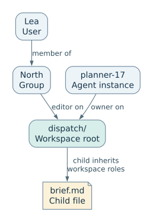
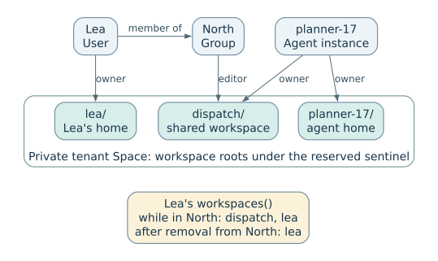
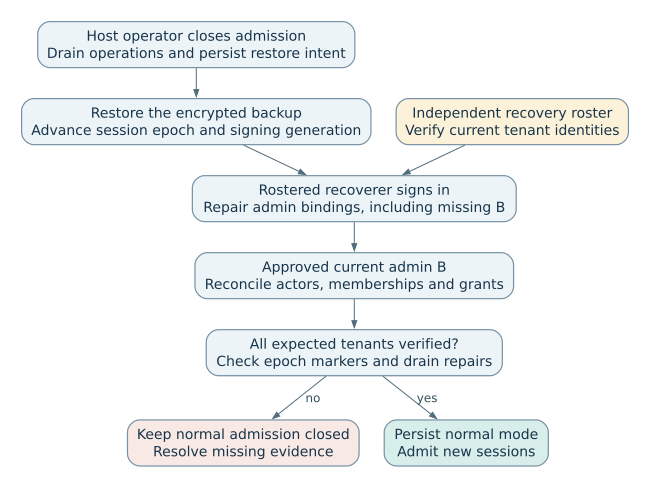

# A Zanzibar-style agent filesystem on phi-spaces

**Status.** Proposed implementation plan, 2026-11-24; file contents moved out of the Space into an encrypted blob store on 2026-11-25. The first release serves persistent files (text or binary, as bytes) to human users and individual agent instances. The acceptance target is a local service on one host with SQLite persistence.

## 1. User journey and design boundary

Lea and the team's planning agent both open `brief.md` in the shared workspace `dispatch`. Lea saves version 4. The agent's attempt to save over version 3 returns a version conflict, so it can read Lea's changes before editing. The tenant administrator then removes Lea from the group North, which gave her editor rights on `dispatch`. A save from her already-open editor must recheck her rights. If North was also her only access to `dispatch`, her next workspace listing must omit `dispatch`, and every path inside it must answer exactly like an absent path.

Two sources shape the design. Zontally describes an agent filesystem built on Zanzibar-style relationships: each authenticated session gets its own home, each operation evaluates relationships afresh, and directory rights are inherited. We adopt an automatically provisioned home for every actor, the inherited directory rights and the separate identity of each agent instance. Google's Zanzibar paper requires that a revocation be respected by every later check, and it motivates the revocation test above. A single authority per tenant gives the first release a tractable ordering guarantee. Multi-host authorization, POSIX mounts, arbitrary user-defined policies, virtual mounts, move and delete are outside its acceptance scope (section 8). [Zontally design](https://www.zontally.com/blogs/technical/why-we-built-a-zanzibar-agent-filesystem) · [Zanzibar paper](https://research.google/pubs/zanzibar-googles-consistent-global-authorization-system/)

**Terms.** A *tenant* is an isolated customer with its own private Space. A *workspace* is a named top-level directory of a tenant. A *home* is the workspace created in the same transaction as its actor, with that actor as its first direct owner. An *actor* is a user or an agent instance. The *tenant administrator* manages actors, groups and workspaces of one tenant. The *host operator* runs the service and manages tenants, keys, backups and limits.

## 2. Application and trust boundary

Create a sibling application under `spaces-files/` (phases 1 to 5 are complete, 2026-11-25; their exit evidence is listed in `spaces-files/README.md`, the operator's procedures in `spaces-files/docs/operator-guide.en.md`). Phase 2 still stored text in the content row with a 10 KiB limit; phase 3 replaced it with the blob store of section 3. Give it its own manifest, typecheck, tests and README. Import the existing public package through `phi-spaces` and its exported subpaths. Keep file semantics in the application. Use the own SQLite store for persistence and the in-memory host for fast contract tests. [Package and service contracts](api.en.md) · [Space client](../spaces/src/client.ts)

**Repository integration.**

- Add `spaces-files` to `APPS` in `checks/roots.mjs`. Then `checks/layering.mjs` keeps the core from naming it, and `checks/package-imports.mjs` requires its `package.json` and holds it to the exported subpaths.
- Add root scripts on the pattern of codemode-forum (`spaces-files`, `spaces-files:dev`, `test:spaces-files`). `checks/root-scripts.mjs` verifies them.
- Do not add the application to `dashboard.apps.json`. The dashboard would expose the tenant Spaces (see below).
- Document the commands in AGENTS.md when the application exists.

**Deliberate deviation.** The other applications run their Space as a process of its own, and on big and nano only the Rust space servers run (R-D12). The pilot instead embeds a TypeScript Space host in the filesystem service and runs only on this machine, without Docker and without a Rust Space server. A separate Space process, a Rust port and a server deployment are later decisions (section 8).


The local deployment runs one filesystem service with an embedded Space host and one SQLite store. That store holds a private named Space per tenant with all metadata: actors, nodes, relations, receipts, audit and, per file, a content row that references its current blob. File contents themselves live in a blob store beside it (section 3, *Contents*): one encrypted file per version, reached only by the service.

- Browser, agent and admin adapters call the operations of section 5. Only the service opens the store.
- Restrict the data directory and the blob directory to the service account.
- No end-user connection, dashboard feed, generic Space tool, event subscription or snapshot endpoint may expose these Spaces. Raw entry access would bypass object authorization.
- The host operator's interface is local and separately authenticated. It offers no file operations.

**Confidentiality boundary.** The local pilot trusts the host operator, the service account and the running host with plaintext. The existing store serializes entry values into SQLite. Filenames, grants, identities and audit rows can occur in the database and its WAL; file contents never do, they are encrypted blobs (section 3, *Contents*). An operation-ID signing key authenticates retry tokens only. Require an encrypted volume for the data directory, the blob directory, WAL, temporary backup staging and swap, and authenticated encryption for every exported backup with the backup key held separately. Restore directly into protected storage. Check these deployment conditions before admitting real data. A logical database copy from the unlocked volume remains readable; a copy of the blob directory alone does not, since its content keys live in the deployment state. Browser and network agent connections require authenticated TLS, including local browser use. Local non-network adapters use OS-protected sockets. Exclude request bodies, credentials and private paths from proxy logs and crash reports. Secrecy from a running host operator is outside the pilot: the service holds the content keys while it runs. [SQLite write path](../spaces/src/store/sqlite.ts)

**Identity.** A trusted session adapter validates the session against the current deployment session epoch and supplies tenant ID, actor kind and stable actor ID. The session carries no workspace: which workspaces an actor reaches follows from relationships alone (section 4).

- For a browser, authenticate through a configured identity provider using an authorization-code flow with PKCE, state and nonce. Validate issuer, audience, expiry and signature on the server. Map the verified issuer/subject pair to a stable user actor through the `(issuer, subject)` binding stored on that actor's FsActor row (section 3). The service finds the candidate tenants through the login index in the deployment state (section 6.6). The index is only a lookup aid: the tenant's FsActor row decides, and it is checked again inside the tenant queue. A tenant selector may choose only among those bindings. Never accept actor or tenant authority from JSON, URL parameters or proxy identity headers sent by the browser.
- Issue a rotated opaque session handle in a Secure, HttpOnly, SameSite cookie scoped to the service. Store its actor, tenant, expiry and deployment epoch server-side. Enforce idle and absolute expiry, invalidate on logout, and check current actor state inside the queue. Require same-origin checks and a session-bound CSRF token on browser mutations, including admin calls. Tenant switching creates a freshly bound session. The security tests exercise two tenants with the same local username.
- **Local development login (decided 2026-11-25).** Without a configured identity provider, a development IdP runs as a process of its own on a loopback address (`spaces-files/server/dev-idp.ts`). The service talks to it through discovery, the code flow with PKCE and a signed ID token like to any provider; it proves nothing, so it never listens beyond loopback, and the service has no login shortcut of its own.
- Bind each agent instance to the pair `(enrolledHostPeerId, agentId)`. The enrolled host peer is authenticated and has the `agentHost` role; it asserts `agentId` as `frame.agent` for one of its conversations. This host assertion is trusted, while a conversation label supplied directly by an untrusted client or a shared agent archetype establishes no identity. [Agent-host contract](m1-mobile.en.md)
- **Checked against the agent-host contract (2026-11-25).** The pair matches the Space principal `{peerId: <host peer>, agentId: <frame.agent>}` of `src/service.ts`. The filesystem service adopts its rules: only a connection with the `agentHost` role and no agent of its own may name an agent, the role is dropped for that call, and `agentId` is 1 to 128 characters of `A-Z a-z 0-9 _ . : -`. Three consequences:
  - The service speaks its own protocol, not the Space protocol, because the tenant Spaces must not be exposed. It therefore reimplements the frame check and does not reuse the Space service.
  - The key proof that authenticates a host peer (`ProvingService`, `startGate`, the enrollment functions) is exported from the package root `phi-spaces`, so the application may use it. The pilot still starts with the simpler local transport: an agent host connects over a local unix socket that the host operator configures for one enrolled host peer and one tenant (decided 2026-11-25: the same identity pair may exist in several tenants, and the socket, not the agent, chooses among them), in a directory only that host's OS user and the service account can reach. File permissions are the whole check: Node.js exposes no peer credentials of a unix socket, so the service cannot verify the OS user itself. A network agent host authenticates with the key proof instead (section 8).
  - **Network agent hosts (decided 2026-11-26).** An agent host on another machine connects over TLS 1.3 to a listener of its own (`spaces-files/server/agent-net.ts`) and speaks the socket frames of phi-spaces with the file operations inside. No overlay names the peer here, so the host names itself in `hello`; that name is worth nothing until a key enrolled for exactly that peer signs the connection's challenge, which carries the claimed peer and the service's ID (`ProvingService`, layer B). Keys live in a control Space of the service's own store (`SpaceKeyDirectory`); the host operator opens an enrollment with `createEnroll` bound to the peer, role `host` and the scope `files:<tenant>` for each tenant the host may act in, and hands the one-time token to the host, which enrolls a new Ed25519 key with it (`EnrollmentService`; the token's hash only is stored, one attempt per peer and minute). The proven peer ID becomes `enrolledHostPeerId`; `frame.agent` names the agent as on the local socket, and `frame.tenant` the tenant, which the key's scope must name. Every file call looks the key up afresh, so a revocation refuses the open connection at its next call. A data restore revokes every host key, like sessions and operation IDs: every host enrolls again.
  - **The Space in a process of its own (decided 2026-11-26).** The tenant Spaces run in a Space process (`spaces-files/server/space-host.ts`) that owns the store, its owner lock and the reaper, and serves phi-spaces' Space service on a unix socket in the data directory (mode 700) to the filesystem service, its only client and peer. It holds no filesystem logic: besides the Space service it answers two requests only the service makes, the creation of a tenant's Space (`t-<tenant>` aliases only) and the store's compaction, as entries in the default Space (`FilesHostRequest`, answered by `FilesHostReply`) that it takes on the store's own thread, so the socket carries the plain Space protocol and the Rust Space process (`files-space`, on `phi-space-host` with a `HostTask`) needs no core change. Admission, the tenant queues, the policy, sessions, receipts and blobs stay in the service, so the single admission owner is unchanged. The service starts the Space process and stops it; the Space process ends when its parent dies (`--exit-with-parent`), and the launcher ends when its Space process does, so the supervisor restarts both. A call that fails in transit is `unavailable`; a commit whose reply is lost is an unknown outcome and closes admission until `resolveOutcomes` (section 6.1), and after a restart the retry with the same operation ID answers from its receipt or applies once. Backups copy the store file directly (`VACUUM INTO`, both processes on one machine). The control Space with the agent hosts' keys stays in the service's own small store in the deployment-state directory (`control.sqlite`), because phi-spaces' pairing commits on a store directly; a data backup therefore no longer carries host keys, a data restore still revokes them, and after a state restore every host enrolls again. The in-process store remains for the tests and for the operator's offline commands (`FILES_SPACE_SERVER=inprocess`); `npm run test:space` runs every suite against the Space process.
  - `remoteSpaces` names each conversation `conversation-<id>` (`conversationAgent`), so by default every conversation is its own actor with its own home. A long-lived agent such as `planner-17` that spans conversations needs its host to assert one stable `agentId` for it; the host decides which conversations act as that agent.
- Each `(issuer, subject)` pair maps to at most one user actor per tenant, including deleted actor tombstones, checked inside the tenant queue on registration. The same pair may be bound in several tenants; each binding is a separate actor.
- Each `(enrolledHostPeerId, agentId)` pair maps to at most one agent actor per tenant, including deleted actor tombstones, checked inside the tenant queue on registration. Session lookup is therefore unambiguous. Two conversations of one host have different agent IDs; equal agent IDs on different host peers have different identities. Re-enrollment after deletion requires a new pair, because neither actor IDs nor identity bindings are reused.
- Every actor has an FsActor row. Unknown, disabled and deleted actors fail closed with `unauthenticated`.
- Select the tenant Space and require its committed initialization before resolving any path or relationship.
- The session table, the login index and the session epoch live in the deployment state outside the restorable data directory (section 6.6). The adapter rejects every session from an older epoch; the host operator advances the epoch on restore, not on ordinary key rotation.

**Provisioning.** Creating the named Space and initializing the tenant are two store commits; phi-spaces does not make them one transaction. The host operator first reserves the named Space, then commits the tenant initialization inside it: FsMeta, the first administrator's FsActor (with the issuer/subject pair the operator supplies) and home root, their `tenant#admin` relation, the home's direct owner relation and the initial FsAudit row. A named Space without the committed FsMeta remains in provisioning and admits no sessions or regular operations. Repeating `createTenant` for that name resumes initialization; after initialization it returns `alreadyExists`.

The recovery-bootstrap exception in section 6.5 uses independently verified authority and the same actor and home invariants. Every later actor registration likewise creates the FsActor, its home root and the home's first direct owner relation in one transaction. The administrator supplies a unique `homeName`; the service generates the root's node ID and stores it as `homeNodeId` on the actor. Home names use the same canonical syntax and uniqueness rules as every workspace name. The home starts private to its actor and remains an ordinary workspace: disabling or deleting the actor does not delete it, and the final-owner rules in section 3 name replacement owners where needed.

Everything else in a tenant goes through the authenticated admin operations of section 5:
- additional workspaces, each with its first enabled direct owner in one transaction;
- group membership and tenant-administrator grants.

## 3. Persistent model and invariants

| Entry | Fields and creation key | Invariant |
|---|---|---|
| FsMeta | tenantId, schemaVersion, formatVersion. Unique creation key (tenantId). | One per tenant Space. The service refuses to open a Space with an unknown version. |
| FsActor | actorKind, actorId, state (enabled, disabled, deleted), homeNodeId; for users issuer and subject; for agents enrolledHostPeerId and agentId. Unique creation key (actorKind, actorId). | Actor IDs are never reused. A deleted actor keeps its row, homeNodeId and identity binding as a tombstone. The pair (issuer, subject) is unique per tenant among user rows and (enrolledHostPeerId, agentId) among agent rows, both checked inside the tenant queue before creation. |
| FsNode | nodeId, parentId, name, kind. Unique creation key (parentId, name). | A workspace root is a directory whose parent is the reserved workspace sentinel, so workspace names are unique per tenant. Every other node has a directory parent. Service-generated immutable IDs identify grant targets and homes. |
| FsContent | nodeId, version, blobId, size, keyGeneration. Unique creation key (nodeId). | Every file has one content row, including empty files. Directories have none. Version starts at 1 and increases on each successful save. The row holds no content: blobId names the encrypted blob of this version in the blob store, size is its plaintext length in bytes, keyGeneration the content key that encrypted it. Each version gets a new blobId; a blob is never rewritten. |
| FsRelation | objectKind, objectId, relation, subjectKind, subjectId, subjectRelation. Unique creation key over all six fields. | Valid combinations are listed in section 4. Use one canonical stored sentinel for a direct subject's empty subjectRelation. |
| FsReceipt | actorKind (user, agent or recoverer), actorId, operationId, argument digest, outcome, expiry. Unique creation key (actorKind, actorId, operationId). | Every successful tenant file or admin mutation, including an idempotent no-op, commits its receipt together with any changed rows and audit row. Expiry is the operation ID's issue time plus the retry window. Persist only the minimum successful result needed to answer a retry. Failed mutations have no receipt and do not consume the ID. Host-operator operations have no tenant receipt. Recovery mutations (section 6.5) use actorKind `recoverer` with an actorId derived from the recoverer's issuer, subject and restore epoch. |
| FsAudit | seq, time, actor, operation, target IDs, operationId, outcome. Unique creation key (seq). | seq increases by one per audit row of the tenant: the single writer reads the highest seq when it opens the Space and assigns the next one inside the tenant queue, and the unique key turns a mistake into a failed transaction, never a duplicate. The oldest row is the one with the lowest seq. A successful tenant file or admin mutation includes its audit row in the same transaction; tenant initialization writes one for the host operator with an empty operationId. After session and actor authentication, a denied administrative operation writes its audit row in a separate transaction containing no object mutation or receipt; refusals of one actor and operation within a window (`deniedAuditWindowMs`, one hour) share one row with a count and the time of the last one (decided 2026-11-25), so asking again and again does not fill the audit. Never holds file contents or names. The host operator sets a maximum retention age. No row is removed before it, and none is ever evicted to make room (budgets below). |

**Contents.** A file is a sequence of bytes; the service neither validates nor normalizes it, and text is a client's reading of those bytes (the browser editor of phase 4 decodes UTF-8 and offers anything else as a download). Contents live outside the Space, in a blob store:
- **Layout.** A blob directory of its own beside the data directory, never inside it or around it, mode 700 for the service account, on the encrypted volume: `<blob dir>/<tenant>/<first two characters of blobId>/<blobId>`. Blob IDs are 128 random bits, never content hashes, so equal files in two tenants or workspaces are not recognizable as equal.
- **Encryption.** Each blob is sealed with AES-256-GCM (`node:crypto`, no new dependency) under a key derived by HKDF-SHA-256 from the content key of its generation and the blobId, with a fresh 96-bit nonce. The associated data binds tenant, nodeId, version and blobId, so a blob copied to another file, version or tenant fails authentication. A missing blob or a failed authentication is `inconsistentState` for that tenant.
- **Content keys.** They live in the deployment state (section 6.6) beside the signing keys but apart from them, in a file readable only by the service account, as numbered generations. New blobs use the newest generation; every generation that a content row still names stays readable. Unlike the signing keys, a restore never retires a content key: retiring one would make every file it sealed unreadable. Losing the content keys loses every file content, so they are part of the deployment state's own backup from their first use. Re-encrypting old blobs under a new generation is later work.
- **Atomicity.** A blob is written before the content row that names it commits and deleted only after a later commit has stopped naming it, so a committed row always finds its blob. A crash in between leaves an unreferenced blob, never a missing one; a sweep removes those (section 6.3).

**Leases and uniqueness.** Use durable entry leases for all of these entries. A transaction's short lease has a different purpose. Generate collision-resistant node IDs and check for collisions inside the tenant queue before creating a node. phi-spaces checks a single declared uniqueness key per write, including against reserved and uncommitted entries. Every creation path, provisioning included, must therefore specify the same key for its type. In-place replacements (`FsContent` version updates and `FsActor` state transitions) reserve the old row with a transactional take and write the successor without a uniqueness check: a check would find the row being replaced. [Uniqueness and transactions](api.en.md)

**Actor lifecycle.**
- Disabling an actor keeps its relations but makes them inert until it is enabled again.
- Deleting an actor removes its relations and leaves the tombstone, in one transaction. If an actor holds more relations than fit in one Space transaction's step or byte budget, `deleteActor` fails with `capacityExceeded`; the tenant administrator disables the actor first (making its relations inert immediately) and revokes excess relations before retrying deletion.
- Both operations refuse with `lastOwner` while the actor is the last enabled direct owner of a workspace root, unless the call names a replacement owner for each such workspace. Each replacement owner must be an enabled direct user or agent instance distinct from the actor being disabled or deleted (never a `group#member`); the replacement is granted in the same transaction.
- Both operations also refuse with `lastAdmin` while the actor is the last enabled `tenant#admin` user.
- The replacement-owner preflight covers every affected workspace root before any row changes. If the required replacements do not fit together with the state transition, the operation fails with `capacityExceeded` and changes nothing. Existing workspace owners can grant replacements in advance through ordinary `grant` calls. Without a cooperating owner, the host operator enters maintenance mode and a tenant administrator uses bounded `maintenancePutGrant` batches (section 5) to install enabled replacement owners while preserving `lastOwner` in every batch. Once no replacements remain in the state-transition transaction, disabling needs only the actor row, receipt and audit.
- After such a disable, group memberships are removed in bounded admin batches and excess file grants in bounded `maintenancePutGrant` batches before retrying deletion. These metadata operations give no file-content access. This runbook covers both the relation-removal budget and the replacement-owner budget rather than assuming that either always fits.

**Budgets and retention.**
- Bound directory size, direct grants per target, the size of one file (`maxFileBytes`), and per tenant the actors, groups, workspaces, nodes, relations and total content bytes (the sum of `size` over the content rows, checked before a blob is written). Configure creation limits so every retained listing remains within its response limit. Ordinary quota failures return `capacityExceeded` and leave admission open.
- Audit retention is bounded by the maximum age alone; there is no row count limit and no eviction. The admission rate bounds the volume: a tenant holds at most *maximum age plus pruning interval* times *the published rate of audit-writing requests* rows. That rate covers mutations, idempotent no-ops and, at most one row per actor, operation and window, denied administrative operations. Reserve that many rows of the largest encoded size in the tenant's storage budget.
- If the audit nevertheless cannot take another row, the operation that would write it fails before any change: ordinary mutations and denied-admin audits with `capacityExceeded`. A young audit row is never deleted to make room. The audit rows of security actions (revocations, membership removal, actor disablement) draw on the security reserve below, like their receipts.
- Limit unexpired receipts by count and encoded bytes per tenant. Budget ordinary mutations separately from a reserved security pool for revocations, membership removal and actor disablement. Charge idempotent no-ops to the ordinary pool. Reserve the security pool, for receipts and their audit rows, and its recovery path for authorized, state-changing removals that pass every other precondition. Check limits before mutation, permit authorized replays without allocating a new receipt, and never evict a live receipt. Publish the retry window, capacity and admission rates together.
- If even the reserve cannot accommodate a required security action, close admission for the affected tenant and return `unavailable`. Persist the closure and the pending security action in the deployment state (section 6.6), alert the operator, and keep the tenant closed across restarts until the action has durably succeeded. Only the operator-assisted, separately authenticated repair path may complete this action while closed. Revalidate the initiating authority, record the repair identity and issue a fresh ID if the original has expired. Recovery may free expired receipts or increase the limit within the physical store budget. Do not substitute a successful reply for a pending action.
- At physical storage failure, fail closed, suspend admission and require operator recovery. Never acknowledge an uncommitted revoke.

## 4. Relationship evaluation

| Object | Relations | Allowed subjects |
|---|---|---|
| tenant | admin | user |
| group | member | user, agent, group#member (nested groups, below) |
| directory, file | owner, editor, viewer | user, agent, group#member |

The three roles on files and directories are ordered:
- An owner can administer grants and has editor rights.
- An editor can modify content and has viewer rights.
- A viewer can read.

A role can come from a direct grant on the object, a grant to a group the actor belongs to, or a grant inherited from any ancestor up to the workspace root. Use the parent recorded on FsNode as the only containment edge. Inheritance stops at the workspace root, and group membership resolves only inside the same tenant. Effective rights are the union of all valid paths. Revoking a tuple removes that source only. The tenant-administrator relation grants no file rights: a tenant administrator who wants to read files needs a grant like anyone else.

Example persisted relationships:

```text
group:north#member@user:lea
directory:dispatch#editor@group:north#member
directory:dispatch#owner@agent:planner-17
```



Read the arrows from actor to file. Lea can edit through North. The planning agent can edit and administer grants through its own owner relation.

**Visibility is decided per workspace.** To reach a node, an actor needs viewer on every directory along its path, starting at the workspace root. Viewer is inherited downward, so viewer on the root already gives viewer on every descendant. It follows that:

- An actor sees either a whole workspace or none of it. A workspace is visible exactly when the actor has an effective viewer role on its root, through a direct or a group grant.
- `list` filters no children except restricted ones the actor does not reach (below): every other child of a visible directory is visible.
- Grants below a workspace root can only raise rights to editor or owner. A viewer grant below the root would be redundant, because anyone who can reach the node already inherits viewer, so the validator rejects it with `invalidInput`.
- An editor or owner grant below the root has no effect while its subject cannot see the workspace. It takes effect if the subject gains access later.
- Private material belongs in a separate workspace, for example the actor's home, or in a restricted child (below).

**Restricted children (decided 2026-11-26).** An owner of a node below a workspace root may restrict it (`restrict`, `unrestrict`; owner on the node, idempotent with a receipt; a workspace root is refused with `invalidInput`, it is a boundary already). The restriction is a marker relation `node:X#restricted@node:P`, P being X's parent, so a single lookup finds every restricted child of a directory; it confers nothing and `listGrants` does not show it. At a restricted node inheritance stops, except for owner:
- The role on a restricted node is the role from grants on it, together with owner if owner was inherited from above. Viewer and editor from above do not pass. Below it, roles inherit again from that role.
- An actor with no role there does not reach the node or anything below it: such a node answers like an absent path for every operation, and `list` leaves it out. The owners of the directories above always reach it, so no restriction can leave a node that nobody reaches as long as its workspace has an owner (the final-owner rule); restricted nodes need no direct owner of their own and `disableActor`/`deleteActor` are unchanged.
- A viewer grant on a restricted node is allowed. A viewer grant below a restricted node is redundant like one below a workspace root (`invalidInput`). Editor and owner grants below a restricted node are inert while the actor does not reach it.
- `list` marks a restricted child the caller reaches (`restricted: true`). The visibility rule above becomes: an actor sees a node when it reaches every boundary on its path (the workspace root and each restricted node), which per boundary means a role on it.
- Names stay unique per directory, so a hidden child's name stays taken. A creation under that name answers `alreadyExists` with the same message whatever the hidden child is (no kind, no version); that a name is taken is all an editor of the directory learns, as with workspace names.
- Restricting narrows access at once: it is ordered in the tenant queue like a revocation, and an operation admitted after it no longer reaches the node. Unlike a revocation it adds a row and is admitted on the ordinary budget, not on the security reserve: with the ordinary budget full, revoke grants instead.



In the journey, removing Lea from North ends all her rights on `dispatch`. `dispatch` disappears from her workspace list, and `brief.md` answers like an absent path. A direct editor grant to Lea on `brief.md` would not change that, because she can no longer see the workspace.

**Final owner and final administrator.** Every workspace root keeps at least one direct owner tuple whose subject is an enabled user or agent instance. An owner grant to a group is allowed but does not count. `revoke`, `maintenancePutGrant` with action `revoke`, disabling an actor and deleting an actor refuse with `lastOwner` when they would break this rule. Likewise, every tenant keeps at least one enabled `tenant#admin` user; `revokeTenantAdmin`, disabling an actor and deleting an actor refuse with `lastAdmin` when they would remove the last one.

**Validation and evaluation budgets.**
- Groups have no separate `FsGroup` entry: a group is identified implicitly by its NFC-normalized, case-sensitive canonical group ID in `FsRelation`, validated for syntax and byte limits like names. A group exists for administration while at least one relation either names it as the membership object or uses it as a grant subject. `listGroups` returns that union. Removing the last member does not remove grants on the group and therefore does not necessarily make it disappear; with no referencing relation, an empty group has no persistent row and is no longer listed.
- Reject unknown relations, invalid subject/object combinations, and unknown or deleted `user`/`agent` subjects before persistence (`invalidInput`). Existing relations of a disabled actor remain stored but inert. Reject paths that leave their workspace.
- Bound path depth and relationship work per decision. Exceeding them returns `capacityExceeded`. The stored quotas are in section 3.
- **Nested groups (decided 2026-11-26).** A group's members may include the members of another group (`group:north#member@group:south#member`). An actor acts as each group it belongs to directly and as every group reachable from those through such rows. The levels are counted from the actor's own groups (1: no nesting) and bounded by `maxGroupDepth` (default 4); all groups an actor reaches count against `maxGroups`, and every lookup against the decision's work. A group met again on its own chain is a cycle: `addMember` refuses it with `invalidInput` (a group as its own member, or a group the new member already contains), and the evaluator treats one found in stored rows as `inconsistentState`. The evaluator walks on past the depth bound, charged and bounded by `maxGroups`, so a cycle is reported before `capacityExceeded`. `addMember` also refuses with `capacityExceeded` when the longest chain through the new edge (the levels below the new member plus the levels above the group) would exceed the bound. Removing a nested group is a membership removal like any other: a security action on the reserve, effective for every actor below it at once.
- Detect repeated parent IDs and missing parents.
- Corrupt graphs produce `inconsistentState`, suspend admission for that tenant pending operator repair, and emit a diagnostic without private paths or contents.
- No decision cache in the pilot.

## 5. Operations

Every tenant file or admin mutation carries an operation ID that the service has issued (section 6.2). Paths are relative to the named workspace. Host-operator operations use the separately authenticated, serialized local interface instead; they do not use tenant-bound operation IDs.

**File operations** (browser and agent adapters):

| Operation | Required effective rights | Contract |
|---|---|---|
| workspaces() | Valid session | Return the names of the workspaces whose root the actor can view, in deterministic name order. Bound the number of workspaces per actor and the response like `list`; no partial success. |
| issueOperationIds(count) | Valid session | Return exactly `count` signed operation IDs for this actor. Writes nothing. A count outside the published inclusive range gives `invalidInput`. Tenant administrators may also use this in maintenance mode. |
| list(workspace, path) | Viewer on the directory | Return the immediate children in deterministic name order, leaving out restricted children the actor does not reach and marking the others `restricted` (section 4). Bound the response and directory cardinality in the pilot. No partial success when a limit is exceeded. |
| read(workspace, path) | Viewer on the file | Return the file's bytes and version from the same ordered operation. |
| write(workspace, path, bytes, expectedVersion, operationId) | Editor on parent for version 0, editor on existing file for positive versions | Version 0 means create only. A positive expected version must match. Return the committed version. No implicit parent creation. |
| mkdir(workspace, path, operationId) | Editor on the parent | Create exactly one directory. An existing child of either kind gives `alreadyExists`. |
| grant(workspace, path, relation, subject, operationId) | Owner on the target | Add one validated tuple for an existing non-deleted user, agent or canonical group#member subject. An identical existing grant succeeds idempotently and records a receipt and audit row. |
| revoke(workspace, path, relation, subject, operationId) | Owner on the target | Remove that exact tuple. A tuple that is not present succeeds idempotently and records a receipt and audit row. Preserve the final owner (section 4). |
| listGrants(workspace, path) | Owner on the target | Return the direct relation tuples on that target in deterministic order. Bounded like `list`. |
| move(workspace, path, toWorkspace, toPath, operationId) | Owner on the node, editor on its parent and on the destination's parent | Move or rename a file or directory, within its workspace or into another of the tenant (below, *Move and delete*). |
| remove(workspace, path, expectedVersion, operationId) | Editor on the node and its parent; owner on the root for "." | Remove a file or an empty directory, or with "." an empty workspace that is no live actor's home (below). |
| listPage(workspace, path, cursor, limit) | Viewer on the directory | One page of `list` in name order, at most `maxListPage` entries, with the cursor of the next page or null (below, *Scale*). |
| restrict(workspace, path, operationId) / unrestrict(…) | Owner on the target | Set or lift the restriction of a node below its workspace root (section 4, restricted children). Idempotent with a receipt and audit row; a workspace root gives `invalidInput`. |

**Move and delete (decided 2026-11-26).**
- *Rights.* `move` needs owner on the moved node (its new place decides who inherits access to it, an access decision), editor on its parent (an entry leaves it) and editor on the destination's parent (an entry arrives). `remove` needs editor on the node and on its parent; removing a workspace (path ".") needs owner on its root.
- *Stable IDs.* A moved node keeps its node ID, so its versions, blobs (bound to tenant, node and version, never to a path), the grants on it and its restriction stay with it; the restriction marker is rewritten to name the new parent in the same transaction. What the node inherits changes with its new place in the same commit: an operation admitted after the move resolves it under its new ancestors only, so an inheritor of the old place loses it at once (and an open editor's save to the old path answers `notFound`), while a grant on the node itself keeps working where the node is visible.
- *Refusals.* A workspace root does not move and nothing takes a root's place (`invalidInput`); a destination at or below the moved directory, found by walking the destination's ancestors, is `invalidInput`; a taken destination name is `alreadyExists` (with the message of a hidden restricted child, so the kind is not told). A move deeper than before measures the subtree: if the new depth of its deepest node would exceed `maxPathDepth`, or the subtree holds more than `maxMoveDirs` directories (default 256, then it moves in parts), the move is `capacityExceeded`. Moving a node to where it is succeeds as a no-op with a receipt.
- *Removal.* `remove` takes a file or an empty directory; a directory with children, hidden restricted ones included, is `invalidInput` (an editor learns that something is there, nothing more). With `expectedVersion` a newer version of the file is `versionConflict`. The node row, its content row, every relation on it (grants, the restriction marker) and the receipt commit in one transaction, and the blob is deleted after the commit; a crash after the commit leaves the blob as an orphan the sweep removes. The freed content bytes leave the tenant's quota.
- *Workspaces.* A workspace is removed with "." when it is empty and is no enabled or disabled actor's home: a home goes with its actor's deletion. Its root's grants go with it; the name is free again.
- *Retries.* Both authorize a retry by the parents, which stay in place, and then answer from the receipt, so a lost reply is recovered after the node has moved or gone. A removed workspace has no parent: its remover's receipt answers the retry.
- No new error code: the refusals use `invalidInput`, `alreadyExists`, `versionConflict`, `capacityExceeded`, `notFound` and `permissionDenied`.

**Scale (decided 2026-11-26).** Measured first with the workload fixture (operator guide, section 8): traversal costs about 3.5 lookups per directory level (85 at depth 24, against a budget of 512); queue wait follows the callers per tenant, and many busy tenants lengthen each other's run time through the shared store.
- *No decision cache.* The traversal is cheap at the measured depths, and a cache would need an invalidation that sees every revocation, membership removal, restriction and move before the next admitted operation. Section 4's "no decision cache" stays.
- *Paginated listings.* `list` stays one reply and refuses a directory larger than `maxListPage` with `capacityExceeded`. `listPage` returns at most `maxListPage` entries in name order and a cursor. Every page is an operation of its own: it resolves the path and the caller's access afresh in the tenant queue, so after a revocation, a restriction or a move away the next page answers `notFound` like a first call. The cursor is the last name returned with a MAC over the tenant, the actor, the directory's node ID and that name, keyed per process: another actor's or another directory's cursor, a changed one and one from before a restart are `invalidInput` ("list from the start"). A page holds the names after the cursor as they are when it is read. `maxDirEntries` may then exceed one reply; each page still reads the whole directory, so it stays in the thousands.
- *A store per tenant* is not introduced: the measurements show the shared store lengthening run times only with many busy tenants at once, below the latencies the pilot accepts. The operator guide says which counter shows when that changes.

**Virtual files (decided 2026-11-26).** A deployment may mount read-only providers; each appears as a workspace named `@<name>`. Workspace and home names starting with `@` are reserved: `createTenant`, `provisionActor`, `registerActor`, `createWorkspace` and `recoveryProvisionAdmin` refuse them with `invalidInput`, so a mount never shadows stored data.
- *Binding.* The service resolves the session in the tenant queue, reads the caller's verified binding from its FsActor row (tenant, actor kind and ID, issuer and subject or enrolled host peer and agent ID), and hands a provider that binding and a deadline signal, nothing else: no session, no Space, no service rights. The provider enforces the source application's permissions for that identity, so a mounted file is never more visible than the source lets that identity see; the service account's own view of the source plays no part.
- *Visibility.* `workspaces()` lists a mount when its provider says the binding sees it. `list`, `listPage` (one page) and `read` on a mount ask the provider; an unknown mount, one the binding does not see, and a path the provider does not show answer `notFound`, like absent stored paths.
- *Read-only.* Every mutation and every grant operation on a workspace starting with `@` answers `permissionDenied`, whether the mount exists or not.
- *Timeout and freshness.* Provider calls run outside the tenant queue, so a slow source never holds a tenant's other operations. Each call has the deadline `mountTimeoutMs` (default 5 s): a late call is `unavailable` and its signal aborts; a mount that does not answer in time is left out of `workspaces()`. Nothing is cached: every call reads the source as it is then, and a file's version is the source's (the directory provider uses the modification time).
- *Failing closed.* A provider's failure is `unavailable` and says nothing about the source; a listing beyond `maxListPage`, a non-canonical or duplicate name, an unknown kind, a file beyond `maxFileBytes` or a malformed reply is refused the same way.
- *The first provider* is a directory of the host (`server/mounts.ts`, configured by the host operator in `FILES_MOUNTS`): its access table maps identity keys (`<tenant>/user:<issuer> <subject>` or `<tenant>/agent:<host peer> <agent ID>`) to the paths below its root they may see, standing in for a source application's permissions. It shows the way down to an allowed path and nothing beside it, never follows a symbolic link and never leaves its root.

**Admin operations** (admin adapter; they require `tenant#admin` and pass through the tenant queue; mutations carry operation IDs like file mutations):

| Operation | Contract |
|---|---|
| createWorkspace(name, owner, operationId) | Create an additional workspace root and its first enabled direct user or agent owner in one transaction. An existing workspace name gives `alreadyExists`; an unknown, deleted or disabled owner gives `invalidInput`. |
| registerActor(kind, actorId, homeName, identity, operationId) | Create an enabled FsActor, its private home root and its first direct owner in one transaction, then add the tenant to the login index (section 6.6). `identity` is the verified issuer and subject for users, or enrolledHostPeerId and agentId for agents. An existing (actorKind, actorId), homeName or identity pair gives `alreadyExists`. |
| disableActor / deleteActor(actor, replacementOwners?, operationId) | As in section 3. Preserve `lastOwner` and `lastAdmin`. Unknown or deleted target actors give `invalidInput`. Disabling an already disabled actor with no replacements is a successful no-op; supplying replacements in that state gives `invalidInput`. |
| enableActor(actor, operationId) | Enable an existing disabled actor. An already enabled actor is a successful no-op; an unknown or deleted actor gives `invalidInput`. |
| grantTenantAdmin / revokeTenantAdmin(user, operationId) | Grant or revoke `tenant#admin` for an existing non-deleted user. Both are idempotent; `revokeTenantAdmin` preserves the last enabled administrator (`lastAdmin`). |
| addMember / removeMember(group, subject, operationId) | Add or remove one membership tuple for an existing non-deleted user or agent. Both are idempotent. |
| listWorkspaces() / listActors() / listGroups() / listGroupMembers(group) | Read-only inspection in deterministic order so a tenant administrator can manage the tenant without holding file rights. Bounded like `list`. |
| maintenanceList(workspace, path) / maintenanceListGrants(workspace, path) | Maintenance mode only. Return node names, kinds and direct grant metadata without requiring viewer or owner and without returning file contents or versions. Resolve an absent path as `notFound`; bound and order like the ordinary listings. |
| maintenancePutGrant(workspace, path, action, relation, subject, operationId) | Maintenance mode only. Add or remove one direct tuple by tenant-administrator authority, without granting file-content access. Apply ordinary subject, relation and redundant-viewer validation and preserve `lastOwner`. Both actions are idempotent and record a receipt and audit row. Use this for restore reconciliation and the bounded actor-lifecycle fallback in section 3. |

The maintenance metadata operations are unavailable in normal mode. During restore, the independent authority gate in section 6.5 also applies. In maintenance mode, ordinary file operations except `issueOperationIds` are unavailable to everyone; an enabled tenant administrator can use admin operations, the maintenance metadata operations and `issueOperationIds`. This is a recovery exception to object-level grant administration, not an additional file role and not a way to read or write text.

**Host operator operations** (local interface, no file access): create or resume initialization of a tenant with its first administrator and home, configure limits, rotate the signing key, request a barriered transition to or from maintenance mode, back up and restore the store (section 6.5), advance the deployment session epoch on restore, and mark a tenant reconciled for that epoch after its administrator reports completion. Serialize these operations on the local interface. Tenant initialization follows the two-commit procedure in section 2. Reconciliation markers live in durable deployment configuration outside the data backup and are keyed by tenant and session epoch.

**Order of checks.**
1. Authenticate the session handle against the session table in the deployment state, outside every tenant queue: a missing, invalid or expired handle, or one from an old session epoch, gives `unauthenticated`. Only this step selects the tenant. Requests without a valid handle never enter a tenant queue; one global bound limits them before authentication.
2. Admit the request into that tenant's queue (full queue or suspended admission -> `unavailable`), then check the actor's current FsActor state inside the queue (unknown, disabled or deleted actor -> `unauthenticated`).
3. Apply the admission mode. In normal mode, maintenance metadata operations give `unavailable`. In maintenance mode, only an enabled tenant administrator's admin operations, maintenance metadata operations and `issueOperationIds` continue; every other authenticated request gives `unavailable`. Restore also requires approval from outside the backup (section 6.5).
4. Validate input syntax (malformed path, unknown relation, malformed subject, redundant `viewer` grant below the workspace root -> `invalidInput`).
5. For mutations, check the operation ID's signature, actor/tenant binding, key generation and retry window (-> `operationIdRejected`).
6. For `mkdir` and create-only `write`, resolve and authorize the existing parent directory first (creation branch below). Otherwise resolve the target and evaluate required rights: for ordinary file operations, resolve the workspace and path with traversal and check effective rights (missing or invisible workspace/path -> `notFound`; visible target without the required role -> `permissionDenied`); for admin and maintenance metadata operations, verify `tenant#admin` (-> `permissionDenied` in normal mode for an admin operation). Maintenance metadata paths do not require object visibility. A corrupt containment graph gives `inconsistentState`.
7. For mutations, look up a receipt. A matching argument digest returns the recorded successful outcome; a different digest gives `requestMismatch`. If there is no receipt, continue: an earlier failed attempt did not consume the ID.
8. Check object-dependent preconditions: node kind and actor state (`invalidInput`), existing objects and identity bindings (`alreadyExists`), expected version (`versionConflict`), subject existence for grants/memberships (`invalidInput`), final-owner/final-admin invariants (`lastOwner`/`lastAdmin`), and budgets (`capacityExceeded`).


**Creation branch.** For `mkdir` or `write(expectedVersion=0)`, an absent or invisible workspace or parent yields `notFound`. A visible parent of the wrong kind yields `invalidInput`; a visible parent directory without editor rights yields `permissionDenied`. Once authorized, check the receipt, then look up the final name. A free name permits creation of the node and any initial content atomically. For a collision, use the operation-specific errors below. An existing file's current version is disclosed only to a caller with current editor rights on it (editor on its parent is inherited). A positive expected version always uses the existing-file branch. For a replay of a creation request, current parent authorization still precedes receipt disclosure.

For ordinary operations that require an existing target, a target that is missing or invisible gets the same error (`notFound`), including an unknown or invisible workspace. Object-dependent errors (wrong node kind, `alreadyExists`, `versionConflict`) are reported only after the target has proved visible. Maintenance metadata operations are the explicit reconciliation exception and report only absence, never invisibility.

**Errors.**

| Code | Meaning |
|---|---|
| unauthenticated | Missing, expired or invalid session, an old session epoch, or unknown, disabled or deleted actor. |
| notFound | For ordinary file operations, the workspace or target is absent or invisible and the cases are indistinguishable. For maintenance metadata operations, the authorized metadata target is absent. |
| permissionDenied | In normal mode, the target is visible but the caller lacks the editor or owner role, or an admin caller lacks the admin role. |
| invalidInput | Malformed path, unknown relation, invalid/unknown/deleted subject, invalid actor state transition, redundant viewer grant, or wrong node kind (for example `read` on a directory, or `write` with a positive version on a directory). |
| alreadyExists | `mkdir` on a visible existing name of either kind, `write` with version 0 on a visible existing directory, a duplicate workspace or home name, a duplicate (actorKind, actorId), or an already bound agent identity pair. When `write` with version 0 hits a visible existing file, it reports `versionConflict` with its current version instead. |
| versionConflict | The expected version does not match (including `write` with version 0 on an existing file). The reply carries the current version. |
| lastOwner | The operation would leave a workspace root without an enabled direct owner. |
| lastAdmin | The operation would leave a tenant without an enabled `tenant#admin` user. |
| requestMismatch | The operation ID already has a successful receipt with a different argument digest. Failed attempts have no receipt and do not consume an ID. |
| operationIdRejected | The signature is invalid, the ID belongs to another actor or tenant, its key generation is retired, or its issue time lies outside the retry window. |
| capacityExceeded | A configured byte, depth, cardinality, transaction, quota or work limit is exceeded. |
| inconsistentState | A durable containment or schema invariant is corrupt. Reveal no target details, suspend the affected tenant and emit an operator diagnostic. |
| unavailable | The queue is full, admission is suspended (section 6.1), or the admission mode does not offer the requested operation (section 6.5). The reply carries a retry delay where retrying can help. |

**Paths and contents.**
- Accept relative paths only, through a single canonical parser shared by the adapters. A lone dot means the workspace root, for `list`, `grant`, `revoke`, `listGrants` and the maintenance metadata operations.
- Reject absolute paths, empty segments, dot components elsewhere, parent components, backslashes and control characters.
- Look up and uniquely write names in NFC-normalized, case-sensitive form. Apply the same normalization to workspace names, home names and group IDs before computing uniqueness keys or request digests.
- Store file contents as the exact bytes received; never decode, normalize or validate them. Limits on contents are byte counts (`maxFileBytes`, the tenant's content quota). An adapter that carries contents as JSON uses base64; the browser editor's text is its UTF-8 encoding.
- The HTTP adapter carries paths in JSON and never URL-decodes them a second time.
- Specify and test byte limits for names, paths, listings and replies against the configured Space limits before freezing the API. File contents do not pass through Space entries, so the Space limits do not bound them; `maxFileBytes` does.

## 6. Ordering, retries and recovery

### 6.1 Admission and the store

1. **One writer process.** The own SQLite store already holds an exclusive owner lock beside the store file while it is open (`spaces/src/store/sqlite.ts`): a second process is refused, and a crash releases the lock. The service relies on that lock. Phase 1 proves both properties with the service itself.
2. **One queue per tenant.** All adapters, provisioning, membership changes and maintenance metadata writes of a tenant pass through one bounded queue. Inside the queue the service validates, resolves, evaluates rights and reads, and it holds the slot until the read result is fixed or the write transaction reaches a known outcome. A read reads and authenticates the whole blob inside the slot, so a later save cannot delete it under the reader; `maxFileBytes` therefore also bounds the memory of one read. After a revoke or a membership removal is acknowledged, every operation admitted later sees the new relationships. Bytes delivered earlier cannot be recalled.
3. **Queues give order and fairness, not fault isolation.** All tenants share one store and one writer. If a commit's outcome is unknown, the service suspends admission for every tenant. It resumes only after it has resolved the transaction or reopened the store and checked the receipt. Run `startService` on the embedded host so the reaper clears abandoned transaction reservations after a crash; abandoned reservations must resolve or expire before a conflicting mutation runs. Callers meanwhile receive `unavailable`. Success is never acknowledged before the durable commit. Corruption reported as `inconsistentState` suspends only the affected tenant and requires operator repair rather than automatic readmission.
4. **Store compaction and live-data quotas.** Deleted receipts, pruned audit rows and replaced content rows leave free pages in the SQLite file; a deleted blob frees its space at once. Schedule periodic `OwnStoreHost.compact()` calls under host-operator control to reclaim those pages. Compaction does not bound live data: the per-tenant actor, node, relation, workspace, content-byte, receipt and audit limits in section 3 (budgets and retention) do that.

**Global admission barrier.** The process has one gate above all tenant queues. Serialize transitions with the local operator interface. Persist the transition intent in the deployment state (section 6.6), close admission to new operations, and reject queued operations that have not started with `unavailable`. Drain every already-started read or mutation to a known outcome across all tenants. Persist the destination mode before acknowledging the transition. Recheck the gate when dequeuing. Restart with a pending transition, restore intent or unknown commit starts closed and resolves outstanding work before serving the permitted mode. A clean shutdown marker or equivalent durable dirty-start protocol must cover a crash before an unknown outcome can be recorded. For an ambiguous commit, close the gate immediately, track every in-flight transaction, resolve outcomes against durable state and receipts, and wait for reservations to clear. A maintenance or restore acknowledgement requires zero unresolved operations. Leaving restore maintenance additionally requires the reconciliation markers of section 6.5.

### 6.2 Operation IDs and receipts


- An operation ID is signed by the service over the tenant, actor kind and ID, issue time, key generation and a random nonce. Signing keys, their generation numbers and retirement times, and the deployment session epoch live in the deployment state (section 6.6) outside the data directory, readable only by the service account and updated atomically before the service continues. Restoring a backup therefore rolls back neither keys nor the session epoch.
- The service publishes a retry window. It rejects IDs whose issue time is at least one window old, or later than the service clock plus a small allowed skew, before any receipt lookup.
- Use one nondecreasing effective time for issuance, verification, key retirement and cleanup. Keep a durable time floor outside the restorable store. Before using a later time to invalidate an ID or remove its receipt, persist that floor atomically and durably. Serialize advances across tenants and signing operations. At startup and on each decision use at least the durable floor and the process high-water mark. Issue IDs only against this same clock. At or after the expiry instant reject the ID before lookup; only then may cleanup remove its receipt. A large unexpected clock jump suspends issuance and cleanup pending operator review. Never lower the floor on restart or restore.
- On rotation, each retired generation gets a persisted `validUntil` at least one retry window after its last permitted issuance. Verification accepts every generation whose own `validUntil` has not passed, not just the immediately previous one, so two rotations within one window cannot prematurely invalidate an ID. Restarting during a rotation reloads the same generation set and times. Restore is different: it installs a fresh generation and immediately retires every earlier one.
- For every mutation, compute the argument digest as SHA-256 over the canonical byte encoding of the operation name and its semantic arguments. Include normalized workspace, path and subject fields, the SHA-256 of the exact content bytes (not the bytes themselves), expectedVersion, action and replacementOwners; sort replacement-owner mappings by workspace node ID before encoding. Thus equal normalized requests have equal digests, while using the same ID for another operation or argument list is detectable.
- Only a successful mutation, including an idempotent no-op, creates a receipt and consumes the ID. A matching retry returns that successful outcome. A successfully consumed ID with a different argument digest returns `requestMismatch`. A failed attempt creates no receipt; within the original ID's validity window it may be retried with corrected or different arguments without producing `requestMismatch`.
- A receipt expires at the ID's issue time plus the window. A maintenance task in the tenant queue deletes expired receipts and prunes audit entries past their maximum age in bounded batches, lowest seq first. Audit rows are removed only this way. Since expired IDs never reach the lookup, deleting their receipts cannot let a duplicate through.
- **Retry after a revocation.** A replay must pass the current authorization before it learns anything. Suppose a write committed, its reply was lost, and the caller then lost access. The retry returns `notFound` or `permissionDenied`, and the committed version stays undisclosed. The caller learns the outcome only by reading the file after regaining access. This is intended, and phase 3 tests it.

### 6.3 Saving an existing file


A retry may still carry the old expected version after the first save succeeded. Because the receipt is checked before the version, an authorized caller recovers the committed result instead of a conflict.

1. Run steps 1 to 5 of the order of checks in section 5: authenticate the session, admit the request into the tenant queue, check the actor, the admission mode and the input, and check the operation ID (section 6.2).
2. Resolve the path and evaluate editor rights.
3. Look up the receipt. If its digest matches, return the recorded version. If it differs, return `requestMismatch`.
4. Compare the expected version with the stored one. A stale version returns `versionConflict` with the current version. The editor keeps the user's draft. Check `maxFileBytes`, the tenant's content quota and the other budgets.
5. Only now write the new blob under a fresh blobId: seal it into a temporary file in its target directory, flush it to disk, rename it to its name and flush the directory.
6. In one leased Space transaction, reserve the old content row with a take, verify the reservation, write the successor naming the new blob, the receipt and the audit entry, and commit. Abort on a missing expected row or any failed step. A take inside a batch can return a miss without throwing, so an unconditional batch cannot implement a version precondition by itself. [Batch semantics](api.en.md)
7. After a durable commit, delete the old blob, still inside the slot. After a failed commit, delete the new one. If the commit's outcome is unknown, delete neither and proceed as in section 6.1; the resolution keeps the blob the content row names. A retry after a lost reply produces exactly one version increment.

Every check runs before the blob is written, so a refused save writes nothing. A crash between steps 5 and 7 leaves a blob no content row names. A sweep in the tenant queue deletes such blobs in bounded batches: inside the slot no save of that tenant is in flight, so every blob the tenant's content rows do not name is an orphan. The sweep pauses while a backup runs (section 6.5) and while a commit outcome is unknown. Creating a file (`write` with version 0) follows the same order with the new node and its first content row in one commit.

### 6.4 Revocation with an open editor


In this example North membership was Lea's only access path, and no other writes intervene. The editor still holds the text it read before, but its next save needs a fresh decision. Because the whole workspace is now invisible to Lea, the save answers `notFound`, not `permissionDenied`.

### 6.5 Backup and restore

Take backups cleanly for SQLite WAL: either use SQLite's online backup API while the service runs, or shut down cleanly, checkpoint and close the store before copying it. Merely stopping or killing the process does not make the main database file a sufficient copy while a WAL still contains committed pages. Never copy a live WAL database file directly. The deployment's signing state and session epoch are deliberately outside this data backup.

The data backup also holds the blob directory. Pause every blob deletion (after-commit deletion and the sweep) first, take the store backup, then copy the blob directory, then resume. Blobs are never rewritten, so the copy holds every blob the store copy names, plus perhaps a few newer ones that the sweep removes after a restore. Before a restored tenant is admitted, check that every content row's blob exists; a missing one is `inconsistentState` for that tenant. The content keys stay in the deployment state and its backup; a restore never retires them (section 3, *Contents*).



**Recovery authority.** Maintain an operator-approved recovery roster outside the restorable database. Bind each tenant to current, independently verified human issuer/subject identities. Changes to the roster use the separately authenticated host-operator interface and an external operator audit. Ordinary tenant-admin grants never update this roster implicitly. Before each restore, verify the roster and the current intended administrator list against the tenant's independent identity authority. If authority or identity cannot be verified, keep admission closed.

**Pilot authority check (decided 2026-11-25).** In the local pilot, two host-operator steps count as the independent verification: the roster entry (`roster-add`), checked against the tenant's identity provider out of band, and the approval of one rostered identity as a tenant's reconciler for the restore epoch (`approve-reconciler`). The service makes no automated query of the identity provider. Recoverers sign in through the same OIDC flow on a path of their own (`/recovery/login`) under a cookie that no ordinary route reads, and the roster alone admits them.

1. Enter the global barrier, persist a restore intent, stop the service and verify the encrypted backup. Install the backup on protected storage with stale WAL sidecars excluded. Restore evidence, the recovery roster, the time floor and the transition journal are kept outside the data backup. Durably advance the session epoch and signing generation, retiring every earlier generation immediately. Journal these steps outside the backup so a restart resumes the same restore closed.
2. Open a restricted recovery interface. Only independently rostered recoverers authenticated in the new epoch can enter it. It authorizes bounded, audited metadata repair for their tenant even if their actor or admin row is absent in the backup. It gives no file, version or ordinary session access. Attribute its actions to the external identity and restore epoch in the external audit. Every recovery mutation carries a recovery operation ID that this interface issues and signs with the new generation, bound to the recoverer's issuer, subject, tenant and restore epoch. It commits an FsReceipt with actorKind `recoverer` and an FsAudit row in the same transaction as its repair, using the same digest, window and replay rules as section 6.2. A repeated recovery step is therefore answered by its receipt instead of being applied twice, and an ID from another restore epoch is rejected. Ordinary backed-up admins cannot use this interface.
3. Reconcile admin and actor bindings with current evidence. If today's administrator B is missing, the recoverer provisions B and B's home using registration invariants, or resolves identity/name conflicts under operator review. Establish an enabled current admin before removing obsolete A to preserve the last-admin invariant. Bind the approved reconciler to B's verified identity outside the store for this restore epoch. Only this approved, enabled tenant admin may obtain fresh tenant operation IDs and use maintenance metadata operations. A restored admin grant alone never permits maintenance access during restore.
4. Reconcile grants, membership, actor states and identity tombstones against current evidence independent of the backup. When evidence for a restored grant is missing, remove it or keep the tenant closed. Respect owner and admin invariants throughout. Verify the current tenant inventory too and handle missing or unexpected tenants explicitly before reopening.
5. The operator records completion per tenant and epoch outside the backup. The global barrier opens regular admission only after all required tenants are reconciled and in-flight recovery mutations have drained. Persist completion and the new normal mode before acknowledging. A restart before completion stays closed to ordinary calls.

Rehearse a restore where A was the administrator in the backup, B is the current administrator and absent from it, and a revoked user still has an old session and a pending retry. A fresh login by A grants no recovery or maintenance authority. B can reconcile grants after independent approval. Verify stale session and old-ID rejection after reauthentication, hidden paths after normal readmission, and restart at each restore step. Exercise the bounded actor-lifecycle fallback of section 3 separately in ordinary maintenance.

### 6.6 Deployment state

Several facts must survive a restore of the data store unchanged, so they cannot live in it. They form the *deployment state*, a second durable store of the service:

| Content | Why outside the data store |
|---|---|
| Signing-key generations with `validUntil`, the session epoch, the durable time floor | A restore must never roll them back (section 6.2). |
| Content-key generations (section 3, *Contents*) | A data backup copied alone must not be readable, and a restore must never retire a key that sealed a blob. |
| Session table (handle, tenant, actor, expiry, epoch) and login index (issuer/subject → tenants) | Steps 1 and 2 of the order of checks run before any tenant queue (section 5). |
| Admission mode, transition journal, restore intent, per-tenant reconciliation markers | The global barrier and a restore must resume closed after a crash (sections 6.1 and 6.5). |
| Recovery roster and external operator audit | Restore authority must not come from the backup (section 6.5). |
| Closed tenants and their pending security actions | They stay closed across restarts (section 3, budgets). |

- **Form.** A plain SQLite database (`node:sqlite`, tables rather than Space entries, since nothing here needs Space semantics) in its own directory, never inside the data directory or around it. The service opens it with an exclusive owner lock like the data store's and commits with `synchronous = FULL`. Session handles are stored only as SHA-256 hashes. Key material lives beside it in a file readable only by the service account; the store holds generation numbers and times. Its directory gets the same encrypted volume as the data directory.
- **Writes.** Each change commits durably before the service acts on it or acknowledges it: a new key generation before the first ID is signed with it, a time floor before an expiry decision, a mode before the transition is acknowledged.
- **Steps that touch both stores.** The authoritative change commits first, and the dependent one must be safe to repeat. `registerActor` commits the FsActor row and then adds the login-index entry; startup rebuilds the index from the FsActor rows of all tenants, and it is only a lookup aid anyway (section 2). A restore or mode transition commits its intent in the deployment state before it touches the data store.
- **Backup.** The deployment state has its own encrypted backup with its own key, taken after every signing- or content-key generation, epoch change, roster change and reconciliation marker. It is never part of a data backup, and restoring the data store never touches it.
- **Loss.** If the deployment state is lost or older than its last backup, the service refuses to start. The host operator restores it from its own backup, then advances the session epoch, installs a new signing generation, retires all earlier signing generations (never a content key), and raises the time floor to at least the latest known value. The operator then runs the reconciliation of section 6.5 for every tenant.

### 6.7 Replicas (specified 2026-11-26)

A replica takes over a deployment whose primary is lost. Single-owner admission stays: at every moment one service process admits operations, and a replica admits nothing until it has been promoted. Relaxing that (two admitting processes, or several authorities) is not part of this design.

- **What is replicated, and how.**
  - The store of the tenant Spaces is the primary of phi-spaces' primary/sync journal (`primarySyncStorage`, `durability: sync`): each commit is sealed, accepted by the standby's journal and only then applied and answered. An answered commit is therefore on the standby. A commit whose reply is lost is the unknown outcome of section 6.1, on the primary or after a handover.
  - The deployment state (sessions, signing and content keys, epoch, roster, restore journal, operator audit) reaches the standby with the same guarantee before the operation it changes is answered (`spaces-files/server/standby.ts`, decided and built 2026-11-26). Without its signing keys the standby would refuse every operation ID, and without its content keys every blob would be unreadable. Every transaction of the state is one numbered unit: SQLite's changeset of that transaction (node:sqlite sessions; every table has a primary key, and a test compares every table after a mix of every kind of change) and, ahead of it, a key file written with it. The transaction commits locally, then the standby applies the unit in one transaction of its own. A gap, a conflict or a fenced standby refuses it. A unit the standby does not confirm poisons the state: the operation fails with `unavailable`, admission closes, and nothing more is written until a restart seeds the standby anew. The primary seeds its standby on every open from a snapshot, so a write made without it (an offline operator command, a restore) never leaves the two apart unnoticed.
  - The blobs are written to the standby before the content row's commit (a save already writes its blob before the commit, section 6.3); a blob the standby does not take fails the save before its commit. Deletions follow as best effort; a blob left on the standby is an orphan for its sweep after a promotion. Every open copies the blobs the standby lacks.
  - The control Space of the agent hosts (`control.sqlite`) is not replicated: after a promotion every agent host enrolls again, as after a restore. This fails closed.
  - Promotion writes a marker into the standby's state and blob directories (`promoteStandby`) before the service opens on them. From then on the old primary can neither seed nor write them, and its next state write poisons it.
  - The standby is a pair of directories the primary reaches (another disk, a mount), or a process of its own on another machine (`server/standby-host.ts`, built 2026-11-26) that keeps them and takes the same two interfaces (`StateReplica`, `BlobReplica`) over TLS 1.3 with mutual authentication (`server/standby-net.ts`, launcher `FILES_STANDBY`): the standby serves only a client certificate its CA signed and one primary at a time, and the primary pins the CA of the standby's certificate. Calls go one at a time in order, so a unit never overtakes the blob or unit before it. A state transaction is synchronous, so the client keeps its connection in a worker thread and the service's thread waits for the confirmation with a bound; after a timeout the replica stays broken (a late answer would leave the order unknown) until the next open seeds it anew. Promotion there: stop the standby process, `operator promote-standby` on its directories, start the service on them.
- **Fencing and promotion.** Promotion follows phi-spaces' replica control: the old primary is fenced by a fencing adapter with a verified proof (`promote`, `degradeToSingle`, docs/federation-plan-v3.en.md 5.3). The standby materializes the accepted history (`materializeSyncHistory`) and seals a configuration transition with a new `primaryEpoch` and itself as primary. A fenced primary seals nothing more. The old primary rejoins only as a new standby (`setStandby`), never with its own unconfirmed tail.
- **Causal revision tokens and minimum-revision reads.** Every Space call already answers with the Space's revision. A client that needs to read its own write after a handover (a browser after a save, an agent host after `fs_write`) carries the revision it last saw. A service that has not reached that revision answers `unavailable` until it has, instead of serving an older state. With one admitting process and sync durability a promoted standby is never behind an answered commit, so this check matters only once replicas serve reads, which this design does not do.
- **Recovery after a handover.** The promoted service opens like a restarted one: a tenant waits until transactions of the dead process have lapsed (section 6.1), retries are answered from their receipts (section 6.2), and sessions and operation IDs stay valid because the deployment state came along. A revocation answered before the loss is in the replicated history, so it holds.
- **Acceptance gate.** `spaces-files/tests/replica-handover.test.ts` runs the handover in one process on two store files and journals. A revocation commits; a save commits and its reply is lost; the primary is killed and fenced; the standby materializes and is promoted under epoch 2; the service opens on it. There the revocation holds, the save is there before its retry, and the retry answers from its receipt without applying twice. The fenced primary commits nothing more. The fence in this test is a flag the primary's journal checks, and the promotion is a direct configuration transition, not phi-spaces' `promote` with a fencing adapter and its register. The deployment state and the blobs reach the standby through `server/standby.ts`, nothing is copied by hand, and the returning old primary is refused by the promotion marker. `spaces-files/tests/standby.test.ts` holds the state replication to every table and both key files, and shows that an unconfirmed change is never answered and never reaches the standby. `spaces-files/tests/standby-net.test.ts` runs the standby as a process over mutual TLS: every table, both key files and the blobs reach it, an unknown client certificate and an unpinned standby certificate are refused so the service does not open, and a standby that dies closes admission until a restart seeds it anew. `spaces-files/tests/replica-processes.test.ts` runs the handover across processes, each site with directories of its own (`tests/support/replica-site.ts`): the store replicates over phi-spaces' signed replica transport over TCP, the state and blobs over mutual TLS, boot permits live in the recovery register. The primary's process is killed with SIGKILL after a revocation and a save whose reply was lost; the standby is promoted by phi-spaces' `promote` with a fencing proof and then `degradeToSingle` (epoch 3, single), and its state and blobs are promoted with it. There the revocation holds and the save's retry answers from its receipt; the old primary, started again, cannot open the service (its standby no longer serves it) and its store commits nothing (its fenced boot permit refuses it). The fencing adapter there is the simulator, admitted by `allowSimulator`. With a real adapter the same handover runs in the test bed `spaces-files/testbed/replica/` (`npm --prefix spaces-files run testbed:replica`, built 2026-11-26): the two sites in containers of their own (compose project `phi-files-replica`, its own network), driven by `docker exec`; site a's container is killed with SIGKILL, and site b fences it through phi-spaces' container fencing adapter, which runs on this machine at the network's gateway behind its mutual-TLS service (only site b's operator certificate, only the pinned container): stopped, restart policy `no`, the unit locked. The proof verifies, `promote` and `degradeToSingle` follow, and on site b the revocation holds and the save's retry answers from its receipt. Site a's unit then refuses to start; released into quarantine (`releaseHostToQuarantine`), its store commits nothing. The test bed changes containers on this machine only, and it is not part of `npm test`.

## 7. Delivery phases and exit evidence

| Phase | Deliverable | Exit evidence |
|---|---|---|
| 1. Storage and identity spike | Sibling package registered in the repository checks and root scripts, local service with embedded host and one store, tenant queues, two-commit tenant initialization with a provisioning gate, the minimal FsMeta/FsActor/FsNode/FsRelation schema, automatic actor-plus-home provisioning, deployment state store (section 6.6) with session table, login index and epoch, session adapter, and the (issuer, subject) and (enrolledHostPeerId, agentId) bindings. | A second service process is refused on the same store. Killing the first releases the lock, and the store reopens. Two tenants stay isolated, and an uninitialized named Space admits no session. Two conversations of one host and equal agent IDs on two hosts resolve to distinct actors and distinct private homes. Duplicate identity pairs fail without creating an actor or home. Disabled and unknown actors and old session epochs fail closed. |
| 2. Policy and namespace | Complete entry schema, canonical paths and text encoding, canonical request-digest encoding, typed relation validator, pure evaluator, bounded traversal, derived group listings and live-data quotas. | Table-driven tests cover direct, group, inherited and overlapping grants, workspace visibility, rejection of redundant viewer grants and unknown/deleted subjects, inert grants below an invisible workspace, final-owner and final-admin protection, group existence after removing the last member, cycles and missing parents, quotas and tenant isolation. Corrupt graphs map to `inconsistentState`; work and capacity limits map to `capacityExceeded`. |
| 3. Filesystem service | The encrypted blob store with its content keys and orphan sweep; file and admin operations (including `listGrants`, tenant-admin and admin list operations), additional workspace provisioning, maintenance metadata operations and admission rules, operation IDs and persisted signing-key rotation, receipts and `FsAudit` retention, `startService` reaper, `compact()`, and all error codes of section 5. | Run the same contracts on memory and SQLite. Race two creates and two edits. Inject a failure before and after the commit and between the blob write and the commit, reopen the SQLite file and the blob directory, and verify rows, receipts, versions, audit and blobs (an orphan is swept, no committed row lacks its blob). A blob copied to another file, version or tenant, a truncated blob and a missing blob give `inconsistentState`; a file at `maxFileBytes` saves and one byte more gives `capacityExceeded`, as does the tenant's content quota. Cover `unauthenticated`, expired IDs, rapid key rotations and restart during rotation, `requestMismatch`, failed attempts without receipts, successful idempotent no-ops with receipts, operation-name changes in the digest, retries after revocation, receipt and audit pruning, duplicate actor/workspace/home/identity creation, invalid actor transitions, `inconsistentState`, actor transaction-budget handling, and store-wide suspension after an unknown commit outcome. |
| 4. Agent and human access | Relative-path agent tools and a minimal authenticated browser with a workspace list, a file list and an editor. A version conflict preserves the user's draft. Admin adapter for actor-plus-home registration, membership and additional workspaces. | Run the opening user journey through both adapters with two clients and a scripted agent. Verify automatic private homes, stale editor saves, revoked group membership, the workspace disappearing from the list, `notFound` inside it, and instance isolation for two conversations of one host. |
| 5. Local acceptance | Operator guide, consistent WAL backup and maintenance-mode restore with session-epoch advancement and key rotation, grant reconciliation, the bounded actor-lifecycle fallback, health reporting, counters, live-data limit configuration, compaction and a repeatable workload fixture. | Rehearse restart, clean and online backup, and maintenance-mode restore with a revoked user, a restored direct file grant and a pending retry. Repeat a recovery step and verify that its `recoverer` receipt answers it. Lose the deployment state, restore it from its own backup, and verify the refused start, the new epoch and generation, the rebuilt login index and that every file still reads. Restore a backup whose blob copy misses a referenced blob and verify `inconsistentState` for that tenant only. Verify old-session rejection, old-ID rejection after reauthentication, metadata-only grant reconciliation and persisted per-tenant epoch markers before normal admission. Exercise the multi-batch owner-replacement and relation-removal runbook. Record queue wait, operation latency, evaluator work, live and free file sizes, together with tenant count, directory depth, concurrency and hardware. Run the application and repository suites. |

**Required acceptance cases by phase.** These checks are part of each phase's exit evidence.

| Phase | Fixture | Required observation |
|---|---|---|
| 1 and 4 | Two tenants with the same username, an expired session, a forged tenant selector and a cross-origin browser mutation | Verified bindings select distinct actors. Expired sessions fail, and cross-origin or unbound requests produce no mutation. |
| 2 and 3 | Missing parent, inaccessible workspace, read-only parent, free child name, existing file and directory | Both creation operations follow the parent branch and their documented collision errors. A lost creation reply replays once. |
| 3 | Ordinary audit and receipt budgets full with all rows young; lost revoke reply | An ordinary mutation fails with `capacityExceeded` and deletes no audit row. Remove a membership using reserved capacity for its receipt and audit row, deny the open editor, and replay without extra allocation. Exhaust the security reserve separately and prove the tenant stays closed through restart until durable revocation. |
| 3 | Controllable clock advanced across expiry, receipt pruned, clock moved backward and service restarted | The consumed ID remains expired. Test the exact expiry instant and an abrupt clock jump. |
| 3 and 5 | Two tenant queues with a paused write, queued reads, a maintenance switch and an ambiguous commit | No queued request starts after closure. No transition is acknowledged while an outcome is unknown. Crash at each boundary and verify the mode after restart. |
| 5 | A revoked backup administrator, missing current administrator, interrupted restore and incomplete authority evidence | Only the independently approved identity can recover the tenant. Missing evidence and missing markers keep normal admission closed. |
| 5 | Production-like local browser transport, store volume, WAL, backup and restore staging | Verify TLS and cookie settings, protected storage paths and encrypted export. Restore with the recovery key; a copy of the encrypted backup alone yields no readable contents. |

**Concurrency gate.**
- Use controlled barriers on both sides of admission. Force one read before a revoke and another after its acknowledgement. Repeat with a write and with a membership removal.
- Assert the result, final content and version deterministically.
- For listings, include visible and invisible workspaces, and compare the public errors for invisible and absent paths.

**API freeze and logging.** Before freezing the API, choose concrete per-object, per-listing, per-tenant and transaction limits from the storage spike and publish them with the canonical digest and content rules, the error codes and examples. Include the maximum workspaces returned by `workspaces()` and prove that configured creation caps cannot leave a retained listing larger than its response bound. Logs record authorization failures and request correlation IDs, but never file contents, session credentials or full private paths. The durable audit trail is FsAudit, not the log.

**Release.** Release the local pilot when all five exit gates have recorded evidence. The application commands follow the conventions of the sibling applications (`npm --prefix spaces-files run typecheck`, `npm --prefix spaces-files test`, `npm run test:spaces-files`). Also run `npm run typecheck` and `npm test` from the repository root, which include the repository checks for the new application. The application commands and acceptance scenarios are planned deliverables.

## 8. Subsequent decisions

- **Virtual files.** Start with one read-only provider under a reserved mount. Bind each provider call to the same tenant and actor, enforce the source application's permissions, and define timeout and freshness behavior before exposing data. A mounted file must never gain the service account's broader visibility. *Done 2026-11-26, section 5 (Virtual files).*
- **Move and delete.** Define source and destination rights, the inheritance changes of a moved subtree, cycles, the behavior of grants on stable IDs, and the deletion of workspaces. Test the loss of access immediately after moving a subtree. *Done 2026-11-26, section 5.*
- **Restricted children.** If a visible directory must hide some children, add a traversal-only relation or a different inheritance rule. Rework section 4's visibility rule and the `list` contract before allowing it. *Done 2026-11-26 as a different inheritance rule, section 4.*
- **Nested groups.** Allow group subjects in group membership only with a depth bound and cycle detection in the evaluator. *Done 2026-11-26, section 4.*
- **Network agent hosts.** Authenticate agent hosts on other machines with the exported key proof (`ProvingService` with a key directory, enrollment by `createEnroll`) over TLS, and define how the enrolled peer ID becomes `enrolledHostPeerId`. *Done 2026-11-26, section 2 (Network agent hosts).*
- **Separate Space process, Rust and servers.** Move the Space into a process of its own like the other applications, port it to a Rust space server, and only then consider big or nano (R-D12). *Space process and Rust done 2026-11-26 (section 2, The Space in a process of its own; the Rust `files-space` in `spaces-files/rust`). Servers open: spaces-files runs on this machine only; big or nano need the owner's decision and a deployment of their own.*
- **Multiple authorities or replicas.** Specify fencing, promotion, causal revision tokens, minimum-revision reads and recovery before relaxing single-owner admission. Use the revocation and retry scenarios against a real handover as the acceptance gate. [Federation plan](federation-plan-v3.en.md) *Specified 2026-11-26 in section 6.7 with single-owner admission kept. The handover of the Space store is accepted in one process (`tests/replica-handover.test.ts`). The deployment state and the blobs replicate to a standby in directories of this machine or in a process on another machine over mutual TLS (section 6.7). The handover across processes with phi-spaces' `promote` is accepted (`tests/replica-processes.test.ts`), and across containers with the container fencing adapter (`testbed/replica/`, `npm --prefix spaces-files run testbed:replica`). Open: several authorities.*
- **Scale.** Measure tenant queue wait and relationship traversal first. Introduce caching or paginated listings only with a defined invalidation and cursor policy that rechecks access after a revocation. Consider a store per tenant if store-wide suspension (section 6.1) proves too coarse. *Done 2026-11-26, section 5 (Scale): measured, paginated listings, no cache, no store per tenant yet.*

The diagrams are rendered from the Graphviz sources in `docs/img/src/` (see `style.inc` there).
