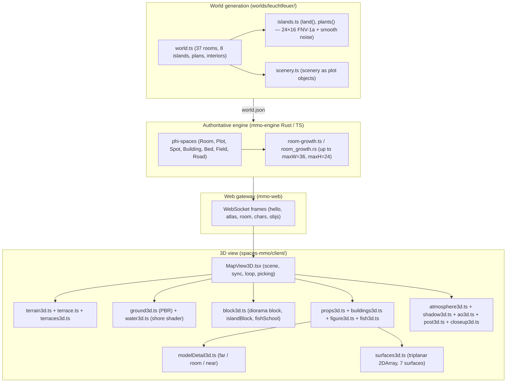

# Analysis & plan: 3D world, rendering improvements and server grid refinement to 1/4 cell area

**Date:** 2026-11-21 (revised the same day and on 2026-11-22)  
**Target system:** `spaces-mmo` (3D client `Three.js 0.186.1`, 2D client `PixiJS 8.22`, dual engine TypeScript & Rust `mmo-engine`, `mmo-web`, `phi-spaces`)  
**Fixed direction:**
1. **Cell size at 1/4 of the area** (`gridScale = 2`, edge length halved → four times as many independent cells: `24×16` → `48×32`, maximum growth `36×24` → `72×48`).
2. **Real server grid refinement** (authoritative coordinates in the TypeScript and Rust engines, including store migration, 2D and 3D client).
3. **Building on 3D-V3** ([`docs/3D-V3/README.md`](3D-V3/README.md)) and the optimisations from [`docs/code-analyse-2026-11-19.md`](../../docs/code-analyse-2026-11-19.md).

---

**Status:** Draft. Sections 2–6 specify the planned changes. Phone measurements in section 1 describe the earlier renderer.

**Grid rule.** Double the number of columns and rows at the same physical room size. Every resulting cell is independently addressable by its own integer coordinates.

1. [Current state](#bestand)
2. [Grid and game rules](#raster)
3. [Movement, occupancy and growth](#engine)
4. [Views and rendering](#ansichten)
5. [Migration and switch-over](#migration)
6. [Order and acceptance](#abnahme)

## 1. Current state: 3D world, world generation & models

### 1.1 Overall architecture

The 3D view (`client/MapView3D.tsx`) is today a purely visual representation of the authoritative 2D grid on the server (`docs/architektur.en.md`, "3D view"). All collisions, paths, occupancy and game rules run in `mmo-engine` (Rust in production on `big` and `nano`, TypeScript as reference/oracle).

### 1.2 World generation (`worlds/leuchtfeuer/`)

- **Room sizes:** All 37 outdoor rooms on 8 islands have a base size of **24×16 = 384 cells** (`islands.ts`: `W = 24, H = 16`). From 70 % occupancy of the buildable land (walkable cells without roads and passages), and with a suitable insertion point, a room grows through `growthTick` (`server/engine/commands/growth.ts`, `rust/mmo-engine/src/commands/growth.rs`) in strips of 4 cells up to **36×24 = 864 cells** (`world.ts`: `growth`). Interiors (`interior` of hut, bakehouse, butcher's, greenhouse) are small rooms of their own (`7×6` to `10×7`).
- **Terrain generator (`islands.ts` `land()`):**
  - `graue-bucht` and `klippenpfad` are hand-drawn ASCII grids (`~` water, `.` sand, `:` paving, `,` grass). The `dig` template (`world.ts`, builder command "grabe") is a template for new rooms, not a room of its own.
  - The other 35 rooms are generated deterministically from the `roomId` seed: FNV-1a hash + 2-octave smooth noise (`step = 4` and `step = 2`) for coastal wobble, beach width (`beach`), ground patches (`step = 3`), round paved squares (`plaza`) and straight paved paths from the room centre `(12, 8)` to the doors/jetties (`DOOR`).
- **Flora & decoration:**
  - **Server (`islands.ts` `plants()`):** Produces the static `decor` grid (flower patches, herbs, bushes, trees) on free grass, one cell away from paths, doors and marked objects. Walkable. The decor kinds present in a room also decide which seeds can be gathered.
  - **Client (`MapView3D.tsx` `buildPlants()`):** Adds, deterministically by `stableHash`, purely visual wild flowers on 28 % of the free grass cells (1–2 per cell) and palms on 7 % of the free sand cells.
- **Scenery & buildings (`scenery.ts`, `world.ts`):** Rectangular footprints from `1×1` (rain barrel, scarecrow, tree) through `2×2` (hut, mill, bed) to `4×4` (field, park). Walkable scenery with `through` gets no plot. Every reserved footprint cell is reserved in the space as a `Plot` entry of its own with `unique: ["room", "x", "y"]` (`build.ts`). This `unique` check of the space is today the mechanism that excludes overlapping buildings, also between parallel workers.
- **Path-finding limits today:** server `findPath` with `max = 40` steps (`server/engine/world.ts`), client BFS with at most 1024 visited cells (`client/walk.ts`).

### 1.3 3D terrain, diorama & rendering pipeline

- **Terrace geometry (`terrain3d.ts`, `terrace.ts`, `terraces3d.ts`):**
  - Fixed height levels per tile kind: `~` = 0.06, `.` = 0.20, `_` = 0.30, `:` = 0.36, `,` = 0.50, `#` = 1.30. The per-cell noise `terrainHeight()` (±0.03) is not used in `MapView3D.tsx`, to avoid dark seams between neighbouring cells.
  - `outlineLoops()` + `withHoles()` extract the outlines of all cells from a height level on, `rounded(CORNER = 0.42, 6)` rounds corners (except at the room edge), `ExtrudeGeometry` (5 bevel segments) produces one mesh per land kind with 3 material groups (`top`, `flank`, `wall`).
- **Ground & water (`ground3d.ts`, `water3d.ts`):**
  - 6 PBR material sets under `public/materials/{sand,grass,paving,planks,plaster,rock}/` (`color.jpg`, `normal.jpg`, `arm.jpg`; about 4.8 MB download), 1.5–2.5 cells repeat, procedural 2-octave macro noise against tiling, shore wetness through `shoreTexture` (chamfer distance, `SHORE_REACH = 4`).
  - Water as a single `BoxGeometry` below the room with a procedural wave-normal shader (3 sines + 2 noise octaves), shallow/deep gradient and animated foam.
- **Diorama block & island level (`block3d.ts`, `fish3d.ts`):**
  - Below the room hangs a block (`BLOCK_DEPTH = 2.6`) with rock strata (`rockSide` + `strataTexture`), translucent sea sides, a sand slope (`SEABED = 1.6`) and instanced fish schools (`fishSchool`, at most 6 draw calls; hidden at island zoom).
  - The island's neighbouring rooms (`islandBlock`, `ISLAND_GAP = 5`) are drawn as one merged voxel lid mesh (up to 5 quads = **10 triangles per cell**).
- **Light, shadow, AO & post-processing (`atmosphere3d.ts`, `shadow3d.ts`, `ao3d.ts`, `post3d.ts`, `closeup3d.ts`):**
  - Physical `Sky` shader + `PMREMGenerator` environment map (re-rendered every 0.1 world hours) + horizon colour sample for `FogExp2`.
  - **Split shadow map (`shadow3d.ts`):** up to 4096² (scaled by `sharp.scale` to 2048² / 1024²). The static scene (`STILL`) is cached and updated once a second or on change; moving figures (`MOVING_LAYER`) are drawn on top.
  - **Baked 2.5D AO (`ao3d.ts`):** orthographic depth pass from above (`AO.texels = 8` texels/cell, at most 2048²) + separable Gaussian blur (`AO.reach = 0.45`, `AO.depth = 0.7`, `AO.strength = 0.45`). One texture lookup per fragment in all lit materials.
  - **Post-processing (`post3d.ts`):** `HalfFloatType` target with 4× MSAA + DepthTexture → `UnrealBloomPass` → `BokehPass` (only zoom > 2, reads the existing DepthTexture) → `OutputPass` (ACES Filmic). Layer 1 (labels/speech bubbles) separately afterwards without tone mapping.
  - **Dynamic resolution (`closeup3d.ts` `sharpen()`):** controls the pixel ratio between 100 % and 50 % (at least 0.75 DPR) within the target corridor of 42–56 FPS.
  - **Historical phone measurement (`docs/3D-V3/README.md`):** **26 FPS (39 ms/frame)** at night at half resolution (partial samples, not an additive breakdown: about 20 ms base load ground+water, 13 ms things+figures, 5 ms shadows, 5 ms plants, 3 ms bloom), about **120–217 draw calls** and **~160k triangles** in Graue Bucht.

### 1.4 Models (`props3d.ts`, `buildings3d.ts`, `figure3d.ts`, `modelDetail3d.ts`, `surfaces3d.ts`)

- **Procedural geometry:** All models are assembled from Three.js primitives and turned by `merge()` into non-indexed `BufferGeometry` with vertex colours, `glow`, `surface`, optionally `tint`, and smoothed `creaseNormals()` (50° threshold), held in the cache (`cached()`).
- **3 LOD levels (`far`, `room`, `near`):** `updateModelDetails()` runs every 150 ms. `far` at zoom ≤ 0.55 (hysteresis 0.65), `near` at zoom ≥ 2 and camera distance ≤ 16 (hysteresis 18) with a budget of **48 near meshes** and **120,000 model triangles**. From `room` on, `BoxGeometry` is bevelled by `ExtrudeGeometry`; large spheres are deformed by `lumpy()`.
- **Foliage:** real 3D geometry foliage (`blade()` = 4 triangles, front and back explicit) with 800 leaves/cell² (`room`) or 1500 (`near`) over an inner shade sphere (`SHADE`). The largest triangle driver of the scene.
- **Material & surfaces (`surfaces3d.ts`):** one shared `propMaterial` with 3D value-noise grain, screen-space bump (`dFdx`/`dFdy`, culled by distance and pixel size) and triplanar projection from two `DataArrayTexture`s (7 surfaces: `bark`, `thatch`, `brick`, `slate`, `wood`, `rock`, `plaster`; 512×512 colour + ARM, no normal maps). Limitation: without UVs the grain on lying beams runs vertically, and every textured fragment performs **6 `textureGrad` fetches**.
- **Figures (`figure3d.ts`):** one `SkinnedMesh` with 7 bones (`FIGURE_SCALE = 1.3`), its own `figureMaterial` (vertex colours only, no cloth/skin textures or `surfaces3d`).

---

## 2. Grid and game rules

Leuchtfeuer gets an authoritative grid with half the edge length. Server, commands, store and room frames use integer cells. `gridScale` applies to the whole world including interiors. 1 and 2 are supported. Old world definitions have 1. A missing value in the store is handled separately at start (section 5). Which cells are walkable is decided by terrain, occupancy and game rules. [Architecture](architektur.en.md)

**Cell.** A room of 48×32 has 1,536 cells. For example, (6,4) and (7,4) may have different terrain, occupancy and road state. Commands, snapshots and picking identify the exact cell.

**Origin of the geometry.** Next to `gridScale` the world definition carries `derivedFrom`. `derivedFrom: 1` means: the generator (`land()`, `plants()`, hand-drawn rooms, `DOOR`, `ARRIVE`) runs with the scale-1 parameters and is resampled to the target dimensions. Without `derivedFrom` the generator designs natively in cells of its own scale. Leuchtfeuer first switches to `gridScale: 2, derivedFrom: 1`. Every loader restart and every fresh world then yields the same geometry as the migration of the existing store. The start check (section 5) compares both values with the store.

### 2.1 Sizes

| Size | Today | Target at scale 2 |
| --- | --- | --- |
| Base room and physical size | 24×16 cells | 48×32 cells on the same 24×16 world units |
| Growth | strip 4, at most 36×24 | strip 8, at most 72×48. Any valid seam between cells is eligible. |
| Interiors | 7×6 to 10×7 | 14×12 to 20×14; doors, exits, interior beds (greenhouse) and furnishings by the same rules as outside |
| Footprint | hut 2×2, field 4×4 | hut 4×4, field 8×8. The origin is the top-left cell, the right and bottom bounds are exclusive. |
| Single objects | tree, scarecrow, rain barrel, bee hive and signal fire 1×1 | footprint 2×2 in all growth stages. Widen the type contract of `TreeFields` from the literals `w: 1; h: 1` to `w: number; h: number`; that both equal `gridScale` is checked at run time. |
| Ranges | rules in cells | Same-cell tests between cell points compare exact coordinates; a test against an area (fire, exit, its passage) tests whether the cell lies in its footprint, so today's point tests such as the free arrival cell ("no exit and no fire is on", `occupancy.ts`) and `isPassage` become footprint tests. For physical reach keep the distance metric and double its radius in cells. Measure to the actual cell or nearest cell of the object footprint. Test all sides and the first cell outside reach. |
| Beds and fields | planting in a bed cell; every cell of a bed takes one plant (`garden.ts`: the free cells of the bed) | A plant occupies its chosen bed cell. A bed holds at most `w·h / gridScale²` plants, the same number as the same physical bed today; any free cell of the bed may be chosen until then. A converted bed keeps its plants and has no room left for more; a bed with fewer plants than its capacity keeps the difference. Without this bound a 4×4 bed would take 16 plants instead of 4 and give four times the yield per physical area. Scale area-based field requirements and per-cell yields to preserve costs and yields for equal physical areas. |
| Roads | ordered path of individual cells | Route.cells, Road.cells and the views list the actual road cells in order. Each cell may turn or end the road. Local paved counts completed cells. Stone and work for new roads use physical route length. Roads overlay the terrain. *Decision:* a road is one cell wide, half today's physical width; the cells beside it are buildable, so a building may stand right beside a road where today half a road cell lay between them. |
| Path finding | server at most 40 steps, client 1024 cells | Command-bound paths: 80 steps. Room-wide navigation: see section 3. |

### 2.2 Points and areas

Every coordinate field of an entry type gets exactly one of the following classes. A type may carry several fields of different classes: `Character.x/y` and the landing point `Character.aboard.spot`, `Room.map`, the outer footprint in `Room.building` and the growth history. The assignment is a table in the code by type and field path (the same in TS and Rust) and is checked against the list in [`shared/model.ts`](../shared/model.ts); the Rust side checks against a list generated from it, as `src/commands.json` is generated from the oracle's command table. A coordinate field without a class makes the start check fail.

| Class | Types (initial list, to be completed during implementation) | Rule at scale 2 |
| --- | --- | --- |
| Area | building site, building, ruin, scenery, tree, bed, field, zone, mill load, building order, motion zone (`Motion.zone`, following its room), fire (`Beacon`), exit (`Exit`) | Position and footprint multiplied by `gridScale`. Converted fires and exits get a `2×2` footprint (`w/h = gridScale`): figures cannot walk into the 1-unit fire ring; paved paths of the terrain, resampled to two cells wide, cross the whole exit; and a converted road, which runs on the even row or column `(2x, 2y)`, meets the exit's first row or column. `ExitFields` and `BeaconFields` have no `w/h` today and get them like `TreeFields`; the world definition keeps exits and fires as points in scale-1 cells, and `world:json` writes `w = h = gridScale` with `derivedFrom: 1`. Native designs may specify smaller `w×h` (down to `1×1` if the visual model and path width match). |
| Cell point | arrival (`arrive`), room spawn, figure, `Spot`, animal, cart, ground item, bed plant, arrival outside a door | Store one coordinate pair. For a legacy point use `(2x, 2y)` once when converting. New points can use any valid cell. Keep a separate passage radius around exits and the existing search for a free arrival cell. |
| No room reference | atlas position (`Room.map`), inventory sentinel `(-1,-1)` | Unchanged. |

**Placement.** Check the actual cells covered by each object.

- World generation and construction validate every occupied cell of the requested footprint.
- Protect the actual cells used by fires, exits, roads and arrival points, plus any independently defined clearance.
- The arrival outside a door follows its building when moved.
- A growth seam may start at any column or row boundary where footprints and reachability allow it.

**Coordinates in texts.** Commands that take coordinates (`geh x y`, `versetze`, the builder's commands) take cells of the world's scale. Help texts, messages that name cells, sizes or distances, the model prompts of the NPCs and stored command lines are inventoried and adapted with the switch.

**Arena and codemode-chat.** The arena (`server/arena.ts`) starts a fresh Leuchtfeuer world per bot and so changes its scale with the world; there is no arena at scale 1 beside a world at scale 2. What codemode-chat keeps of it counts in cells and changes with the same cut: the bots' tool descriptions and examples (`codemode-chat/server/bottask.ts`: `move 5 7`, a subgoal "at most 3 cells from `near`", "10 cells of detour" per jump), the judge's constants behind them (lengths, in the table of section 2.4) and the entries with cells in its Space (`BotEpisode` paths, `PlanMemory` observations and subgoals, `BotRoom` geometry). *Decision:* the stored cells are cell points and are scaled with the cut, so a remembered path stays a valid sequence of `move` targets; `BotRoom` geometry is not converted but read anew from the arena's `map`. Bot runs, durable ones included, are finished or closed before the cut. The codemode-chat store belongs to the inventory of section 5 (step 1), its tests to case 3 of section 6.

### 2.3 Decisions

1. **Figure density.** A figure occupies one cell, so physically up to four figures fit where one stands today. The figure size (2D 32 px, 3D `FIGURE_SCALE 1.3`) is larger than a cell of 0.5 world units.  
   *Decision:* keep the figure size and draw at the centre of its actual cell. A converted figure, arrival or spawn stands on `(2x, 2y)` and is thus drawn a quarter world unit up and left of today's place; that is accepted. Test four adjacent figures across both even and odd coordinates in 2D and 3D. Passed when each of the four can be chosen by a tap (the hits of section 4, per figure), each name label is readable without overlapping another, and in 3D no figure stands inside another's body at rest (the models touch at most).
2. **One cut, occupancy first.**  
   *Decision:* the switch is one defined cut without a way back. Development and all tests run on local machines; `big` and `nano` get binaries, page and migrated stores together, and only after the local release (section 6). There is no stage in production in between: the occupancy format does not go into operation at scale 1 on its own. The binaries of the target state therefore run on the target format only (footprints, the scale of the world definition); plots are read by the migration alone. Inside the cut the order stays: the migration first turns plots into footprints at scale 1 and compares them (section 5), then it scales the grid, which is then a pure coordinate migration. Development keeps the same order (phases 1 and 2).

### 2.4 World definition

For the first conversion, resample the existing terrain to the target dimensions. Place each decor symbol once at its converted position and draw it there. Compare wild-gatherable seed kinds per room. Subsequent edits may change each cell independently.

**Definition values in cells.** With `derivedFrom: 1` the world definition stays written in scale-1 cells for everything that is a position or a footprint: plan footprints, `door`, interior layouts and furnishings, `scenery.ts`, `FieldDef.w/h`, bed sizes, spawn. `world:json` scales them like the generator's output. Rule values counted in cells or cell counts are not scaled by their position in a footprint. They stand in one table in the code (the same in TS and Rust), each with its place and its kind: a length (factor 2) or an area (factor 4). Values of the world definition are named by their path and scaled by `world:json` with `derivedFrom: 1`, so `world.ts` stays in scale-1 cells: the lengths `growth.strip`, `growth.maxW`, `growth.maxH`, the areas `field.seedPerCells`, `field.sowPerCells`, `field.harvestPerCells` and the divisor of the crops' `perCell`; `growth.fullShare` is a ratio and stays. Constants of the code (ranges such as `SITE_REACH`, path limits) take their value from the table. A value is in exactly one place: either the definition or the code, never scaled twice. Road and movement costs use physical length with rounding at the final total. Unlike a coordinate field without a class (section 2.2), a constant missing from the table cannot be found by the start check. The table is therefore filled by an inventory of both engines, and the inventory covers named constants (`EXIT_REACH`, `SITE_REACH`), default arguments (`freeCellNear(…, radius = 8)` in `occupancy.ts`, `findPath(…, max = 40)` in `world.ts`) and bare numbers in comparisons of distances. Afterwards the helpers for distance, search and path take their bound as a required argument from the table, without a default, so a new use cannot bring a number of its own. Counts that are not cells stay out of it (`MOVES_PER_COMMAND`: things per command).

A later native design (without `derivedFrom`) sizes `DOOR`, `ARRIVE`, paths, squares, beach widths, noise step lengths and planting distances in physical units. The two hand-drawn rooms, the dig template, interiors and `scenery.ts` are handled separately. Per room check entrances and exits, spawn and intended connections by flood fill. Existing rooms then get a check of their own of all buildings, roads, seed kinds and arrival points (section 5). Purely client-side plants can vary independently. After every changed world definition run `npm --prefix spaces-mmo run world:json`. [World generation](../worlds/leuchtfeuer/islands.ts) · [Seed rules](../server/engine/commands/garden.ts)

## 3. Movement, occupancy and growth

**Movement.** A single tap moves one cell. A held direction or a click path may, at scale 2, request two consecutive steps on the same axis in one numbered intent. The tick stays 150 ms, so about 6.7 intents per second on a free straight line and the same physical speed as today. At scale 1 the allowed length stays one. An intent takes one tick whatever its length: a single step at scale 2 covers half the physical distance per tick. That is accepted for single taps and odd remainders and is what path smoothing keeps rare. The TS and Rust gateways validate numbered frames including the sequence number. The engine checks direction and length for every way in, also for text commands without a sequence number. The existing step buffer of eight intents (`MAX_AHEAD`) and the refill rate of ten intents/s are starting values. CPU and write load per executed path are measured. [Gateway](../server/gateway.ts) · [Rust gateway](../rust/mmo-web/src/gateway.rs) · [Prediction](../client/walk.ts)

**Path smoothing.** So that diagonal paths do not fall apart into single steps, the client path finding picks, among paths of equal length, the one with the fewest turns, and a turn preferably follows an even number of steps. Single steps remain for odd remainders and obstacles. Measure: on a diagonal test route without obstacles the figure reaches at least 90 % of the physical speed of the straight line. Today's `nextStep` (`client/walk.ts`) cannot do this: it returns only the first step of a breadth-first search and searches anew at every step. The smoothing needs a search that carries the direction (and the parity of the run) in its state, or a path that is kept and planned anew only when a step is refused. The search cost rises as well (four times the cells, twice the steps per route); measure the client's search time per route on the phone at scale 2 in the maximal room and keep it below one tick.

**Server-driven movers.** The double step is not only for the page. Everything the server moves is inventoried with its cells per cycle and keeps its physical speed: NPCs and settlers, which walk by commands like a player's (`server/npc/requests.ts`, `economy.ts`), wild animals, carts, and the arena's bots (`server/arena.ts`, whose path limit of 400 becomes 800). Measure the physical speed per kind of mover before and after.

**Execution.** The engine checks both legs in order against terrain, blocking objects and figures. If the first step is blocked, the figure stays at the start. If only the second is refused, it ends on the first cell. A valid exit triggers the transition at once on entering any cell of its footprint and ends this intent. Everything else that reacts to a figure entering a cell (zones, wild animals that notice a figure, whatever the inventory of phase 0 finds besides) is evaluated for the cell between the two steps as for the end cell, in order: an intent of two steps must not skip what two single steps would have triggered. Position and final spot, or the handover, are written atomically. On a competing spot reservation the transaction secures the last allowed end point, or the figure stays at the start. [Movement rules](../server/engine/commands/default.ts) · [Spot reservation](../server/engine/occupancy.ts)

**Acknowledgement.** For every accepted numbered intent exactly one acknowledgement carries the state actually reached, also when shortened or refused. As today it is written as `CharacterFields.ack {conn, seq}` with the commit that ends the intent. On a transition into another region, `ack` travels with `Handover.character` and is acknowledged with room and arrival cell in the target room. A room change discards old predictions. Tests cover occupied intermediate cells, oncoming traffic, an exit on leg one, an exit across a region boundary and a target spot taken during the prediction.

**Path finding.** For room-wide navigation at scale 2 every cell may be visited once. The search budget is the actual room area (at most 72×48 = 3456 cells); a simple path has at most area minus one steps. In the largest open room it is 118 steps from corner to corner; obstacles can force longer paths. Command-bound paths keep a limit of their own (80 steps, twice today's 40). Examples for both engines and the client: an open maximal room, a connected detour longer than 80 steps whose search has to look at more than 1024 cells (above the command-bound limit and above today's client budget, which counts cells looked at, not steps; as a case for room-wide navigation) and an unreachable target. At scale 1 check the existing limits as the compatibility case. [Server path finding](../server/engine/world.ts) · [Client path finding](../client/walk.ts)

**Occupancy.** The object footprints replace the permanent single plots. One shared query yields per cell the object ID, movement blocking, building blocking and the contribution to the growth share. Its output at scale 1 is compared cell by cell with the previous behaviour before the switch.

- Building site, building, ruin, bed, field, tree and fixed blocking scenery keep their reserved area. Removable blocking scenery counts as well. With `Scenery.through` the previous pass-through rules apply. Fires obstruct their footprint cells. Road cells stay walkable and exclude new buildings. Zones keep their own building rules.
- Figures can leave a bed or field laid out beneath them across the cells of the same object. Moving an object ignores its own old footprint. Demolition, decay, harvest, animal placement, nearby object choice and the change from building site to building use the same assignment. `Spot` remains the unique reservation for figures outside passages, still with `unique` on room and cell.

**Locks.** Since with the plots the `unique` check disappears as the protection against overlapping buildings, lock entries take over this task:

- *Room lock:* one entry per room. Whoever changes static occupancy of a room takes it by `take` in their transaction and writes it back with the commit. If the transaction is aborted or its lease runs out, the entry returns to the space by the transaction rules of phi-spaces; a crashed worker thus holds the lock at most until the lease expires. A command that meets a taken room lock does not wait: it is refused like today's held case of `takeNear()` (not available right now, try again), while loader, growth and background jobs wait and try again. This widens today's case: `held` concerns one site or bed, the room lock every change of static occupancy in the room, so a player building beside settlers at work can be refused where both succeed today. The lock is therefore taken only for the overlap check and the write, not while a command still reads or computes; NPCs and settlers try a refused command again on their next cycle, like any other refusal. Measure: with two players and the room's settlers building in the same room, at most 1 % of the building commands are refused for the lock; above that the lock is taken with a short wait (below one tick) before it refuses.
- *Island lock:* one entry per island, for changes touching several rooms of an island while `WORLD_LOCK` is only held shared (roads across room boundaries). Growth holds `WORLD_LOCK` exclusively and thereby excludes every builder; it takes the island lock as well only to keep one order. A region is a group of islands (`server/engine/regions.ts`), so an island lock never spans two spaces.
- *Lifecycle:* a room's lock is written in the transaction that creates the room (loader, the builder's dig, the interior of a finished building) and removed with the room, `unique` on the room, the island's likewise on the island. An interior belongs to the island of the room its building stands in. The start check (section 5) demands exactly one lock per room and island: a missing one would block building there for good, a second one would exclude nothing.
- Order: `WORLD_LOCK` (shared via `pinTerrain` or exclusive for loader and growth) before island lock before room lock, several rooms in stable ID order. This prevents deadlocks between `growthTick`/loader and building commands and applies to all changes of static occupancy, including loader, background jobs and repairs. The decisive overlap check reads, after acquiring, the current authoritative state inside the transaction. A process mirror read before acquiring is not enough.
- Every current plot reader and writer in TS and Rust gets an assigned replacement (today among others `build.ts`, `builder.ts`, `field.ts`, `garden.ts`, `trees.ts`, `interior.ts`, `wild.ts`, `growth.ts`, `loader.ts`, `occupancy.ts`, `fire.ts`, `commands/default.ts`, `server/npc/settlers.ts`, `server/npc/economy.ts` and their Rust counterparts). In particular, `takeNear()` (`build.ts` and its Rust counterpart) currently uses `Plot` entries to detect sites or beds held by another open transaction (`held`) and must switch to the room lock or direct object contention handling. Two simultaneous overlapping building attempts on separate workers must yield exactly one success. Also check building against growth, abort with retry, a worker crash while holding a lock, parallel building in different rooms and in the same room (the refusal rate above). [Building and object assignment](../server/engine/commands/build.ts) · [Snapshot in the worker](../server/world-host.ts) · [Wild animals](../server/engine/commands/wild.ts)

**Growth.** Count the union of plot-equivalent footprint cells on buildable land. The denominator counts walkable terrain excluding paving tile `:` and exit passages. Roads on grass leave that terrain intact. Compare the actual counts before and after conversion, including changed passage geometry. At 70% occupancy consider every safe seam between cells, including odd coordinates. Reject a seam that cuts a footprint or disconnects a path. A seam between two consecutive cells of a road does not reject it: the strip's cells on the road's line are inserted into `Route.cells` in order, as paved if both neighbours are paved, else as not yet built, without charging stone or work again (today `growth.ts` knows no road rule; rejecting such seams would let no room grow whose roads cross both axes). Shift affected objects, route cells, arrival points, terrain and growth history consistently in one transaction. [Growth](../server/engine/commands/growth.ts) · [Growth transformation](../server/engine/room-growth.ts)

**Cost of the finer grid.** The physical room size stays, so whatever is computed per world unit or per object costs the same as today: terrain mesh (`outlineLoops` keeps only corners, a resampled terrain has the same ones), AO, shadows, water, island lids from the preview, plant count. Plots disappear, which makes growth and building commits and the fire's taken set cheaper. What runs per cell grows: room data, a search over a room and the ring search of `freeCellNear` (radius 8 to 16) by four, a player's steps per physical distance by two. Server-driven movers do not step cell by cell: NPCs and settlers walk by `move x y`, one commit to the target after a path check (`server/engine/commands/default.ts`); animals are placed, carts hop room by room, the arena searches paths only for the drawn trail. Their commit load does not grow with the grid. Two loops multiply the per-cell costs:

- *Target choice on a tap* (`client/App.tsx`, `walkTo`): for an occupied target it tries up to 169 replacement cells (rings up to radius 6) with a search of its own each; today at worst 169 × 1024 ≈ 173,000 cells looked at, at scale 2 with radius 12 and the room budget 625 × 3456 ≈ 2.2 million on the phone's main thread.
- *Seam search of growth* (`growthTick`, in the epoch job, once per world hour, `epochs.checkWorldMs`): every candidate seam runs `connected()` with two searches over the room and a copy with the strip inserted. Odd seams double the candidates (about 20 to about 40 per room), the room has four times the cells: about eight times the work, roughly 35,000 to 280,000 cells looked at per maximal room. One run checks every full room of the region in turn while `WORLD_LOCK` is held exclusively, so a world of full rooms without a valid seam, the lasting state of old villages, stops all building in the region for the whole run.

A third cost is the search per step on the page (`client/walk.ts`): at most the room area per tick, uncritical on its own, with the direction in the search state (path smoothing) up to four times that.

**Performance strategy.** Costs follow physical quantities (world area, objects, distance), not cells; where that is not possible, work runs once instead of in a loop, outside locks and only on change.

- *A shared grid.* Searches and occupied sets use `Set<string>` with `"x,y"` keys today (`walk.ts`, growth, `blockedIn`, `occupiedIn`; `findPath` counts numerically inside but takes its blocked cells as strings). A `Grid` in `shared/` with `Uint8Array` for walkability and occupancy, index `y·w+x` and reused search buffers, in Rust the same as `Vec<u8>`; the rectangle query of the occupancy (phase 1) returns its result in this form. Neighbour order and tie-break of every breadth-first search stay exactly as they are, so the engine walks against the oracle hold.
- *Target choice in one search.* One breadth-first search from the start, then the candidates in the same ring order, the first reachable one wins: the same result, at most the room area plus the candidates per tap.
- *A kept path.* The page plans the path once per target and plans anew only when a step is refused or an ack differs; path smoothing then runs once per target, not per tick.
- *Growth: cheaper, rarer, outside the lock.* (1) One flood fill per room gives the components of the walkable cells; a seam is checked locally along the inserted strip (does it join the same components as the two neighbouring columns did), instead of two searches over the room and a copy per candidate: room area plus candidates × room height, about 3456 + 40 × 48 in a maximal room. (2) Every room carries an occupancy version that counts every write under its room lock; "no seam" and the share are kept with that version, an unchanged full room costs a comparison. (3) The candidates are found on the mirror (`server/world-host.ts`) before the lock; under `WORLD_LOCK` only the version is compared and the chosen seam executed; a changed room is skipped until the next run. The authoritative check inside the transaction (section 3, locks) stays as it is.
- *Room change on the phone.* The shore distance field and the bake of the Pixi texture run in pieces across frames or in a worker with `OffscreenCanvas`, and are kept per room and version until the room grows.
- *Room data in the network* only after the measure of case 4: `ground` as run lengths per row (resampled terrain is mostly pairs of equal characters), or the room kept per version on the page with `hello` carrying only the version.
- *Counted, not only timed.* The meter counts the cells looked at per search (target choice, `findPath`, growth) and the time `WORLD_LOCK` is held per epoch run. Tests hold fixed bounds on the counts (target choice at most room area plus candidates); they reproduce on any device, unlike milliseconds.

Nothing is needed for the 3D renderer because of the cells, nor double steps for NPCs.

## 4. Views and rendering

**2D.** The base room stays 768×512 pixels at nominal zoom. The existing tilesets still deliver 32×32 source pixels, an autotile quarter 16×16. At scale 2 Pixi draws them into 16×16 and 8×8 target pixels. Source rectangle and target size get separate sizes, also for the tileset looks used in 3D. Draw the actual cells. Check animated water quarters, sprites, four adjacent figures (section 2.3), labels and touch picking at the edge at both scales. A cell is 16 pixels at nominal zoom, less than a finger's width on a phone. *Decision:* a tap on free ground names the cell under it, and the page shows that cell before it sends it; a tap within a touch radius of an object, a figure or an exit chooses that target instead of the cell. The radius is in screen pixels, not in cells, and the same in 2D and 3D. Measure on the phone at nominal zoom: of 50 taps each on a figure, on a 2×2 object and on an exit, at least as many hit as at scale 1. Drawing each cell as its own Pixi sprite would quadruple the terrain sprites; bake static ground into a room texture (keeping animated water separate) so that Pixi sprite count and room-change cost stay within 5 % of the scale-1 reference of the same room. The texture is baked at the highest zoom times the device pixel ratio, split into chunks no larger than the device's `MAX_TEXTURE_SIZE` (a maximal room of 72×48 is 3456×2304 pixels at zoom 3); a change of ground or decor rebakes only the chunks it touches, roads, beds and objects stay sprites of their own. [Pixi map](../client/MapView.tsx) · [3D tileset](../client/tiles3d.ts)

**3D.** The cell edge is `1 / gridScale` world units. The cell centre lies half a cell edge from the cell border. Forward and inverse transforms use the same room origin and the same bounds for raycast, object anchors, roads, model footprints and camera target. Materials repeat per world unit. Heights, wall thicknesses, AO reach, shadow camera, view distances and diorama depth are kept in world units; `AO.texels` applies per world unit. Corner rounding uses min(0.42 world units, 0.45 cell edges). `SHORE_REACH` applies in world units: four world units are eight cells. The shore gets twice the linear resolution. Divide the client-side planting probability per suitable cell by four, with a hash modulus whose threshold stays whole: flowers at 7 % remain exact with `% 100 < 7`; palms at 1.75 % need a multiple of 400 (`% 400 < 7` or `% 2000 < 35`), since 1.75 % of any other modulus is rounded to a whole threshold. Measure the actual number of plants per room. Check decor and vegetation at the actual cell, and keep client-side plants clear of a clearance radius around upright decor (trees, bushes) so palms and wild flowers do not spawn inside a tree's crown. A touch tolerance may ease object selection. The building or movement point sent to the server stays explicit and visible.

**Atlas.** The gateway sends the atlas in its own `atlas` frame. Only the gateway reduces the terrain to a preview. Every room entry carries the original width and height in game cells and the sampling per preview cell (1 or 2). For each preview pixel sample the covered terrain cells with a deterministic majority and fixed tie-break, clipping at the room edge. This applies only to the preview image. Fires and object markers keep game cell coordinates; a marker of an area (fire, exit) stands at the centre of its footprint. The atlas view converts them into image coordinates exactly once. `Room.map` counts room steps. The 3D client builds the lid directly from the delivered preview in the physical extent of each room. The active room always uses its full room grid. Old frames without the additional fields count as an uncompressed preview.

**Protocol version.** `hello` carries `gridScale` and a protocol version, and the page names the version it speaks when it connects. A page from before the switch cannot support the new format: both gateways refuse a connection without the matching version, also a reconnect from an old tab, with an answer that makes the page load anew (the build is known by `out/BUILD_ID`). Its single-step intents and scale-1 coordinates thus never reach the engine. Test: a tab opened before the switch reconnects after it. [Frames](../shared/frames.ts) · [Atlas generation](../server/gateway.ts) · [Island view](../client/MapView3D.tsx)

With eight rooms on the largest island at most seven neighbouring lids are drawn. For seven base rooms today at most `7 × 384 × 10 = 26,880` lid triangles arise. Without a preview it would be 107,520, with a 2×2 preview again 26,880. This count covers only the lids. Count grown rooms, diorama sides, figures and plants separately. [World data](../worlds/leuchtfeuer/world.json) · [Lid geometry](../client/block3d.ts)

**Render budget of the grid switch.** The physical room size stays the same. The grid switch alone may raise draw calls, triangles and frame time against the newly measured scale-1 reference of the same scene by at most 5 %, for the frame time as in section 6 (case 5): the median by 5 % or by the spread of the three reference runs, whichever is larger. Anything beyond is a defect of the switch, not a consequence of the grid.

| Step from 3D-V3 | Expected benefit | Comparison before adoption |
| --- | --- | --- |
| Primitive UVs, indexed geometry, one-sided leaf geometry with a visible back | Aligned grain, fewer texture fetches and duplicated vertices | UV seams, hard normals, material attributes, lighting of both leaf sides, shadows, buffer bytes and GPU frame time |
| Smoothed heightfield and splat blending | Finer coasts, dunes and material transitions | Flat standing areas, heights when picking, attachment of models, passages and visual agreement with the authoritative coast |
| Wind, leaf translucency, grass, rain and wet surfaces | Visible response to wind and weather | Carry a numeric wind and weather state through gateway and renderer. Measure view distance, instance budget, shadows and frame times per effect. |
| KTX2, figure material, texel snapping, underwater floor, instancing and later glTF models | Less texture memory, more detailed models, steadier shadows and water | On target devices record load time, supported texture format and fallback, GPU memory and frame time at equal image quality. |

The rendering work can be compared step by step on both grids. The draw-call target in section 6 (case 5), 200, lies below today's maximum of 217. The triangle bound of 180,000 lies above today's about 160,000: it is an upper bound that leaves the rendering work some room, not a reduction. Both are goals of this rendering work, not of the grid switch. The phone test from 3D-V3 gave about 39 ms per frame at night at half resolution. Triangle counts or single shader changes give no reliable FPS forecast. [3D-V3 measurements](3D-V3/README.md)

## 5. Migration and switch-over

**Start condition.** A new persisted grid and occupancy version is independent of `WorldLoaded.version`. It consists of the grid version (`gridScale`, `derivedFrom`) and the occupancy format (plots or footprints), each with its completed migration state. If the marker is missing in an existing world store, its format counts as legacy (scale 1, plots). Before the first writing loader, seed, job or client access both runtimes check world ID, grid version, occupancy format, migration state and the class assignment of all coordinate types (section 2.2) against the world definition. Until the cut the check only reads: a binary deployable on today's stores writes no marker (a written marker would itself be a change of format, section 6). The migration writes the marker, and an empty world may be initialised in the target format with it. An existing store with a different format requires an offline migration: the binaries of the target state stop on it and name the migration, they never convert at start and carry no code path for plots (section 2.3). This also protects grown rooms, whose loader compares the stored base sizes with the definition. [Loader](../server/engine/loader.ts) · [Base size check](../server/engine/room-growth.ts)

| Existing data | Transformation from 1 to 2 and functional check |
| --- | --- |
| Terrain, spawn and growth | Resample ground to twice the width and height. Transfer each decor symbol once at its converted coordinates. In built and dug rooms keep the existing state. Double base sizes, `east/south` and per step `at/size`, take every element of the cross-running `fill` twice. Keep the step sequence and revision numbers. Reconstruct from the scaled base (`derivedFrom: 1`) and the history and compare with the converted terrain, also for old sums without single steps. Compare the growth share per room before and after. |
| Areas | Scale position and footprint by the class "area" (section 2.2). `Motion.zone` and the outer footprint in `Room.building` follow their reference room. |
| Cell points | Convert each existing position once into one exact cell. Atlas coordinates and inventory sentinels retain their own units. |
| Exits and regions | Transform `Exit.x/y` in the source room and `arrive` in the target room including the existing `arriveGrowthRevision`. Also during a running ship voyage scale the stored landing point in `Character.aboard.spot` in the target room and keep the arrival time. Check against the reconstructed target geometry. Before the snapshot complete region handovers and pending coordinate-bearing orders. If a `Handover.character` or an unexecuted movement intent remains, the store concerned is reported with its ID and the switch point is not released. |
| Roads and progress | In each room double the old path coordinates and insert the missing cell between consecutive neighbouring old points. Preserve order, turns and endpoints. Rebuild Road from Route. Map the completed prefix to the corresponding fine path through its last completed point, including intermediate cells. Keep votes, deliveries, work and deadlines. Test a bent half-built road on grass across a restart and check every cell in both views. |
| Bed plants, crops and ownership | Existing plant coordinates are absolute in the store. Today the client gets the difference to the bed origin. Convert each plant to its own exact cell and verify bounds and uniqueness. Check position, kind, stage and due time. For a running field keep yields already fixed (`yields`), deliveries and work shares; recompute `seedNeed`, `workNeed` and harvest need and check them for equality. Compare IDs, owners, stocks and terms across the switch. |
| Interiors | As outdoor rooms: scale terrain, furnishings, interior beds, door and exit (`exit_id_of`), check the connection of door and building in the outdoor room. |
| Legacy plots and new occupancy (first step of the cut, at scale 1) | Before removing each legacy plot, check its object ID, cell coverage and special rules against the derived occupancy in the source grid. Report missing, orphaned or contradictory assignments with room and object. Release the target copy only after a successful comparison. Create the lock entries (room, island). The grid migration requires the occupancy format "footprints" and refuses a store with plots. Both steps run one after the other in the same cut on the same target copies; no store goes into operation between them. Neither step has a migration back: the cut has no way back (section 2.3), a figure on an odd cell has no scale-1 position, and the previous binaries know neither footprints nor lock entries. Until the opening only the restore of step 4 remains. |

Every loader restart and every later application of the growth history must yield the same positions; `derivedFrom: 1` ensures this for the geometry. Manual or native coastline changes to existing rooms later get a check of their own of all buildings, roads, seed kinds and arrival points. For every further coordinate-bearing entry in the actual store, the matching class and transformation rule must be shown before release. [Entry fields](../shared/model.ts) · [Road progress](../server/engine/commands/road.ts) · [Handovers](../server/engine/handover.ts)

**Old binaries.** The marker protects only binaries that know it. A binary from before the cut that is started on a migrated store stops only by chance: the base size check of a grown room (`room-growth.ts`) compares the stored 48×32 base with the definition's 24×16 and throws. Rooms that never grew it does not check; its loader leaves them alone where the store's `WorldLoaded.version` is not older than its definition (`loader.ts`), and it runs on, finds no plots, so nothing in the way of a building, and lets footprints overlap without an error. A store without grown rooms, or a definition with a higher version that makes the old loader replace the rooms, gives no protection at all. After the cut the previous images are therefore removed from `big` and `nano`, and the launch scripts refuse the previous line, as the plain `docker:nano:up`/`docker:big:up` refuse since R-D12.

**Operating sequence for a date released later.** The cut is one: all stores of `big` and `nano`, both migration steps, binaries and page together, and only after the local release (section 6, phase 5).

1. Inventory the roles and paths of the stores actually involved. On `big` record the world regions. On `nano` search the account store for coordinate-bearing fields (e.g. a stored last position, spawn); only if there are none does it need no grid transformation, otherwise every field gets a class by section 2.2. The same holds for the codemode-chat Space with its bot entries (section 2.2). Record all versions involved and the matching backup state.
2. Rehearse on copies in an isolated local environment first. For the switch, stop write access, delivery of new intents and background jobs in a coordinated way, finish running work, control region changes and back up all SQLite stores consistently. A single `WORLD_LOCK` covers only its own space.
3. Migrate into separate target copies. Handle an abort during a batch by rebuilding from the same backed-up source state. A second run on fully marked targets only checks. Logical checksums and records must match. Errors in one region prevent the release of all target copies.
4. Before opening to players, start all regions isolated with compatible binaries, web client and target definition. Start the loader twice, test a handover across a region boundary and the return. Until the opening the cut can be called off by restoring the whole backed-up state with the matching binaries; this restore is rehearsed locally (phase 4). With the opening the way back is closed: the backup is kept, but what is found afterwards is repaired forward, and the previous images leave the servers (old binaries, above).

## 6. Order and acceptance

| Phase | Result and precondition for the next step |
| --- | --- |
| 0 · Reference | At scale 1 record semantic examples, reproducible growth cases, atlas sizes, a render reference per zoom and the phone reference. Implement the start check, version markers and class assignment (section 2.2) before any change of the existing format. Inventory the rule constants (section 2.4), everything that reacts to entering a cell (section 3) and the cells codemode-chat keeps (section 2.2). |
| 1 · Occupancy | Introduce the rectangle query and the room and island locks on local stores at scale 1, and write the migration from plots to footprints. Check against legacy plots, game behaviour and parallel workers (with the refusal rate at the room lock, section 3). Production stays untouched in the plot format. Introduce the shared grid, the occupancy version per room, the target choice in one search and the three growth steps (performance strategy, section 3), still at scale 1 against today's results, so that every deviation comes from the rework alone. |
| 2 · Grid | Check generator with `derivedFrom`, TS/Rust engine, both gateways, clients, atlas, arena and codemode-chat together on fresh target stores and on migrated test copies. The rendering stays as it is, so that the grid switch alone is measured against the scale-1 reference (case 5). |
| 3 · Rendering work | The steps of the 3D-V3 table (section 4) one at a time in the order of its rows, each behind a switch of its own and compared before and after on the same grid (case 5); the optimisations of the code analysis are broken down into steps here. Not a precondition of the cut: a step changes no format, so what is not released by then follows as an ordinary deploy after the cut (before it no deploy reaches the servers, below). |
| 4 · Migration rehearsal | Practise the complete operating sequence of section 5 locally on a copy of the production stores, with interruption, repetition, restart and restore. |
| 5 · Local release and cut | Release locally only after passing the function, budget, parity and device checks. Then the one cut on `big` and `nano` by section 5, without a way back after the opening. Tests with load or process kills run only on the local test system, never on the servers. |

**Deploys until the cut.** From the first commit on master that changes a format, `big` and `nano` take no deploy of master until the cut: its binaries would stop on their stores (section 5). This is decided (2026-11-22): the servers stay on the state they run until the cut, and everything stays on master. That includes fixes: until the cut no fix of master reaches the servers; a fault in production that cannot wait is a decision of its own (a fix on the state the servers run, outside master).

**Acceptance cases and measures**

1. **Real growth.** Build a `64×48` room from the base `48×32` and a recorded growth history (two X steps, two Y steps), so that the loader's base size check holds, with 75 % occupancy of the actually buildable land. Force a valid inner X seam at an odd column and place many objects to be moved, a fire and a road behind it. Show exactly one growth to `72×48`, moved object and arrival positions, road continuity, free paths and a correct history. Afterwards the maximal room stays stable on the next tick. Below the 70 % threshold or with no suitable seam, no growth takes place. A second room with roads across both axes grows through a seam across a road; the road is continuous afterwards, its inserted cells are paved exactly where both neighbours were, and stone and work are unchanged.
2. **Space budget.** On the successful tick run both implementations under the commit limit actually configured. Report separately the peak of reserved commit bytes including completion costs, the number of entries read and changed, and the serialised room size. The default limit is 192 KiB (`maxCommitBytes`), the target for the defined test case < 40 KiB. Add an edge case with many small objects. The saving follows from a before/after measurement with the same scene. Also check loader batches and migration against the limit. [Core budget](../../spaces/src/core.ts)
3. **Function and parity.** Check root, MMO and codemode-chat each with typecheck and tests (`npm run test:codemode-chat` with the arena at scale 2 and bot entries scaled by section 2.2). In the MMO Rust workspace additionally `cargo test` and `cargo clippy --all-targets`. The existing walk uses a frozen TS state by default. Use the old state to check the previous behaviour. For the new states set `MMO_ORACLE` to the matching, explicitly recorded TS state and run scenarios at both scales. Additionally compare deliberately changed storage representations at scale 1 by functional answers, ownership, occupancy and reachability. On a migrated copy check `test:play`, region changes and switching between TS and Rust including reopening. [Oracle selection](../rust/mmo-engine/tests/common/mod.rs) · [Game operation](betrieb.en.md)
4. **Network and handling.** Record the UTF-8 bytes of `hello`, `atlas` and `atlasState` separately for the same world, and within `hello` the share of the room (`room: RoomFields` with `ground` and decor, four times the cells) for a base room and a maximal room, at both scales; record the time of a room change on the phone with it. The room's share has no target before this first measurement. For `atlas` the target is 25 KiB for 37 base rooms. Compare markers, lids and picking for a grown neighbouring room and after a room change. Check single and double steps through the real gateways including ack, partial movement, refused steps and an exit across a region boundary, and a tab from before the switch (protocol version, section 4). Measure the physical speed of the server-driven movers (section 3). Measure the physical speed on straight and diagonal routes (path smoothing, section 3). Compare server CPU, commit rate and response times at the same number of players and the same physical distance. [Load test as reference](lasttest-2026-11-08.en.md)
5. **Mobile and image quality.** Measure before/after on the same phone, browser, data state and with identical effective render resolution; for that switch `sharpen()` off and fix the pixel ratio. After warm-up record three runs of equal length each for room, close and island zoom, report median and p95 of the frame time, draw calls, triangles and room change time. Count full shadow updates separately from the ordinary frame. Grid switch alone: at most 5 % above the scale-1 reference per zoom (section 4); draw calls and triangles are counted and the bound is hard, for the frame time the median may exceed the reference by 5 % or by the spread of the three reference runs, whichever is larger. With the rendering work: for the reproduced night scene in Graue Bucht at half resolution at least the median of the scale-1 reference measured anew by this protocol (the 26 FPS of 3D-V3 were measured with `sharpen()` on and serve as orientation), target 30 FPS, in the ordinary room frame at most 200 draw calls and 180,000 triangles. Keep screenshots for day, dusk, night, fog, close view and island, and a 2D check of water animation, four adjacent figures (section 2.3) and touch targets (the hits of section 4).
6. **Search loops and server load.** On the phone at scale 2 in the maximal room, with an unreachable and an enclosed occupied target: the target choice of a tap below one tick (150 ms) and at most room area plus candidates cells looked at. Epoch run on the server with every room of a region maximal, full and without a valid seam, while players build: the time `WORLD_LOCK` is held exclusively per run, against the scale-1 reference of the same world, target at most the reference; a second run without changes costs one version comparison per room. Commits per second of the server-driven movers at the same number of figures, before and after, target unchanged.

All numbers with target character are acceptance values for the later implementation. Measurement logs, test setup and the tested store version belong to each result.
