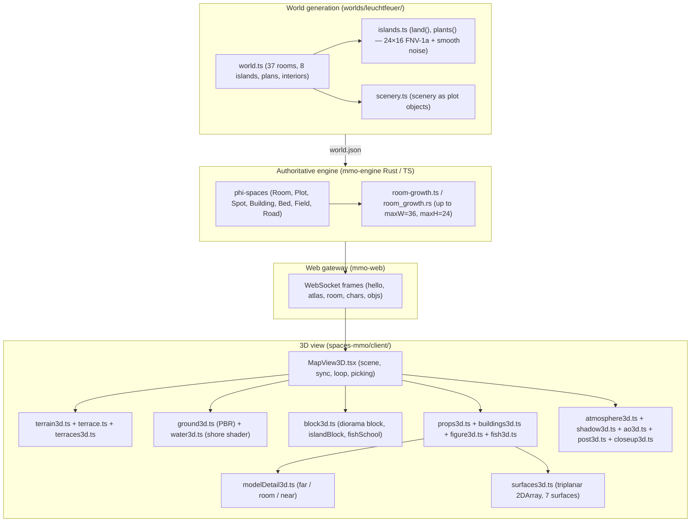

# Analysis & plan: 3D world, rendering improvements and server grid refinement to 1/4 cell area

**Date:** 2026-11-21 (revised the same day)  
**Target system:** `spaces-mmo` (3D client `Three.js 0.186.1`, 2D client `PixiJS 8.22`, dual engine TypeScript & Rust `mmo-engine`, `mmo-web`, `phi-spaces`)  
**Fixed direction:**
1. **Cell size at 1/4 of the area** (`gridScale = 2`, edge length halved → 2×2 sub-cells per former cell: `24×16` → `48×32`, maximum growth `36×24` → `72×48`).
2. **Real server grid refinement** (authoritative coordinates in the TypeScript and Rust engines, including store migration, 2D and 3D client).
3. **Building on 3D-V3** ([`docs/3D-V3/README.md`](3D-V3/README.md)) and the optimisations from [`docs/code-analyse-2026-11-19.md`](../../docs/code-analyse-2026-11-19.md).

---

**Status:** Draft. The target rules and checks from section 2 on describe planned behaviour. The phone figures in section 1 come from earlier measurements. All rules are decisions of this draft; figure density and the switch of occupancy are decided in section 2.3.

**Guiding rule.** The first switch is *position-preserving*: whatever occupies, blocks or triggers on a cell today occupies, blocks or triggers on the same physical area afterwards, i.e. the whole 2×2 block. At first only *where* figures stand and *where* new things can be placed becomes finer. Every exception to this rule is named explicitly in section 2.

1. [Current state](#bestand)
2. [Grid and game rules](#raster)
3. [Movement, occupancy and growth](#engine)
4. [Views and rendering](#ansichten)
5. [Migration and switch-over](#migration)
6. [Order and acceptance](#abnahme)

## 1. Current state: 3D world, world generation & models

### 1.1 Overall architecture

The 3D view (`client/MapView3D.tsx`) is today a purely visual representation of the authoritative 2D grid on the server (`docs/architektur.en.md`, "3D view"). All collisions, paths, occupancy and game rules run in `mmo-engine` (Rust in production on `big` and `nano`, TypeScript as reference/oracle).

### 1.2 World generation (`worlds/leuchtfeuer/`)

- **Room sizes:** All 37 outdoor rooms on 8 islands have a base size of **24×16 = 384 cells** (`islands.ts`: `W = 24, H = 16`). From 70 % occupancy of the buildable land (walkable cells without roads and passages), and with a suitable insertion point, a room grows through `growthTick` (`server/engine/commands/growth.ts`, `rust/mmo-engine/src/commands/growth.rs`) in strips of 4 cells up to **36×24 = 864 cells** (`world.ts`: `growth`). Interiors (`interior` of hut, bakehouse, butcher's, greenhouse) are small rooms of their own (`7×6` to `10×7`).
- **Terrain generator (`islands.ts` `land()`):**
  - `graue-bucht` and `klippenpfad` are hand-drawn ASCII grids (`~` water, `.` sand, `:` paving, `,` grass). The `dig` template (`world.ts`, builder command "grabe") is a template for new rooms, not a room of its own.
  - The other 35 rooms are generated deterministically from the `roomId` seed: FNV-1a hash + 2-octave smooth noise (`step = 4` and `step = 2`) for coastal wobble, beach width (`beach`), ground patches (`step = 3`), round paved squares (`plaza`) and straight paved paths from the room centre `(12, 8)` to the doors/jetties (`DOOR`).
- **Flora & decoration:**
  - **Server (`islands.ts` `plants()`):** Produces the static `decor` grid (flower patches, herbs, bushes, trees) on free grass, one cell away from paths, doors and marked objects. Walkable. The decor kinds present in a room also decide which seeds can be gathered.
  - **Client (`MapView3D.tsx` `buildPlants()`):** Adds, deterministically by `stableHash`, purely visual wild flowers on 28 % of the free grass cells (1–2 per cell) and palms on 7 % of the free sand cells.
- **Scenery & buildings (`scenery.ts`, `world.ts`):** Rectangular footprints from `1×1` (rain barrel, scarecrow, tree) through `2×2` (hut, mill, bed) to `4×4` (field, park). Walkable scenery with `through` gets no plot. Every reserved footprint cell is reserved in the space as a `Plot` entry of its own with `unique: ["room", "x", "y"]` (`build.ts`). This `unique` check of the space is today the mechanism that excludes overlapping buildings, also between parallel workers.
- **Path-finding limits today:** server `findPath` with `max = 40` steps (`server/engine/world.ts`), client BFS with at most 1024 visited cells (`client/walk.ts`).

### 1.3 3D terrain, diorama & rendering pipeline

- **Terrace geometry (`terrain3d.ts`, `terrace.ts`, `terraces3d.ts`):**
  - Fixed height levels per tile kind: `~` = 0.06, `.` = 0.20, `_` = 0.30, `:` = 0.36, `,` = 0.50, `#` = 1.30. The per-cell noise `terrainHeight()` (±0.03) is not used in `MapView3D.tsx`, to avoid dark seams between neighbouring cells.
  - `outlineLoops()` + `withHoles()` extract the outlines of all cells from a height level on, `rounded(CORNER = 0.42, 6)` rounds corners (except at the room edge), `ExtrudeGeometry` (5 bevel segments) produces one mesh per land kind with 3 material groups (`top`, `flank`, `wall`).
- **Ground & water (`ground3d.ts`, `water3d.ts`):**
  - 6 PBR material sets under `public/materials/{sand,grass,paving,planks,plaster,rock}/` (`color.jpg`, `normal.jpg`, `arm.jpg`; about 4.8 MB download), 1.5–2.5 cells repeat, procedural 2-octave macro noise against tiling, shore wetness through `shoreTexture` (chamfer distance, `SHORE_REACH = 4`).
  - Water as a single `BoxGeometry` below the room with a procedural wave-normal shader (3 sines + 2 noise octaves), shallow/deep gradient and animated foam.
- **Diorama block & island level (`block3d.ts`, `fish3d.ts`):**
  - Below the room hangs a block (`BLOCK_DEPTH = 2.6`) with rock strata (`rockSide` + `strataTexture`), translucent sea sides, a sand slope (`SEABED = 1.6`) and instanced fish schools (`fishSchool`, at most 6 draw calls; hidden at island zoom).
  - The island's neighbouring rooms (`islandBlock`, `ISLAND_GAP = 5`) are drawn as one merged voxel lid mesh (up to 5 quads = **10 triangles per cell**).
- **Light, shadow, AO & post-processing (`atmosphere3d.ts`, `shadow3d.ts`, `ao3d.ts`, `post3d.ts`, `closeup3d.ts`):**
  - Physical `Sky` shader + `PMREMGenerator` environment map (re-rendered every 0.1 world hours) + horizon colour sample for `FogExp2`.
  - **Split shadow map (`shadow3d.ts`):** up to 4096² (scaled by `sharp.scale` to 2048² / 1024²). The static scene (`STILL`) is cached and updated once a second or on change; moving figures (`MOVING_LAYER`) are drawn on top.
  - **Baked 2.5D AO (`ao3d.ts`):** orthographic depth pass from above (`AO.texels = 8` texels/cell, at most 2048²) + separable Gaussian blur (`AO.reach = 0.45`, `AO.depth = 0.7`, `AO.strength = 0.45`). One texture lookup per fragment in all lit materials.
  - **Post-processing (`post3d.ts`):** `HalfFloatType` target with 4× MSAA + DepthTexture → `UnrealBloomPass` → `BokehPass` (only zoom > 2, reads the existing DepthTexture) → `OutputPass` (ACES Filmic). Layer 1 (labels/speech bubbles) separately afterwards without tone mapping.
  - **Dynamic resolution (`closeup3d.ts` `sharpen()`):** controls the pixel ratio between 100 % and 50 % (at least 0.75 DPR) within the target corridor of 42–56 FPS.
  - **Historical phone measurement (`docs/3D-V3/README.md`):** **26 FPS (39 ms/frame)** at night at half resolution (partial samples, not an additive breakdown: about 20 ms base load ground+water, 13 ms things+figures, 5 ms shadows, 5 ms plants, 3 ms bloom), about **120–217 draw calls** and **~160k triangles** in Graue Bucht.

### 1.4 Models (`props3d.ts`, `buildings3d.ts`, `figure3d.ts`, `modelDetail3d.ts`, `surfaces3d.ts`)

- **Procedural geometry:** All models are assembled from Three.js primitives and turned by `merge()` into non-indexed `BufferGeometry` with vertex colours, `glow`, `surface`, optionally `tint`, and smoothed `creaseNormals()` (50° threshold), held in the cache (`cached()`).
- **3 LOD levels (`far`, `room`, `near`):** `updateModelDetails()` runs every 150 ms. `far` at zoom ≤ 0.55 (hysteresis 0.65), `near` at zoom ≥ 2 and camera distance ≤ 16 (hysteresis 18) with a budget of **48 near meshes** and **120,000 model triangles**. From `room` on, `BoxGeometry` is bevelled by `ExtrudeGeometry`; large spheres are deformed by `lumpy()`.
- **Foliage:** real 3D geometry foliage (`blade()` = 4 triangles, front and back explicit) with 800 leaves/cell² (`room`) or 1500 (`near`) over an inner shade sphere (`SHADE`). The largest triangle driver of the scene.
- **Material & surfaces (`surfaces3d.ts`):** one shared `propMaterial` with 3D value-noise grain, screen-space bump (`dFdx`/`dFdy`, culled by distance and pixel size) and triplanar projection from two `DataArrayTexture`s (7 surfaces: `bark`, `thatch`, `brick`, `slate`, `wood`, `rock`, `plaster`; 512×512 colour + ARM, no normal maps). Limitation: without UVs the grain on lying beams runs vertically, and every textured fragment performs **6 `textureGrad` fetches**.
- **Figures (`figure3d.ts`):** one `SkinnedMesh` with 7 bones (`FIGURE_SCALE = 1.3`), its own `figureMaterial` (vertex colours only, no cloth/skin textures or `surfaces3d`).

---

## 2. Grid and game rules

Leuchtfeuer gets an authoritative grid with half the edge length. Server, commands, store and room frames use integer cells. `gridScale` applies to the whole world including interiors. 1 and 2 are supported. Old world definitions have 1. A missing value in the store is handled separately at start (section 5). Which cells are walkable is decided by terrain, occupancy and game rules. [Architecture](architektur.en.md)

**Block.** A *block* is the square of `gridScale × gridScale` cells whose top-left cell has both coordinates divisible by `gridScale`. At scale 1 every block is one cell. Blocks are the unit of the position-preserving mapping, of roads, of growth seams and of the atlas preview.

**Origin of the geometry.** Next to `gridScale` the world definition carries `derivedFrom`. `derivedFrom: 1` means: the generator (`land()`, `plants()`, hand-drawn rooms, `DOOR`, `ARRIVE`) runs with the scale-1 parameters and is scaled up block by block. Without `derivedFrom` the generator designs natively in cells of its own scale. Leuchtfeuer first switches to `gridScale: 2, derivedFrom: 1`. Every loader restart and every fresh world then yields the same geometry as the migration of the existing store. The start check (section 5) compares both values with the store.

### 2.1 Sizes

| Size | Today | Target at scale 2 |
| --- | --- | --- |
| Base room and physical size | 24×16 cells | 48×32 cells on the same 24×16 world units |
| Growth | strip 4, at most 36×24 | strip 8, at most 72×48. Seams lie on block boundaries (section 3). |
| Interiors | 7×6 to 10×7 | 14×12 to 20×14; doors, exits, interior beds (greenhouse) and furnishings by the same rules as outside |
| Footprint | hut 2×2, field 4×4 | hut 4×4, field 8×8. The origin is the top-left cell, the right and bottom bounds are exclusive. |
| Single objects | tree and scarecrow 1×1 | footprint 2×2 in all growth stages. Extend the type contract of `TreeFields` (`w: 1; h: 1`) to `w/h = gridScale`. |
| Ranges | rules in cells | Express existing physical ranges in cells with factor 2. Keep each distance metric. Measured from the figure's cell to the nearest cell of the target footprint. Because migrated figures land on the top-left cell of their block (distance 2 on west/north sides vs. 1 on east/south sides), factor 2 preserves reachability on all sides; check passage, disembarking, interaction, NPCs, wild animals, fire, greenhouse and zones on all four sides at the bound and one cell outside. |
| Beds and fields | one planting slot per former bed cell | Every block of a bed is one logical slot. An old bed with four slots keeps four. Beds and fields have width and height as multiples of `gridScale`; their position may be any cell; slots count from the bed origin. For the same physical field area raise `seedPerCells` from 4 to 16, `sowPerCells` from 8 to 32 and `harvestPerCells` from 2 to 8, quarter the yields' `perCell`. Since `harvestOf` computes `floor(cells · perCell · factor)`, the amounts stay the same; test the rounding at `Math.ceil` for seed, work and harvest anyway. |
| Roads | a path of cells, stone and work need from the cell count | Roads are bound to blocks: they are planned on the block grid, and all cells of the blocks are stored. Stone and work need are computed per block, so today's divisors apply unchanged to the block count. Paving in `ground` and `Road.cells` cover the same cells. |
| Path finding | server at most 40 steps, client 1024 cells | Command-bound paths: 80 steps. Room-wide navigation: see section 3. |

### 2.2 Points and areas

Every entry type with coordinates gets exactly one of the following classes. The assignment is a table in the code (the same in TS and Rust) and is checked against the list in [`shared/model.ts`](../shared/model.ts): a type without a class makes the start check fail.

| Class | Types (initial list, to be completed during implementation) | Rule at scale 2 |
| --- | --- | --- |
| Area | building site, building, ruin, scenery, tree, bed, field, zone, mill load, building order | Position and footprint multiplied by `gridScale`. |
| Block point | fire, exit, arrival point (`arrive`, room spawn) | Lies on a block. Acts on all cells of the block: a fire blocks the whole block, an exit triggers on every cell of the block. Arrival: the top-left cell of the block; if it is taken, the nearest free one by today's rule "onto a free cell starting at `at`". |
| Cell point | figure and its `Spot`, animal, cart, ground item, plant in a slot (through the slot) | Stands on exactly one cell. Migrated to the top-left cell of its block. What does not block today does not block afterwards. |
| No room reference | atlas position (`Room.map`), inventory sentinel `(-1,-1)` | Unchanged. |

### 2.3 Decisions

1. **Figure density.** A figure occupies one cell, so physically up to four figures fit where one stands today. The figure size (2D 32 px, 3D `FIGURE_SCALE 1.3`) is larger than a cell of 0.5 world units.  
   *Decision:* figures keep their size. The view shifts figures on neighbouring cells towards the edge of their cell without changing the authoritative position. Accepted by screenshot with four figures in one block, in 2D and 3D. There is no distance rule between figures on the server, since it cannot be enforced atomically through the `unique` entry per cell.
2. **Switch occupancy separately.**  
   *Decision:* the occupancy format is switched first, at scale 1 in production, with an offline migration of its own (section 6, phase 1b), and only then the grid. The grid switch is then a pure coordinate migration.

### 2.4 World definition

For the first switch (`derivedFrom: 1`) the same coastline, paths, squares and decor as today arise, scaled up block by block. The decor symbol of a former cell lies on the top-left cell of its block, the other three stay empty. The set of wild-gatherable seed kinds per room thus stays the same; it is compared before and after the switch anyway.

A later native design (without `derivedFrom`) sizes `DOOR`, `ARRIVE`, paths, squares, beach widths, noise step lengths and planting distances in physical units. The two hand-drawn rooms, the dig template, interiors and `scenery.ts` are handled separately. Per room check entrances and exits, spawn and intended connections by flood fill. Existing rooms then get a check of their own of all buildings, roads, seed kinds and arrival points (section 5). Purely client-side plants can vary independently. After every changed world definition run `npm --prefix spaces-mmo run world:json`. [World generation](../worlds/leuchtfeuer/islands.ts) · [Seed rules](../server/engine/commands/garden.ts)

## 3. Movement, occupancy and growth

**Movement.** A single tap moves one cell. A held direction or a click path may, at scale 2, request two consecutive steps on the same axis in one numbered intent. The tick stays 150 ms, so about 6.7 intents per second on a free straight line and the same physical speed as today. At scale 1 the allowed length stays one. The TS and Rust gateways validate numbered frames including the sequence number. The engine checks direction and length for every way in, also for text commands without a sequence number. The existing step buffer of eight intents (`MAX_AHEAD`) and the refill rate of ten intents/s are starting values. CPU and write load per executed path are measured. [Gateway](../server/gateway.ts) · [Rust gateway](../rust/mmo-web/src/gateway.rs) · [Prediction](../client/walk.ts)

**Path smoothing.** So that diagonal paths do not fall apart into single steps, the client path finding picks, among paths of equal length, the one with the fewest turns, and a turn preferably follows an even number of steps. Single steps remain for odd remainders and obstacles. Measure: on a diagonal test route without obstacles the figure reaches at least 90 % of the physical speed of the straight line.

**Execution.** The engine checks both legs in order against terrain, blocking objects and figures. If the first step is blocked, the figure stays at the start. If only the second is refused, it ends on the first cell. A valid exit triggers the transition at once on first entering any cell of its block and ends this intent. Position and final spot, or the handover, are written atomically. On a competing spot reservation the transaction secures the last allowed end point, or the figure stays at the start. [Movement rules](../server/engine/commands/default.ts) · [Spot reservation](../server/engine/occupancy.ts)

**Acknowledgement.** For every accepted numbered intent exactly one acknowledgement carries the state actually reached, also when shortened or refused. As today it is written as `CharacterFields.ack {conn, seq}` with the commit that ends the intent. On a transition into another region, `ack` travels with `Handover.character` and is acknowledged with room and arrival cell in the target room. A room change discards old predictions. Tests cover occupied intermediate cells, oncoming traffic, an exit on leg one, an exit across a region boundary and a target spot taken during the prediction.

**Path finding.** For room-wide navigation at scale 2 every cell may be visited once. The search budget is the actual room area (at most 72×48 = 3456 cells); a simple path has at most area minus one steps. In the largest open room it is 118 steps from corner to corner; obstacles can force longer paths. Command-bound paths keep a limit of their own (80 steps, twice today's 40). Examples for both engines and the client: an open maximal room, a connected detour of 128 steps (deliberately above the command-bound limit and above today's client limit, as a case for room-wide navigation) and an unreachable target. At scale 1 check the existing limits as the compatibility case. [Server path finding](../server/engine/world.ts) · [Client path finding](../client/walk.ts)

**Occupancy.** The object footprints replace the permanent single plots. One shared query yields per cell the object ID, movement blocking, building blocking and the contribution to the growth share. Its output at scale 1 is compared cell by cell with the previous behaviour before the switch.

- Building site, building, ruin, bed, field, tree and fixed blocking scenery keep their reserved area. Removable blocking scenery counts as well. With `Scenery.through` the previous pass-through rules apply. Fires block their block. Roads stay walkable and prevent new buildings on their blocks. Zones keep their own building rules.
- Figures can leave a bed or field laid out beneath them across the cells of the same object. Moving an object ignores its own old footprint. Demolition, decay, harvest, animal placement, nearby object choice and the change from building site to building use the same assignment. `Spot` remains the unique reservation for figures outside passages, still with `unique` on room and cell.

**Locks.** Since with the plots the `unique` check disappears as the protection against overlapping buildings, lock entries take over this task:

- *Room lock:* one entry per room. Whoever changes static occupancy of a room takes it by `take` in their transaction and writes it back with the commit. If the transaction is aborted or its lease runs out, the entry returns to the space by the transaction rules of phi-spaces; a crashed worker thus holds the lock at most until the lease expires.
- *Island lock:* one entry per island, for changes touching several rooms of an island (growth with its accompanying changes, roads across room boundaries).
- Order: `WORLD_LOCK` (shared via `pinTerrain` or exclusive for loader and growth) before island lock before room lock, several rooms in stable ID order. This prevents deadlocks between `growthTick`/loader and building commands and applies to all changes of static occupancy, including loader, background jobs and repairs. The decisive overlap check reads, after acquiring, the current authoritative state inside the transaction. A process mirror read before acquiring is not enough.
- Every current plot reader and writer in TS and Rust gets an assigned replacement (today among others `build.ts`, `builder.ts`, `field.ts`, `garden.ts`, `trees.ts`, `interior.ts`, `wild.ts`, `growth.ts`, `loader.ts`, `occupancy.ts`, `fire.ts`, `server/npc/settlers.ts` and their Rust counterparts). In particular, `takeNear()` (`build.ts` and its Rust counterpart) currently uses `Plot` entries to detect sites or beds held by another open transaction (`held`) and must switch to the room lock or direct object contention handling. Two simultaneous overlapping building attempts on separate workers must yield exactly one success. Also check building against growth, abort with retry, a worker crash while holding a lock and parallel building in different rooms. [Building and object assignment](../server/engine/commands/build.ts) · [Snapshot in the worker](../server/world-host.ts) · [Wild animals](../server/engine/commands/wild.ts)

**Growth.** The numerator is the union of the footprint cells of all objects that write a plot today, within the buildable land. Point objects do not count, as today. The denominator is the number of walkable cells without roads and exit passages. Since numerator and denominator are both multiplied by 4 position-preservingly, the share stays the same at the switch; this is checked per room. From 70 % occupancy a strip may be inserted. Seams lie on block boundaries (`at` divisible by `gridScale`), so that terrain, roads and block points still lie block-aligned after growth. The strip must not cut footprints and must keep previously reachable free areas and the new building land connected. The engine reads the affected objects and writes the entries actually moved as well as room, growth history and accompanying changes. On insertion, nested positions and roads of both rooms involved are to be moved consistently. An insertion across a road must close the gap with road blocks or reject the seam as unsuitable. [Growth](../server/engine/commands/growth.ts) · [Growth transformation](../server/engine/room-growth.ts)

## 4. Views and rendering

**2D.** The base room stays 768×512 pixels at nominal zoom. The existing tilesets still deliver 32×32 source pixels, an autotile quarter 16×16. At scale 2 Pixi draws them into 16×16 and 8×8 target pixels. Source rectangle and target size get separate sizes, also for the tileset looks used in 3D. With `derivedFrom: 1` the terrain may still be drawn per block with one 32×32 tile; that saves sprites and is compared against drawing per cell. Check animated water quarters, sprites, figure offset (section 2.3), labels and touch picking at the edge at both scales. Measure the number of Pixi sprites and the cost of a room change separately. [Pixi map](../client/MapView.tsx) · [3D tileset](../client/tiles3d.ts)

**3D.** The cell edge is `1 / gridScale` world units. The cell centre lies half a cell edge from the cell border. Forward and inverse transforms use the same room origin and the same bounds for raycast, object anchors, roads, model footprints and camera target. Materials repeat per world unit. Heights, wall thicknesses, AO reach, shadow camera, view distances and diorama depth are kept in world units; `AO.texels` applies per world unit. The corner rounding is `min(0.42, 0.45 · cell edge)` world units so that it does not degenerate for single sub-cells (native design); with `derivedFrom: 1` it stays 0.42 world units. Because `rounded()` (`terrace.ts` / `terraces3d.ts`) currently works in cell units, convert `CORNER` consistently into the same unit (`0.42 · gridScale` cells for `derivedFrom: 1`, `0.45` cells natively). `SHORE_REACH` applies in world units: four world units are eight cells. The shore gets twice the linear resolution. Divide the client-side planting probability per suitable cell by four using a finer hash modulus (e.g. `% 1000` instead of `% 100` so palms at 1.75 % are not distorted by integer rounding) and measure the actual number of plants per room. A touch tolerance may ease object selection. The building or movement point sent to the server stays explicit and visible.

**Atlas.** The gateway sends the atlas in its own `atlas` frame. Only the gateway reduces the terrain to a preview. Every room entry carries the original width and height in game cells and the sampling per preview cell (1 or 2). The preview uses a deterministic majority vote per block with a fixed order on ties. Since seams lie on block boundaries and room sizes are multiples of `gridScale`, there are no incomplete edge blocks; the case is caught anyway. Fires and object markers keep game cell coordinates. The atlas view converts them into image coordinates exactly once. `Room.map` counts room steps. The 3D client builds the lid directly from the delivered preview in the physical extent of each room. The active room always uses its full room grid. Old frames without the additional fields count as an uncompressed preview. Before scale 2 is activated, browser and gateway must support the new format, also after a reconnect from an old tab. [Frames](../shared/frames.ts) · [Atlas generation](../server/gateway.ts) · [Island view](../client/MapView3D.tsx)

With eight rooms on the largest island at most seven neighbouring lids are drawn. For seven base rooms today at most `7 × 384 × 10 = 26,880` lid triangles arise. Without a preview it would be 107,520, with a 2×2 preview again 26,880. This count covers only the lids. Count grown rooms, diorama sides, figures and plants separately. [World data](../worlds/leuchtfeuer/world.json) · [Lid geometry](../client/block3d.ts)

**Render budget of the grid switch.** The physical room size stays the same. The grid switch alone may raise draw calls, triangles and frame time against the newly measured scale-1 reference of the same scene by at most 5 %. Anything beyond is a defect of the switch, not a consequence of the grid.

| Step from 3D-V3 | Expected benefit | Comparison before adoption |
| --- | --- | --- |
| Primitive UVs, indexed geometry, one-sided leaf geometry with a visible back | Aligned grain, fewer texture fetches and duplicated vertices | UV seams, hard normals, material attributes, lighting of both leaf sides, shadows, buffer bytes and GPU frame time |
| Smoothed heightfield and splat blending | Finer coasts, dunes and material transitions | Flat standing areas, heights when picking, attachment of models, passages and visual agreement with the authoritative coast |
| Wind, leaf translucency, grass, rain and wet surfaces | Visible response to wind and weather | Carry a numeric wind and weather state through gateway and renderer. Measure view distance, instance budget, shadows and frame times per effect. |
| KTX2, figure material, texel snapping, underwater floor, instancing and later glTF models | Less texture memory, more detailed models, steadier shadows and water | On target devices record load time, supported texture format and fallback, GPU memory and frame time at equal image quality. |

The rendering work can be compared step by step on both grids. The target values for draw calls and triangles in section 6 (case 5) lie below today's maximum of 217 draw calls; they are the goal of this rendering work, not of the grid switch. The phone test from 3D-V3 gave about 39 ms per frame at night at half resolution. Triangle counts or single shader changes give no reliable FPS forecast. [3D-V3 measurements](3D-V3/README.md)

## 5. Migration and switch-over

**Start condition.** A new persisted grid and occupancy version is independent of `WorldLoaded.version`. It consists of the grid version (`gridScale`, `derivedFrom`) and the occupancy format (plots or footprints), each with its completed migration state. If the marker is missing in an existing world store, its format counts as legacy (scale 1, plots). Before the first writing loader, seed, job or client access both runtimes check world ID, grid version, occupancy format, migration state and the class assignment of all coordinate types (section 2.2) against the world definition. An empty world may be initialised in the target format. An existing store with a different format requires an offline migration. This also protects grown rooms, whose loader compares the stored base sizes with the definition. [Loader](../server/engine/loader.ts) · [Base size check](../server/engine/room-growth.ts)

| Existing data | Transformation from 1 to 2 and functional check |
| --- | --- |
| Terrain, spawn and growth | Quadruple the persisted `ground` block by block. Decor symbols per former cell onto the top-left cell of the block, the other three cells empty. In built and dug rooms keep the existing state. Double base sizes, `east/south` and per step `at/size`, take every element of the cross-running `fill` twice. Keep the step sequence and revision numbers. Reconstruct from the scaled base (`derivedFrom: 1`) and the history and compare with the converted terrain, also for old sums without single steps. Compare the growth share per room before and after. |
| Areas | Scale position and footprint by the class "area" (section 2.2). `Motion.zone` and the outer footprint in `Room.building` follow their reference room. |
| Block points and cell points | Fires, exits and arrival points onto their block; figures, spots, animals, carts and ground items onto the top-left cell of their block. Atlas positions and inventory sentinels such as `(-1,-1)` keep their meaning. |
| Exits and regions | Transform `Exit.x/y` in the source room and `arrive` in the target room including the existing `arriveGrowthRevision`. Also during a running ship voyage scale the stored landing point in `Character.aboard.spot` in the target room and keep the arrival time. Check against the reconstructed target geometry. Before the snapshot complete region handovers and pending coordinate-bearing orders. If a `Handover.character` or an unexecuted movement intent remains, the store concerned is reported with its ID and the switch point is not released. |
| Roads and building progress | Map `Route.cells` per room block by block: every former cell becomes its block, all four cells belong to the road. Derive `Road.cells` and `paved` anew from the converted route and its work state; `paved` counts blocks. Keep delivered materials, votes, remaining work and terms. Every road half must be connected, lead to its exit and agree with the paving in `ground`. |
| Bed plants, crops and ownership | Existing plant coordinates are absolute in the store. Today the client gets the difference to the bed origin. When converting, save this difference as the logical slot, check it for bounds and double occupancy, and derive the new drawing anchor from bed origin and slot. Stop with the bed ID on contradictory existing data. Check slot position, kind, stage and due time. For a running field keep yields already fixed (`yields`), deliveries and work shares; recompute `seedNeed`, `workNeed` and harvest need and check them for equality. Compare IDs, owners, stocks and terms across the switch. |
| Interiors | As outdoor rooms: scale terrain, furnishings, interior beds, door and exit (`exit_id_of`), check the connection of door and building in the outdoor room. |
| Legacy plots and new occupancy (migration of phase 1b, at scale 1) | Before removing each legacy plot, check its object ID, cell coverage and special rules against the derived occupancy in the source grid. Report missing, orphaned or contradictory assignments with room and object. Release the target copy only after a successful comparison. Create the lock entries (room, island). The grid migration requires the occupancy format "footprints" and refuses a store with plots. |

Every loader restart and every later application of the growth history must yield the same positions; `derivedFrom: 1` ensures this for the geometry. Manual or native coastline changes to existing rooms later get a check of their own of all buildings, roads, seed kinds and arrival points. For every further coordinate-bearing entry in the actual store, the matching class and transformation rule must be shown before release. [Entry fields](../shared/model.ts) · [Road progress](../server/engine/commands/road.ts) · [Handovers](../server/engine/handover.ts)

**Operating sequence for a date released later.**

1. Inventory the roles and paths of the stores actually involved. On `big` record the world regions. On `nano` search the account store for coordinate-bearing fields (e.g. a stored last position, spawn); only if there are none does it need no grid transformation, otherwise every field gets a class by section 2.2. Record all versions involved and the matching backup state.
2. Rehearse on copies in an isolated local environment first. For the switch, stop write access, delivery of new intents and background jobs in a coordinated way, finish running work, control region changes and back up all SQLite stores consistently. A single `WORLD_LOCK` covers only its own space.
3. Migrate into separate target copies. Handle an abort during a batch by rebuilding from the same backed-up source state. A second run on fully marked targets only checks. Logical checksums and records must match. Errors in one region prevent the release of all target copies.
4. Before opening to players, start all regions isolated with compatible binaries, web client and target definition. Start the loader twice, test a handover across a region boundary and the return. Rehearse the way back before opening by restoring the whole backed-up state with the matching binaries. After new player writes a restore would discard progress and needs a decision of its own.

## 6. Order and acceptance

| Phase | Result and precondition for the next step |
| --- | --- |
| 0 · Reference | At scale 1 record semantic examples, reproducible growth cases, atlas sizes, a render reference per zoom and the phone reference. Implement the start check, version markers and class assignment (section 2.2) before any change of the existing format. |
| 1 · Occupancy | Introduce the rectangle query and the room and island locks on isolated stores at scale 1. Check against legacy plots, game behaviour and parallel workers. Until phase 1b the existing data stays in the plot format. |
| 1b · Occupancy in production (section 2.3) | Switch the occupancy format at scale 1 in production with an offline migration of its own and the operating sequence of section 5, and let it prove itself in operation. Only then does phase 2 begin. |
| 2 · Grid | Check generator with `derivedFrom`, TS/Rust engine, both gateways, clients and atlas together on fresh target stores and on migrated test copies. Switch mobile rendering optimisations on one by one. |
| 3 · Migration rehearsal | Practise the complete operating sequence of section 5 locally with interruption, repetition, restart and restore. Larger visual changes are measured separately. |
| 4 · Release | Switch together only after passing the function, budget, parity and device checks. Run tests with load or process kills only on the isolated test system. |

**Acceptance cases and measures**

1. **Real growth.** Build a `64×48` room from the base `48×32` and a recorded growth history (two X steps, two Y steps), so that the loader's base size check holds, with 75 % occupancy of the actually buildable land. Force a valid inner X seam on a block boundary and place many objects to be moved, a fire and a road behind it. Show exactly one growth to `72×48`, moved object and arrival positions, road continuity, free paths and a correct history. Afterwards the maximal room stays stable on the next tick. Below the 70 % threshold, with an unsuitable seam and with a seam that would only be possible on an odd cell, no growth takes place.
2. **Space budget.** On the successful tick run both implementations under the commit limit actually configured. Report separately the peak of reserved commit bytes including completion costs, the number of entries read and changed, and the serialised room size. The default limit is 192 KiB (`maxCommitBytes`), the target for the defined test case < 40 KiB. Add an edge case with many small objects. The saving follows from a before/after measurement with the same scene. Also check loader batches and migration against the limit. [Core budget](../../spaces/src/core.ts)
3. **Function and parity.** Check root and MMO each with typecheck and tests. In the MMO Rust workspace additionally `cargo test` and `cargo clippy --all-targets`. The existing walk uses a frozen TS state by default. Use the old state to check the previous behaviour. For the new states set `MMO_ORACLE` to the matching, explicitly recorded TS state and run scenarios at both scales. Additionally compare deliberately changed storage representations at scale 1 by functional answers, ownership, occupancy and reachability. On a migrated copy check `test:play`, region changes and switching between TS and Rust including reopening. [Oracle selection](../rust/mmo-engine/tests/common/mod.rs) · [Game operation](betrieb.en.md)
4. **Network and handling.** Record the UTF-8 bytes of `hello`, `atlas` and `atlasState` separately for the same world. For `atlas` the target is 25 KiB for 37 base rooms. Compare markers, lids and picking for a grown neighbouring room and after a room change. Check single and double steps through the real gateways including ack, partial movement, refused steps and an exit across a region boundary. Measure the physical speed on straight and diagonal routes (path smoothing, section 3). Compare server CPU, commit rate and response times at the same number of players and the same physical distance. [Load test as reference](lasttest-2026-11-08.en.md)
5. **Mobile and image quality.** Measure before/after on the same phone, browser, data state and with identical effective render resolution; for that switch `sharpen()` off and fix the pixel ratio. After warm-up record three runs of equal length each for room, close and island zoom, report median and p95 of the frame time, draw calls, triangles and room change time. Count full shadow updates separately from the ordinary frame. Grid switch alone: at most 5 % above the scale-1 reference per zoom (section 4). With the rendering work: for the reproduced night scene in Graue Bucht at least 26 FPS median at half resolution, target 30 FPS, in the ordinary room frame at most 200 draw calls and 180,000 triangles. Keep screenshots for day, dusk, night, fog, close view and island, and a 2D check of water animation, figures, figure offset and touch targets.

All numbers with target character are acceptance values for the later implementation. Measurement logs, test setup and the tested store version belong to each result.
