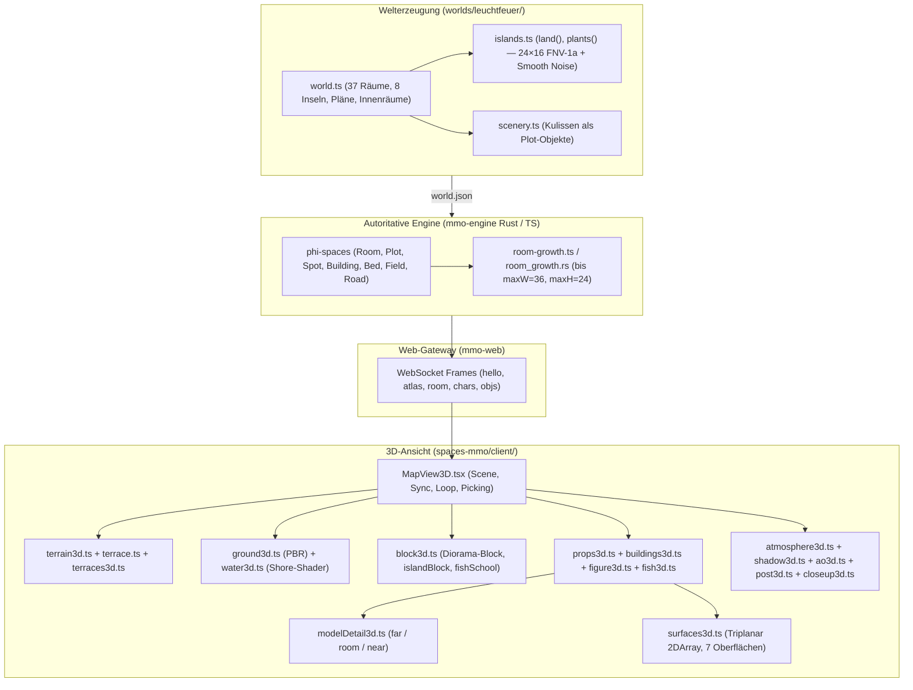

# Analyse & Plan: 3D-Welt, Rendering-Verbesserungen und Server-Raster-Verfeinerung auf 1/4 Zellfläche

**Datum:** 2026-11-21 (überarbeitet am selben Tag, am 2026-11-22 und am 2026-11-24)  
**Zielsystem:** `spaces-mmo` (3D-Client `Three.js 0.186.1`, 2D-Client `PixiJS 8.22`, Dual-Engine TypeScript & Rust `mmo-engine`, `mmo-web`, `phi-spaces`)  
**Festgelegte Zielrichtung:**
1. **Zellgröße auf 1/4 Fläche** (`gridScale = 2`, Kantenlänge halbiert → viermal so viele eigenständige Zellen: `24×16` → `48×32`, max. Wachstum `36×24` → `72×48`).
2. **Echte Server-Raster-Verfeinerung** (autoritative Koordinaten in TypeScript- & Rust-Engine, inklusive Store-Migration, 2D- und 3D-Client).
3. **Aufbauend auf 3D-V3** ([`docs/3D-V3/README.md`](../3D-V3/README.md)) und den Optimierungen aus [`docs/code-analyse-2026-11-19.md`](../../../docs/code-analyse-2026-11-19.md).

---

**Status:** Entwurf. Abschnitte 2–6 beschreiben die geplanten Änderungen. Die Smartphone-Messungen in Abschnitt 1 betreffen den bisherigen Renderer.

**Rasterregel.** Bei gleicher physischer Raumgröße verdoppeln sich Spalten- und Zeilenzahl. Jede der entstehenden Zellen ist über ihre eigenen ganzzahligen Koordinaten unabhängig adressierbar.

1. [Ist-Analyse](#bestand)
2. [Raster und Spielregeln](#raster)
3. [Bewegung, Belegung und Wachstum](#engine)
4. [Ansichten und Rendering](#ansichten)
5. [Migration und Umschaltung](#migration)
6. [Reihenfolge und Abnahme](#abnahme)

## 1. Ist-Analyse: 3D-Welt, Welterzeugung & Modelle

### 1.1 Gesamtarchitektur

Die 3D-Ansicht (`client/MapView3D.tsx`) ist heute eine rein visuelle Repräsentation des autoritativen 2D-Rasters auf dem Server (`docs/architektur.en.md`, „3D-Ansicht“). Sämtliche Kollisionen, Wege, Belegungen und Spielregeln laufen in `mmo-engine` (produktiv Rust auf `big` und `nano`, TypeScript als Referenz/Orakel).

### 1.2 Welterzeugung (`worlds/leuchtfeuer/`)

- **Raumgrößen:** Alle 37 Außenräume auf 8 Inseln haben eine Basisgröße von **24×16 = 384 Zellen** (`islands.ts`: `W = 24, H = 16`). Ab 70 % Belegung des bebaubaren Landes (begehbare Zellen ohne Wege und Passagen) und bei geeigneter Einfügestelle wächst ein Raum über `growthTick` (`server/engine/commands/growth.ts`, `rust/mmo-engine/src/commands/growth.rs`) in Streifen zu 4 Zellen bis auf **36×24 = 864 Zellen** (`world.ts`: `growth`). Innenräume (`interior` bei Hütte, Backhaus, Metzgerei, Gewächshaus) sind eigene kleine Räume (`7×6` bis `10×7`).
- **Terrain-Generator (`islands.ts` `land()`):**
  - `graue-bucht` und `klippenpfad` sind handgezeichnete ASCII-Grids (`~` Wasser, `.` Sand, `:` Pflaster, `,` Gras). Das `dig`-Template (`world.ts`, Builder-Befehl „grabe“) ist eine Vorlage für neue Räume, kein eigener Raum.
  - Die übrigen 35 Räume werden deterministisch aus `roomId`-Seed generiert: FNV-1a-Hash + 2-Oktaven-Smooth-Noise (`step = 4` und `step = 2`) für Küsten-Wobble, Strandbreite (`beach`), Bodenflecken (`step = 3`), runde Pflasterplätze (`plaza`) und gerade Pflasterwege von der Raummitte `(12, 8)` zu den Türen/Stegen (`DOOR`).
- **Flora & Deko:**
  - **Server (`islands.ts` `plants()`):** Erzeugt das statische `decor`-Grid (Blumen-Patches, Kräuter, Büsche, Bäume) auf freiem Gras mit 1-Zellen-Abstand zu Wegen, Türen und markierten Objekten. Begehbar. Die im Raum vorkommenden Decor-Arten bestimmen auch, welche Samen gesammelt werden können.
  - **Client (`MapView3D.tsx` `buildPlants()`):** Ergänzt deterministisch per `stableHash` rein visuelle Wildblumen auf 28 % der freien Graszellen (1–2 Stück pro Zelle) sowie Palmen auf 7 % der freien Sandzellen.
- **Kulissen & Gebäude (`scenery.ts`, `world.ts`):** Rechteckige Grundrisse von `1×1` (Regentonne, Vogelscheuche, Baum) über `2×2` (Hütte, Mühle, Beet) bis `4×4` (Acker, Park). Begehbare Kulissen mit `through` erhalten keinen Plot. Jede reservierte Grundrisszelle wird im Space als eigener `Plot`-Eintrag mit `unique: ["room", "x", "y"]` reserviert (`build.ts`). Diese `unique`-Prüfung des Space ist heute der Mechanismus, der überlappende Bauten auch zwischen parallelen Workern ausschließt.
- **Grenzen der Wegsuche heute:** Server `findPath` mit `max = 40` Schritten (`server/engine/world.ts`), Client-BFS mit höchstens 1024 besuchten Zellen (`client/walk.ts`).

### 1.3 3D-Terrain, Diorama & Rendering-Pipeline

- **Terrassen-Geometrie (`terrain3d.ts`, `terrace.ts`, `terraces3d.ts`):**
  - Feste Höhenstufen pro Kachelart: `~` = 0,06, `.` = 0,20, `_` = 0,30, `:` = 0,36, `,` = 0,50, `#` = 1,30. Das per-cell-Rauschen `terrainHeight()` (±0,03) wird in `MapView3D.tsx` nicht genutzt, um dunkle Fugen zwischen Nachbarzellen zu vermeiden.
  - `outlineLoops()` + `withHoles()` extrahieren Konturen aller Zellen ab einer Höhenstufe, `rounded(CORNER = 0.42, 6)` rundet Ecken (außer am Raumrand), `ExtrudeGeometry` (5 Bevel-Segmente) erzeugt pro Land-Art ein Mesh mit 3 Materialgruppen (`top`, `flank`, `wall`).
- **Boden & Wasser (`ground3d.ts`, `water3d.ts`):**
  - 6 PBR-Materialsets unter `public/materials/{sand,grass,paving,planks,plaster,rock}/` (`color.jpg`, `normal.jpg`, `arm.jpg`; ca. 4,8 MB Download), 1,5–2,5 Zellen Repeat, prozedurales 2-Oktaven-Makro-Noise gegen Kachelung, Ufer-Nässe über `shoreTexture` (Chamfer-Distanz, `SHORE_REACH = 4`).
  - Wasser als einzelne `BoxGeometry` unter dem Raum mit prozeduralem Wellen-Normalen-Shader (3 Sinus + 2 Noise-Oktaven), Flach-/Tiefwasser-Verlauf und animiertem Schaum.
- **Diorama-Block & Insel-Ebene (`block3d.ts`, `fish3d.ts`):**
  - Unter dem Raum hängt ein Block (`BLOCK_DEPTH = 2.6`) mit Gesteinsschichten (`rockSide` + `strataTexture`), halbtransparenten Seeseiten, Sandhang (`SEABED = 1.6`) und instanziierten Fischschwärmen (`fishSchool`, max. 6 Draw-Calls; auf Insel-Zoom ausgeblendet).
  - Nachbarräume der Insel (`islandBlock`, `ISLAND_GAP = 5`) werden als ein zusammengefügtes Voxel-Deckel-Mesh gezeichnet (bis 5 Quads = **10 Dreiecke pro Zelle**).
- **Licht, Schatten, AO & Postprocessing (`atmosphere3d.ts`, `shadow3d.ts`, `ao3d.ts`, `post3d.ts`, `closeup3d.ts`):**
  - Physischer `Sky`-Shader + `PMREMGenerator` Environment-Map (alle 0,1 Weltstunden neu gerendert) + Horizont-Farbprobe für `FogExp2`.
  - **Split-Shadow-Map (`shadow3d.ts`):** Bis 4096² (skaliert mit `sharp.scale` auf 2048² / 1024²). Statische Szene (`STILL`) wird gecacht und 1×/s bzw. bei Änderung aktualisiert; bewegte Figuren (`MOVING_LAYER`) werden darüber gezeichnet.
  - **Baked 2.5D-AO (`ao3d.ts`):** Orthografischer Tiefen-Pass von oben (`AO.texels = 8` Texel/Zelle, max. 2048²) + separabler Gauss-Blur (`AO.reach = 0.45`, `AO.depth = 0.7`, `AO.strength = 0.45`). Ein Textur-Lookup pro Fragment in allen beleuchteten Materialien.
  - **Postprocessing (`post3d.ts`):** `HalfFloatType` Target mit 4× MSAA + DepthTexture → `UnrealBloomPass` → `BokehPass` (nur Zoom > 2, liest bestehende DepthTexture) → `OutputPass` (ACES Filmic). Layer 1 (Labels/Sprechblasen) separat danach ohne Tone-Mapping.
  - **Dynamische Auflösung (`closeup3d.ts` `sharpen()`):** Regelt Pixel-Ratio zwischen 100 % und 50 % (min. 0,75 DPR) im Zielkorridor 42–56 FPS.
  - **Historische Smartphone-Messung (`docs/3D-V3/README.md`):** **26 FPS (39 ms/Frame)** nachts bei halber Auflösung (Teilproben, keine additive Zerlegung: ca. 20 ms Grundlast Boden+Wasser, 13 ms Dinge+Figuren, 5 ms Schatten, 5 ms Pflanzen, 3 ms Bloom), ca. **120–217 Draw-Calls** und **~160k Dreiecke** in Graue Bucht.

### 1.4 Modelle (`props3d.ts`, `buildings3d.ts`, `figure3d.ts`, `modelDetail3d.ts`, `surfaces3d.ts`)

- **Prozedurale Geometrie:** Alle Modelle werden aus Three.js-Primitiven zusammengesetzt und via `merge()` in non-indexed `BufferGeometry` mit Vertex-Farben, `glow`, `surface`, optional `tint` und geglätteten `creaseNormals()` (50°-Grenzwinkel) überführt und im Cache (`cached()`) gehalten.
- **3 LOD-Stufen (`far`, `room`, `near`):** `updateModelDetails()` läuft alle 150 ms. `far` bei Zoom ≤ 0,55 (Hysterese 0,65), `near` bei Zoom ≥ 2 und Kamera-Distanz ≤ 16 (Hysterese 18) mit Budget-Limit **48 Near-Meshes** und **120.000 Modell-Dreiecken**. `BoxGeometry` wird ab `room` per `ExtrudeGeometry` abgeschrägt (Bevel); große Kugeln werden mit `lumpy()` verformt.
- **Laub:** Echtes 3D-Geometrie-Laub (`blade()` = 4 Dreiecke, Vor- und Rückseite explizit) mit 800 Blättern/Zelle² (`room`) bzw. 1500 (`near`) über einer inneren Schattenkugel (`SHADE`). Größter Dreieckstreiber der Szene.
- **Material & Oberflächen (`surfaces3d.ts`):** Ein geteiltes `propMaterial` mit 3D-Value-Noise-Grain, Screen-Space-Bump (`dFdx`/`dFdy`, distanz- und pixelgrößen-gecullt) und triplanarer Projektion aus zwei `DataArrayTexture`s (7 Oberflächen: `bark`, `thatch`, `brick`, `slate`, `wood`, `rock`, `plaster`; 512×512 Color + ARM, ohne Normal-Maps). Einschränkung: Ohne UVs liegt die Maserung auf liegenden Balken senkrecht, und jedes texturierte Fragment führt **6 `textureGrad`-Fetches** aus.
- **Figuren (`figure3d.ts`):** Ein `SkinnedMesh` mit 7 Bones (`FIGURE_SCALE = 1.3`), eigenes `figureMaterial` (nur Vertex-Farben, ohne Stoff-/Haut-Texturen oder `surfaces3d`).

---

## 2. Raster und Spielregeln

Leuchtfeuer erhält ein autoritatives Raster mit halber Kantenlänge. Server, Befehle, Store und Raum-Frames verwenden ganzzahlige Zellen. `gridScale` gilt für die ganze Welt einschließlich Innenräumen. Unterstützt werden 1 und 2. Für alte Weltdefinitionen gilt 1. Das Fehlen einer Angabe im Store wird beim Start gesondert behandelt (Abschnitt 5). Welche Zellen begehbar sind, entscheiden Terrain, Belegung und Spielregeln. [Architektur](../architektur.en.md)

**Zelle.** Ein Raum mit 48×32 hat 1.536 Zellen. Beispielsweise können (6,4) und (7,4) unterschiedlichen Boden, unterschiedliche Belegung und unterschiedlichen Straßenzustand haben. Befehle, Snapshots und Picking beziehen sich auf die genaue Zelle.

**Herkunft der Geometrie.** Die Weltdefinition führt neben `gridScale` die Angabe `derivedFrom`. `derivedFrom: 1` bedeutet: Der Generator (`land()`, `plants()`, handgezeichnete Räume, `DOOR`, `ARRIVE`) läuft mit den Skala-1-Parametern und wird auf die Zielmaße umgerechnet. Ohne `derivedFrom` entwirft der Generator nativ in Zellen der eigenen Skala. Leuchtfeuer wechselt zuerst auf `gridScale: 2, derivedFrom: 1`. Dadurch liefern jeder Loader-Neustart und jede frische Welt dieselbe Geometrie wie die Migration des Bestands. Der Startcheck (Abschnitt 5) vergleicht beide Angaben mit dem Store.

### 2.1 Größen

| Größe | Heute | Ziel bei Skala 2 |
| --- | --- | --- |
| Basisraum und physische Größe | 24×16 Zellen | 48×32 Zellen auf denselben 24×16 World-Units |
| Wachstum | Streifen 4, maximal 36×24 | Streifen 8, maximal 72×48. Jede geeignete Naht zwischen Zellen ist zulässig. |
| Innenräume | 7×6 bis 10×7 | 14×12 bis 20×14, Türen, Ausgänge, Innen-Beete (Gewächshaus) und Einrichtung nach denselben Regeln wie außen |
| Grundriss | Hütte 2×2, Acker 4×4 | Hütte 4×4, Acker 8×8. Ursprung ist die linke obere Zelle, die rechte und untere Grenze sind exklusiv. |
| Einzelobjekte | Baum, Vogelscheuche, Regentonne, Bienenstock und Signalfeuer 1×1 | Grundriss 2×2 in allen Wachstumsstadien. Den Typvertrag von `TreeFields` von den Literalen `w: 1; h: 1` auf `w: number; h: number` weiten; dass beide gleich `gridScale` sind, wird zur Laufzeit geprüft. |
| Reichweiten | Regeln in Zellen | Gleiche Zelle bedeutet bei Zellpunkten identische Koordinaten; eine Prüfung gegen eine Fläche (Feuer, Ausgang, dessen Passage) prüft, ob die Zelle in ihrem Grundriss liegt, sodass heutige Punktprüfungen wie die freie Ankunftszelle („no exit and no fire is on“, `occupancy.ts`) und `isPassage` zu Grundrissprüfungen werden. Für physische Reichweiten die Metrik beibehalten und den Radius in Zellen verdoppeln. Zur tatsächlichen Zelle oder nächsten Zelle des Objektgrundrisses messen. Alle Seiten und die erste Zelle außerhalb der Reichweite prüfen. |
| Beete und Äcker | Pflanzung auf einer Beetzelle; jede Zelle eines Beets nimmt eine Pflanze (`garden.ts`: die freien Zellen des Beets) | Eine Pflanze steht auf ihrer gewählten Beetzelle. Ein Beet fasst höchstens `w·h / gridScale²` Pflanzen, so viele wie dasselbe physische Beet heute; bis dahin darf jede freie Zelle des Beets gewählt werden. Ein konvertiertes Beet behält seine Pflanzen und hat keinen Platz für weitere; ein Beet mit weniger Pflanzen als seine Kapazität behält die Differenz. Ohne diese Grenze nähme ein 4×4-Beet 16 statt 4 Pflanzen und gäbe den vierfachen Ertrag je physischer Fläche. Flächenabhängigen Bedarf und Ertrag je Ackerzelle für gleiche physische Fläche umrechnen. |
| Straßen | geordneter Weg aus einzelnen Zellen | Route.cells, Road.cells und die Ansichten führen die tatsächlichen Straßenfelder in Reihenfolge. Auf jeder Zelle kann die Straße abbiegen oder enden. Der lokale Wert paved zählt fertige Zellen. Stein und Arbeit neuer Straßen richten sich nach physischer Weglänge. Straßen liegen als Auflage auf dem Terrain. *Festlegung:* Eine Straße ist eine Zelle breit, halb so breit wie heute; die Zellen daneben sind bebaubar, ein Gebäude darf also direkt neben einer Straße stehen, wo heute eine halbe Straßenzelle dazwischen lag. |
| Wegsuche | Server höchstens 40 Schritte, Client 1024 Zellen | Befehlsgebundene Wege: 80 Schritte. Raumweite Navigation: siehe Abschnitt 3. |

### 2.2 Punkte und Flächen

Jedes Koordinatenfeld eines Eintragstyps erhält genau eine der folgenden Klassen. Ein Typ kann mehrere Felder verschiedener Klassen tragen: `Character.x/y` und den Landepunkt `Character.aboard.spot`, `Room.map`, den äußeren Grundriss in `Room.building` und die Wachstumshistorie. Die Zuordnung steht als Tabelle im Code nach Typ und Feldpfad (TS und Rust gleich) und wird gegen die Liste aus [`shared/model.ts`](../../shared/model.ts) geprüft; die Rust-Seite prüft gegen eine daraus erzeugte Liste, so wie `src/commands.json` aus der Befehlstabelle des Orakels erzeugt wird. Ein Koordinatenfeld ohne Klasse lässt den Startcheck scheitern.

| Klasse | Typen (Ausgangsliste, beim Umsetzen vervollständigen) | Regel bei Skala 2 |
| --- | --- | --- |
| Fläche | Baustelle, Gebäude, Ruine, Kulisse, Baum, Beet, Acker, Zone, Mühlenladung, Bauauftrag, Motion-Zone (`Motion.zone`, folgt ihrem Raum), Feuer (`Beacon`), Ausgang (`Exit`) | Position und Grundriss mit `gridScale` multipliziert. Konvertierte Feuer und Ausgänge erhalten einen `2×2`-Grundriss (`w/h = gridScale`): Figuren laufen nicht in den 1-Unit-Feuerring; gepflasterte Wege des Terrains, auf zwei Zellen Breite umgerechnet, überqueren den ganzen Ausgang; und eine konvertierte Straße, die auf der geraden Zeile oder Spalte `(2x, 2y)` verläuft, trifft die erste Zeile oder Spalte des Ausgangs. `ExitFields` und `BeaconFields` haben heute kein `w/h` und erhalten es wie `TreeFields`; die Weltdefinition führt Ausgänge und Feuer weiter als Punkte in Skala-1-Zellen, und `world:json` schreibt bei `derivedFrom: 1` `w = h = gridScale`. Native Entwürfe dürfen kleinere `w×h` wählen (bis `1×1`, wenn Modellgröße und Wegbreite dazu passen). |
| Zellpunkt | Ankunft (`arrive`), Raum-Spawn, Figur, `Spot`, Tier, Karren, Boden-Item, Beetpflanze, Ankunft vor einer Tür | Ein Koordinatenpaar speichern. Für einen Altpunkt einmalig bei der Konvertierung `(2x, 2y)` verwenden. Neue Punkte dürfen jede gültige Zelle nutzen. Passagenradius um Ausgänge und die bestehende Suche nach einer freien Ankunftszelle separat beibehalten. |
| Ohne Raumbezug | Atlasposition (`Room.map`), Inventar-Sentinel `(-1,-1)` | Unverändert. |

**Platzierung.** Maßgeblich sind die tatsächlich vom Objekt belegten Zellen.

- Welterzeugung und Bau prüfen jede belegte Zelle des gewünschten Grundrisses.
- Die tatsächlichen Zellen von Feuern, Ausgängen, Straßen und Ankunftspunkten sowie ausdrücklich festgelegte Abstände schützen.
- Die Ankunft vor einer Tür folgt beim Versetzen ihrem Gebäude.
- Eine Wachstumsnaht ist an jeder Spalten- oder Zeilengrenze zulässig, an der Grundrisse und Erreichbarkeit sie erlauben.

**Koordinaten in Texten.** Befehle mit Koordinaten (`geh x y`, `versetze`, die Befehle des Bauherrn) nehmen Zellen der Skala der Welt. Hilfetexte, Meldungen, die Zellen, Größen oder Abstände nennen, die Modell-Prompts der NPCs und gespeicherte Befehlszeilen werden inventarisiert und mit dem Wechsel angepasst.

**Arena und codemode-chat.** Die Arena (`server/arena.ts`) startet je Bot eine frische Leuchtfeuer-Welt und wechselt ihre Skala daher mit der Welt; eine Arena auf Skala 1 neben einer Welt auf Skala 2 gibt es nicht. Was codemode-chat davon hält, zählt in Zellen und ändert sich mit demselben Schnitt: die Werkzeugbeschreibungen und Beispiele der Bots (`codemode-chat/server/bottask.ts`: `move 5 7`, ein Teilziel „höchstens 3 Zellen von `near`“, „je 10 Zellen Umweg“ pro Sprung), die Konstanten des Richters dahinter (Längen, in der Tabelle aus Abschnitt 2.4) und die Einträge mit Zellen in seinem Space (`BotEpisode`-Wege, `PlanMemory`-Beobachtungen und -Teilziele, `BotRoom`-Geometrie). *Festlegung:* Die gespeicherten Zellen sind Zellpunkte und werden mit dem Schnitt skaliert, ein gemerkter Weg bleibt also eine gültige Folge von `move`-Zielen; `BotRoom`-Geometrie wird nicht konvertiert, sondern neu aus `map` der Arena gelesen. Bot-Läufe, auch dauerhafte, werden vor dem Schnitt beendet oder geschlossen. Der Store von codemode-chat gehört zum Inventar aus Abschnitt 5 (Schritt 1), seine Tests zu Fall 3 in Abschnitt 6. Die Spielzeuginseln des Judges werden mit demselben Schnitt skaliert (Abschnitt 2.3); die Zellen und Regelwerte, die codemode-chat hält, stehen in den [Inventuren](../raster-inventur-2026-11-24.en.md) (Abschnitt 4).

### 2.3 Entscheidungen

1. **Figurendichte.** Eine Figur belegt eine Zelle, also passen physisch bis zu vier Figuren dorthin, wo heute eine steht. Die Figurengröße (2D 32 px, 3D `FIGURE_SCALE 1.3`) ist größer als eine Zelle von 0,5 World-Units.  
   *Festlegung:* Figurengröße beibehalten und am Mittelpunkt der tatsächlichen Zelle zeichnen. Eine konvertierte Figur, Ankunft oder ein Spawn steht auf `(2x, 2y)` und wird damit eine Viertel World-Unit links oberhalb der heutigen Stelle gezeichnet; das wird hingenommen. Vier benachbarte Figuren über gerade und ungerade Koordinaten hinweg in 2D und 3D prüfen. Bestanden, wenn jede der vier per Tippen gewählt werden kann (die Treffer aus Abschnitt 4, je Figur), jedes Namenslabel ohne Überdeckung lesbar ist und in 3D keine Figur im Stand in einer anderen steht (die Modelle berühren sich höchstens).
2. **Ein Schnitt, Belegung zuerst.**  
   *Festlegung:* Die Umstellung ist ein definierter Schnitt ohne Rückweg. Entwicklung und alle Tests laufen auf lokalen Rechnern; `big` und `nano` erhalten Binaries, Seite und migrierte Stores zusammen, und erst nach der lokalen Freigabe (Abschnitt 6). Eine Zwischenstufe in Produktion gibt es nicht: Das Belegungsformat geht nicht für sich auf Skala 1 in Betrieb. Die Binaries des Zielstands laufen deshalb nur auf dem Zielformat (Grundrisse, die Skala der Weltdefinition); Plots liest allein die Migration. Innerhalb des Schnitts bleibt die Reihenfolge: Die Migration macht zuerst auf Skala 1 aus Plots Grundrisse und vergleicht sie (Abschnitt 5), dann skaliert sie das Raster, was damit eine reine Koordinatenmigration ist. Die Entwicklung hält dieselbe Reihenfolge (Phasen 1 und 2).
3. **Was die Inventuren von Phase 0 offen ließen** ([Inventuren](../raster-inventur-2026-11-24.en.md), Abschnitt 5).  
   *Festlegung (2026-11-24):*
   - Ein Ring „neben“ im Abstand genau einer Zelle wird zu den Zellen innerhalb der verdoppelten Reichweite, die nicht auf dem Grundriss liegen (1 bis 2).
   - Blumen kreuzen sich mit einer Pflanze bis Manhattan-Abstand 2; zwei Pflanzen stehen nie auf einer Zelle.
   - `MAX_TRAIL` der Arena verdoppelt sich.
   - `NpcMemory` wird beim Schnitt geleert.
   - Die Spielzeuginseln von codemode-chat (`toyisland.ts`, `toyarena.ts`, eine eigene Welt im Prozess des Judges) wechseln ihre Skala mit dem Schnitt, damit Bots und Judge ein Raster kennen.

### 2.4 Weltdefinition

Bei der ersten Umrechnung das vorhandene Terrain auf die Zielmaße übertragen. Jedes Decor-Symbol einmal an seine umgerechnete Position setzen und dort zeichnen. Sammelbare Samenarten je Raum vergleichen. Danach lässt sich jede Zelle unabhängig ändern.

**Definitionswerte in Zellen.** Bei `derivedFrom: 1` bleibt die Weltdefinition für alles, was Position oder Grundriss ist, in Skala-1-Zellen geschrieben: Plan-Grundrisse, `door`, Innenraum-Layouts und Einrichtung, `scenery.ts`, `FieldDef.w/h`, Beetgrößen, Spawn. `world:json` skaliert sie wie die Ausgabe des Generators. Regelwerte, die in Zellen oder Zellzahlen zählen, werden nicht über ihre Lage in einem Grundriss skaliert. Sie stehen in einer Tabelle im Code (TS und Rust gleich), jeder mit seinem Ort und seiner Art: Länge (Faktor 2) oder Fläche (Faktor 4). Werte der Weltdefinition werden mit ihrem Pfad genannt und von `world:json` bei `derivedFrom: 1` skaliert, sodass `world.ts` in Skala-1-Zellen bleibt: die Längen `growth.strip`, `growth.maxW`, `growth.maxH`, die Flächen `field.seedPerCells`, `field.sowPerCells`, `field.harvestPerCells` und der Divisor von `perCell` der Feldfrüchte; `growth.fullShare` ist ein Verhältnis und bleibt. Konstanten des Codes (Reichweiten wie `SITE_REACH`, Weggrenzen) nehmen ihren Wert aus der Tabelle. Ein Wert steht an genau einem Ort: in der Definition oder im Code, nie doppelt skaliert. Straßen- und Bewegungskosten aus der physischen Länge berechnen und erst die Gesamtsumme runden. Anders als ein Koordinatenfeld ohne Klasse (Abschnitt 2.2) kann der Startcheck eine Konstante, die in der Tabelle fehlt, nicht finden. Die Tabelle wird deshalb durch ein Inventar beider Engines gefüllt, und das Inventar umfasst benannte Konstanten (`EXIT_REACH`, `SITE_REACH`), Default-Argumente (`freeCellNear(…, radius = 8)` in `occupancy.ts`, `findPath(…, max = 40)` in `world.ts`) und bloße Zahlen in Abstandsvergleichen. Danach nehmen die Helfer für Abstand, Suche und Weg ihre Grenze als Pflichtargument aus der Tabelle, ohne Default, sodass eine neue Verwendung keine eigene Zahl mitbringen kann. Zahlen, die keine Zellen sind, bleiben draußen (`MOVES_PER_COMMAND`: Dinge je Befehl). Die [Inventuren](../raster-inventur-2026-11-24.en.md) (Abschnitt 1) führen jeden gefundenen Wert auf, darunter neben den obigen die Straßenkosten `cart.route.stonePer`/`workPer`, `wild.scareReach`, `wild.scarecrowReach`, `garden.greenhouse.reach` und `townhall.zoneRadius` (Längen), sowie 30 Prüfungen „neben einem Objekt“ und acht Reichweiten zu einem Punkt, die über zwei benannte Einträge laufen.

Ein späterer nativer Entwurf (ohne `derivedFrom`) bemisst `DOOR`, `ARRIVE`, Wege, Plätze, Küstenbreiten, Noise-Schrittlängen und Pflanzabstände in physischen Einheiten. Die beiden handgezeichneten Räume, das Grabungs-Template, Innenräume und `scenery.ts` werden dabei gesondert behandelt. Je Raum Ein- und Ausgänge, Spawn und beabsichtigte Verbindungen per Flutsuche prüfen. Bestehende Räume erhalten dann eine eigene Prüfung aller Bauten, Wege, Samenarten und Ankunftsorte (Abschnitt 5). Rein clientseitige Pflanzen können unabhängig davon variiert werden. Nach jeder geänderten Weltdefinition `npm --prefix spaces-mmo run world:json` ausführen. [Welterzeugung](../../worlds/leuchtfeuer/islands.ts) · [Samenregeln](../../server/engine/commands/garden.ts)

## 3. Bewegung, Belegung und Wachstum

**Bewegung.** Einzelnes Antippen bewegt eine Zelle. Gehaltene Richtung oder Klickpfad dürfen bei Skala 2 zwei aufeinanderfolgende Schritte auf derselben Achse in einem nummerierten Intent anfordern. Der Takt bleibt 150 ms, auf freier gerader Strecke also rund 6,7 Intents pro Sekunde und dieselbe physische Geschwindigkeit wie heute. Bei Skala 1 bleibt die zulässige Länge eins. Ein Intent dauert einen Takt, gleich wie lang er ist: Ein Einzelschritt bei Skala 2 legt je Takt die halbe physische Strecke zurück. Das wird für einzelnes Antippen und ungerade Reste hingenommen, und die Wegglättung hält es selten. TS- und Rust-Gateway validieren nummerierte Frames einschließlich Sequenznummer. Die Engine prüft Richtung und Länge für jeden Zugangsweg, auch für Textbefehle ohne Sequenznummer. Der bestehende Schrittpuffer von acht Intents (`MAX_AHEAD`) und die Nachfüllrate von zehn Intents/s sind Ausgangswerte. CPU und Schreiblast pro ausgeführtem Weg werden gemessen. [Gateway](../../server/gateway.ts) · [Rust-Gateway](../../rust/mmo-web/src/gateway.rs) · [Vorhersage](../../client/walk.ts)

**Wegglättung.** Damit schräge Wege nicht in Einzelschritte zerfallen, wählt die Client-Wegsuche unter gleich langen Wegen den mit den wenigsten Richtungswechseln, und ein Richtungswechsel folgt möglichst erst nach einer geraden Zahl von Schritten. Einzelschritte bleiben für ungerade Reste und Hindernisse. Messgröße: Auf einer diagonalen Testroute ohne Hindernisse erreicht die Figur mindestens 90 % der physischen Geschwindigkeit der geraden Strecke. Das heutige `nextStep` (`client/walk.ts`) kann das nicht: Es liefert nur den ersten Schritt einer Breitensuche und sucht bei jedem Schritt neu. Die Glättung braucht eine Suche, die die Richtung (und die Parität des Laufs) im Zustand führt, oder einen Weg, der behalten und nur bei einem verweigerten Schritt neu geplant wird. Auch die Suchkosten steigen (vierfache Zellzahl, doppelt so viele Schritte je Strecke); die Suchzeit des Clients je Strecke auf dem Smartphone bei Skala 2 im Maximalraum messen und unter einem Takt halten.

**Servergetriebene Beweger.** Der Doppelschritt gilt nur für Spieler. Alles, was der Server bewegt, wird mit seinen Zellen je Zyklus inventarisiert und behält seine physische Geschwindigkeit: NPCs und Siedler gehen mit `move x y` zu einem Ziel und mit `go` durch einen Ausgang (`server/npc/requests.ts`, `economy.ts`, `scripts.ts`), ein Befehl und ein Commit je Gang, wie lang er auch ist, begrenzt durch die Grenze befehlsgebundener Wege (80 Schritte, dieselbe physische Reichweite wie heute 40); Wildtiere werden gesetzt, Wagen springen von Raum zu Raum, und die Bots der Arena suchen Wege nur für die gezeichnete Spur (`server/arena.ts`, deren Weggrenze von 400 wird 800). Die physische Geschwindigkeit je Art von Beweger vorher und nachher messen.

**Ausführung.** Die Engine prüft beide Teilstrecken in Reihenfolge gegen Terrain, blockierende Objekte und Figuren. Bei blockiertem ersten Schritt bleibt die Figur am Start. Wird erst der zweite verweigert, endet sie auf der ersten Zelle. Ein gültiger Ausgang löst beim Betreten einer beliebigen Zelle seines Grundrisses sofort den Übergang aus und beendet diesen Intent. Alles andere, was auf das Betreten einer Zelle reagiert (Zonen, Wildtiere, die eine Figur bemerken, und was das Inventar der Phase 0 sonst findet), wird für die Zelle zwischen den beiden Schritten ausgewertet wie für die Endzelle, in Reihenfolge: Ein Intent aus zwei Schritten darf nichts überspringen, was zwei Einzelschritte ausgelöst hätten. Position und endgültiger Spot beziehungsweise die Übergabe werden atomar festgeschrieben. Bei konkurrierender Spot-Reservierung sichert die Transaktion den letzten zulässigen Endpunkt oder die Figur bleibt am Start. [Bewegungsregeln](../../server/engine/commands/default.ts) · [Spot-Reservierung](../../server/engine/occupancy.ts)

**Bestätigung.** Für jeden angenommenen nummerierten Intent enthält genau eine Bestätigung den tatsächlich erreichten Zustand, auch bei Verkürzung oder Ablehnung. Sie wird wie heute als `CharacterFields.ack {conn, seq}` mit dem Commit geschrieben, der den Intent beendet. Bei einem Übergang in eine andere Region reist `ack` mit `Handover.character` und wird mit Raum und Ankunftszelle im Zielraum bestätigt. Raumwechsel verwirft alte Vorhersagen. Tests umfassen belegte Zwischenzellen, Gegenverkehr, Ausgang auf Teilstrecke eins, Ausgang über eine Regionsgrenze und einen während der Vorhersage belegten Zielplatz.

**Wegsuche.** Für die raumweite Navigation auf Skala 2 darf jede Zelle einmal besucht werden. Das Suchbudget entspricht der tatsächlichen Raumfläche (höchstens 72×48 = 3456 Zellen), ein einfacher Weg umfasst höchstens Fläche minus eins Schritte. Im maximalen offenen Raum sind es von Ecke zu Ecke 118 Schritte, Hindernisse können längere Wege erzwingen. Befehlsgebundene Wege behalten eine eigene Grenze (80 Schritte, das Doppelte der heutigen 40). Beispiele für beide Engines und den Client: ein offener Maximalraum, ein verbundener Umweg von mehr als 80 Schritten, dessen Suche mehr als 1024 Zellen betrachten muss (über der befehlsgebundenen Grenze und über dem heutigen Client-Budget, das betrachtete Zellen zählt, nicht Schritte; als Fall für die raumweite Navigation) und ein unerreichbares Ziel. Bei Skala 1 die bestehenden Grenzen als Kompatibilitätsfall prüfen. [Server-Wegsuche](../../server/engine/world.ts) · [Client-Wegsuche](../../client/walk.ts)

**Belegung.** Die Objektgrundrisse ersetzen die dauerhaften Einzel-Plots. Eine gemeinsame Abfrage liefert pro Zelle Objekt-ID, Bewegungsblockade, Baublockade und Beitrag zur Wachstumsquote. Ihre Ausgabe bei Skala 1 wird vor der Umschaltung zellenweise mit dem bisherigen Verhalten verglichen.

- Baustelle, Gebäude, Ruine, Beet, Acker, Baum und feste blockierende Kulissen behalten ihre reservierte Fläche. Abbaubare blockierende Kulissen zählen ebenfalls. Bei `Scenery.through` gelten die bisherigen Durchgangsregeln. Feuer sperren ihre Grundrisszellen. Straßenzellen bleiben begehbar und schließen Neubauten aus. Zonen behalten ihre eigenen Bauregeln.
- Figuren können ein unter ihnen angelegtes Beet oder Feld über die Zellen desselben Objekts verlassen. Versetzen ignoriert den eigenen alten Grundriss. Abriss, Verfall, Ernte, Tierplatzierung, nahe Objektwahl und der Wechsel von Baustelle zu Gebäude verwenden dieselbe Zuordnung. `Spot` bleibt die eindeutige Reservierung für Figuren außerhalb von Passagen, weiterhin mit `unique` auf Raum und Zelle.

**Sperren.** Weil mit den Plots die `unique`-Prüfung als Schutz gegen überlappende Bauten wegfällt, übernehmen Sperreinträge diese Aufgabe:

- *Raumsperre:* ein Eintrag je Raum. Wer statische Belegung eines Raums ändert, nimmt ihn per `take` in seiner Transaktion und schreibt ihn mit dem Commit zurück. Bricht die Transaktion ab oder läuft ihre Frist ab, fällt der Eintrag nach den Transaktionsregeln von phi-spaces an den Space zurück; ein abgestürzter Worker hält die Sperre also höchstens bis zum Fristablauf. Ein Befehl, der auf eine genommene Raumsperre trifft, wartet nicht: Er wird abgelehnt wie der heutige `held`-Fall von `takeNear()` (gerade nicht greifbar, bitte gleich noch einmal), während Loader, Wachstum und Hintergrundjobs warten und es erneut versuchen. Das weitet den heutigen Fall: `held` betrifft eine Baustelle oder ein Beet, die Raumsperre jede Änderung statischer Belegung im Raum, ein Spieler, der neben arbeitenden Siedlern baut, kann also abgelehnt werden, wo heute beide Erfolg haben. Die Sperre wird deshalb nur für die Überlappungsprüfung und das Schreiben genommen, nicht solange ein Befehl noch liest oder rechnet; NPCs und Siedler versuchen einen abgelehnten Befehl im nächsten Zyklus erneut, wie jede andere Ablehnung. Messgröße: Bauen zwei Spieler und die Siedler des Raums im selben Raum, werden höchstens 1 % der Baubefehle wegen der Sperre abgelehnt; darüber wird die Sperre mit kurzem Warten (unter einem Takt) genommen, bevor sie ablehnt.
- *Inselsperre:* ein Eintrag je Insel, für Änderungen, die mehrere Räume einer Insel betreffen, während `WORLD_LOCK` nur geteilt gehalten wird (Straßen über Raumgrenzen). Wachstum hält `WORLD_LOCK` exklusiv und schließt damit jeden Bauenden aus; es nimmt die Inselsperre nur zusätzlich, damit eine Reihenfolge gilt. Eine Region ist eine Gruppe von Inseln (`server/engine/regions.ts`), eine Inselsperre reicht also nie über zwei Spaces.
- *Lebenszyklus:* Die Sperre eines Raums wird in der Transaktion geschrieben, die den Raum anlegt (Loader, Grabung des Bauherrn, Innenraum eines fertigen Gebäudes), und mit dem Raum entfernt, `unique` auf den Raum, die der Insel ebenso auf die Insel. Ein Innenraum gehört zur Insel des Raums, in dem sein Gebäude steht. Der Startcheck (Abschnitt 5) verlangt genau eine Sperre je Raum und Insel: Eine fehlende würde das Bauen dort dauerhaft blockieren, eine zweite schlösse nichts aus.
- Reihenfolge: `WORLD_LOCK` (geteilt über `pinTerrain` oder exklusiv für Loader und Wachstum) vor Inselsperre vor Raumsperre, mehrere Räume in stabiler ID-Reihenfolge. Das verhindert Deadlocks zwischen `growthTick`/Loader und Baubefehlen und gilt für alle Änderungen an statischer Belegung, einschließlich Loader, Hintergrundjobs und Reparaturen. Die entscheidende Überlappungsprüfung liest nach dem Erwerb den aktuellen autoritativen Stand innerhalb der Transaktion. Ein vor dem Erwerb gelesener Prozessspiegel reicht dafür nicht aus.
- Jeder heutige Plot-Leser und -Schreiber in TS und Rust erhält einen zugeordneten Ersatz (heute u. a. `build.ts`, `builder.ts`, `field.ts`, `garden.ts`, `trees.ts`, `interior.ts`, `wild.ts`, `growth.ts`, `loader.ts`, `occupancy.ts`, `fire.ts`, `commands/default.ts`, `server/npc/settlers.ts`, `server/npc/economy.ts` und die Rust-Gegenstücke). Insbesondere nutzt `takeNear()` (`build.ts` und das Rust-Gegenstück) heute `Plot`-Einträge, um von einer anderen offenen Transaktion gehaltene Baustellen oder Beete zu erkennen (`held`), und muss auf die Raumsperre oder direkte Objektkonkurrenz umgestellt werden. Zwei gleichzeitige überlappende Bauversuche über getrennte Worker müssen genau einen Erfolg liefern. Zusätzlich Bau gegen Wachstum, Abbruch mit erneutem Versuch, Worker-Absturz mit gehaltener Sperre, parallelen Bau in verschiedenen Räumen und im selben Raum (die Ablehnungsrate oben) prüfen. [Bau und Objektzuordnung](../../server/engine/commands/build.ts) · [Momentaufnahme im Worker](../../server/world-host.ts) · [Wildtiere](../../server/engine/commands/wild.ts)

**Wachstum.** Die Vereinigung der bisher plotbelegten Grundrisszellen auf Bauland zählen. Der Nenner umfasst begehbares Terrain ohne Pflasterkachel `:` und Ausgangspassagen. Straßen auf Gras erhalten den Untergrund. Tatsächliche Zähler und Nenner vor und nach der Konvertierung vergleichen, einschließlich geänderter Passagengeometrie. Ab 70 % Belegung jede sichere Naht zwischen Zellen prüfen, auch an ungeraden Koordinaten. Eine Naht verwerfen, wenn sie einen Grundriss schneidet oder einen Weg unterbricht. Eine Naht zwischen zwei aufeinanderfolgenden Zellen einer Straße verwirft sie nicht: Die Zellen des Streifens auf der Linie der Straße werden der Reihe nach in `Route.cells` eingefügt, als gepflastert, wenn beide Nachbarn gepflastert sind, sonst als noch nicht gebaut, ohne Stein oder Arbeit erneut zu verlangen (heute kennt `growth.ts` keine Straßenregel; solche Nähte zu verwerfen, ließe keinen Raum wachsen, dessen Straßen beide Achsen kreuzen). Betroffene Objekte, Straßenfelder, Ankunftspunkte, Terrain und Wachstumshistorie gemeinsam transaktional verschieben. [Wachstum](../../server/engine/commands/growth.ts) · [Wachstumstransformation](../../server/engine/room-growth.ts)

**Kosten des feineren Rasters.** Die physische Raumgröße bleibt, darum kostet alles, was je World-Unit oder je Objekt gerechnet wird, so viel wie heute: Terrain-Mesh (`outlineLoops` behält nur Ecken, hochgerechnetes Terrain hat dieselben), AO, Schatten, Wasser, Inseldeckel aus der Vorschau, Pflanzenzahl. Die Plots entfallen, was Wachstums- und Bau-Commits und die belegte Menge des Feuers billiger macht. Was je Zelle läuft, wächst: Raumdaten, eine Suche über einen Raum und die Ringsuche von `freeCellNear` (Radius 8 auf 16) um das Vierfache, die Schritte eines Spielers je physischer Strecke um das Doppelte. Servergetriebene Beweger gehen nicht Zelle für Zelle: NPCs und Siedler laufen mit `move x y`, ein Commit aufs Ziel nach einer Wegprüfung (`server/engine/commands/default.ts`); Tiere werden gesetzt, Wagen springen Raum für Raum, die Arena sucht Wege nur für die gezeichnete Spur. Ihre Commit-Last wächst mit dem Raster nicht. Zwei Schleifen vervielfachen die Kosten je Zelle:

- *Zielwahl beim Antippen* (`client/App.tsx`, `walkTo`): Bei belegtem Ziel prüft sie bis zu 169 Ersatzzellen (Ringe bis Radius 6) mit je eigener Suche; heute im schlechtesten Fall 169 × 1024 ≈ 173.000 betrachtete Zellen, bei Skala 2 mit Radius 12 und dem Raumbudget 625 × 3456 ≈ 2,2 Millionen im Hauptthread des Smartphones.
- *Nahtsuche des Wachstums* (`growthTick`, im Epochen-Job, einmal je Weltstunde, `epochs.checkWorldMs`): Jede Kandidatennaht führt `connected()` mit zwei Suchen über den Raum und einer Kopie mit eingefügtem Streifen aus. Ungerade Nähte verdoppeln die Kandidaten (etwa 20 auf etwa 40 je Raum), der Raum hat die vierfache Zellzahl: etwa die achtfache Arbeit, grob 35.000 auf 280.000 betrachtete Zellen je Maximalraum. Ein Lauf prüft alle vollen Räume der Region nacheinander, während `WORLD_LOCK` exklusiv gehalten wird; eine Welt voller Räume ohne gültige Naht, der Dauerzustand alter Dörfer, hält damit jedes Bauen in der Region für den ganzen Lauf an.

Dritte Kostenstelle ist die Suche je Schritt auf der Seite (`client/walk.ts`): höchstens die Raumfläche je Tick, für sich unkritisch, mit der Richtung im Suchzustand (Wegglättung) bis zum Vierfachen.

**Leistungsstrategie.** Kosten folgen physischen Größen (Weltfläche, Objekte, Strecke), nicht Zellen; wo das nicht geht, läuft Arbeit einmal statt in einer Schleife, außerhalb von Sperren und nur bei Änderung.

- *Ein gemeinsames Raster.* Suchen und belegte Mengen nutzen heute `Set<string>` mit `"x,y"`-Schlüsseln (`walk.ts`, Wachstum, `blockedIn`, `occupiedIn`; `findPath` zählt innen numerisch, bekommt seine gesperrten Zellen aber als Zeichenketten). Ein `Grid` in `shared/` mit `Uint8Array` für Begehbarkeit und Belegung, Index `y·w+x` und wiederverwendeten Suchpuffern, in Rust dasselbe als `Vec<u8>`; die Rechteckabfrage der Belegung (Phase 1) liefert ihr Ergebnis in dieser Form. Nachbarreihenfolge und Tie-Break jeder Breitensuche bleiben genau, wie sie sind, damit die Engine-Walks gegen das Orakel halten.
- *Zielwahl in einer Suche.* Eine Breitensuche vom Start, dann die Kandidaten in derselben Ringreihenfolge, der erste erreichbare gewinnt: dasselbe Ergebnis, höchstens Raumfläche plus Kandidaten je Antippen.
- *Ein behaltener Weg.* Die Seite plant den Weg einmal je Ziel und plant nur neu, wenn ein Schritt abgelehnt wird oder ein Ack abweicht; die Wegglättung läuft dann einmal je Ziel statt je Tick.
- *Wachstum: billiger, seltener, außerhalb der Sperre.* (1) Eine Flutfüllung je Raum liefert die Komponenten der begehbaren Zellen; eine Naht wird lokal entlang des eingefügten Streifens geprüft (verbindet er dieselben Komponenten wie vorher die beiden Nachbarspalten), statt zwei Suchen über den Raum und einer Kopie je Kandidat: Raumfläche plus Kandidaten × Raumhöhe, etwa 3456 + 40 × 48 im Maximalraum. (2) Jeder Raum trägt einen Belegungsstand, der jedes Schreiben unter seiner Raumsperre zählt; „keine Naht“ und die Quote werden mit diesem Stand gemerkt, ein unveränderter voller Raum kostet einen Vergleich. Der Stand ist ein Feld des Raumsperr-Eintrags, den jeder Schreiber statischer Belegung ohnehin nimmt und zurückschreibt; auch das Wachstum zählt ihn hoch. (3) Die Kandidaten werden vor der Sperre auf dem Spiegel (`server/world-host.ts`) ermittelt; unter `WORLD_LOCK` wird nur der Stand verglichen und die gewählte Naht ausgeführt; ein geänderter Raum wird bis zum nächsten Lauf übersprungen. Die autoritative Prüfung in der Transaktion (Abschnitt 3, Sperren) bleibt, wie sie ist. Auf jedem Kandidaten geben die lokale Prüfung und das heutige `connected()` dieselbe Antwort; die Wachstums-Walks halten sie bei Skala 1 gegeneinander, bevor `connected()` entfällt.
- *Raumwechsel auf dem Smartphone.* Ufer-Distanzfeld und Backen der Pixi-Textur laufen stückweise über mehrere Frames oder in einem Worker mit `OffscreenCanvas` und werden je Raum und Version behalten, bis der Raum wächst.
- *Raumdaten im Netz* erst nach der Messung von Fall 4: `ground` als Lauflängen je Zeile (hochgerechnetes Terrain besteht meist aus Paaren gleicher Zeichen), oder der Raum je Version auf der Seite behalten und `hello` trägt nur die Version.
- *Gezählt, nicht nur gemessen.* Das Meter zählt die betrachteten Zellen je Suche (Zielwahl, `findPath`, Wachstum) und die Haltezeit von `WORLD_LOCK` je Epochenlauf. Tests halten feste Grenzen auf den Zählungen (Zielwahl höchstens Raumfläche plus Kandidaten); sie sind auf jedem Gerät reproduzierbar, Millisekunden nicht.

Für den 3D-Renderer ist wegen der Zellen nichts nötig, ebenso wenig Doppelschritte für NPCs.

## 4. Ansichten und Rendering

**2D.** Der Basisraum bleibt bei nominalem Zoom 768×512 Pixel groß. Die vorhandenen Tilesets liefern weiter 32×32 Quellpixel, ein Autotile-Viertel 16×16. Pixi zeichnet sie bei Skala 2 in 16×16 beziehungsweise 8×8 Zielpixel. Quellrechteck und Zielmaß erhalten getrennte Größen, auch für die in 3D verwendeten Tileset-Looks. Die tatsächlichen Zellen zeichnen. Animierte Wasser-Viertel, Sprites, vier benachbarte Figuren (Abschnitt 2.3), Labels und Touch-Picking am Rand mit beiden Skalen prüfen. Eine Zelle misst bei nominalem Zoom 16 Pixel, weniger als eine Fingerbreite auf dem Smartphone. *Festlegung:* Ein Tippen auf freien Boden nennt die Zelle darunter, und die Seite zeigt diese Zelle, bevor sie sie sendet; ein Tippen innerhalb eines Touch-Radius um ein Objekt, eine Figur oder einen Ausgang wählt dieses Ziel statt der Zelle. Der Radius gilt in Bildschirmpixeln, nicht in Zellen, und in 2D und 3D gleich. Messgröße auf dem Smartphone bei nominalem Zoom: Von je 50 Tippern auf eine Figur, auf ein 2×2-Objekt und auf einen Ausgang treffen mindestens so viele wie auf Skala 1. Jede Zelle als eigenes Pixi-Sprite zu zeichnen, würde die Terrain-Sprites vervierfachen; statischen Boden deshalb in eine Raum-Textur backen (animiertes Wasser bleibt separat), sodass die Anzahl der Pixi-Sprites und die Kosten beim Raumwechsel höchstens 5 % über der Skala-1-Referenz desselben Raums liegen. Die Textur wird beim höchsten Zoom mal Pixelverhältnis des Geräts gebacken, in Kacheln nicht größer als `MAX_TEXTURE_SIZE` des Geräts (ein Maximalraum von 72×48 hat bei Zoom 3 3456×2304 Pixel); eine Änderung an Boden oder Decor backt nur die betroffenen Kacheln neu, Straßen, Beete und Objekte bleiben eigene Sprites. [Pixi-Karte](../../client/MapView.tsx) · [3D-Tileset](../../client/tiles3d.ts)

**3D.** Die Zellkante beträgt `1 / gridScale` World-Units. Die Zellmitte liegt eine halbe Zellkante vom Zellrand entfernt. Vorwärts- und Rücktransformation verwenden denselben Raumursprung und dieselben Grenzen für Raycast, Objektanker, Straßen, Modellgrundrisse und Kameraziel. Materialien wiederholen sich je World-Unit. Höhen, Wandstärken, AO-Reichweite, Schattenkamera, Sichtweiten und Diorama-Tiefe werden in World-Units geführt; `AO.texels` gilt je World-Unit. Die Eckenrundung beträgt min(0,42 World-Units, 0,45 Zellkanten). `SHORE_REACH` gilt in World-Units: vier World-Units sind acht Zellen. Das Ufer bekommt doppelte lineare Auflösung. Clientseitige Pflanzwahrscheinlichkeit pro geeigneter Zelle durch vier teilen, mit einem Hash-Modulo, dessen Schwellwert ganz bleibt: Blumen bleiben bei 7 % mit `% 100 < 7` exakt; Palmen brauchen bei 1,75 % ein Vielfaches von 400 (`% 400 < 7` oder `% 2000 < 35`), denn 1,75 % jedes anderen Modulus wird auf einen ganzen Schwellwert gerundet. Die tatsächliche Pflanzzahl je Raum messen. Decor und Pflanzen auf der tatsächlichen Zelle prüfen und für clientseitige Pflanzen einen Freihalteradius um aufrechtes Decor (Bäume, Büsche) einhalten, damit Palmen und Wildblumen nicht in einer Baumkrone entstehen. Eine Touch-Toleranz darf die Objektauswahl erleichtern. Der an den Server gesendete Bau- oder Bewegungspunkt bleibt explizit und sichtbar.

**Atlas.** Das Gateway sendet den Atlas in seinem eigenen `atlas`-Frame. Nur das Gateway reduziert das Gelände auf eine Vorschau. Jeder Raumeintrag liefert Originalbreite und -höhe in Spielzellen sowie die Abtastung je Vorschauzelle (1 oder 2). Je Vorschaupixel die erfassten Terrainzellen mit deterministischer Mehrheit und fester Reihenfolge bei Gleichstand abbilden, am Raumrand beschneiden. Das gilt ausschließlich für das Vorschaubild. Feuer und Objektmarker behalten Spielzellenkoordinaten; der Marker einer Fläche (Feuer, Ausgang) steht in der Mitte ihres Grundrisses. Die Atlasansicht rechnet sie genau einmal in Bildkoordinaten um. `Room.map` zählt Raumschritte. Der 3D-Client baut den Deckel direkt aus der gelieferten Vorschau in der physischen Ausdehnung des jeweiligen Raums. Der aktive Raum verwendet immer sein volles Raumraster. Alte Frames ohne Zusatzfelder gelten als unverdichtete Vorschau.

**Protokollversion.** `hello` führt `gridScale` und eine Protokollversion, und die Seite nennt beim Verbinden die Version, die sie spricht. Eine Seite von vor dem Wechsel kann das neue Format nicht unterstützen: Beide Gateways verweigern eine Verbindung ohne passende Version, auch einen Reconnect aus einem alten Tab, mit einer Antwort, die die Seite neu laden lässt (der Build ist über `out/BUILD_ID` bekannt). Ihre Einzelschritt-Intents und Skala-1-Koordinaten erreichen die Engine damit nie. Test: Ein vor dem Wechsel geöffneter Tab verbindet sich danach neu. [Frames](../../shared/frames.ts) · [Atlas-Erzeugung](../../server/gateway.ts) · [Inselansicht](../../client/MapView3D.tsx)

Bei acht Räumen auf der größten Insel werden maximal sieben Nachbardeckel gezeichnet. Für sieben Basisräume entstehen heute höchstens `7 × 384 × 10 = 26.880` Deckel-Dreiecke. Ohne Vorschau wären es 107.520, mit 2×2-Vorschau wieder 26.880. Diese Rechnung erfasst nur die Deckel. Gewachsene Räume, Diorama-Seiten, Figuren und Pflanzen separat zählen. [Weltdaten](../../worlds/leuchtfeuer/world.json) · [Deckelgeometrie](../../client/block3d.ts)

**Renderbudget der Rasterumstellung.** Die physische Raumgröße bleibt gleich. Die Rasterumstellung allein darf Draw-Calls, Dreiecke und Framezeit gegenüber der neu gemessenen Skala-1-Referenz derselben Szene um höchstens 5 % erhöhen, die Framezeit wie in Abschnitt 6 (Fall 5): den Median um 5 % oder um die Streuung der drei Referenzläufe, je nachdem, was größer ist. Was darüber hinausgeht, ist ein Fehler der Umstellung, keine Folge des Rasters.

| Ausbauschritt aus 3D-V3 | Erwarteter Nutzen | Vergleich vor Übernahme |
| --- | --- | --- |
| Primitive-UVs, indizierte Geometrie, einseitige Blattgeometrie mit sichtbarer Rückseite | Ausgerichtete Maserung, weniger Texturzugriffe und doppelte Vertices | UV-Nähte, harte Normalen, Materialattribute, Beleuchtung beider Blattseiten, Schatten, Buffer-Bytes und GPU-Framezeit |
| Geglättetes Heightfield und Splat-Blending | Feinere Küsten, Dünen und Materialübergänge | Ebene Standflächen, Höhen beim Picking, Befestigung von Modellen, Durchgänge und visuelle Übereinstimmung mit der autoritativen Küste |
| Wind, Blatt-Transluzenz, Gras, Regen und nasse Flächen | Sichtbare Reaktion auf Wind und Wetter | Numerischen Wind- und Wetterzustand über Gateway und Renderer führen. Sichtweite, Instanzbudget, Schatten und Framezeiten je Effekt messen. |
| KTX2, Figurenmaterial, Texel-Snapping, Unterwasserboden, Instancing und spätere glTF-Modelle | Weniger Texturspeicher, detailliertere Modelle, stabilere Schatten und Wasserwirkung | Auf Zielgeräten Ladezeit, unterstütztes Texturformat und Fallback, GPU-Speicher sowie Framezeit bei gleicher Bildqualität erfassen. |

Die Renderarbeiten lassen sich einzeln auf beiden Rastern vergleichen. Der Zielwert für Draw-Calls in Abschnitt 6 (Fall 5), 200, liegt unter dem heutigen Höchstwert von 217. Die Grenze von 180.000 Dreiecken liegt über den heutigen rund 160.000: Sie ist eine Obergrenze, die den Renderarbeiten Raum lässt, keine Verringerung. Beide sind Ziel dieser Renderarbeiten, nicht der Rasterumstellung. Der Smartphone-Versuch aus 3D-V3 ergab nachts bei halber Auflösung rund 39 ms pro Frame. Aus Dreieckszahlen oder einzelnen Shaderänderungen ergibt sich keine belastbare FPS-Prognose. [3D-V3-Messungen](../3D-V3/README.md)

## 5. Migration und Umschaltung

**Startbedingung.** Eine neue persistierte Raster- und Belegungsversion ist unabhängig von `WorldLoaded.version`. Sie besteht aus Rasterversion (`gridScale`, `derivedFrom`) und Belegungsformat (Plots oder Grundrisse), jeweils mit abgeschlossenem Migrationsstand. Fehlt der Marker in einem bestehenden Weltstore, gilt dessen Format als Legacy (Skala 1, Plots). Vor dem ersten schreibenden Loader, Seed, Job oder Clientzugriff prüfen beide Laufzeiten Welt-ID, Rasterversion, Belegungsformat, Migrationsstand und die Klassenzuordnung aller Koordinatentypen (Abschnitt 2.2) gegen die Weltdefinition. Bis zum Schnitt liest die Prüfung nur: Ein auf die heutigen Stores deploybares Binary schreibt keinen Marker (ein geschriebener Marker wäre selbst eine Formatänderung, Abschnitt 6). Den Marker schreibt die Migration, und eine leere Welt darf mit ihm im Zielformat initialisiert werden. Ein Bestandsstore mit abweichendem Format erfordert Offline-Migration: Die Binaries des Zielstands halten auf ihm an und nennen die Migration, sie konvertieren nie beim Start und führen keinen Codepfad für Plots (Abschnitt 2.3). Das schützt auch gewachsene Räume, deren Loader die gespeicherten Basismaße mit der Definition vergleicht. [Loader](../../server/engine/loader.ts) · [Basismaßprüfung](../../server/engine/room-growth.ts)

| Bestand | Transformation von 1 auf 2 und fachliche Prüfung |
| --- | --- |
| Terrain, Spawn und Wachstum | Bodenraster auf doppelte Breite und Höhe umrechnen. Jedes Decor-Symbol einmal an seine umgerechnete Position setzen. Bei gebauten und gegrabenen Räumen den vorhandenen Zustand erhalten. Basismaße, `east/south` und je Schritt `at/size` verdoppeln, jedes Element des quer laufenden `fill` zweimal übernehmen. Schrittfolge und Revisionsnummern erhalten. Aus der skalierten Basis (`derivedFrom: 1`) und der Historie rekonstruieren und gegen das konvertierte Terrain vergleichen, auch für alte Summen ohne Einzelschritte. Die Wachstumsquote je Raum vor und nach vergleichen. |
| Flächen | Position und Grundriss nach Klasse „Fläche“ skalieren (Abschnitt 2.2). `Motion.zone` und der äußere Grundriss in `Room.building` folgen ihrem Bezugsraum. |
| Zellpunkte | Jede Bestandsposition einmal in eine genaue Zelle umrechnen. Atlaspositionen und Inventar-Sentinel behalten ihre eigenen Einheiten. |
| Ausgänge und Regionen | `Exit.x/y` im Quellraum und `arrive` im Zielraum einschließlich der vorhandenen `arriveGrowthRevision` transformieren. Auch bei laufender Schiffsreise den gespeicherten Landepunkt in `Character.aboard.spot` im Zielraum skalieren und die Ankunftszeit erhalten. Gegen die rekonstruierte Zielgeometrie prüfen. Vor dem Snapshot Regionenübergaben und ausstehende koordinatenhaltige Aufträge abschließen. Verbleibt ein `Handover.character` oder ein unausgeführter Bewegungsintent, wird der betreffende Store mit ID gemeldet und der Umschaltpunkt nicht freigegeben. |
| Straßen und Fortschritt | Je Raum alte Wegkoordinaten verdoppeln und zwischen aufeinanderfolgenden benachbarten Altpunkten die fehlende Zelle einsetzen. Reihenfolge, Kurven und Endpunkte erhalten. Road aus Route ableiten. Den fertigen Präfix bis zum letzten fertigen Punkt einschließlich der Zwischenzellen auf den neuen Weg abbilden. Stimmen, Lieferungen, Arbeit und Fristen erhalten. Eine abknickende, halb gebaute Straße auf Gras nach Neustart zellweise in beiden Ansichten prüfen. |
| Beetpflanzen, Feldfrüchte und Besitz | Bestehende Pflanzkoordinaten sind im Store absolut. Der Client erhält heute die Differenz zum Beetursprung. Jede Pflanze auf ihre eigene Zelle umrechnen und Grenzen sowie Eindeutigkeit prüfen. Position, Sorte, Stadium und Fälligkeit prüfen. Beim laufenden Acker bereits festgelegte Erträge (`yields`), Lieferungen und Arbeitsanteile erhalten; `seedNeed`, `workNeed` und Erntebedarf neu berechnen und auf Gleichheit prüfen. IDs, Eigentümer, Vorräte und Fristen über die Umstellung vergleichen. |
| Innenräume | Wie Außenräume: Terrain, Einrichtung, Innen-Beete, Tür und Ausgang (`exit_id_of`) skalieren, die Verbindung von Tür und Gebäude auf dem Außenraum prüfen. |
| Alt-Plots und neue Belegung (erster Schritt des Schnitts, auf Skala 1) | Vor Entfernen jedes Legacy-Plots dessen Objekt-ID, Zellabdeckung und Sonderregeln gegen die abgeleitete Belegung im Quellraster prüfen. Fehlende, verwaiste oder widersprüchliche Zuordnungen mit Raum und Objekt ausweisen. Die Zielkopie erst nach erfolgreichem Abgleich freigeben. Sperreinträge (Raum, Insel) anlegen. Die Rastermigration setzt das Belegungsformat „Grundrisse“ voraus und verweigert einen Store mit Plots. Beide Schritte laufen nacheinander im selben Schnitt auf denselben Zielkopien; dazwischen geht kein Store in Betrieb. Keiner der beiden Schritte hat eine Rückmigration: Der Schnitt hat keinen Rückweg (Abschnitt 2.3), eine Figur auf ungerader Zelle hat keine Skala-1-Position, und die vorigen Binaries kennen weder Grundrisse noch Sperreinträge. Bis zur Öffnung bleibt nur die Rücksicherung aus Schritt 4. |

Jeder Loader-Neustart und jede spätere Anwendung der Wachstumshistorie muss dieselben Positionen liefern; `derivedFrom: 1` stellt das für die Geometrie sicher. Manuelle oder native Küstenänderungen an bestehenden Räumen erhalten später eine eigene Prüfung aller Bauten, Wege, Samenarten und Ankunftsorte. Für jeden weiteren koordinatenhaltigen Eintrag im tatsächlichen Store ist vor Freigabe die passende Klasse und Transformationsregel nachzuweisen. [Eintragsfelder](../../shared/model.ts) · [Straßenfortschritt](../../server/engine/commands/road.ts) · [Übergaben](../../server/engine/handover.ts)

**Alte Binaries.** Der Marker schützt nur Binaries, die ihn kennen. Ein Binary von vor dem Schnitt, das auf einem migrierten Store gestartet wird, hält nur zufällig an: Die Basismaßprüfung eines gewachsenen Raums (`room-growth.ts`) vergleicht die gespeicherte Basis 48×32 mit 24×16 der Definition und wirft. Nie gewachsene Räume prüft es nicht; sein Loader lässt sie stehen, solange `WorldLoaded.version` des Stores nicht älter ist als seine Definition (`loader.ts`), und es läuft weiter, findet keine Plots, also nichts, was einem Bau im Weg stünde, und lässt Grundrisse ohne Fehler überlappen. Ein Store ohne gewachsene Räume oder eine Definition mit höherer Version, die den alten Loader die Räume ersetzen lässt, schützt gar nicht. Nach dem Schnitt werden die vorigen Images deshalb von `big` und `nano` entfernt, und die Startskripte verweigern die vorige Linie, so wie die schlichten `docker:nano:up`/`docker:big:up` seit R-D12 verweigern.

**Betriebsfolge für einen später freigegebenen Termin.** Der Schnitt ist einer: alle Stores von `big` und `nano`, beide Migrationsschritte, Binaries und Seite zusammen, und erst nach der lokalen Freigabe (Abschnitt 6, Phase 5).

1. Rollen und Pfade der tatsächlich beteiligten Stores inventarisieren. Auf `big` die Weltregionen erfassen. Auf `nano` den Account-Store auf koordinatenhaltige Felder durchsuchen (z. B. gespeicherte letzte Position, Spawn); nur wenn keine vorhanden sind, braucht er keine Rastertransformation, sonst erhält jedes Feld eine Klasse nach Abschnitt 2.2. Dasselbe gilt für den Space von codemode-chat mit seinen Bot-Einträgen (Abschnitt 2.2). Alle beteiligten Versionen und den zusammengehörenden Sicherungsstand protokollieren.
2. In einer isolierten lokalen Umgebung zuerst auf Kopien proben. Für die Umschaltung Schreibzugriffe, Einlieferung neuer Intents und Hintergrundjobs koordiniert anhalten, laufende Arbeit abschließen, Regionswechsel kontrollieren und alle SQLite-Stores konsistent sichern. Ein einzelner `WORLD_LOCK` umfasst nur seinen eigenen Space.
3. In getrennte Zielkopien migrieren. Abbruch während eines Batches durch Neuaufbau aus demselben gesicherten Quellstand behandeln. Ein zweiter Lauf auf vollständig markierten Zielen prüft nur. Logische Prüfsummen und Datensätze müssen übereinstimmen. Fehler in einer Region verhindern die Freigabe aller Zielkopien.
4. Vor Öffnung für Spieler alle Regionen mit kompatiblen Binaries, Webclient und Zieldefinition isoliert starten. Loader zweimal starten, Übergabe über eine Regionsgrenze und Rückkehr testen. Bis zur Öffnung lässt sich der Schnitt absagen, indem der gesamte gesicherte Stand mit den zugehörigen Binaries wiederhergestellt wird; diese Rücksicherung wird lokal geprobt (Phase 4). Mit der Öffnung ist der Rückweg geschlossen: Die Sicherung bleibt erhalten, aber was danach gefunden wird, wird vorwärts repariert, und die vorigen Images verlassen die Server (alte Binaries, oben).

## 6. Reihenfolge und Abnahme

| Phase | Ergebnis und Voraussetzung für den nächsten Schritt |
| --- | --- |
| 0 · Referenz | Auf Skala 1 semantische Beispiele, reproduzierbare Wachstumsfälle, Atlasgrößen, Renderreferenz je Zoom und Smartphone-Referenz aufnehmen. Startprüfung, Versionsmarker und Klassenzuordnung (Abschnitt 2.2) vor jeder Änderung des Bestandsformats implementieren. Die Regelkonstanten (Abschnitt 2.4), alles, was auf das Betreten einer Zelle reagiert (Abschnitt 3), und die Zellen, die codemode-chat hält (Abschnitt 2.2), inventarisieren. Die Referenzen von Fall 6 aufnehmen: die Haltezeit von `WORLD_LOCK` je Epochenlauf in einer Welt voller Räume, die Commits je Sekunde der servergetriebenen Beweger, die betrachteten Zellen je Zielwahl. |
| 1 · Belegung | Rechteckabfrage, Raum- und Inselsperren auf lokalen Stores bei Skala 1 einführen und die Migration von Plots zu Grundrissen schreiben. Gegen Alt-Plots, Spielverhalten und parallele Worker prüfen (mit der Ablehnungsrate an der Raumsperre, Abschnitt 3). Die Produktion bleibt unberührt im Plot-Format. Gemeinsames Raster, Belegungsstand je Raum, Zielwahl in einer Suche und die drei Wachstumsstufen (Leistungsstrategie, Abschnitt 3) einführen, noch bei Skala 1 gegen die heutigen Ergebnisse, damit jede Abweichung allein vom Umbau kommt. |
| 2 · Raster | Generator mit `derivedFrom`, TS-/Rust-Engine, beide Gateways, Clients, Atlas, Arena und codemode-chat auf frischen Zielstores und auf migrierten Testkopien gemeinsam prüfen. Das Rendering bleibt, wie es ist, damit die Rasterumstellung allein gegen die Skala-1-Referenz gemessen wird (Fall 5). |
| 3 · Renderarbeiten | Die Schritte der 3D-V3-Tabelle (Abschnitt 4) einzeln in der Reihenfolge ihrer Zeilen, jeder hinter einem eigenen Schalter und vorher/nachher auf demselben Raster verglichen (Fall 5); die Optimierungen der Code-Analyse werden hier in Schritte zerlegt. Keine Voraussetzung des Schnitts: Ein Schritt ändert kein Format, was bis dahin nicht freigegeben ist, folgt also als gewöhnliches Deploy nach dem Schnitt (davor erreicht nichts von `new-world` die Server, unten). |
| 4 · Migrationsprobe | Die vollständige Betriebsfolge aus Abschnitt 5 lokal an einer Kopie der Produktionsstores üben, mit Unterbrechung, Wiederholung, Neustart und Rücksicherung. |
| 5 · Lokale Freigabe und Schnitt | Erst nach bestandenen Funktions-, Budget-, Paritäts- und Geräteprüfungen lokal freigeben. Dann der eine Schnitt auf `big` und `nano` nach Abschnitt 5, ohne Rückweg nach der Öffnung. Tests mit Last oder Prozessabbruch laufen nur am lokalen Testsystem, nie auf den Servern. |

**Deploys bis zum Schnitt.** Die Rasterumstellung wird auf dem Branch `new-world` entwickelt (entschieden 2026-11-24), ab Phase 0. master bleibt deploybar wie bisher: `big` und `nano` erhalten weiter Deploys von master, Fehlerbehebungen eingeschlossen, und jeder Commit von master wird in `new-world` gemergt. Nichts von `new-world` erreicht die Server vor dem Schnitt: Dessen Binaries hielten auf ihren Stores an (Abschnitt 5). Der Schnitt mergt `new-world` in master; ab dann trägt master den Zielstand. Arbeit, die kein Format ändert und vor dem Schnitt auf die Server soll (eine Fehlerbehebung, ein Renderschritt), entsteht auf master und wird in `new-world` gemergt, nicht umgekehrt.

**Abnahmefälle und Messgrößen**

1. **Echtes Wachstum.** Einen Raum mit `64×48` aus der Basis `48×32` und einer protokollierten Wachstumshistorie (zwei X-Schritte, zwei Y-Schritte) aufbauen, sodass die Basismaßprüfung des Loaders gilt, mit 75 % Belegung des tatsächlich bebaubaren Landes. Eine gültige innere X-Naht an einer ungeraden Spalte erzwingen und zahlreiche zu verschiebende Objekte, ein Feuer und eine Straße dahinter platzieren. Genau ein Wachstum auf `72×48`, verschobene Objekt- und Ankunftspositionen, Straßenkontinuität, freie Wege und korrekte Historie nachweisen. Anschließend bleibt der Maximalraum beim nächsten Tick stabil. Unterhalb der 70-%-Schwelle oder ohne geeignete Naht findet kein Wachstum statt. Ein zweiter Raum mit Straßen über beide Achsen wächst durch eine Naht quer zu einer Straße; die Straße ist danach durchgehend, ihre eingefügten Zellen sind genau dort gepflastert, wo es beide Nachbarn waren, und Stein und Arbeit sind unverändert.
2. **Space-Budget.** Beim erfolgreichen Tick beide Implementierungen unter dem tatsächlich konfigurierten Commit-Limit betreiben. Spitzenwert der reservierten Commit-Bytes einschließlich Abschlusskosten, Zahl gelesener und geänderter Einträge sowie serialisierte Raumgröße separat ausweisen. Das Standardlimit beträgt 192 KiB (`maxCommitBytes`), das Ziel für den definierten Testfall < 40 KiB. Einen Grenzfall mit vielen kleinen Objekten ergänzen. Die Einsparung ergibt sich aus Vorher-/Nachher-Messung mit gleicher Szene. Auch Loader-Batches und Migration auf das Limit prüfen. [Core-Budget](../../../spaces/src/core.ts)
3. **Funktion und Parität.** Root, MMO und codemode-chat jeweils mit Typecheck und Tests prüfen (`npm run test:codemode-chat` mit der Arena auf Skala 2 und nach Abschnitt 2.2 skalierten Bot-Einträgen). Im MMO-Rust-Workspace zusätzlich `cargo test` und `cargo clippy --all-targets`. Der bestehende Walk verwendet standardmäßig einen eingefrorenen TS-Stand. Den alten Stand für die Prüfung des bisherigen Verhaltens heranziehen. Für die neuen Zustände `MMO_ORACLE` auf den passenden explizit protokollierten TS-Stand setzen und Szenarien auf beiden Skalen laufen lassen. Bewusst geänderte Speicherrepräsentationen auf Skala 1 zusätzlich anhand fachlicher Antworten, Besitz, Belegung und Erreichbarkeit vergleichen. Auf migrierter Kopie `test:play`, Regionswechsel sowie Wechsel zwischen TS und Rust einschließlich Wiederöffnung prüfen. [Oracle-Auswahl](../../rust/mmo-engine/tests/common/mod.rs) · [Spielbetrieb](../betrieb.en.md)
4. **Netzwerk und Bedienung.** UTF-8-Bytes von `hello`, `atlas` und `atlasState` separat für dieselbe Welt erfassen, und innerhalb von `hello` den Anteil des Raums (`room: RoomFields` mit `ground` und Decor, die vierfache Zellzahl) für einen Basisraum und einen Maximalraum, auf beiden Skalen; dazu die Zeit eines Raumwechsels auf dem Smartphone festhalten. Der Raumanteil hat vor dieser ersten Messung kein Ziel. Für `atlas` gilt 25 KiB als Ziel bei 37 Basisräumen. Marker, Deckel und Picking für einen gewachsenen Nachbarraum sowie nach Raumwechsel vergleichen. Einzel- und Doppelschritte über die echten Gateways inklusive Ack, Teilbewegung, abgelehnten Schritten und Ausgang über eine Regionsgrenze prüfen, dazu einen Tab von vor dem Wechsel (Protokollversion, Abschnitt 4). Die physische Geschwindigkeit der servergetriebenen Beweger messen (Abschnitt 3). Die physische Geschwindigkeit auf gerader und diagonaler Strecke messen (Wegglättung, Abschnitt 3). Server-CPU, Commit-Rate und Antwortzeiten bei gleicher Spielerzahl und gleicher physischer Wegstrecke vergleichen. [Lasttest als Referenz](../lasttest-2026-11-08.en.md)
5. **Mobil und Bildqualität.** ([Messprotokoll](../messprotokoll-fall5.en.md)) Vorher/nachher auf demselben Smartphone, Browser, Datenstand und mit identischer effektiver Renderauflösung messen; dafür `sharpen()` abschalten und die Pixel-Ratio fest setzen. Nach Aufwärmen je drei gleich lange Läufe für Raum-, Nah- und Inselzoom erfassen, Median und p95 der Framezeit, Draw-Calls, Dreiecke und Raumwechselzeit ausweisen. Volle Schattenaktualisierung separat vom gewöhnlichen Frame zählen. Rasterumstellung allein: höchstens 5 % über der Skala-1-Referenz je Zoom (Abschnitt 4); Draw-Calls und Dreiecke werden gezählt, die Grenze ist hart, bei der Framezeit darf der Median die Referenz um 5 % oder um die Streuung der drei Referenzläufe überschreiten, je nachdem, was größer ist. Mit den Renderarbeiten: für die reproduzierte Nachtszene in Graue Bucht bei halber Auflösung mindestens der nach diesem Protokoll neu gemessene Median der Skala-1-Referenz (die 26 FPS aus 3D-V3 wurden mit eingeschaltetem `sharpen()` gemessen und dienen zur Orientierung), Ziel 30 FPS, im gewöhnlichen Raumframe höchstens 200 Draw-Calls und 180.000 Dreiecke. Screenshots für Tag, Dämmerung, Nacht, Nebel, Nahansicht und Insel sowie eine 2D-Prüfung von Wasseranimation, vier benachbarten Figuren (Abschnitt 2.3) und Touch-Zielen (die Treffer aus Abschnitt 4) festhalten.
6. **Suchschleifen und Serverlast.** Auf dem Smartphone bei Skala 2 im Maximalraum mit einem unerreichbaren und einem eingeschlossenen belegten Ziel: die Zielwahl eines Antippens unter einem Tick (150 ms) und höchstens Raumfläche plus Kandidaten betrachtete Zellen. Epochenlauf auf dem Server mit allen Räumen einer Region maximal, voll und ohne gültige Naht ([Testwelt und Skala-1-Referenzen](../raster-inventur-2026-11-24.en.md#referenzen)). Ohne Last: die Zeit, die `WORLD_LOCK` je Lauf exklusiv gehalten wird, gegen die Skala-1-Referenz derselben Welt, Ziel höchstens die Referenz. Während Spieler spielen: Jeder Befehl liest die Weltsperre in seiner Transaktion, also stellt sich ein Wachstumslauf zurück, sobald ein Befehl offen ist, und bei Skala 1 schließt unter Dauerlast kein Lauf ab; verglichen werden dort die längste Einzelsperre und das Verhältnis der Antwortzeiten der Befehle, die während eines Laufs gesendet wurden, zu denen außerhalb eines Laufs im selben Fenster, Ziel jeweils höchstens die Skala-1-Referenz. Ein zweiter Lauf ohne Änderungen kostet einen Standvergleich je Raum. Commits je Sekunde der servergetriebenen Beweger bei gleicher Figurenzahl, vorher und nachher, Ziel unverändert.

Alle Zahlen mit Zielcharakter sind Abnahmewerte für die spätere Umsetzung. Messprotokolle, Teststand und getestete Store-Version gehören zum jeweiligen Ergebnis.
